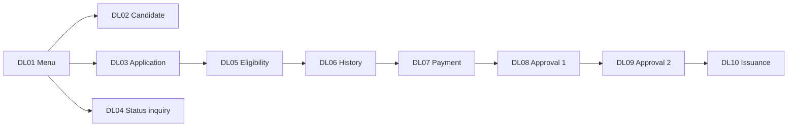

# DLIS – Driver License Issuance System

A pseudo-conversational **CICS / DB2 / COBOL** application for IBM Z that manages the full driver-license lifecycle: candidate registration, license application, eligibility and driving-history checks, payment, two-level authority approval, and license issuance.

This repository contains the complete source (COBOL, BMS, DB2 DDL, CICS CSD, JCL), plus generated documentation produced with IBM Bob (business-rule extraction, code explanations, program documentation and an HTML application wiki).

## Table of Contents

- [Technology Stack](#technology-stack)
- [Application Overview](#application-overview)
- [Application Flow](#application-flow)
- [Repository Layout](#repository-layout)
- [Data Model](#data-model)
- [Build & Deployment](#build--deployment)
- [Coding Conventions](#coding-conventions)
- [Documentation](#documentation)

## Technology Stack

| Layer | Technology |
|---|---|
| Language | IBM Enterprise COBOL for z/OS (fixed format) |
| Transaction monitor | CICS TS (pseudo-conversational) |
| Database | Db2 for z/OS (embedded SQL, DCLGEN host structures) |
| Screens | BMS maps (HLASM macros) |
| Build / deploy | JCL + cataloged procedures, `DFHCSDUP`, Db2 BIND |

## Application Overview

| Transaction | Program | Map source | Function |
|---|---|---|---|
| `DL01` | [`DLISMENU`](cobol/DLISMENU.cbl) | [`DLISMM`](bms/DLISMM.bms) | Main menu / routing |
| `DL02` | [`DLISCAND`](cobol/DLISCAND.cbl) | [`DLISCM`](bms/DLISCM.bms) | Candidate maintenance |
| `DL03` | [`DLISAPPL`](cobol/DLISAPPL.cbl) | [`DLISAE`](bms/DLISAE.bms) | License application entry |
| `DL04` | [`DLISSTAT`](cobol/DLISSTAT.cbl) | [`DLISAPPR`](bms/DLISAPPR.bms) | Application status inquiry |
| `DL05` | [`DLISELIG`](cobol/DLISELIG.cbl) | [`DLISECHPE`](bms/DLISECHPE.bms) | Eligibility check |
| `DL06` | [`DLISHIST`](cobol/DLISHIST.cbl) | [`DLISECHPE`](bms/DLISECHPE.bms) | Driving-history check |
| `DL07` | [`DLISPAY`](cobol/DLISPAY.cbl) | [`DLISECHPE`](bms/DLISECHPE.bms) | Payment entry & processing |
| `DL08` | [`DLISAP1`](cobol/DLISAP1.cbl) | [`DLISAPPR`](bms/DLISAPPR.bms) | First authority approval |
| `DL09` | [`DLISAP2`](cobol/DLISAP2.cbl) | [`DLISAPPR`](bms/DLISAPPR.bms) | Second authority approval |
| `DL10` | [`DLISISSU`](cobol/DLISISSU.cbl) | [`DLISAPPR`](bms/DLISAPPR.bms) | License issuance |

Transaction-to-program bindings are defined in [`csd/DLISCSD.csd`](csd/DLISCSD.csd) (group `DLISGRP`).

## Application Flow

`LICENSE_APPLICATION.APPLICATION_STATUS` drives the workflow (`PE` pending, `EC` eligibility checked, `HC` history checked, `PA` paid, `A1`/`A2` approvals, `AP` approved, `RE` rejected, `IS` issued).



## Repository Layout

```
cobol/      COBOL programs (one per CICS transaction)
copybook/   Shared copybooks
              DLISWS    common working storage and return codes
              DLISCSEC  350-byte DFHCOMMAREA layout
              DLISDCLG  Db2 DCLGEN host structures
bms/        BMS map sources (assembled to load modules + symbolic copybooks)
db2/        DDL: tables, indexes, grants
csd/        CICS resource definitions (DFHCSDUP input)
jcl/        Build, bind, schema and CSD deployment jobs
proc/       Cataloged procedures used by the JCL
docs/       Generated documentation (see below)
reports/    Step-by-step Bob walkthrough reports
```

## Data Model

Schema `DLIS` – created by [`db2/DLIS0001-CREATE-TABLES.sql`](db2/DLIS0001-CREATE-TABLES.sql), indexed by [`DLIS0002-CREATE-INDEXES.sql`](db2/DLIS0002-CREATE-INDEXES.sql), secured by [`DLIS0003-GRANTS.sql`](db2/DLIS0003-GRANTS.sql).

| Table | Purpose |
|---|---|
| `DLIS.CANDIDATE` | Applicant personal data |
| `DLIS.LICENSE_APPLICATION` | Application and per-step status flags |
| `DLIS.DRIVING_HISTORY` | Driving record / violations |
| `DLIS.PAYMENT` | Fee payments |
| `DLIS.ISSUED_LICENSE` | Issued licenses |
| `DLIS.AUTHORITY_USER` | Approving authority users |
| `DLIS.LICENSE_FEE_SCHEDULE` | Fee schedule per license class |

## Build & Deployment

Run the jobs in this order (adjust dataset names, subsystem and library qualifiers to your site):

| Step | Job | Description |
|---|---|---|
| 1 | [`jcl/DLISDB2.jcl`](jcl/DLISDB2.jcl) | Create tables, indexes and grants (`db2/*.sql`) |
| 2 | [`jcl/DLISBMS.jcl`](jcl/DLISBMS.jcl) | Assemble BMS maps via `proc/DLISBASM.proc` → `DLIS.LOADLIB` and `DLIS.COPYBOOK` |
| 3 | [`jcl/DLISCOMP.jcl`](jcl/DLISCOMP.jcl) | Db2 precompile (`DSNHPC`), COBOL compile (`IGYCRCTL`, `RENT,APOST,LIB,NOSEQ,NOTERM`), link-edit (`IEWL`, `AMODE(31),RMODE(ANY)`) via `proc/DLISCLNK.proc` |
| 4 | [`jcl/DLISBIND.jcl`](jcl/DLISBIND.jcl) | Bind DBRMs into collection `DLISPKG` and plan `DLISPLAN` (subsystem `DSN1`) |
| 5 | [`jcl/DLISCSD.jcl`](jcl/DLISCSD.jcl) | Register CICS resources from `csd/DLISCSD.csd` with `DFHCSDUP` |

After step 5, install group `DLISGRP` in the CICS region and start with transaction `DL01`.

## Coding Conventions

- Fixed-format COBOL: columns 1-6 sequence, column 7 indicator (`*` comment), statements in columns 8-72.
- Pseudo-conversational design: `EXEC CICS RETURN TRANSID(...) COMMAREA(...)`; `EIBCALEN = 0` identifies first entry.
- CICS responses are handled with `RESP(WS-RESP1)`.
- Embedded SQL via `EXEC SQL ... END-EXEC`; every statement checks `SQLCODE` (`0` success, `100` not found, otherwise error handling).

## Documentation

| Location | Content |
|---|---|
| [`docs/business-rule/`](docs/business-rule) | Extracted business rules (overview + inventory per program) |
| [`docs/program/cobol/`](docs/program/cobol) | Per-program documentation (inputs, outputs, logic, dependencies, constraints) |
| [`docs/explain/`](docs/explain) | Architect, business and developer code explanations |
| [`docs/index.html`](docs/index.html), `docs/html/` | Browsable HTML application wiki |
| [`reports/`](reports) | Step-by-step reports of the analysis and documentation workflow |
