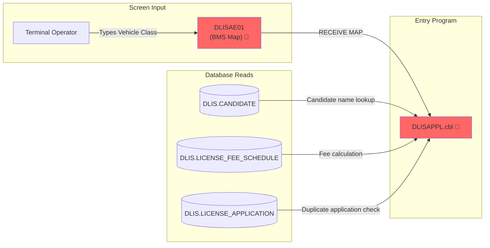
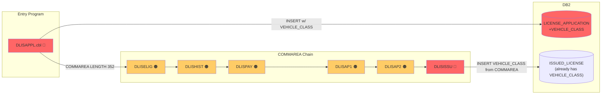
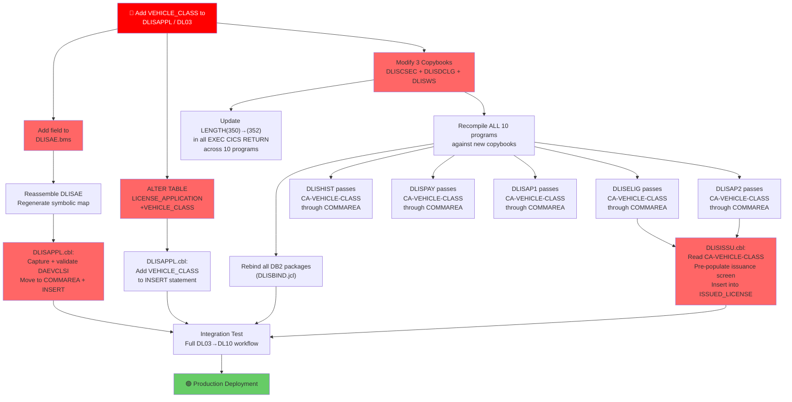

# Impact Analysis Report: Add Vehicle Class to License Application

**Created**: 2025-10-26T00:00:00Z
**Author**: IBM Bob — Z Architect
**Analysis Method**: Local Workspace (file-based analysis)
**Workspace Alignment**: Not Applicable (no Z Understand service used)
**Confidence Level**: High

---

## 1. Change Summary

### Change Specification

**Title**: Add Vehicle Class Field to License Application Process

**Type**: Enhancement

**Description**: Add a new `VEHICLE_CLASS` field (values: A, B, C, D) to the license application entry transaction (`DL03 / DLISAPPL.cbl`). The field must be captured on the Application Entry screen (`DLISAE`), stored in `DLIS.LICENSE_APPLICATION`, passed through the COMMAREA to downstream transactions, and consumed by the issuance program (`DLISISSU.cbl`) when writing to `DLIS.ISSUED_LICENSE`.

**Business Objective**: Vehicle Class is currently only collected at the point of license issuance (transaction `DL10`). Moving this capture earlier — to application entry — lets officers verify the requested class through the eligibility and approval workflow, preventing late-stage rejections and ensuring the appropriate fee schedule is applied.

### System Context

**Architecture Overview**: DLIS is a pseudo-conversational CICS/COBOL application backed by DB2 for z/OS. All 10 transactions share three copybooks (`DLISWS.cpy`, `DLISCSEC.cpy`, `DLISDCLG.cpy`) and a 350-byte COMMAREA.

**Key Technologies**: IBM Enterprise COBOL, CICS Transaction Server, DB2 for z/OS, BMS

**Entry Points**: `DLISAPPL.cbl` (transaction `DL03`) — License Application Entry

**Known Dependencies**:
- Shared COMMAREA copybook `DLISCSEC.cpy` — used by all 10 programs
- Shared DCLGEN copybook `DLISDCLG.cpy` — hosts DB2 host variable for `DLIS.LICENSE_APPLICATION`
- BMS mapset `DLISAE` — Application Entry screen
- `DLIS.LICENSE_APPLICATION` DB2 table — receives the new column

**Workspace Notes**: All 10 programs are present in the local workspace. No Z Understand service was used; analysis is entirely file-based.

---

## 2. Scope Definition

### In Scope

Components that WILL be modified or directly affected:

- **`DLISAPPL.cbl`**: Add Vehicle Class input field capture, validation, pass to COMMAREA, include in INSERT
- **`DLISCSEC.cpy`**: Expand `DLIS-APPL-COMMAREA` to add `CA-VEHICLE-CLASS PIC X(2)`; increase COMMAREA LENGTH from 350 → 352
- **`DLISDCLG.cpy`**: Regenerate DCLGEN for `DLIS.LICENSE_APPLICATION` to add `VEHICLE-CLASS PIC X(2)` host variable
- **`DLISWS.cpy`**: Add `WS-VEHICLE-CLASS PIC X(2)` to `WS-APPLICATION` working storage group
- **`DLISAE.bms`**: Add a new `DFHMDF` field for Vehicle Class input on the Application Entry screen
- **`DLIS.LICENSE_APPLICATION` (DB2 table)**: `ALTER TABLE … ADD VEHICLE_CLASS CHAR(2) NOT NULL WITH DEFAULT 'C'`
- **`DLISISSU.cbl`**: Read Vehicle Class from COMMAREA; include in `DLIS.ISSUED_LICENSE` INSERT
- **`DLISELIG.cbl`**: Pass received COMMAREA (including Vehicle Class) through unchanged — recompile required
- **`DLISHIST.cbl`**: Pass received COMMAREA through unchanged — recompile required
- **`DLISPAY.cbl`**: Pass received COMMAREA through unchanged — recompile required
- **`DLISAP1.cbl`**: Display/validate Vehicle Class if eligibility logic extends to class — recompile required
- **`DLISAP2.cbl`**: Pass received COMMAREA through unchanged — recompile required
- **`DLISSTAT.cbl`**: Optionally display Vehicle Class on Status Inquiry screen — recompile required
- **`DLISCAND.cbl`**: Unrelated to application — recompile only if DLISDCLG.cpy changes affect it
- **`DLISMENU.cbl`**: No data change; recompile if copybook changes cause compile errors
- **`db2/DLIS0001-CREATE-TABLES.sql`**: Document the `ALTER TABLE` DDL

### Out of Scope

- `DLIS.ISSUED_LICENSE` table — `VEHICLE_CLASS` column already exists; no schema change needed
- `DLIS.LICENSE_FEE_SCHEDULE` — fee calculation does not depend on vehicle class
- `DLIS.PAYMENT` — payment does not reference vehicle class
- `DLIS.CANDIDATE` — candidate record is unchanged
- `DLIS.DRIVING_HISTORY` — history check is unchanged

### System Boundaries

- **External Systems**: None — DLIS is self-contained; no outbound APIs
- **Batch Jobs**: `JCL/DLISCOMP.jcl` — compile/link job must be run for all modified programs
- **Data Boundaries**: Only `DLIS.LICENSE_APPLICATION` changes; all other tables are unaffected

### Functional Area

**Primary Functional Area**: License Application Submission & Lifecycle Management

**Business Function Summary**: Enables Vehicle Class (A/B/C/D) to be declared at application entry, visible throughout the review workflow, and automatically carried into the issued license — eliminating manual re-entry at issuance and enabling class-specific validation during approval.

---

## 3. System Overview

### System Context Diagram

```mermaid
graph TB
    subgraph "Entry Point — Modified"
        APPL["DLISAPPL.cbl\n(DL03) 🔴"]
        BMS["DLISAE.bms\n(Screen Map) 🔴"]
    end

    subgraph "Shared Copybooks — Modified"
        CSEC["DLISCSEC.cpy\n(COMMAREA) 🔴"]
        DCLG["DLISDCLG.cpy\n(DCLGEN) 🔴"]
        WS["DLISWS.cpy\n(Working Storage) 🔴"]
    end

    subgraph "Database — Modified"
        DB2["DLIS.LICENSE_APPLICATION\n(DB2 Table) 🔴"]
    end

    subgraph "Downstream Transactions — Recompile"
        ELIG["DLISELIG.cbl\n(DL05) 🟠"]
        HIST["DLISHIST.cbl\n(DL06) 🟠"]
        PAY["DLISPAY.cbl\n(DL07) 🟠"]
        AP1["DLISAP1.cbl\n(DL08) 🟠"]
        AP2["DLISAP2.cbl\n(DL09) 🟠"]
        ISSU["DLISISSU.cbl\n(DL10) 🔴"]
        STAT["DLISSTAT.cbl\n(DL04) 🟠"]
    end

    subgraph "Unchanged"
        MENU["DLISMENU.cbl\n(DL01) ⚪"]
        CAND["DLISCAND.cbl\n(DL02) ⚪"]
        LIC["DLIS.ISSUED_LICENSE\n(VEHICLE_CLASS exists) ⚪"]
    end

    APPL -->|"EXEC CICS RETURN\nCOMMARE expanded"| ELIG
    ELIG --> HIST
    HIST --> PAY
    PAY --> AP1
    AP1 --> AP2
    AP2 --> ISSU
    APPL -->|EXEC SQL INSERT| DB2
    ISSU -->|EXEC SQL INSERT\n(VEHICLE_CLASS from COMMAREA)| LIC
    APPL --- BMS
    APPL --- CSEC
    APPL --- DCLG
    APPL --- WS

    style APPL fill:#ff6666
    style BMS fill:#ff6666
    style CSEC fill:#ff6666
    style DCLG fill:#ff6666
    style WS fill:#ff6666
    style DB2 fill:#ff6666
    style ISSU fill:#ff6666
    style ELIG fill:#ffcc66
    style HIST fill:#ffcc66
    style PAY fill:#ffcc66
    style AP1 fill:#ffcc66
    style AP2 fill:#ffcc66
    style STAT fill:#ffcc66
```

**Legend**: 🔴 Red — directly modified | 🟠 Orange — recompile required | ⚪ White — unaffected

### Components Analyzed

**Total Programs**: 10  
**Programs in Workspace**: 10  
**Programs Missing from Workspace**: 0  

**Key Programs**:

| Program | Transaction | Description | Impact Level |
|---|---|---|---|
| `DLISAPPL.cbl` | DL03 | License Application Entry | **High** — modified |
| `DLISISSU.cbl` | DL10 | License Issuance | **High** — logic change |
| `DLISELIG.cbl` | DL05 | Eligibility Check | Medium — recompile |
| `DLISHIST.cbl` | DL06 | Driving History Check | Medium — recompile |
| `DLISPAY.cbl` | DL07 | Payment Entry | Medium — recompile |
| `DLISAP1.cbl` | DL08 | First Approval | Medium — recompile |
| `DLISAP2.cbl` | DL09 | Second Approval | Medium — recompile |
| `DLISSTAT.cbl` | DL04 | Status Inquiry | Low — optional display |
| `DLISCAND.cbl` | DL02 | Candidate Maintenance | Low — recompile only |
| `DLISMENU.cbl` | DL01 | Main Menu | Low — recompile only |

**Database Tables/Files**:

| Table | Purpose | Access | Impact |
|---|---|---|---|
| `DLIS.LICENSE_APPLICATION` | Application lifecycle | Read/Write | **High** — ADD COLUMN |
| `DLIS.ISSUED_LICENSE` | Issued licenses | Write | None — column exists |
| `DLIS.CANDIDATE` | Candidate master | Read | None |
| `DLIS.LICENSE_FEE_SCHEDULE` | Fee lookup | Read | None |
| `DLIS.PAYMENT` | Payment records | Write | None |

---

## 4. Dependency Analysis

### Upstream Dependencies

**What Feeds Into This**:

#### Input Programs / Services

| Component | Relationship | Data Provided | Impact |
|---|---|---|---|
| `DLISMENU.cbl` (DL01) | Routes user to DL03 via CICS XCTL | Transaction ID | No change — navigation only |
| Terminal Operator | Enters data on DLISAE screen | `DAELTYPI` (License Type), `DAECIDI` (Candidate ID) | Add `DAEVCLSI` (Vehicle Class) input field |

#### Input Data Sources

| Source | Type | Data Provided | Impact |
|---|---|---|---|
| `DLIS.CANDIDATE` | DB2 — SELECT | Candidate name and status | No change |
| `DLIS.LICENSE_FEE_SCHEDULE` | DB2 — SELECT | Fee amount | No change |
| `DLIS.LICENSE_APPLICATION` | DB2 — SELECT (COUNT) | Duplicate check | No change to query; new column added to table |
| Terminal screen DLISAE01 | BMS RECEIVE MAP | Operator-entered data | New input field needed |

#### Dependency Flow Diagram (Upstream)



---

### Downstream Dependencies

**What Consumes This**:

#### Output Programs / Services

| Component | Relationship | Data Consumed | Impact |
|---|---|---|---|
| `DLISELIG.cbl` | Receives COMMAREA via CICS RETURN | `CA-VEHICLE-CLASS` (new) | Must pass new COMMAREA field; recompile |
| `DLISHIST.cbl` | Receives COMMAREA via CICS RETURN | `CA-VEHICLE-CLASS` (new) | Must pass new COMMAREA field; recompile |
| `DLISPAY.cbl` | Receives COMMAREA via CICS RETURN | `CA-VEHICLE-CLASS` (new) | Must pass new COMMAREA field; recompile |
| `DLISAP1.cbl` | Receives COMMAREA via CICS RETURN | `CA-VEHICLE-CLASS` (new) | Must pass new COMMAREA field; recompile |
| `DLISAP2.cbl` | Receives COMMAREA via CICS RETURN | `CA-VEHICLE-CLASS` (new) | Must pass new COMMAREA field; recompile |
| `DLISISSU.cbl` | Receives COMMAREA via CICS RETURN | `CA-VEHICLE-CLASS` (new) | **Logic change** — use for ISSUED_LICENSE INSERT |
| `DLISSTAT.cbl` | Independent inquiry — reads `LICENSE_APPLICATION` | `VEHICLE_CLASS` (new column) | Optional display enhancement |

#### Output Data Destinations

| Destination | Type | Data Written | Impact |
|---|---|---|---|
| `DLIS.LICENSE_APPLICATION` | DB2 INSERT | All application fields + new `VEHICLE_CLASS` | **ALTER TABLE** + update INSERT statement |
| `DLIS-COMMAREA` (350-byte) | CICS COMMAREA | Application state including Vehicle Class | **Expand to 352 bytes** — update all RETURN LENGTH values |

#### Dependency Flow Diagram (Downstream)



---

### Internal Dependencies

**Internal Relationships**:

#### Copybooks / Includes

| Copybook | Used By | Purpose | Impact |
|---|---|---|---|
| `DLISCSEC.cpy` | All 10 programs | CICS COMMAREA layouts | **Modify** — add `CA-VEHICLE-CLASS PIC X(2)` to `DLIS-APPL-COMMAREA`; all 10 programs must be recompiled |
| `DLISDCLG.cpy` | All 10 programs | DB2 host variables for all tables | **Modify** — add `VEHICLE-CLASS PIC X(2)` to `DCLDLIS-LICENSE-APPL`; all 10 programs must be recompiled |
| `DLISWS.cpy` | All 10 programs | Common working storage | **Modify** — add `WS-VEHICLE-CLASS PIC X(2)` to `WS-APPLICATION` |
| `DLISAE.bms` | `DLISAPPL.cbl` only | Application Entry screen definition | **Modify** — add `DFHMDF` field for Vehicle Class; reassemble and regenerate symbolic map |

#### Shared Data Structures

| Structure | Shared By | Purpose | Impact |
|---|---|---|---|
| `DLIS-APPL-COMMAREA` (in DLISCSEC.cpy) | All 10 programs | Pass application state across pseudo-conversational turns | **Add `CA-VEHICLE-CLASS PIC X(2)`; expand COMMAREA from 350 → 352 bytes; update all `LENGTH(350)` to `LENGTH(352)` across all EXEC CICS RETURN and EIBCALEN checks** |
| `DCLDLIS-LICENSE-APPL` (in DLISDCLG.cpy) | 8 programs (all except DLISMENU, DLISCAND at runtime) | DB2 host variable structure for LICENSE_APPLICATION | **Add `VEHICLE-CLASS PIC X(2)` host variable**; all programs using the copybook need recompile and rebind |
| `WS-APPLICATION` (in DLISWS.cpy) | All 10 programs | Working storage for application data | **Add `WS-VEHICLE-CLASS PIC X(2)`** |

#### Common Modules / Functions

| Module / Function | Used By | Purpose | Impact |
|---|---|---|---|
| `SUBMIT-APPLICATION` paragraph | `DLISAPPL.cbl` | Creates application record in DB2 | **Modify** — add Vehicle Class to INSERT and validation |
| `LOAD-APPLICATION` paragraph | `DLISELIG`, `DLISHIST`, `DLISPAY`, `DLISAP1`, `DLISAP2`, `DLISISSU` | Loads application from DB2 | Update SELECT to include `VEHICLE_CLASS` where downstream logic needs it |
| `ISSUE-LICENSE` paragraph | `DLISISSU.cbl` | Inserts into ISSUED_LICENSE | **Modify** — `VEHICLE_CLASS` now sourced from COMMAREA instead of screen input |

---

## 5. Impact Analysis

### Code-Level Impact

#### `DLISCSEC.cpy` — COMMAREA Copybook (Primary Change — Impacts All Programs)

**Impact Type**: Modify

**Specific Changes Required**:

1. Add `10 CA-VEHICLE-CLASS PIC X(2)` to `DLIS-APPL-COMMAREA` (line ~49, after `CA-APP2-STATUS`)
2. Current `DLIS-COMMAREA` is 350 bytes. Adding 2 bytes brings total to **352 bytes**
3. All `EXEC CICS RETURN … LENGTH(350)` statements in all 10 programs must change to `LENGTH(352)`
4. All `IF EIBCALEN = 0` guards are correct and unchanged (zero check for initial invocation)
5. Any guard checking `IF EIBCALEN = 350` (none found in current source) would need updating

**Complexity**: High (propagates to all 10 programs)

**Lines of Code Affected**: 1 line in copybook + `LENGTH` literal in every `EXEC CICS RETURN` across all 10 programs (approximately 10–20 occurrences)

---

#### `DLISDCLG.cpy` — DCLGEN Copybook

**Impact Type**: Modify

**Specific Changes Required**:

1. Add `10 VEHICLE-CLASS PIC X(2)` to `DCLDLIS-LICENSE-APPL` group (after `LAST-UPDATED-BY`)
2. All 10 programs include this copybook and must be recompiled
3. No existing program uses `SELECT *` or group-level moves on `DCLDLIS-LICENSE-APPL` — explicit column lists are used throughout, so no logic changes required in programs that do not use Vehicle Class

**Complexity**: Medium

**Lines of Code Affected**: ~2 lines

---

#### `DLISWS.cpy` — Common Working Storage

**Impact Type**: Modify

**Specific Changes Required**:

1. Add `10 WS-VEHICLE-CLASS PIC X(2)` to `WS-APPLICATION` group (after `WS-CREATED-BY`)

**Complexity**: Low

**Lines of Code Affected**: 1 line

---

#### `DLISAE.bms` — Application Entry Screen

**Impact Type**: Modify

**Specific Changes Required**:

1. Add new `DFHMDF` field for Vehicle Class input (suggested position row 9, col 2–22, `LENGTH=1`, `ATTRB=(UNPROT)`)
2. Add label field: `DFHMDF POS=(9,2), LENGTH=18, ATTRB=(PROT,NORM), INITIAL='VEHICLE CLASS   : '`
3. Add input field: `DAEVCLSI DFHMDF POS=(9,20), LENGTH=1, ATTRB=(UNPROT)` followed by help text `(A=HEAVY B=MEDIUM C=LIGHT D=MOTORCYCLE)`
4. Reassemble BMS mapset to regenerate physical map and symbolic copybook
5. Install new mapset via `CEDA INSTALL MAPSET(DLISAE)` in CICS

**Complexity**: Medium

**Lines of Code Affected**: ~6 lines

---

#### `DLISAPPL.cbl` — License Application Entry (Entry Point)

**Impact Type**: Modify

**Specific Changes Required**:

1. **`SUBMIT-APPLICATION` paragraph** — add Vehicle Class validation:
   ```cobol
   IF DAEVCLSI NOT IN ('A','B','C','D')
       MOVE 'VEHICLE CLASS MUST BE A B C OR D' TO DAEMSG
       GO TO SUBMIT-APPLICATION-EXIT
   END-IF
   ```
2. Move screen input to COMMAREA: `MOVE DAEVCLSI TO CA-VEHICLE-CLASS`
3. Move to DCLGEN host variable: `MOVE DAEVCLSI TO VEHICLE-CLASS OF DCLDLIS-LICENSE-APPL`
4. **`SUBMIT-APPLICATION` INSERT statement** — add `VEHICLE_CLASS` column and host variable:
   ```cobol
   EXEC SQL
       INSERT INTO DLIS.LICENSE_APPLICATION
          (CANDIDATE_ID, LICENSE_TYPE, APPLICATION_STATUS, CREATED_BY,
           LAST_UPDATED_BY, VEHICLE_CLASS)
       VALUES
          (:CANDIDATE-ID, :LICENSE-TYPE, 'PE', :CREATED-BY, :CREATED-BY,
           :VEHICLE-CLASS)
       OF DCLDLIS-LICENSE-APPL
   END-EXEC
   ```
5. Update `EXEC CICS RETURN … LENGTH(350)` → `LENGTH(352)` (2 occurrences)

**Complexity**: Medium

**Lines of Code Affected**: ~15 lines

---

#### `DLISISSU.cbl` — License Issuance

**Impact Type**: Modify

**Specific Changes Required**:

1. The `ISSUE-LICENSE` paragraph currently validates `DLIVCLSI` (screen input) for Vehicle Class
2. **After this change**, `DLIVCLSI` should default from `CA-VEHICLE-CLASS` received via COMMAREA, pre-populating the issuance screen — the operator can confirm or override
3. `LOAD-APPLICATION` paragraph — add `VEHICLE_CLASS` to SELECT to populate display
4. Update `EXEC CICS RETURN … LENGTH(350)` → `LENGTH(352)` (2 occurrences)
5. Add: `MOVE CA-VEHICLE-CLASS TO WS-VEHICLE-CLASS` at top of `ISSUE-LICENSE` paragraph to pre-populate from COMMAREA

**Complexity**: Low-Medium

**Lines of Code Affected**: ~8 lines

---

#### `DLISELIG.cbl`, `DLISHIST.cbl`, `DLISPAY.cbl`, `DLISAP1.cbl`, `DLISAP2.cbl`

**Impact Type**: Recompile (no logic change required, unless class-specific rules added)

**Specific Changes Required**:

1. Update `EXEC CICS RETURN … LENGTH(350)` → `LENGTH(352)` in each program (2 occurrences per program = ~10 total)
2. Recompile against updated copybooks
3. Rebind DB2 packages (SQLCODE -805/-818 risk if not rebound)

**Note for `DLISAP1.cbl`**: The Authority User validation currently checks `LIC_TYPES_AUTH` against `DA1LTYO` (License Type). If Vehicle Class–specific approval rules are required in future, this is the insertion point. No change required for this increment.

**Complexity**: Low

**Lines of Code Affected**: 2 per program × 5 programs = ~10 LENGTH literal changes

---

#### `DLISSTAT.cbl` — Status Inquiry

**Impact Type**: Optional Modify + Recompile

**Specific Changes Required**:

1. Update `EXEC CICS RETURN … LENGTH(350)` → `LENGTH(352)` (1 occurrence)
2. Optionally: add `VEHICLE_CLASS` to the `INQUIRE-STATUS` SELECT list and display it on `DLISST01` map

**Complexity**: Low

---

#### `DLISMENU.cbl`, `DLISCAND.cbl`

**Impact Type**: Recompile only

**Specific Changes Required**:

1. Recompile against updated `DLISCSEC.cpy`, `DLISDCLG.cpy`, `DLISWS.cpy`
2. No logic changes; these programs do not reference `LICENSE_APPLICATION` fields

**Complexity**: Low

---

#### `DLIS.LICENSE_APPLICATION` — DB2 Table Schema

**Impact Type**: ALTER TABLE

**DDL Required**:

```sql
ALTER TABLE DLIS.LICENSE_APPLICATION
    ADD VEHICLE_CLASS CHAR(2) NOT NULL WITH DEFAULT 'C';

ALTER TABLE DLIS.LICENSE_APPLICATION
    ADD CONSTRAINT APPL_VC CHECK (VEHICLE_CLASS IN ('A','B','C','D'));
```

**Notes**:
- `DEFAULT 'C'` (Light Vehicle) is used for existing rows; the CHECK constraint is satisfied by this default value
- Existing INSERT statements that do not list `VEHICLE_CLASS` will automatically receive `'C'` — no SQLCODE -407 errors
- No table REORG is required for the ADD COLUMN operation itself, though one may be advisable for performance after data migration
- No change to `DLIS0002-CREATE-INDEXES.sql` is required unless an index on `VEHICLE_CLASS` is desired for reporting

---

### Application-Level Impact

#### Interface Changes

| Interface | Change | Affected Programs | Impact |
|---|---|---|---|
| `DLIS-APPL-COMMAREA` in `DLISCSEC.cpy` | Add `CA-VEHICLE-CLASS PIC X(2)` | All 10 programs | Recompile all; update LENGTH literals |
| `DCLDLIS-LICENSE-APPL` in `DLISDCLG.cpy` | Add `VEHICLE-CLASS PIC X(2)` | All 10 programs | Recompile all; rebind packages |
| `WS-APPLICATION` in `DLISWS.cpy` | Add `WS-VEHICLE-CLASS PIC X(2)` | All 10 programs | Recompile all |
| `DLISAE01` screen (BMS) | New Vehicle Class input field | `DLISAPPL.cbl` | Reassemble map; install in CICS |

#### Data Contract Changes

| Contract | Change | Affected Programs | Impact |
|---|---|---|---|
| `DLIS.LICENSE_APPLICATION` INSERT | Add `VEHICLE_CLASS` column | `DLISAPPL.cbl` | Modify INSERT statement |
| `DLIS.LICENSE_APPLICATION` SELECT | Add `VEHICLE_CLASS` to fetch | `DLISISSU.cbl`, optionally `DLISSTAT.cbl` | Modify SELECT statements |
| `DLIS.ISSUED_LICENSE` INSERT | `VEHICLE_CLASS` source changes from screen → COMMAREA | `DLISISSU.cbl` | Minor logic update |

#### Batch Job Impact

| Job | Affected Programs | Impact | Changes Required |
|---|---|---|---|
| `DLISCOMP.jcl` | All 10 programs | High | Must compile and link all 10 programs against updated copybooks |
| `DLISBIND.jcl` | All programs with SQL | High | Rebind all packages to avoid SQLCODE -805/-818 after recompile |
| `DLISBMS.jcl` | `DLISAE.bms` | Medium | Reassemble BMS mapset; link new physical map |

---

### System-Level Impact

#### Database Schema Changes

```sql
-- Step 1: Add column with default (satisfies CHECK constraint for existing rows)
ALTER TABLE DLIS.LICENSE_APPLICATION
    ADD VEHICLE_CLASS CHAR(2) NOT NULL WITH DEFAULT 'C';

-- Step 2: Add CHECK constraint
ALTER TABLE DLIS.LICENSE_APPLICATION
    ADD CONSTRAINT APPL_VC CHECK (VEHICLE_CLASS IN ('A','B','C','D'));

-- Optional Step 3: Update existing rows to correct vehicle class if known
-- UPDATE DLIS.LICENSE_APPLICATION SET VEHICLE_CLASS = 'C'
-- WHERE APPLICATION_STATUS IN ('PE','EC','HC','PA','A1','A2','AP');
```

**Impact on existing index** `DLIS.XAPPL02` (on `CANDIDATE_ID, LICENSE_TYPE, APPLICATION_STATUS`): No change needed; index is not affected by new column.

#### Integration Point Changes

None — DLIS has no outbound integrations or message queues.

---

### Operational Impact

**Build/Deployment Sequence** (order is critical):

1. Apply `ALTER TABLE` DDL to DB2 (`DLISDB2.jcl` or SPUFI)
2. Modify and assemble `DLISAE.bms` → new physical map and symbolic copybook
3. Modify `DLISCSEC.cpy`, `DLISDCLG.cpy`, `DLISWS.cpy`
4. Modify COBOL source files: `DLISAPPL.cbl`, `DLISISSU.cbl`; update `LENGTH` literals in all 10 programs
5. Compile and link all 10 programs (`DLISCOMP.jcl`)
6. Bind all DB2 packages (`DLISBIND.jcl`)
7. Install new BMS mapset in CICS (`CEDA INSTALL MAPSET(DLISAE)`)
8. Deploy load modules to `DLIS.LOADLIB`

**Runtime Impact**:
- COMMAREA grows 2 bytes (350 → 352); negligible memory and I/O impact
- One additional column in `LICENSE_APPLICATION` INSERT; negligible performance impact
- If a running CICS region has programs loaded with old copybooks and a new BMS map is installed, a window of inconsistency exists — coordinate deployment atomically

**Rollback Plan**:
- DB2: `ALTER TABLE DLIS.LICENSE_APPLICATION DROP COLUMN VEHICLE_CLASS` (if supported) or reverse by setting DEFAULT and removing constraint; revert programs to prior load modules
- CICS: Reinstall prior BMS mapset load module

---

## 6. Change Propagation Map

### Complete Ripple Effect



### Detailed Propagation Paths

**Path 1 — COMMAREA Expansion**
```
Add CA-VEHICLE-CLASS to DLIS-APPL-COMMAREA (DLISCSEC.cpy)
  ↓
All 10 programs include DLISCSEC.cpy → all must be recompiled
  ↓
All EXEC CICS RETURN LENGTH(350) → LENGTH(352) in 10 programs
  ↓
CICS passes 352-byte COMMAREA between all DL01–DL10 transactions
  ↓
DLISISSU receives CA-VEHICLE-CLASS without DB2 re-query
```

**Path 2 — DB2 Schema & SQL**
```
ALTER TABLE DLIS.LICENSE_APPLICATION ADD VEHICLE_CLASS CHAR(2) NOT NULL WITH DEFAULT 'C'
  ↓
DLISDCLG.cpy updated (add VEHICLE-CLASS host variable)
  ↓
All 10 programs recompiled; DLISAPPL INSERT includes VEHICLE_CLASS
  ↓
All packages rebound (DLISBIND.jcl) to avoid SQLCODE -805/-818
  ↓
DLISISSU SELECT can fetch VEHICLE_CLASS for display; ISSUED_LICENSE receives correct class
```

**Path 3 — BMS Screen**
```
Add DAEVCLSI field to DLISAE.bms
  ↓
Reassemble DLISAE → new physical load module + new symbolic copybook
  ↓
DLISAPPL.cbl recompiled against new symbolic map (DAEVCLSI field available)
  ↓
CEDA INSTALL MAPSET(DLISAE) in CICS region
  ↓
Operators see Vehicle Class input field on DL03 screen
```

---

## 7. Risk Assessment

### Risk Assessment Table

| Risk ID | Description | Category | Likelihood | Impact | Risk Level | Mitigation Strategy |
|---|---|---|---|---|---|---|
| R1 | COMMAREA `LENGTH(350)` hard-coded in all 10 programs — silent truncation if not all updated | Regression | **High** | **High** | 🔴 **CRITICAL** | Search all programs for `LENGTH(350)`; update atomically to `LENGTH(352)` before deployment |
| R2 | Mixed deployment — some programs recompiled with new COMMAREA (352-byte), some still using 350 — causes runtime COMMAREA mismatch | Regression | **High** | **High** | 🔴 **CRITICAL** | Deploy all 10 programs atomically in a single CICS maintenance window |
| R3 | SQLCODE -805/-818 after recompile if DB2 packages not rebound | Runtime Failure | **High** | **High** | 🔴 **CRITICAL** | Always run `DLISBIND.jcl` after any recompile; include in deployment checklist |
| R4 | BMS symbolic map out-of-sync with DLISAPPL load module — DAEVCLSI not resolved | Regression | Medium | High | 🟠 **HIGH** | Assemble BMS map first; only compile DLISAPPL after new symbolic copybook is generated |
| R5 | DB2 CHECK constraint `APPL_VC` rejects default value `'C'` if DEFAULT is not a valid class | Data Integrity | Low | High | 🟠 **HIGH** | Verify `'C'` is in `('A','B','C','D')` before applying DDL; test in non-prod first |
| R6 | `DLISISSU.cbl` still accepts screen input override — operator enters different class than application COMMAREA | Data Integrity | Medium | Medium | 🟡 **MEDIUM** | Add display-only field from COMMAREA; validate screen entry matches COMMAREA value |
| R7 | Existing applications in-flight (status PE/EC/HC/PA/A2) have `VEHICLE_CLASS='C'` default after ALTER TABLE — may not reflect actual desired class | Data Integrity | Medium | Medium | 🟡 **MEDIUM** | Review in-flight applications and manually update VEHICLE_CLASS before cutover |
| R8 | CICS region caches old MAPSET load module after BMS reassembly — operators see old screen | Runtime Failure | Medium | Low | 🟡 **MEDIUM** | Issue `CEDA INSTALL MAPSET(DLISAE)` explicitly; verify with `CEMT INQ MAPSET` |
| R9 | Screen position conflict if row 9 is already occupied in DLISAE01 — BMS assembly error | Build | Low | Medium | 🟡 **MEDIUM** | Check BMS map layout; rows 9–12 appear available between LICENSE TYPE (row 8) and APPLICATION DATE (row 10) — use row 9 |
| R10 | `DLISSTAT.cbl` does not display Vehicle Class — operators cannot see it in Status Inquiry | Usability | Low | Low | 🟢 **LOW** | Optional enhancement — add `VEHICLE_CLASS` to Status Inquiry SELECT and DLISST01 map |

### Critical Risk Detail

#### R1 & R2: COMMAREA LENGTH Mismatch — Silent Data Loss Risk

IBM CICS documentation confirms: if `LENGTH` in `EXEC CICS RETURN` is smaller than the actual COMMAREA structure, CICS passes only the specified bytes and **silently drops the rest** with no LENGERR. `EIBCALEN` in the receiving program reflects the value passed, not the structure size. This means `CA-VEHICLE-CLASS` will contain binary zeros (or stale data from the previous task) in every downstream program that returns with the old `LENGTH(350)` — creating a very hard-to-diagnose bug.

**Mandatory action items**:
- [ ] `grep -r "LENGTH(350)" cobol/` — list all occurrences
- [ ] Update every occurrence to `LENGTH(352)` before compilation
- [ ] Include this check in code review gate before deployment

#### R3: Package Timestamp Mismatch (SQLCODE -805/-818)

After recompiling any COBOL program that includes `DLISDCLG.cpy` (which contains `EXEC SQL INCLUDE SQLCA END-EXEC` indirectly via `DLISWS.cpy`), the DB2 precompiler generates a new DBRM with a new timestamp. Unless the package is rebound, any SQL statement that runs will receive SQLCODE -805 (package not found) or -818 (timestamp mismatch). This will affect all 8 programs that execute SQL.

**Mandatory action items**:
- [ ] Run `DLISBIND.jcl` after compile step completes
- [ ] Verify bind completes with return code 0 before installing load modules

---

## 8. Assumptions and Unknowns

### Assumptions Made During Analysis

| # | Assumption | Basis | Validated? |
|---|---|---|---|
| A1 | Vehicle Class values are A, B, C, D (matching existing `DLIS.ISSUED_LICENSE` constraint) | `CONSTRAINT LIC_VC CHECK (VEHICLE_CLASS IN ('A','B','C','D'))` in DDL | ✅ Confirmed in source |
| A2 | COMMAREA expansion from 350 → 352 bytes is acceptable (within 32,763-byte CICS limit) | IBM CICS documentation | ✅ Confirmed |
| A3 | Default value `'C'` (Light Vehicle) is appropriate for existing in-flight applications | Business decision | ⚠️ Requires business confirmation |
| A4 | `DLISISSU.cbl` should receive Vehicle Class from COMMAREA, with screen allowing override | User confirmed | ✅ Confirmed |
| A5 | `DLISAP1.cbl` and `DLISAP2.cbl` do not require class-specific approval logic in this increment | Scope decision | ⚠️ Confirm with business |
| A6 | No external systems consume `DLIS.LICENSE_APPLICATION` directly | Workspace analysis | ✅ No external integrations found |
| A7 | `DLISSTAT.cbl` Vehicle Class display is optional enhancement, not required | Scope decision | ⚠️ Confirm with business |

### Unknowns

| # | Unknown | Risk Level | Resolution |
|---|---|---|---|
| U1 | How many existing in-flight applications exist and what their correct Vehicle Class should be | Medium | Query `DLIS.LICENSE_APPLICATION WHERE APPLICATION_STATUS NOT IN ('IS','RE')` before deployment |
| U2 | Whether CICS region requires a warm restart to release old BMS map — or if `CEDA INSTALL` is sufficient | Medium | Confirm with CICS systems team |
| U3 | Whether the approval logic in `DLISAP1/AP2` needs vehicle class validation (e.g., Class A requires Level 2 authority) | Low | Confirm with business stakeholders |

---

## 9. Confidence Assessment

### Overall Confidence: **High**

### Justification

**Strengths**:
- ✅ All 10 COBOL source files read and analysed in full
- ✅ All 3 copybooks fully inspected — no hidden COMMAREA structures
- ✅ Complete DB2 DDL reviewed — existing VEHICLE_CLASS column in `ISSUED_LICENSE` confirmed
- ✅ BMS map inspected — available screen positions confirmed
- ✅ No external integrations or APIs that could be affected
- ✅ IBM CICS and DB2 documentation consulted — COMMAREA truncation and SQL rebind risks confirmed
- ✅ User clarified COMMAREA expansion requirement

**Minor gaps**:
- ⚠️ Default value for in-flight applications (`'C'`) requires business confirmation
- ⚠️ Class-specific approval rules out of scope — may surface as follow-up change

**Confidence by Category**:

| Category | Confidence | Reason |
|---|---|---|
| Code-Level Impact | **High** | All programs read; explicit change points identified |
| Application-Level Impact | **High** | COMMAREA chain fully traced; all 10 programs mapped |
| DB2 Schema Impact | **High** | DDL reviewed; ALTER TABLE semantics confirmed |
| System-Level Impact | **High** | No external integrations; CICS is self-contained |
| Operational Impact | **High** | Build sequence defined; rebind risk documented |
| Risk Assessment | **High** | Critical CICS truncation and DB2 rebind risks identified |

---

## 10. Effort Estimation

### Complexity Analysis

| Component | Complexity | Estimated Effort | Dependencies |
|---|---|---|---|
| `DLISCSEC.cpy` | Low | 0.5 hr | None — change first |
| `DLISDCLG.cpy` | Low | 0.5 hr | None — change first |
| `DLISWS.cpy` | Low | 0.25 hr | None |
| `DLISAE.bms` | Medium | 1 hr | None — assemble first |
| DB2 `ALTER TABLE` + DDL | Low | 0.5 hr | DBA access; non-prod test first |
| `DLISAPPL.cbl` | Medium | 2–3 hr | BMS symbolic map; updated copybooks |
| `DLISISSU.cbl` | Low-Medium | 1–2 hr | Updated copybooks |
| 5× recompile-only programs | Low | 1 hr | Updated copybooks |
| `DLISSTAT.cbl` (optional) | Low | 0.5 hr | Updated copybooks |
| `DLISMENU.cbl`, `DLISCAND.cbl` | Low | 0.25 hr | Updated copybooks |
| Compile + link all 10 programs | Low | 0.5 hr | JCL: DLISCOMP.jcl |
| DB2 rebind all packages | Low | 0.25 hr | JCL: DLISBIND.jcl |
| BMS assemble + CICS install | Low | 0.25 hr | JCL: DLISBMS.jcl |
| **Testing** | High | **8–12 hr** | Full DL03 → DL10 workflow |
| Documentation update | Low | 1 hr | All of above |

### Total Effort Estimate

**Development**: 8–10 hours  
**Testing**: 8–12 hours  
**Deployment**: 1–2 hours  
**Total**: **17–24 hours (2–3 days)**

### Critical Path

1. DB2 `ALTER TABLE` in test environment — 0.5 days
2. Modify copybooks; assemble BMS map — 0.5 days
3. Modify and compile all 10 programs; rebind packages — 1 day
4. Integration testing (DL03 → DL04 → DL05 → DL06 → DL07 → DL08 → DL09 → DL10) — 1 day
5. Production deployment — 0.5 days

**Total Critical Path**: 3.5 days

---

## 11. Next Steps

### Immediate Actions

1. **Confirm DB2 default value**: Verify with business that `'C'` (Light Vehicle) is the correct default for existing in-flight applications, or determine a data migration query
2. **Audit COMMAREA LENGTH occurrences**: `grep -rn "LENGTH(350)" cobol/` to count all occurrences before coding begins
3. **Confirm approval scope**: Decide with business whether vehicle class affects `DLISAP1`/`DLISAP2` approval routing in this increment

### Before Implementation

1. **Switch to Z Code mode** to implement the changes per this plan
2. **Test DB2 `ALTER TABLE`** in a non-production environment first
3. **BMS map first**: assemble `DLISAE.bms` before compiling `DLISAPPL.cbl` (dependency)
4. **Atomic deployment**: schedule a CICS maintenance window; deploy all 10 load modules together

### During Implementation

Follow this sequence precisely:
1. DB2 DDL (ALTER TABLE + CHECK constraint)
2. Copybook changes (`DLISCSEC.cpy`, `DLISDCLG.cpy`, `DLISWS.cpy`)
3. BMS map (`DLISAE.bms`) — assemble and generate new symbolic map
4. COBOL changes (`DLISAPPL.cbl`, `DLISISSU.cbl`) + LENGTH literals in all 10 programs
5. Compile all 10 programs (`DLISCOMP.jcl`)
6. Rebind all packages (`DLISBIND.jcl`)
7. Install BMS mapset (`CEDA INSTALL MAPSET(DLISAE)`)
8. Deploy to production `DLIS.LOADLIB`

---

## Appendix A: Programs Analysed

| Program | Transaction | Source Available | SQL Operations | COMMAREA RETURN Occurrences |
|---|---|---|---|---|
| `DLISAPPL.cbl` | DL03 | ✅ | INSERT + 2× SELECT | 2 × `LENGTH(350)` |
| `DLISSTAT.cbl` | DL04 | ✅ | SELECT + SELECT (conditional) | 1 × `LENGTH(350)` |
| `DLISELIG.cbl` | DL05 | ✅ | SELECT (JOIN) + 2× SELECT + UPDATE | 2 × `LENGTH(350)` |
| `DLISHIST.cbl` | DL06 | ✅ | SELECT (JOIN) + CURSOR + UPDATE | 2 × `LENGTH(350)` |
| `DLISPAY.cbl` | DL07 | ✅ | SELECT (JOIN) + SELECT + INSERT + 2× UPDATE | 2 × `LENGTH(350)` |
| `DLISAP1.cbl` | DL08 | ✅ | SELECT (JOIN) + SELECT + UPDATE | 2 × `LENGTH(350)` |
| `DLISAP2.cbl` | DL09 | ✅ | SELECT (JOIN) + SELECT + UPDATE | 2 × `LENGTH(350)` |
| `DLISISSU.cbl` | DL10 | ✅ | SELECT (JOIN) + INSERT + UPDATE | 2 × `LENGTH(350)` |
| `DLISMENU.cbl` | DL01 | ✅ | None | None |
| `DLISCAND.cbl` | DL02 | ✅ | SELECT + INSERT + UPDATE | 2 × `LENGTH(350)` |

**Total `LENGTH(350)` occurrences to update**: ~18 across 9 programs  
**Total DB2 package rebinds required**: 8 programs (all with SQL)

---

## Appendix B: Key Data Structures After Change

### `DLIS-APPL-COMMAREA` (in `DLISCSEC.cpy`) — After Change

```cobol
01  DLIS-APPL-COMMAREA.
    10 CA-APPLICATION-ID       PIC S9(10)  COMP-3.    *> 6 bytes
    10 CA-CANDIDATE-ID         PIC S9(10)  COMP-3.    *> 6 bytes
    10 CA-LICENSE-TYPE         PIC X(1).               *> 1 byte
    10 CA-APP-STATUS           PIC X(2).               *> 2 bytes
    10 CA-APP-STATUS-DESC      PIC X(50).              *> 50 bytes
    10 CA-ELIG-STATUS          PIC X(1).               *> 1 byte
    10 CA-HIST-STATUS          PIC X(1).               *> 1 byte
    10 CA-PAY-STATUS           PIC X(1).               *> 1 byte
    10 CA-APP1-STATUS          PIC X(1).               *> 1 byte
    10 CA-APP2-STATUS          PIC X(1).               *> 1 byte
    10 CA-LICENSE-NUMBER       PIC X(20).              *> 20 bytes
    10 CA-VEHICLE-CLASS        PIC X(2).              *> 2 bytes ← NEW
```

### `DCLDLIS-LICENSE-APPL` (in `DLISDCLG.cpy`) — After Change

```cobol
01  DCLDLIS-LICENSE-APPL.
    ...
    10 LAST-UPDATED-BY         PIC X(20).
    10 VEHICLE-CLASS           PIC X(2).              *> ← NEW
```

### DB2 `DLIS.LICENSE_APPLICATION` — After Change

```sql
VEHICLE_CLASS    CHAR(2)  NOT NULL WITH DEFAULT 'C'
                 CONSTRAINT APPL_VC CHECK (VEHICLE_CLASS IN ('A','B','C','D'))
```

---

**End of Impact Analysis Report**
