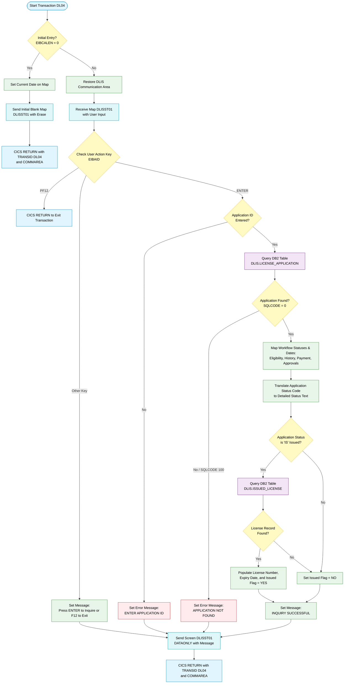

# DLISSTAT – Application Status Inquiry (CICS transaction DL04)

## 1. Main Objective

DLISSTAT is a CICS online COBOL program for the DLIS driver-license processing system. It runs as transaction **DL04** with BMS mapset **DLISST** and map **DLISST01**. It is a read-only inquiry screen. A clerk, examiner, or counter operator enters an **Application ID**. The program then shows where that driver-license application sits in the multi-step licensing workflow.

It reports:

- The license type and the current status code with a readable description.
- The result, date, and notes of each workflow stage: eligibility check, driving-history check, payment, first approval, and second approval.
- Once the license is issued, the license number and expiry date.

The user presses **ENTER** to inquire and **F12** to exit.

## 2. Position in the Enterprise Landscape

Other DLIS programs use the same copybooks (DLISWS, DLISCSEC, and the DCLGEN members). The shared workflow they cover is:

| Workflow stage | Status code | Tracking field in the data dictionary |
|---|---|---|
| Pending, awaiting eligibility check | `PE` | `APPLICATION-STATUS` |
| Eligibility checked | `EC` | `ELIG-CHECK-STATUS`, `ELIG-CHECK-DATE`, `ELIG-CHECK-NOTES` |
| History checked | `HC` | `HIST-CHECK-STATUS`, `HIST-CHECK-DATE`, `HIST-CHECK-NOTES` |
| Payment approved | `PA` | `PAYMENT-STATUS`, `PAYMENT-REFERENCE` |
| Awaiting second authority | `A2` | `APPROVAL-1-STATUS`, `APPROVAL-2-STATUS` |
| Fully approved, ready for issue | `AP` | Approval 1 and approval 2 statuses |
| License issued | `IS` | `LICENSE-NUMBER`, `EXPIRY-DATE` |
| Rejected | `RE` | `APPLICATION-STATUS` |

DLISSTAT does not change any of these stages. Its place in the system is **cross-cutting visibility**. It is the read-side counterpart to the programs that perform eligibility checking, history checking, payment, approval, and issuance.

## 3. Technology Stack

| Layer | Component | Use in this program |
|---|---|---|
| Transaction manager | **CICS** | Task control, terminal I/O, pseudo-conversational flow |
| Presentation | **BMS** mapset `DLISST`, map `DLISST01` | 3270 screen. Input fields end in `I` (such as `DSTAIDI`) and output fields in `O` (such as `DSTLTYO`). |
| Database | **Db2 for z/OS** (embedded static SQL) | Tables `DLIS.LICENSE_APPLICATION` and `DLIS.ISSUED_LICENSE` |
| Language | Enterprise COBOL with the CICS translator and Db2 precompiler or coprocessor | |
| Messaging | None | The program has no IBM MQ calls. |
| Files | None | The program has no VSAM or QSAM access. |

Shared copybooks, inlined in the source:

- **DLISWS** holds common work areas, return codes, and message fields, plus group layouts for candidate, application, payment, eligibility, history, approval, and license data. It also holds the SQLCA and null indicators.
- **DLISCSEC** holds the COMMAREA layouts: `DLIS-COMMAREA`, `DLIS-CAND-COMMAREA`, and `DLIS-APPL-COMMAREA`. It also holds the CICS response work fields.
- **DLISDCLG** holds the DCLGEN host-variable structures for six tables: CANDIDATE, LICENSE_APPLICATION, DRIVING_HISTORY, PAYMENT, ISSUED_LICENSE, and AUTHORITY_USER. It also holds the LICENSE_FEE_SCHEDULE structure.

This program uses only the LICENSE_APPLICATION and ISSUED_LICENSE structures. The other copybook content is shared boilerplate.

## 4. Integration Points

### 4.1 Upstream: terminal user and CICS navigation
- A 3270 terminal user starts transaction **DL04**, either directly or by navigating from another DLIS menu.
- `DLIS-COMMAREA` is the shared navigation structure. It carries the transaction ID, return screen, candidate/application/license/payment IDs, user ID, return code, message text and color, and an action byte. It is the contract for hand-offs between DLIS programs.
- `DFHCOMMAREA` is 350 bytes, and the program returns with `LENGTH(350)`.

### 4.2 Downstream: Db2
| Access | Table | Key | Columns retrieved | Purpose |
|---|---|---|---|---|
| Singleton `SELECT … INTO` | `DLIS.LICENSE_APPLICATION` | `APPLICATION_ID` | License type, application status, eligibility, history, payment, and approval 1/2 status, date, and notes or authority fields | Core status snapshot |
| Singleton `SELECT … INTO` (only when status = `IS`) | `DLIS.ISSUED_LICENSE` | `APPLICATION_ID` | `LICENSE_NUMBER`, `EXPIRY_DATE` | Show the issued license identity and validity |

The tables join logically on `APPLICATION_ID`. Host variables are qualified with `OF DCLDLIS-LICENSE-APPL` or `OF DCLDLIS-ISSUED-LIC`. The same column names exist in several DCLGEN structures, so the qualification keeps them unambiguous.

### 4.3 Outbound
- The program writes no messages to queues, files, or other services.
- Its only output is the terminal screen and the pseudo-conversational return to itself.

## 5. Control Flow

### 5.1 Pseudo-conversational design
`MAIN-LOGIC` checks `EIBCALEN`:

- **`EIBCALEN = 0` (first entry):** The program runs `INIT-SCREEN`. It sets the screen date field `DSTDATE`, then sends the map with `ERASE FREEKB`. It issues `RETURN TRANSID('DL04') COMMAREA(DLIS-COMMAREA) LENGTH(350)`. CICS then releases the task and holds no resources while the user reads the screen.
- **`EIBCALEN > 0` (re-entry):** The program copies `DFHCOMMAREA` to `DLIS-COMMAREA` and runs `PROCESS-INPUT`.

A task started from a terminal by transaction ID has no COMMAREA, so a zero `EIBCALEN` identifies the first invocation. The COMMAREA passed on `RETURN TRANSID` causes the next invocation to arrive with a non-zero length.

### 5.2 PROCESS-INPUT
1. `RECEIVE MAP('DLISST01') MAPSET('DLISST') RESP(WS-RESP1)` reads the user's input.
2. The program evaluates the attention key `EIBAID`:
   - **ENTER (`DFHENTER`)** runs `INQUIRE-STATUS`.
   - **F12 (`DFHPF12`)** issues `EXEC CICS RETURN` with no TRANSID, which ends the conversation and the pseudo-conversational loop.
   - **Anything else** puts "PRESS ENTER TO INQUIRE OR F12 TO EXIT" in `DSTMSG`.
3. `SEND MAP … DATAONLY FREEKB` redisplays only the changed data fields, without erasing the screen.
4. `RETURN TRANSID('DL04') COMMAREA(...)` re-arms the transaction.

### 5.3 INQUIRE-STATUS
1. **Input validation.** If `DSTAIDI` is zeros, the message "ENTER APPLICATION ID" is shown and the program branches to `INQUIRE-EXIT`.
2. **Key move.** `DSTAIDI` is moved to `APPLICATION-ID`.
3. **Db2 read.** The first singleton SELECT reads `LICENSE_APPLICATION`.
   - If `SQLCODE = 100`, the message is "APPLICATION NOT FOUND" and the program exits the paragraph.
4. **Screen population.** The program moves the license type and status code to the output fields.
5. **Status translation.** An `EVALUATE` converts the two-character `APPLICATION-STATUS` code to text:

   | Code | Description shown |
   |---|---|
   | `PE` | Pending – awaiting eligibility check |
   | `EC` | Eligibility checked – awaiting history |
   | `HC` | History checked – awaiting payment |
   | `PA` | Payment approved – awaiting auth 1 |
   | `A2` | Awaiting second authority approval |
   | `AP` | Fully approved – ready for issue |
   | `IS` | License issued |
   | `RE` | Rejected |
   | other | Unknown status |

6. **Stage detail fields.** The program fills eligibility (`DST1*`), history (`DST2*`), payment (`DST3*`), approval 1 (`DST4*`), and approval 2 (`DST5*`) on the screen.
7. **Issued-license lookup.**
   - When status is `IS`, the program selects the license number and expiry date from `ISSUED_LICENSE`. On `SQLCODE = 0` it fills `DST6NUMO` and `DST6EXPO` and sets the issued flag `DST6FLGO` to "YES".
   - Otherwise it sets `DST6FLGO` to "NO".
8. It sets "INQUIRY SUCCESSFUL" in `DSTMSG`.

## 6. Data Usage Summary

| Data dictionary item | Source | Screen role |
|---|---|---|
| `APPLICATION-ID` | User input (`DSTAIDI`) and WHERE key | Search key |
| `APPLICATION-STATUS` | LICENSE_APPLICATION | Status code and decoded description |
| `LICENSE-TYPE` | LICENSE_APPLICATION | Displayed classification |
| `ELIG-CHECK-STATUS`, `ELIG-CHECK-DATE`, `ELIG-CHECK-NOTES` | LICENSE_APPLICATION | Eligibility section |
| `HIST-CHECK-STATUS`, `HIST-CHECK-DATE`, `HIST-CHECK-NOTES` | LICENSE_APPLICATION | History section |
| `PAYMENT-STATUS`, `PAYMENT-REFERENCE` | LICENSE_APPLICATION | Payment section |
| `APPROVAL-1-STATUS`, `APPROVAL-2-STATUS` | LICENSE_APPLICATION | Two-level approval sections |
| `LICENSE-NUMBER`, `EXPIRY-DATE` | ISSUED_LICENSE (only when status `IS`) | Issued-license section |

## 7. Observations and Risks

- **Error handling:**
  - `SQLCODE` is checked only for 100 on the first SELECT and for 0 on the second. A negative SQLCODE, such as a deadlock or an unavailable resource, is not handled. After a negative SQLCODE the host variables may be unreliable, but processing continues and shows the results.
  - `WS-RESP1` is captured on the CICS commands but never inspected. A `MAPFAIL`, for example when ENTER is pressed with no data, is therefore silently ignored. Because `RESP` is specified, the task does not abend.
- **Null indicators:** `WS-NULL-INDICATORS` is defined, but the SELECTs use no indicator variables. Selecting a nullable column such as `ELIG_CHECK_DATE`, `APPROVAL_1_DATE`, or `EXPIRY_DATE` that holds NULL without an indicator gives SQLCODE -305 in Db2, and in this program that case would be missed.
- **Qualified host names:** The Db2 documentation recommends the `structure.field` form for qualified host variables. The `field OF structure` form used here depends on the precompiler or coprocessor accepting it.
- **Commarea handling:** The 350-byte `DFHCOMMAREA` is moved into the smaller `DLIS-COMMAREA`, so only the leading bytes are used. `RETURN … COMMAREA(DLIS-COMMAREA) LENGTH(350)` passes 350 bytes from an area defined as smaller. The CICS documentation warns that a LENGTH greater than the data area is unpredictable and may cause `LENGERR`. This should be reviewed.
- **Program termination:** The program ends with `STOP RUN`. This is unusual in CICS programs, where `EXEC CICS RETURN` is the standard exit. In practice each path issues `EXEC CICS RETURN` before reaching it.
- **Unused WORKING-STORAGE:** Most of the copybook storage, such as candidate, payment, and history structures, is unused. This costs per-task storage but has no functional effect.
- **Security and concurrency:** The program does not check user authority beyond the CICS transaction-level security of DL04. The singleton SELECTs do no locking beyond Db2's normal isolation.

## 8. Modernization Notes

- **Service candidate:** The logic is a good fit for a stateless "get application status" REST service. It takes an application ID, performs two keyed reads, and maps a status code to a description.
- **Status mapping:** The `PE → … → IS/RE` status table should be moved into reference data or an enumeration, so the DLIS programs share a single definition.
- **Screen-state handling:** The pseudo-conversational pattern with a COMMAREA maps to session or request context in a web or mobile front end.
- **Db2 access:** The two reads could become one join or a view over `LICENSE_APPLICATION` and `ISSUED_LICENSE`. This would reduce round trips and centralize null handling.

## 9. Summary

DLISSTAT is a small, read-only Db2/CICS inquiry transaction. It gives front-line users a single-screen view of a driver-license application's progress through the workflow. It reads two Db2 tables and keeps no state beyond a COMMAREA. It uses no MQ, file, or other external integration, and it relies on the shared DLIS copybooks for common data definitions and inter-program navigation.

# DLISSTAT Program Flow

---

Generated by IBM Bob Premium Package for Z
