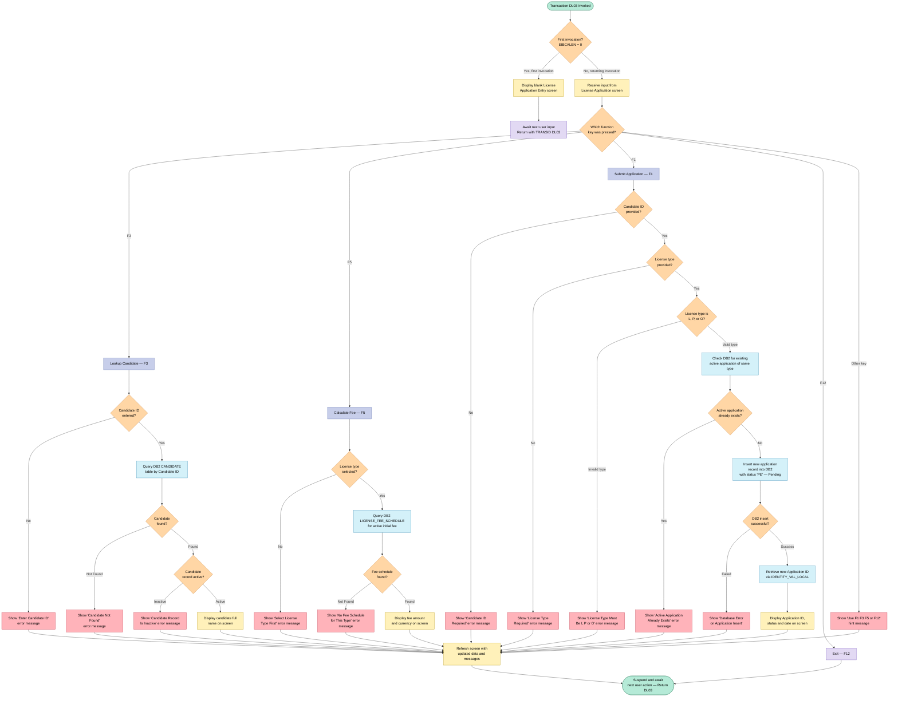

# DLISAPPL – License Application Entry

## Business Purpose
DLISAPPL is the data-entry screen that licensing office staff use to start a new license application for a candidate. The program runs under CICS as transaction **DL03**. It lets a clerk:
- check who a candidate is,
- see what the license will cost,
- file the application.

It is the entry point of the license application workflow. Every later step starts from the application record it creates. Those steps are the eligibility check, the driving-history check, payment, the two approvals, and issuing the license.

## How Users Interact With It
The program is a single screen with function keys. After each key press the program gives control back, and the next key press picks up where the user left off.

| Key | What it does for the user |
|---|---|
| **F3 – Lookup Candidate** | The clerk enters a Candidate ID. The program shows the candidate's full name. It reports "Candidate not found" or "Candidate record is inactive" when the person can't be used. |
| **F5 – Calc Fee** | The clerk selects a license type. The program shows the current fee and its currency. If no fee is defined for that type, it says so. |
| **F1 – Submit** | The program checks the entries and creates the application. It then shows the new application number, the status "PE" (Pending) and the application date. |
| **F12** | Leaves the transaction. |
| Any other key | Prompts the user to use F1, F3, F5 or F12. |

On first entry the screen is shown blank except for today's date.

## Business Decisions and Actions It Supports
- **Confirming the applicant.** Staff can verify the candidate's identity and active standing before taking an application. This guards against applications for unknown or deactivated people.
- **Fee transparency.** The fee comes from the official fee schedule. It uses the initial-fee ("IF") entry that is active and in effect today. The clerk can quote the exact cost before committing.
- **Validating the request.** Submission is refused unless both a Candidate ID and a license type are given. The type must be **L**, **P** or **O**.
- **Preventing duplicates.** An applicant cannot hold two live applications of the same license type. An application counts as live unless it is Rejected ("RE") or Issued ("IS"). A repeat attempt is stopped with a clear message.
- **Starting the application.** The program creates the application with status "Pending". It records the terminal that created it for audit purposes, and the database assigns the application number.

## Business Domain
Government or regulatory **license administration** (driver or vehicle licensing). The supporting data covers candidates, license applications, fee schedules, driving history, payments, approving authorities and issued licenses.

## Criticality
This is a **core operational, front-line program**. It is not a back-office utility. It is the only point where new applications enter the system, so if it is unavailable, no new applications can be taken. It also enforces key intake rules: valid candidate, valid license type and no duplicate live application. These rules protect the quality of data for every later step. It does not itself approve anything, take payment or issue a license, so its direct business impact is limited to intake.

## Observations for Stakeholders
- The program does not check eligibility, driving history or payment at intake. Other steps in the workflow handle those.
- The submit step does not require that the candidate was looked up or is active. It checks only that an ID and a valid type were entered.
- The program does not confirm the database save beyond reporting an error. A change of mind after saving is not supported by this screen.

# DLISAPPL — Program Flow Diagram

---

Generated by IBM Bob Premium Package for Z
