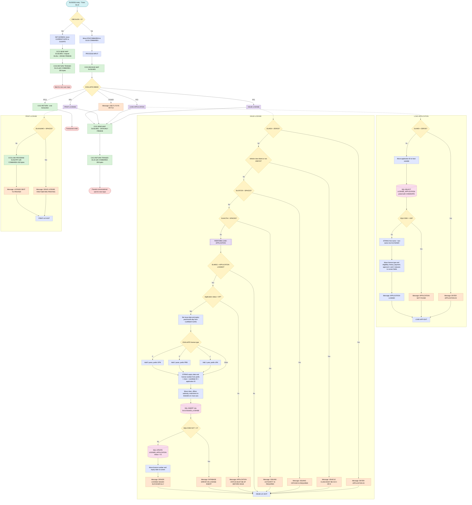

# DLISISSU — License Issuance Program: Technical Explanation

## Program Overview

**DLISISSU** is a CICS pseudo-conversational COBOL online program that implements the driver license issuance function within the DLIS (Driver Licensing Information System) application suite. It runs under CICS transaction identifier **DL10** and uses BMS map **DLISLIM01** within mapset **DLISLI** as its single screen. The program has no file I/O other than its two DB2 table interactions; all persistence is managed through embedded SQL. The program terminates every processing cycle with `STOP RUN`, which in a CICS environment returns control to CICS — it does not keep the task alive across terminal interactions. State is preserved across screen interactions by returning control to CICS with `EXEC CICS RETURN TRANSID('DL10') COMMAREA(DLIS-COMMAREA) LENGTH(350)`, which re-queues the transaction and carries a 350-byte communication area into the next invocation.

---

## Data Structures and Copybooks

The WORKING-STORAGE SECTION is built from several inline-expanded copybooks (originally `COPY` statements that are present but commented out):

### WS-COMMON-AREA (from DLISWS)
Holds the current date broken into `WS-CURR-YYYY`, `WS-CURR-MM`, and `WS-CURR-DD` components, a message text area (`WS-RETURN-MSG`), the signed return code (`WS-RETURN-CODE`), the current user ID (`WS-USER-ID`), and a message color indicator defaulting to `'GREEN'`.

### WS-APPLICATION (from DLISWS)
Holds the working copy of application-level status indicators used during processing: `WS-APPLICATION-ID`, `WS-LICENSE-TYPE`, `WS-APP-STATUS`, and the five gate statuses — `WS-ELIG-STATUS`, `WS-HIST-STATUS`, `WS-PAY-STATUS`, `WS-APP1-STATUS`, `WS-APP2-STATUS`.

### WS-LICENSE (from DLISWS)
Contains the generated license data for a current issuance cycle: `WS-LICENSE-NUMBER` (20 characters), `WS-VEHICLE-CLASS`, `WS-RESTRICTIONS`, `WS-ISSUED-BY-OFFICER`, `WS-ISSUED-BY-AUTH`, `WS-EXPIRY-DATE`, `WS-YEARS-VALID`, and `WS-LIC-PREFIX` (3 characters). The working-storage fields `WS-ISSUE-DATE`, `WS-EXPIRY-YYYY`, and `WS-EXPIRY-MMDD` are declared at the 01 level separately to support date calculations.

### DB2 DCLGEN Host Variable Structures (from DLISDCLG)
Five DCLGEN layouts provide host variable groups for embedded SQL:

| Structure | DB2 Table |
|---|---|
| `DCLDLIS-LICENSE-APPL` | `DLIS.LICENSE_APPLICATION` |
| `DCLDLIS-CANDIDATE` | `DLIS.CANDIDATE` |
| `DCLDLIS-ISSUED-LIC` | `DLIS.ISSUED_LICENSE` |
| `DCLDLIS-DRIVING-HIST` | `DLIS.DRIVING_HISTORY` |
| `DCLDLIS-PAYMENT` | `DLIS.PAYMENT` |
| `DCLDLIS-AUTH-USER` | `DLIS.AUTHORITY_USER` |
| `DCLDLIS-FEE-SCHED` | `DLIS.LICENSE_FEE_SCHEDULE` |

Only `DCLDLIS-LICENSE-APPL`, `DCLDLIS-CANDIDATE`, and `DCLDLIS-ISSUED-LIC` are accessed by SQL at runtime; the remaining structures are declared but not referenced in any SQL statement within this program.

### SQLCA
The SQL Communication Area is included twice: once within the DLISWS copybook expansion (line 141) and once directly at line 389. After every SQL execution, DB2 places a return code in `SQLCODE`. A value of 0 signals success, +100 signals no row found (NOT FOUND condition), and a negative value signals a DB2 error.

### COMMAREA Layouts (from DLISCSEC)
Three COMMAREA structures are declared:
- **`DLIS-COMMAREA`** — the primary 350-byte navigation commarea containing `CA-TRANSACTION-ID`, `CA-CANDIDATE-ID`, `CA-APPLICATION-ID`, `CA-LICENSE-ID`, `CA-PAYMENT-ID`, `CA-USER-ID`, `CA-RETURN-CODE`, `CA-MSG-TEXT`, `CA-MSG-COLOR`, and `CA-ACTION`.
- **`DLIS-CAND-COMMAREA`** — candidate personal data layout.
- **`DLIS-APPL-COMMAREA`** — application status data layout including all five gate statuses and `CA-LICENSE-NUMBER`.

All three structures share the same 350-byte `DFHCOMMAREA` storage in the LINKAGE SECTION through the CICS COMMAREA mechanism; the program overlays `DFHCOMMAREA` onto `DLIS-COMMAREA` by a direct MOVE at the start of subsequent invocations.

### Null Indicators
`WS-NULL-INDICATORS` holds nine halfword COMP indicators (`NI-ADDR2`, `NI-ELIG-DATE`, `NI-HIST-DATE`, `NI-PAY-REF`, `NI-A1-DATE`, `NI-A2-DATE`, `NI-SUSP-END`, `NI-EXPIRY`, `NI-PREV-LIC`), all initialized to 0. These are declared but none are referenced as indicator variables in any SQL statement in this program — they are present as part of the shared working storage copybook.

---

## Pseudo-Conversational Execution Model

DLISISSU follows the standard CICS pseudo-conversational pattern. When `EIBCALEN` equals zero, no commarea was passed to the task, meaning this is the very first invocation of the transaction — the program routes to `INIT-SCREEN`. On every subsequent invocation `EIBCALEN` is non-zero, and `DFHCOMMAREA` is moved into `DLIS-COMMAREA` before control passes to `PROCESS-INPUT`. After each cycle, the program issues `EXEC CICS RETURN TRANSID('DL10') COMMAREA(DLIS-COMMAREA) LENGTH(350)`, which suspends the task, returns the terminal to the user, and pre-arms CICS to re-invoke `DLISISSU` under transaction `DL10` the next time the user presses an attention key. This means no CICS task exists between keystrokes and no z/OS storage is held — the full 350-byte state of the conversation lives exclusively in the CICS-managed COMMAREA.

---

## Procedure Division — Execution Flow

### MAIN-LOGIC (Entry Point)

This is the sole entry point. It tests `EIBCALEN`:
- **= 0** → `PERFORM INIT-SCREEN`
- **≠ 0** → MOVE `DFHCOMMAREA` TO `DLIS-COMMAREA`, then `PERFORM PROCESS-INPUT`

The paragraph ends with `STOP RUN`, which terminates the CICS task after the chosen path completes.

---

### INIT-SCREEN — First Invocation Initialization

Executed only when the transaction is started fresh (no commarea). The current system date is obtained via the `CURRENT-DATE` intrinsic function, with the first 10 characters moved to `DLIDATE` (the date output field on the map). Then:

1. `EXEC CICS SEND MAP('DLISLIM01') MAPSET('DLISLI') ERASE FREEKB RESP(WS-RESP1)` — sends the map to the 3270 terminal. `ERASE` clears the entire screen buffer and returns the cursor to the upper-left corner, which is the correct behavior for the first output operation of a pseudo-conversational transaction. `FREEKB` unlocks the 3270 keyboard so the operator can type immediately; without this option, the keyboard would remain locked after the send.
2. `EXEC CICS RETURN TRANSID('DL10') COMMAREA(DLIS-COMMAREA) LENGTH(350)` — terminates the task and instructs CICS to re-invoke `DLISISSU` under `DL10` at the next attention keystroke, carrying the (currently empty) 350-byte `DLIS-COMMAREA` as the startup commarea. This sets `EIBCALEN` to 350 on the next invocation.

---

### PROCESS-INPUT — Subsequent Invocation Dispatcher

Executes on every invocation after the first. It first reads the screen input:

`EXEC CICS RECEIVE MAP('DLISLIM01') MAPSET('DLISLI') RESP(WS-RESP1)` — maps the inbound 3270 data stream from the terminal into the symbolic map area. BMS translates each modified screen field into the corresponding `-I` (input) suffix map field. After this command, `EIBAID` contains the one-byte Attention Identifier (AID) corresponding to the key pressed.

An `EVALUATE TRUE` block then dispatches on `EIBAID` against the DFHAID copy-library constants:

| AID Value | Condition | Action |
|---|---|---|
| `DFHPF1` | F1 pressed | `PERFORM ISSUE-LICENSE` |
| `DFHPF3` | F3 pressed | `PERFORM LOAD-APPLICATION` |
| `DFHPF6` | F6 pressed | `PERFORM PRINT-LICENSE` |
| `DFHPF12` | F12 pressed | `EXEC CICS RETURN END-EXEC` — unconditional exit, no re-queue |
| Any other key | `OTHER` | Moves `'USE F1 F3 F6 OR F12'` to `DLIMSG` |

After the EVALUATE (for all paths except F12, which returns before reaching this point), control falls through to:
1. `EXEC CICS SEND MAP('DLISLIM01') MAPSET('DLISLI') DATAONLY FREEKB RESP(WS-RESP1)` — sends the updated map back using `DATAONLY`, which writes only the application data fields without re-transmitting the static screen labels, reducing network traffic. `FREEKB` again unlocks the keyboard.
2. `EXEC CICS RETURN TRANSID('DL10') COMMAREA(DLIS-COMMAREA) LENGTH(350)` — re-queues the transaction for the next keystroke.

**Unhandled AID values:** When a key other than PF1, PF3, PF6, or PF12 is pressed (e.g., Enter, PF2, Clear, PA keys), the `OTHER` branch sets the message field to the guidance text and falls through to the `SEND MAP DATAONLY`, displaying the message. No ABEND or error is raised.

---

## Functional Areas

### F3 — LOAD-APPLICATION Paragraph

This paragraph retrieves a license application and its associated candidate from DB2 using the Application ID entered on the screen (`DLIAIDI`).

**Input validation:** If `DLIAIDI` is zero, the message `'ENTER APPLICATION ID'` is placed in `DLIMSG` and the paragraph exits via `GO TO LOAD-APP-EXIT`.

**DB2 SELECT — JOIN query:**
A single `SELECT … INTO` retrieves eight columns from `DLIS.LICENSE_APPLICATION` and two from `DLIS.CANDIDATE` via a JOIN on `CANDIDATE_ID`:

- From `DLIS.LICENSE_APPLICATION`: `CANDIDATE_ID`, `LICENSE_TYPE`, `APPLICATION_STATUS`, `ELIG_CHECK_STATUS`, `HIST_CHECK_STATUS`, `PAYMENT_STATUS`, `APPROVAL_1_STATUS`, `APPROVAL_2_STATUS`.
- From `DLIS.CANDIDATE`: `FIRST_NAME`, `LAST_NAME`.

The WHERE clause filters on `APPLICATION_ID = :APPLICATION-ID OF DCLDLIS-LICENSE-APPL`, which was loaded from `DLIAIDI`.

**Result handling:**
- If `SQLCODE = 100` (no matching row — DB2's NOT FOUND indicator), `'APPLICATION NOT FOUND'` is moved to `DLIMSG` and the paragraph exits.
- On success, the candidate's full name is assembled on the map using a `STRING` statement: `FIRST-NAME` delimited by SPACE, a literal space, and `LAST-NAME` delimited by SPACE are concatenated into `DLICNAMO`. All five gate statuses (`ELIG-CHECK-STATUS`, `HIST-CHECK-STATUS`, `PAYMENT-STATUS`, `APPROVAL-1-STATUS`, `APPROVAL-2-STATUS`) and `LICENSE-TYPE` are moved to their respective map output fields (`DLIELIG0`, `DLIHISTO`, `DLIPAYO`, `DLIAU1O`, `DLIAU2O`, `DLILTYO`).
- The message `'APPLICATION LOADED'` is placed in `DLIMSG` to signal success to the caller.

`LOAD-APP-EXIT` is a fall-through EXIT paragraph.

---

### F1 — ISSUE-LICENSE Paragraph

This is the primary business logic paragraph. It performs all validation, date calculation, license number generation, and database writes necessary to issue a driver license.

#### Step 1 — Screen Field Validation (Four Guards)

Four sequential guards validate mandatory input fields. Any failure sets a descriptive message in `DLIMSG` and branches to `ISSUE-LIC-EXIT`, bypassing all further processing:

| Guard | Condition | Message |
|---|---|---|
| Application ID | `DLIAIDI = ZEROS` | `'ENTER APPLICATION ID'` |
| Vehicle Class | `DLIVCLSI = SPACES` or not in `('A','B','C','D')` | `'VEHICLE CLASS MUST BE A B C OR D'` |
| Issuing Officer | `DLIOFCRI = SPACES` | `'ISSUING OFFICER IS REQUIRED'` |
| Issuing Authority | `DLIAUTHI = SPACES` | `'ISSUING AUTHORITY IS REQUIRED'` |

`VEHICLE-CLASS` accepts exactly four values: `'A'`, `'B'`, `'C'`, or `'D'`. Any other non-space character fails the guard.

#### Step 2 — Application Load and Status Gate

`PERFORM LOAD-APPLICATION` is called inline. If the message in `DLIMSG` is anything other than `'APPLICATION LOADED'` (meaning the SELECT failed or the application was not found), the paragraph exits immediately via `GO TO ISSUE-LIC-EXIT`.

After a successful load, `APPLICATION-STATUS OF DCLDLIS-LICENSE-APPL` is checked. If it is not equal to `'AP'` (Approved), the message `'APPLICATION STATUS MUST BE AP BEFORE ISSUE'` is set and the paragraph exits. This is the single gating check on application status; the five individual gate fields (eligibility, history, payment, approval 1, approval 2) are displayed to the user for review but are not individually re-evaluated in the issuance logic — only the composite `'AP'` status is enforced programmatically.

#### Step 3 — Expiry Date Calculation

The current system date is obtained via `CURRENT-DATE`:
- `CURRENT-DATE(1:10)` → `WS-ISSUE-DATE` (the full issue date, e.g., `2024-07-15`).
- `CURRENT-DATE(1:4)` → `WS-EXPIRY-YYYY` (the four-digit year as a numeric field).
- `CURRENT-DATE(5:6)` → `WS-EXPIRY-MMDD` (month and day, e.g., `0715`).

An `EVALUATE` on `LICENSE-TYPE OF DCLDLIS-LICENSE-APPL` sets the validity period and license number prefix:

| License Type | Years Added | Prefix |
|---|---|---|
| `'L'` (Learner) | 1 | `'LRN'` |
| `'P'` (Probationary) | 2 | `'PRB'` |
| `'O'` (Open) | 5 | `'OPN'` |

The year arithmetic is a direct `ADD` to `WS-EXPIRY-YYYY`. The expiry date string is then assembled: `STRING WS-EXPIRY-YYYY WS-EXPIRY-MMDD INTO WS-EXPIRY-DATE`, producing a 10-character date in the format `YYYYMMDD` (the MMDD portion is 6 characters: month + day + two trailing spaces from the PIC X(6) declaration).

**Silent boundary behavior:** The `EVALUATE` on license type covers only `'L'`, `'P'`, and `'O'`. If `LICENSE-TYPE` holds any other value, no WHEN branch matches, `WS-LIC-PREFIX` remains uninitialized (spaces from its VALUE clause), and `WS-EXPIRY-YYYY` is not incremented — the issue date year is used as the expiry year. This is an unhandled case that could produce a malformed license number and a same-year expiry date without any error message or abend.

#### Step 4 — License Number Generation

`STRING WS-LIC-PREFIX DLIVCLSI CANDIDATE-ID OF DCLDLIS-LICENSE-APPL APPLICATION-ID OF DCLDLIS-LICENSE-APPL INTO WS-LICENSE-NUMBER`

The 20-character `WS-LICENSE-NUMBER` is constructed by concatenating without delimiters: the 3-character type prefix, the vehicle class from the screen (`DLIVCLSI`), the packed-decimal `CANDIDATE-ID`, and the packed-decimal `APPLICATION-ID`. Because `CANDIDATE-ID` and `APPLICATION-ID` are `PIC S9(10) COMP-3` (packed decimal), their raw internal binary/packed representation is concatenated into the license number string; no MOVE to a display field is performed before the STRING. This means the license number contains non-printable bytes derived from the packed fields.

#### Step 5 — DB2 INSERT into DLIS.ISSUED_LICENSE

Input fields are moved from screen map fields to the corresponding host variable structure fields before the INSERT:
- `DLIVCLSI` → `VEHICLE-CLASS OF DCLDLIS-ISSUED-LIC`
- `DLIOFCRI` → `ISSUED-BY-OFFICER OF DCLDLIS-ISSUED-LIC`
- `DLIAUTHI` → `ISSUED-BY-AUTH OF DCLDLIS-ISSUED-LIC`
- `DLIRSTI` → `RESTRICTIONS OF DCLDLIS-ISSUED-LIC`

The INSERT into `DLIS.ISSUED_LICENSE` provides the following columns and values:

| Column | Value Source |
|---|---|
| `APPLICATION_ID` | `:APPLICATION-ID` (host variable) |
| `CANDIDATE_ID` | `:CANDIDATE-ID` (host variable) |
| `LICENSE_NUMBER` | `:WS-LICENSE-NUMBER` |
| `LICENSE_TYPE` | `:LICENSE-TYPE` (host variable) |
| `ISSUE_DATE` | `CURRENT DATE` (DB2 special register — current server date at execution time) |
| `EXPIRY_DATE` | `:WS-EXPIRY-DATE` |
| `LICENSE_STATUS` | `'A'` (hardcoded literal — Active) |
| `VEHICLE_CLASS` | `:VEHICLE-CLASS` |
| `RESTRICTIONS` | `:RESTRICTIONS` |
| `DEMERIT_BALANCE` | `12` (hardcoded literal) |
| `ISSUED_BY_AUTH` | `:ISSUED-BY-AUTH` |
| `ISSUED_BY_OFFICER` | `:ISSUED-BY-OFFICER` |

`LICENSE_STATUS` is always set to `'A'` (Active) without any override logic. `DEMERIT_BALANCE` is always initialized to the literal value `12`; this is a business rule hardcoded in the program meaning every newly issued license starts with a demerit balance of 12 points regardless of license type or candidate history.

If `SQLCODE NOT = 0` after the INSERT, `'DATABASE ERROR ON LICENSE INSERT'` is placed in `DLIMSG` and the paragraph exits. No rollback is explicitly issued; under CICS with DB2, the unit of work is committed or rolled back at task termination — the `STOP RUN` at the end of `MAIN-LOGIC` ends the CICS task, and if no explicit `EXEC CICS SYNCPOINT` or DB2 COMMIT is issued, CICS manages the sync point at task end. A non-zero SQLCODE causes an early exit, so the UPDATE described next is skipped — the INSERT row, if any partial state exists, is not separately rolled back within the program.

#### Step 6 — DB2 UPDATE of DLIS.LICENSE_APPLICATION

`UPDATE DLIS.LICENSE_APPLICATION SET APPLICATION_STATUS = 'IS', LAST_UPDATED_DATE = CURRENT DATE, LAST_UPDATED_BY = :DLIOFCRI WHERE APPLICATION_ID = :APPLICATION-ID OF DCLDLIS-LICENSE-APPL`

The application record is updated to status `'IS'` (Issued). `LAST_UPDATED_DATE` is set to the DB2 `CURRENT DATE` special register (the same server clock used for the issue date). `LAST_UPDATED_BY` is populated with the issuing officer identifier from the screen field `DLIOFCRI`. The SQLCODE from this UPDATE is not individually checked; if it fails silently, the license insert stands but the application status remains `'AP'`, creating a potential data inconsistency.

#### Step 7 — Screen Update on Success

`WS-LICENSE-NUMBER` is moved to `DLIILNUMO` (the issued license number output field) and `WS-EXPIRY-DATE` is moved to `DLIEXPO` (the expiry date output field). The message `'DRIVER LICENSE ISSUED SUCCESSFULLY'` is placed in `DLIMSG`.

`ISSUE-LIC-EXIT` is the fall-through EXIT paragraph.

---

### F6 — PRINT-LICENSE Paragraph

This paragraph delegates printing to an external program.

**Guard:** If `DLIILNUMO` (the license number output field on the map) is spaces, the message `'ISSUE LICENSE FIRST BEFORE PRINTING'` is set and the paragraph exits via `GO TO PRINT-LIC-EXIT`. This means a license must have been successfully issued in a prior F1 invocation within the same session, leaving a non-space value in `DLIILNUMO`.

**Program delegation:** `EXEC CICS LINK PROGRAM('DLISLPRT') COMMAREA(DLIS-COMMAREA) LENGTH(350)` — issues a synchronous CICS LINK to the program `DLISLPRT`. This is a synchronous call; `DLISISSU` suspends at the LINK point, `DLISLPRT` runs to completion and issues its own `EXEC CICS RETURN`, at which point control is returned to the statement immediately following the LINK in `DLISISSU`. The entire 350-byte `DLIS-COMMAREA` is passed as the communication area, giving `DLISLPRT` access to all navigation and context data including `CA-APPLICATION-ID`, `CA-CANDIDATE-ID`, and `CA-LICENSE-ID`.

After the LINK returns, `'LICENSE SENT TO PRINTER'` is moved to `DLIMSG`.

`PRINT-LIC-EXIT` is the fall-through EXIT paragraph.

---

### F12 — Exit

`EXEC CICS RETURN END-EXEC` within the EVALUATE block terminates the task definitively. Unlike the `RETURN TRANSID('DL10') COMMAREA(…)` form used for pseudo-conversational re-queue, this bare `RETURN` does not specify a `TRANSID`, so CICS does not pre-arm the next invocation and the transaction ends. The remaining code in `PROCESS-INPUT` (SEND MAP DATAONLY, RETURN TRANSID) is never reached for this path because the `EXEC CICS RETURN` inside EVALUATE does not fall through.

---

## DB2 Interactions Summary

| Paragraph | Operation | Table | Key |
|---|---|---|---|
| `LOAD-APPLICATION` | `SELECT … INTO` (JOIN) | `DLIS.LICENSE_APPLICATION` JOIN `DLIS.CANDIDATE` | `APPLICATION_ID` |
| `ISSUE-LICENSE` | `INSERT` | `DLIS.ISSUED_LICENSE` | N/A (new row) |
| `ISSUE-LICENSE` | `UPDATE` | `DLIS.LICENSE_APPLICATION` | `APPLICATION_ID` |

---

## External Program Interactions

| Program | Mechanism | Commarea | Purpose |
|---|---|---|---|
| `DLISLPRT` | `EXEC CICS LINK` | `DLIS-COMMAREA` (350 bytes) | License print delegation |

---

## CICS Commands Summary

| Command | Where Used | Purpose |
|---|---|---|
| `SEND MAP … ERASE FREEKB` | `INIT-SCREEN` | Initial blank map display; ERASE clears screen, FREEKB unlocks keyboard |
| `RETURN TRANSID('DL10') COMMAREA(…)` | `INIT-SCREEN`, `PROCESS-INPUT` | Pseudo-conversational re-queue with state |
| `RECEIVE MAP` | `PROCESS-INPUT` | Read terminal input into symbolic map fields |
| `SEND MAP … DATAONLY FREEKB` | `PROCESS-INPUT` | Refresh only data fields after each action |
| `RETURN` (bare) | F12 path in `PROCESS-INPUT` | Unconditional task termination |
| `LINK PROGRAM('DLISLPRT')` | `PRINT-LICENSE` | Synchronous call to print program |

---

## Input/Output Summary

**Inputs:**
- `DLIAIDI` — Application ID entered by the operator.
- `DLIVCLSI` — Vehicle class (`A`/`B`/`C`/`D`) entered by the operator.
- `DLIOFCRI` — Issuing officer identifier entered by the operator.
- `DLIAUTHI` — Issuing authority entered by the operator.
- `DLIRSTI` — License restrictions entered by the operator (optional, not explicitly validated).

**Outputs written to screen:**
- `DLICNAMO` — Candidate full name (loaded from DB2).
- `DLILTYO` — License type.
- `DLIELIG0`, `DLIHISTO`, `DLIPAYO`, `DLIAU1O`, `DLIAU2O` — Five gate status indicators.
- `DLIILNUMO` — Generated license number (after successful issuance).
- `DLIEXPO` — Calculated expiry date (after successful issuance).
- `DLIMSG` — Status or error message after every action.
- `DLIDATE` — Current date, set at first screen display.

**DB2 outputs:**
- A new row inserted into `DLIS.ISSUED_LICENSE`.
- `APPLICATION_STATUS` updated to `'IS'` in `DLIS.LICENSE_APPLICATION`.

# DLISISSU – Program Flow

---

Generated by IBM Bob Premium Package for Z
