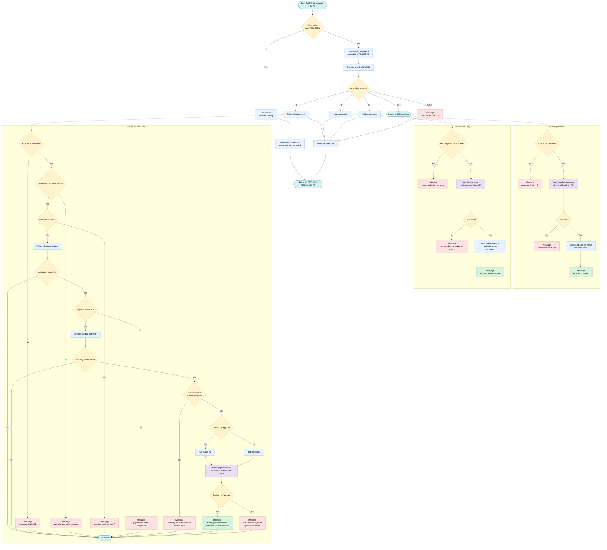
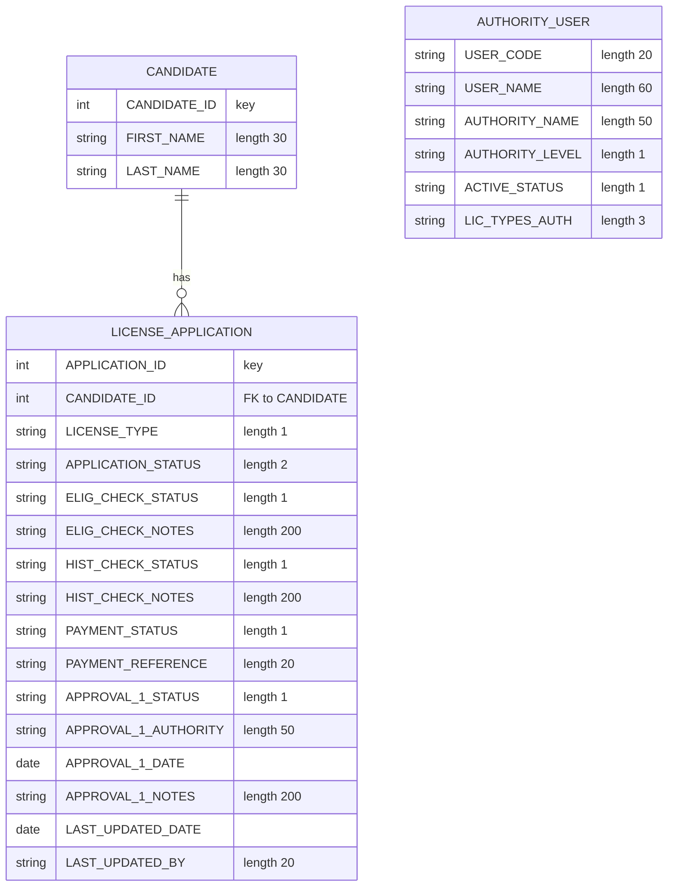

## Table of Contents

- [1. Purpose](#1-purpose)
- [2. Inputs](#2-inputs)
  - [2.1 Screen / Map Inputs (CICS BMS — Map `DLISA1M01`, Mapset `DLISA1`)](#21-screen--map-inputs-cics-bms--map-dlisa1m01-mapset-dlisa1)
  - [2.2 CICS System Inputs](#22-cics-system-inputs)
  - [2.3 DB2 Database Inputs](#23-db2-database-inputs)
- [3. Outputs](#3-outputs)
  - [3.1 Screen output (BMS map DLISA1 / DLISA1M01, sent with CICS SEND MAP)](#31-screen-output-bms-map-dlisa1--dlisa1m01-sent-with-cics-send-map)
  - [3.2 Database updates (DB2 table DLIS.LICENSE_APPLICATION)](#32-database-updates-db2-table-dlislicense_application)
  - [3.3 Conditions that stop the update](#33-conditions-that-stop-the-update)
  - [3.4 Transaction control and session state](#34-transaction-control-and-session-state)
  - [3.5 Not produced](#35-not-produced)
- [4. Processing Logic](#4-processing-logic)
  - [4.1 Mermaid Flow Diagram](#41-mermaid-flow-diagram)
  - [4.2 Processing Logic Description](#42-processing-logic-description)
  - [4.3 Database Tables](#43-database-tables)
- [5. Paragraphs](#5-paragraphs)
- [6. Dependencies](#6-dependencies)
  - [6.1 CICS Transaction & Screen Map](#61-cics-transaction--screen-map)
  - [6.2 DB2 Tables](#62-db2-tables)
  - [6.3 DB2 Host-Variable Copybooks (DCLGEN)](#63-db2-host-variable-copybooks-dclgen)
  - [6.4 Common Working-Storage Copybooks](#64-common-working-storage-copybooks)
  - [6.5 CICS Runtime Components](#65-cics-runtime-components)
  - [6.6 Input Parameters / Screen Fields](#66-input-parameters--screen-fields)
- [7. Constraints](#7-constraints)
  - [7.1 Transaction and Navigation Constraints](#71-transaction-and-navigation-constraints)
  - [7.2 Input Validation Rules](#72-input-validation-rules)
  - [7.3 Business Rules and Conditional Restrictions](#73-business-rules-and-conditional-restrictions)
  - [7.4 Sequencing Constraints](#74-sequencing-constraints)
  - [7.5 Data Format and Size Limits](#75-data-format-and-size-limits)
  - [7.6 Error Handling Limits](#76-error-handling-limits)
- [8. Error Handling](#8-error-handling)
  - [8.1 Input validation (field-level checks)](#81-input-validation-field-level-checks)
  - [8.2 Business rule validation (guard conditions in the approval flow)](#82-business-rule-validation-guard-conditions-in-the-approval-flow)
  - [8.3 Database error handling (DB2)](#83-database-error-handling-db2)
  - [8.4 CICS error handling](#84-cics-error-handling)
  - [8.5 User notifications and feedback](#85-user-notifications-and-feedback)
  - [8.6 Control flow and recovery behaviour](#86-control-flow-and-recovery-behaviour)
- [9. Examples](#9-examples)
  - [9.1 Example 1: Load an application (F3)](#91-example-1-load-an-application-f3)
  - [9.2 Example 2: Validate the authority user (F4)](#92-example-2-validate-the-authority-user-f4)
  - [9.3 Example 3: Successful first approval (F1, decision A)](#93-example-3-successful-first-approval-f1-decision-a)
  - [9.4 Example 4: Rejection and blocked submissions (F1)](#94-example-4-rejection-and-blocked-submissions-f1)
  - [9.5 Example 5: Navigation and exit](#95-example-5-navigation-and-exit)

## 1. Purpose

DLISAP1 is a CICS/COBOL interactive transaction (transaction ID DL08) that manages the **first-level authority approval** step in a driver's license application workflow. An authority user loads a license application by its ID — which retrieves the applicant's personal details, license type, eligibility and history check outcomes, and payment information — then validates their own identity and approval rights against the authority user database, confirming they are an active level-1 authority permitted to handle the given license type. Once all preconditions are satisfied (payment completed, authority validated, license type authorized), the user enters an approve or reject decision: an approval advances the application to status `A2` for second-level review, while a rejection closes it with status `RE`, and in both cases the decision, authority name, date, and any notes are written back to the license application record in DB2.

## 2. Inputs

### 2.1 Screen / Map Inputs (CICS BMS — Map `DLISA1M01`, Mapset `DLISA1`)

- **`DA1AIDI`** — Application ID entered by the user on the screen. Used as the key to retrieve the license application record from DB2 and to anchor the approval update.
- **`DA1AUCOI`** — Authority user code entered on the screen. Used as the key to look up and validate the approving authority in the `DLIS.AUTHORITY_USER` table; also written to the `LAST_UPDATED_BY` column on update.
- **`DA1DECI`** — Approver's decision entered on the screen (`A` = Approve, `R` = Reject). Drives the new application status (`A2` or `RE`) and the approval outcome message.
- **`DA1DCNTI`** — Decision notes entered on the screen. Written directly to the `APPROVAL_1_NOTES` column of the license application record.

### 2.2 CICS System Inputs

- **`EIBCALEN`** — CICS Execute Interface Block field indicating the length of the passed COMMAREA. A value of `0` signals the first (cold) entry to the program, triggering screen initialisation; any non-zero value means the program has been re-entered after a user action.
- **`EIBAID`** — CICS attention identifier indicating which PF key the user pressed (`PF1` = submit approval, `PF3` = load application, `PF4` = validate authority, `PF12` = exit). Controls the main processing branch.
- **`DFHCOMMAREA`** — 350-byte CICS communication area passed back on each pseudo-conversational return. Mapped to `DLIS-COMMAREA`, it carries the transaction context (transaction ID, candidate/application/payment IDs, user ID, return code, and message) between conversational cycles.

### 2.3 DB2 Database Inputs

- **`DLIS.LICENSE_APPLICATION` table** — Queried (via `LOAD-APPLICATION`) and updated (via `SUBMIT-APPROVAL1`) using `APPLICATION-ID` as the key. Columns read into the program:
  - `APPLICATION-STATUS` — current workflow status; must be a valid state for approval processing; updated to `A2` (approved) or `RE` (rejected).
  - `LICENSE-TYPE` — classification of the license being applied for; checked against the authority's permitted types.
  - `ELIG-CHECK-STATUS` — outcome of the eligibility check; displayed to the approver.
  - `HIST-CHECK-STATUS` — outcome of the history check; displayed to the approver.
  - `PAYMENT-STATUS` — must equal `'P'` (payment completed) before the first approval can proceed.
  - `PAYMENT-REFERENCE` — payment reference identifier; displayed to the approver.
  - `ELIG-CHECK-NOTES` / `HIST-CHECK-NOTES` — supporting notes displayed to the approver.

- **`DLIS.CANDIDATE` table** — Joined to `LICENSE_APPLICATION` during load. Columns read:
  - `FIRST-NAME` / `LAST-NAME` — applicant's name; combined and displayed on screen to identify the candidate.

- **`DLIS.AUTHORITY_USER` table** — Queried (via `VALIDATE-AUTHORITY`) using `USER-CODE` as the key, filtered to active (`ACTIVE_STATUS = 'A'`) level-1 authorities. Columns read:
  - `USER-NAME` — name of the authority user; displayed on screen.
  - `AUTHORITY-NAME` — formal authority name; displayed on screen and written to `APPROVAL_1_AUTHORITY` on update.
  - `AUTHORITY-LEVEL` — approval level; only level `'1'` users are accepted.
  - `LIC-TYPES-AUTH` — list of license types the authority is permitted to approve; the application's license type must appear in this list.

## 3. Outputs

### 3.1 Screen output (BMS map DLISA1 / DLISA1M01, sent with CICS SEND MAP)
- Message line (`DA1MSG`): the main user feedback field. It shows one of these messages:
  - Prompts and validation errors:
    - "USE F1 F3 F4 OR F12" for any other key
    - "ENTER APPLICATION ID"
    - "ENTER AUTHORITY USER CODE"
    - "AUTHORITY USER CODE IS REQUIRED"
    - "DECISION MUST BE A=APPROVE OR R=REJECT"
  - Lookup results:
    - "APPLICATION LOADED"
    - "APPLICATION NOT FOUND"
    - "AUTHORITY USER VALIDATED"
    - "AUTHORITY USER NOT FOUND OR NOT ACTIVE AT LEVEL 1"
  - Business-rule rejections:
    - "PAYMENT MUST BE COMPLETED BEFORE FIRST APPROVAL"
    - "AUTHORITY NOT AUTHORISED FOR THIS LICENSE TYPE"
  - Approval outcomes:
    - "FIRST APPROVAL RECORDED - FORWARDED FOR 2ND APPROVAL" when the decision is `A`
    - "FIRST APPROVAL REJECTED - APPLICATION CLOSED" when the decision is `R`
- Application details shown after a successful load (F3, or the load step inside F1):
  - Candidate full name (`DA1CNAMO`), built from `FIRST-NAME` and `LAST-NAME`
  - License type (`DA1LTYO`) from `LICENSE-TYPE`
  - Application status (`DA1ASTTO`) from `APPLICATION-STATUS`
  - Supporting check information for the approver:
    - Eligibility check status (`DA1ELIGO`) from `ELIG-CHECK-STATUS`
    - History check status (`DA1HISTO`) from `HIST-CHECK-STATUS`
    - Eligibility check notes (`DA1ELNTO`)
    - History check notes (`DA1HSNTO`)
  - Payment information:
    - Payment status (`DA1PAYO`) from `PAYMENT-STATUS`
    - Payment reference (`DA1PYRFO`) from `PAYMENT-REFERENCE`
- Authority user details shown after validation (F4, or the validation step inside F1):
  - Authority display field (`DA1AUNMO`). The program moves `USER-NAME` into it and then overwrites it with `AUTHORITY-NAME`, so the screen shows only the authority name.
- Initial screen:
  - On first entry the program moves a date value to `DA1DATE`. It then sends the blank map with ERASE and FREEKB.
  - On later interactions it sends the map with DATAONLY and FREEKB.

### 3.2 Database updates (DB2 table DLIS.LICENSE_APPLICATION)
- Performed once, when F1 (submit) passes all validations. The row is selected by `APPLICATION-ID`. These columns are written:
  - First-approval decision:
    - `APPROVAL_1_STATUS` is set from `WS-DECISION` (`A` or `R`).
    - `APPROVAL_1_AUTHORITY` is set from `AUTHORITY-NAME`, the approving authority.
    - `APPROVAL_1_DATE` is set to the current date.
    - `APPROVAL_1_NOTES` is set from the decision notes entered on screen (`DA1DCNTI`).
  - Workflow status:
    - `APPLICATION-STATUS` is set to `A2` when the decision is approve, which forwards the application for second approval.
    - `APPLICATION-STATUS` is set to `RE` when the decision is reject, which closes the application.
  - Audit fields:
    - `LAST_UPDATED_DATE` is set to the current date.
    - `LAST_UPDATED_BY` is set from the authority user code entered on screen (`DA1AUCOI`).
- The program does not check `SQLCODE` after the update. The success or rejection message is shown regardless of the update result.
- The program only reads from the `DLIS.CANDIDATE` and `DLIS.AUTHORITY_USER` tables. It does not write to them.

### 3.3 Conditions that stop the update
- The update is skipped, and only a message is shown, if any of these is true:
  - The application ID is missing.
  - The authority user code is missing.
  - The decision is not `A` or `R`.
  - The application is not found.
  - `PAYMENT-STATUS` is not `P`.
  - The authority user is not active at level `1`.
  - The application's license type is not in `LIC-TYPES-AUTH`.

### 3.4 Transaction control and session state
- Pseudo-conversational return: after every interaction the program ends with CICS RETURN TRANSID('DL08'). It passes `DLIS-COMMAREA` with LENGTH(350) so the next key press restarts the same transaction.
- F12 exit: CICS RETURN with no transaction ID ends the conversation.
- The program checks `WS-RESP1` after the CICS calls but never acts on it.

### 3.5 Not produced
- The program writes no files, queues, or external API calls.
- It uses no MQ operations.
- It returns no function values.

## 4. Processing Logic

### 4.1 Mermaid Flow Diagram

---

### 4.2 Processing Logic Description

#### 4.2.1 High-level Summary
DLISAP1 is a pseudo-conversational CICS COBOL program for transaction DL08. It uses map DLISA1M01 in mapset DLISA1, and it records the first authority approval of a driving license application. A level 1 authority officer can:
- load an application (F3),
- validate the authority user (F4),
- submit an approve or reject decision (F1).

A successful approval moves the application to status `A2`, which is awaiting second approval. A rejection moves it to status `RE`, which is rejected. The program reads and updates the DB2 tables `DLIS.LICENSE_APPLICATION`, `DLIS.CANDIDATE` and `DLIS.AUTHORITY_USER`.

#### 4.2.2 Execution Flow

**1. Entry (MAIN-LOGIC)**
- If `EIBCALEN = 0`, this is the first invocation, so the program performs `INIT-SCREEN`.
  - It places the current date in `DA1DATE`.
  - It sends the map with `ERASE` and `FREEKB`.
  - It returns to CICS with `TRANSID('DL08')` and a 350-byte COMMAREA, so the transaction restarts on the next key press.
- Otherwise it copies `DFHCOMMAREA` to `DLIS-COMMAREA` and performs `PROCESS-INPUT`.
- The program ends with `STOP RUN`, but the CICS RETURN statements normally end the task first.

**2. Input dispatch (PROCESS-INPUT)**
- The program receives the map, then branches on the attention key (`EIBAID`):
  - **F1** performs `SUBMIT-APPROVAL1`.
  - **F3** performs `LOAD-APPLICATION`.
  - **F4** performs `VALIDATE-AUTHORITY`.
  - **F12** issues `EXEC CICS RETURN` with no transaction ID, which ends the conversation.
  - **Any other key** sets the message "USE F1 F3 F4 OR F12".
- The screen is then refreshed with `SEND MAP ... DATAONLY FREEKB`.
- The program returns with `TRANSID('DL08')` and the COMMAREA.
- `RESP` is captured in `WS-RESP1` on the CICS calls, but it is never tested afterwards.

**3. Load application (LOAD-APPLICATION, F3)**
- If the application ID field (`DA1AIDI`) is zero, the message is "ENTER APPLICATION ID" and the paragraph exits.
- Otherwise the application ID is moved to the host variable.
- A DB2 SELECT joins `LICENSE_APPLICATION` (A) to `CANDIDATE` (C) on `CANDIDATE_ID`. It reads:
  - license type,
  - application status,
  - eligibility check status and notes,
  - history check status and notes,
  - payment status and reference,
  - candidate first and last name.
- If `SQLCODE = 100`, the message is "APPLICATION NOT FOUND" and the paragraph exits. Other SQL errors are not checked.
- On success:
  - The candidate's full name is built with STRING, as first name, a space, then last name, each trimmed at the first space, and placed in `DA1CNAMO`.
  - The remaining fields go to the screen output fields: license type, status, eligibility and history status, payment status and reference, and the two notes.
  - The message is "APPLICATION LOADED".

**4. Validate authority (VALIDATE-AUTHORITY, F4)**
- If the authority user code (`DA1AUCOI`) is blank, the message is "ENTER AUTHORITY USER CODE" and the paragraph exits.
- A DB2 SELECT on `DLIS.AUTHORITY_USER` reads the user name, authority name, level and licence types authorised. It filters on:
  - the user code,
  - `ACTIVE_STATUS = 'A'`,
  - `AUTHORITY_LEVEL = '1'`.
- If `SQLCODE = 100`, the message is "AUTHORITY USER NOT FOUND OR NOT ACTIVE AT LEVEL 1" and the paragraph exits. Only active level 1 authorities can pass.
- On success, the user name and then the authority name are both moved to `DA1AUNMO`. The second move overwrites the first, so the authority name is what remains on screen.
- The message is "AUTHORITY USER VALIDATED".

**5. Submit first approval (SUBMIT-APPROVAL1, F1)**
The checks run in this order, and any failure sets a message and exits:
1. The application ID must be entered ("ENTER APPLICATION ID").
2. The authority user code must be entered ("AUTHORITY USER CODE IS REQUIRED").
3. The decision must be `A` (approve) or `R` (reject) ("DECISION MUST BE A=APPROVE OR R=REJECT").
4. The application is loaded by performing `LOAD-APPLICATION`. Processing continues only if the message is "APPLICATION LOADED".
5. **Payment rule:** `PAYMENT-STATUS` must be `P`, otherwise the message is "PAYMENT MUST BE COMPLETED BEFORE FIRST APPROVAL".
6. The authority is validated by performing `VALIDATE-AUTHORITY`. Processing continues only if the message is "AUTHORITY USER VALIDATED".
7. **License type rule:** the application's license type (`DA1LTYO`) must appear in the authority's `LIC-TYPES-AUTH`. Otherwise the message is "AUTHORITY NOT AUTHORISED FOR THIS LICENSE TYPE".

After all checks pass:
- The decision is stored in `WS-DECISION`.
- The new status is `A2` for approve (forwarded to second approval) or `RE` for reject.
- A DB2 UPDATE on `LICENSE_APPLICATION` sets:
  - `APPROVAL_1_STATUS` to the decision,
  - `APPROVAL_1_AUTHORITY` to the authority name,
  - `APPROVAL_1_DATE` to `CURRENT DATE`,
  - `APPROVAL_1_NOTES` to the notes field (`DA1DCNTI`),
  - `APPLICATION_STATUS` to the new status,
  - `LAST_UPDATED_DATE` to `CURRENT DATE`,
  - `LAST_UPDATED_BY` to the authority user code.
- The update is keyed by application ID.
- The final message is "FIRST APPROVAL RECORDED - FORWARDED FOR 2ND APPROVAL" for approve, or "FIRST APPROVAL REJECTED - APPLICATION CLOSED" for reject.

**Observations**
- The `SQLCODE` of the UPDATE is not checked, so a failed update would still show a success message.
- There is no explicit `SYNCPOINT`. The commit happens when the CICS task ends with RETURN.
- The `IN` test on license types is written as a class-style comparison against the 3-character `LIC-TYPES-AUTH` field.

#### 4.2.3 External Interactions
- **CICS terminal I/O:** `RECEIVE MAP` and `SEND MAP` on DLISA1M01 of mapset DLISA1, with pseudo-conversational `RETURN TRANSID('DL08')` and a COMMAREA of 350 bytes.
- **DB2 `DLIS.LICENSE_APPLICATION`:**
  - Read to show application, eligibility, history and payment details.
  - Updated to record the first approval.
- **DB2 `DLIS.CANDIDATE`:** Read-only. It is joined to supply the applicant's name.
- **DB2 `DLIS.AUTHORITY_USER`:** Read-only. It validates that the approver is active, at level 1, and authorised for the license type.
- There are no MQ operations in this program.

#### 4.2.4 Plain Language Summary
A first-level approving officer uses a screen to review a driving license application. The officer enters the application number and their own user code, then presses a function key:
- F3 shows the applicant's name, license type, check results and payment information.
- F4 confirms the officer is an active first-level authority.
- F1 submits the decision.

On submit, the program checks that:
- all required fields are filled in,
- the decision is Approve or Reject,
- the application exists,
- the fee has been paid,
- the officer is valid,
- the officer may handle this license type.

If everything is in order, it records who made the decision, when, and any notes. Approving sends the application on to the second approver. Rejecting closes the application. F12 leaves the screen.

---

### 4.3 Database Tables

## 5. Paragraphs

- **MAIN-LOGIC**
  - Entry point of the pseudo-conversational CICS transaction (DL08).
  - If `EIBCALEN = 0`, this is the first entry, so it performs **INIT-SCREEN**.
  - Otherwise it copies `DFHCOMMAREA` into `DLIS-COMMAREA` and performs **PROCESS-INPUT**.
  - Ends with `STOP RUN`.

- **INIT-SCREEN**
  - Displays the empty approval screen on first entry.
  - Moves the first 10 characters of `CURRENT-DATE` to the map date field `DA1DATE`.
  - Sends map `DLISA1M01` from mapset `DLISA1` with `ERASE` and `FREEKB`, using `RESP(WS-RESP1)`.
  - Issues `EXEC CICS RETURN TRANSID('DL08')` with `DLIS-COMMAREA` (length 350), so the next terminal input restarts the transaction.
  - External interactions: CICS BMS terminal output and CICS task return.

- **PROCESS-INPUT**
  - Handles each user interaction after the first screen.
  - Receives map `DLISA1M01` with `RESP(WS-RESP1)`.
  - Uses `EVALUATE TRUE` on the attention key (`EIBAID`):
    - F1 performs **SUBMIT-APPROVAL1**.
    - F3 performs **LOAD-APPLICATION**.
    - F4 performs **VALIDATE-AUTHORITY**.
    - F12 issues `EXEC CICS RETURN` with no transaction, which ends the conversation.
    - Any other key sets the message "USE F1 F3 F4 OR F12" in `DA1MSG`.
  - Re-sends the map with `DATAONLY` and `FREEKB`.
  - Returns with `TRANSID('DL08')` and the COMMAREA to continue the pseudo-conversation.
  - External interactions: CICS BMS input and output, CICS return.

- **LOAD-APPLICATION**
  - Retrieves a license application and its candidate details, then displays them.
  - Conditional logic:
    - If `DA1AIDI = ZEROS`, it sets "ENTER APPLICATION ID" and jumps to **LOAD-APP-EXIT** with `GO TO`.
    - If `SQLCODE = 100`, it sets "APPLICATION NOT FOUND" and jumps to **LOAD-APP-EXIT**.
  - Moves the screen application ID into `APPLICATION-ID` of `DCLDLIS-LICENSE-APPL`.
  - Runs a DB2 `SELECT ... INTO` that joins `DLIS.LICENSE_APPLICATION` (A) with `DLIS.CANDIDATE` (C) on `CANDIDATE_ID`. It filters on `APPLICATION_ID`.
    - From the application it reads `LICENSE-TYPE`, `APPLICATION-STATUS`, `ELIG-CHECK-STATUS`, `HIST-CHECK-STATUS`, `PAYMENT-STATUS`, `PAYMENT-REFERENCE`, `ELIG-CHECK-NOTES` and `HIST-CHECK-NOTES`.
    - From the candidate it reads `FIRST-NAME` and `LAST-NAME`.
  - Builds the candidate full name with `STRING` (first name, a space, last name, each delimited by space) into `DA1CNAMO`.
  - Moves the license type, application status, eligibility status, history status, payment status, payment reference, and eligibility and history notes to their output map fields.
  - Sets the message "APPLICATION LOADED".
  - External interactions: DB2 read (join) and screen output fields.

- **LOAD-APP-EXIT**
  - Exit point for **LOAD-APPLICATION**, containing only `EXIT`.
  - It is the target of the early `GO TO` statements.

- **VALIDATE-AUTHORITY**
  - Checks that the entered authority user exists, is active, and is a first-level approver.
  - Conditional logic:
    - If `DA1AUCOI = SPACES`, it sets "ENTER AUTHORITY USER CODE" and jumps to **VALIDATE-AUTH-EXIT**.
    - If `SQLCODE = 100`, it sets "AUTHORITY USER NOT FOUND OR NOT ACTIVE AT LEVEL 1" and jumps to **VALIDATE-AUTH-EXIT**.
  - Moves the screen user code into `USER-CODE` of `DCLDLIS-AUTH-USER`.
  - Runs a DB2 `SELECT ... INTO` on `DLIS.AUTHORITY_USER`. It reads `USER-NAME`, `AUTHORITY-NAME`, `AUTHORITY-LEVEL` and `LIC-TYPES-AUTH`. It filters on `USER_CODE`, `ACTIVE_STATUS = 'A'` and `AUTHORITY_LEVEL = '1'`.
  - Moves `USER-NAME` and then `AUTHORITY-NAME` to `DA1AUNMO`. The second move overwrites the first, so the screen shows the authority name.
  - Sets the message "AUTHORITY USER VALIDATED".
  - External interactions: DB2 read and screen output.

- **VALIDATE-AUTH-EXIT**
  - Exit point for **VALIDATE-AUTHORITY**, containing only `EXIT`.

- **SUBMIT-APPROVAL1**
  - Records the first-level approval or rejection of an application. It is the main business routine.
  - Each of the following checks sets an error message in `DA1MSG` and jumps to **SUBMIT-A1-EXIT** on failure:
    - The application ID must not be zero.
    - The authority user code must not be spaces.
    - The decision (`DA1DECI`) must be 'A' or 'R'.
    - **LOAD-APPLICATION** is performed, and `DA1MSG` must equal "APPLICATION LOADED".
    - `PAYMENT-STATUS` must be 'P'. Otherwise the message is "PAYMENT MUST BE COMPLETED BEFORE FIRST APPROVAL".
    - **VALIDATE-AUTHORITY** is performed, and `DA1MSG` must equal "AUTHORITY USER VALIDATED".
    - The loaded license type (`DA1LTYO`) must appear in `LIC-TYPES-AUTH`. Otherwise the message is "AUTHORITY NOT AUTHORISED FOR THIS LICENSE TYPE".
  - Moves `DA1DECI` to `WS-DECISION`.
    - If the decision is 'A', `APPLICATION-STATUS` is set to 'A2' (forwarded for second approval).
    - Otherwise it is set to 'RE' (rejected).
  - Runs a DB2 `UPDATE` on `DLIS.LICENSE_APPLICATION`. It sets:
    - `APPROVAL_1_STATUS` to `WS-DECISION`.
    - `APPROVAL_1_AUTHORITY` to the authority name.
    - `APPROVAL_1_DATE` to `CURRENT DATE`.
    - `APPROVAL_1_NOTES` to `DA1DCNTI`.
    - `APPLICATION_STATUS` to the new status.
    - `LAST_UPDATED_DATE` to `CURRENT DATE`.
    - `LAST_UPDATED_BY` to `DA1AUCOI`.
    - The row is selected by `APPLICATION_ID`.
  - It does not check `SQLCODE` after the update.
  - Sets the final message:
    - "FIRST APPROVAL RECORDED - FORWARDED FOR 2ND APPROVAL" if approved.
    - "FIRST APPROVAL REJECTED - APPLICATION CLOSED" if rejected.
  - External interactions: DB2 update (through the performed paragraphs, also DB2 reads) and screen messages.

- **SUBMIT-A1-EXIT**
  - Exit point for **SUBMIT-APPROVAL1**, containing only `EXIT`.
  - It is the target of all the validation `GO TO` statements.

## 6. Dependencies

### 6.1 CICS Transaction & Screen Map

- **Transaction ID: `DL08`**
  - The CICS transaction identifier under which this program executes; used in `EXEC CICS RETURN TRANSID('DL08')` to ensure pseudo-conversational control returns to this program after each user interaction
- **BMS Map: `DLISA1M01` / Mapset: `DLISA1`**
  - The BMS (Basic Mapping Support) screen map used for all terminal I/O (`EXEC CICS SEND MAP` / `EXEC CICS RECEIVE MAP`); defines every field visible on the first-authority approval screen (application ID, authority user code, decision, candidate name, status fields, message area, etc.)

---

### 6.2 DB2 Tables

- **`DLIS.LICENSE_APPLICATION`**
  - The central table for license applications; queried (via a JOIN to `DLIS.CANDIDATE`) to load application details such as status, license type, eligibility/history check results, and payment information; updated at the end of the approval workflow to record the first-approval decision, authority, date, notes, and new application status
- **`DLIS.CANDIDATE`**
  - Joined to `DLIS.LICENSE_APPLICATION` during the load step to retrieve the applicant's first and last name for display on screen
- **`DLIS.AUTHORITY_USER`**
  - Queried to validate the approving authority by user code; the query filters for active (`ACTIVE_STATUS = 'A'`) level-1 (`AUTHORITY_LEVEL = '1'`) users and returns the user name, authority name, and the list of license types the authority is permitted to approve

---

### 6.3 DB2 Host-Variable Copybooks (DCLGEN)

- **`DLISDCLG`** (expanded inline)
  - Container copybook that includes the DCLGEN host-variable layouts for all tables used by the DLIS system; the following individual members are embedded:
    - **`DLISCAND`** — host-variable layout for `DLIS.CANDIDATE` (`DCLDLIS-CANDIDATE`)
    - **`DLISAPPL`** — host-variable layout for `DLIS.LICENSE_APPLICATION` (`DCLDLIS-LICENSE-APPL`)
    - **`DLISHIST`** — host-variable layout for `DLIS.DRIVING_HISTORY` (`DCLDLIS-DRIVING-HIST`; declared but not queried directly in this program)
    - **`DLISPAY`** — host-variable layout for the `PAYMENT` table (`DCLDLIS-PAYMENT`; declared but not queried directly in this program)
    - **`DLISLIC`** — host-variable layout for `DLIS.ISSUED_LICENSE` (`DCLDLIS-ISSUED-LIC`; declared but not queried directly in this program)
    - **`DLISAUTH`** — host-variable layout for `DLIS.AUTHORITY_USER` (`DCLDLIS-AUTH-USER`)
    - **`DLISFEE`** — host-variable layout for `LICENSE_FEE_SCHEDULE` (`DCLDLIS-FEE-SCHED`; declared but not queried directly in this program)
- **`SQLCA`** (`EXEC SQL INCLUDE SQLCA`)
  - DB2 SQL Communication Area; provides `SQLCODE` and related fields used after every SQL statement to detect `NOT FOUND` (100) and error conditions

---

### 6.4 Common Working-Storage Copybooks

- **`DLISWS`** (expanded inline)
  - Shared working-storage copybook providing common data areas used across all DLIS programs:
    - `WS-COMMON-AREA` — return code, message text, user ID, current date, message colour
    - `WS-CANDIDATE`, `WS-APPLICATION`, `WS-PAYMENT`, `WS-ELIGIBILITY`, `WS-HISTORY`, `WS-APPROVAL`, `WS-LICENSE` — working-storage mirrors of the main business entities
    - `WS-NULL-INDICATORS` — null indicator variables for nullable DB2 columns
- **`DLISCSEC`** (expanded inline)
  - CICS COMMAREA layout copybook; defines the structures passed between DLIS programs via `DFHCOMMAREA`:
    - `DLIS-COMMAREA` — main navigation commarea (transaction ID, candidate/application/license/payment IDs, user ID, return code, message)
    - `DLIS-CAND-COMMAREA` — candidate screen data commarea
    - `DLIS-APPL-COMMAREA` — application status data commarea
    - `WS-CICS-RESPONSE` — CICS response code storage (`WS-RESP1`, `WS-RESP2`, `WS-EIBRESP-SAVE`, `WS-EIBCALEN-SAVE`)

---

### 6.5 CICS Runtime Components

- **`DFHCOMMAREA`** (Linkage Section, 350 bytes)
  - The standard CICS communication area passed on each pseudo-conversational return; carries the `DLIS-COMMAREA` structure between transaction invocations and from calling programs
- **CICS EIB (Execute Interface Block)**
  - `EIBCALEN` — checked at entry to determine whether the program is being invoked for the first time (no commarea) or as a returning pseudo-conversational call
  - `EIBAID` — used in the `EVALUATE` to dispatch the correct function based on which PF key the user pressed (PF1 submit, PF3 load, PF4 validate, PF12 exit)
  - `DFHPF1`, `DFHPF3`, `DFHPF4`, `DFHPF12` — CICS-supplied attention identifier constants referenced in the key-handling logic

---

### 6.6 Input Parameters / Screen Fields

- **`DA1AIDI`** — Application ID entered by the user on the map; key for all database lookups and updates
- **`DA1AUCOI`** — Authority user code entered on screen; used to validate the approving authority against `DLIS.AUTHORITY_USER`
- **`DA1DECI`** — Decision field entered on screen (`A` = Approve, `R` = Reject); drives the new application status and the approval message
- **`DA1DCNTI`** — Decision notes entered on screen; stored as `APPROVAL_1_NOTES` in the database

## 7. Constraints

### 7.1 Transaction and Navigation Constraints
- Initial entry versus re-entry
  - If the commarea length is zero (`EIBCALEN = 0`), the program only sends the blank map (`INIT-SCREEN`). It does no business processing on this pass.
  - If a commarea is present, it is copied into `DLIS-COMMAREA` and the screen input is processed.
- Pseudo-conversational flow
  - Every pass ends with `EXEC CICS RETURN TRANSID('DL08')` and a 350-byte commarea. The program keeps no state between interactions except through the commarea.
  - The `DFHCOMMAREA` linkage item is fixed at 350 bytes, and the `RETURN` passes `LENGTH(350)`.
- Allowed function keys
  - F1 submits the approval, F3 loads the application, F4 validates the authority, and F12 exits.
  - Any other attention key sets the message 'USE F1 F3 F4 OR F12' and performs no business action.
  - F12 issues `EXEC CICS RETURN` without a transaction ID, which ends the conversation.
- Screen specifics
  - The map `DLISA1M01` in mapset `DLISA1` is the only screen used.
  - The first send uses `ERASE`. Later sends use `DATAONLY`, so only the changed data is sent.

### 7.2 Input Validation Rules
- Loading an application (F3, and also called from F1)
  - The application ID must be non-zero (`DA1AIDI = ZEROS`). Otherwise the message is 'ENTER APPLICATION ID' and processing stops.
  - The application must exist. The join of `LICENSE_APPLICATION` to `CANDIDATE` returns SQLCODE 100 if there is no match, and the message is 'APPLICATION NOT FOUND'.
  - The application is only accepted if the candidate record also exists. The query is an inner join on `CANDIDATE_ID`.
- Validating the authority (F4, and also called from F1)
  - The authority user code must not be spaces. Otherwise the message is 'ENTER AUTHORITY USER CODE'.
  - The user must exist in `AUTHORITY_USER` with `ACTIVE_STATUS = 'A'` and `AUTHORITY_LEVEL = '1'`.
    - If not, SQLCODE 100 produces 'AUTHORITY USER NOT FOUND OR NOT ACTIVE AT LEVEL 1'.
    - Inactive users and users at other authority levels are rejected.
- Submitting the approval (F1)
  - The application ID must be non-zero. Otherwise the message is 'ENTER APPLICATION ID'.
  - The authority user code must not be spaces. Otherwise the message is 'AUTHORITY USER CODE IS REQUIRED'.
  - The decision must be 'A' (approve) or 'R' (reject). Spaces or any other value gives 'DECISION MUST BE A=APPROVE OR R=REJECT'.

### 7.3 Business Rules and Conditional Restrictions
- Payment prerequisite
  - The payment status of the application must be 'P' (completed) before a first approval or rejection is recorded.
  - Otherwise the message is 'PAYMENT MUST BE COMPLETED BEFORE FIRST APPROVAL'.
  - This applies to rejections as well as approvals, because the check happens before the decision is evaluated.
- Authority-level restriction
  - Only active level-1 authorities can perform the first approval. This is enforced by the filter in the validation query.
- License-type authorisation
  - The application's license type (`DA1LTYO`) must appear in the authority's `LIC-TYPES-AUTH` list.
  - Otherwise the message is 'AUTHORITY NOT AUTHORISED FOR THIS LICENSE TYPE'.
- Decision-to-status mapping
  - Approve ('A') sets `APPLICATION-STATUS` to 'A2', which forwards the application for second approval. The message is 'FIRST APPROVAL RECORDED - FORWARDED FOR 2ND APPROVAL'.
  - Reject ('R') sets the status to 'RE', which closes the application. The message is 'FIRST APPROVAL REJECTED - APPLICATION CLOSED'.
- Data written on a decision
  - The update sets `APPROVAL_1_STATUS`, `APPROVAL_1_AUTHORITY` (the authority name), `APPROVAL_1_DATE` (current date), `APPROVAL_1_NOTES`, `APPLICATION_STATUS`, `LAST_UPDATED_DATE` and `LAST_UPDATED_BY` (the user code entered).
  - The update targets exactly one application, through `WHERE APPLICATION_ID = :APPLICATION-ID`.

### 7.4 Sequencing Constraints
- Order of checks in the submit function (F1)
  - The checks run in this fixed order, and each failure exits through `SUBMIT-A1-EXIT`. The last failure message stays on screen.
    - Input fields: application ID, authority code, decision.
    - Application load, which must return the message 'APPLICATION LOADED'.
    - Payment status check.
    - Authority validation, which must return the message 'AUTHORITY USER VALIDATED'.
    - License-type authorisation.
    - Status determination and database update.
- Dependency on message text
  - Success of the load and validation steps is detected by comparing `DA1MSG` with the exact strings 'APPLICATION LOADED' and 'AUTHORITY USER VALIDATED'.
  - If those messages change, the sequencing breaks.
- Reload before update
  - The F1 function reloads the application from the database each time. The payment status and license type are therefore current at the time of approval and are not taken from earlier screen data.
- No explicit pre-status check
  - The program does not check that the current `APPLICATION-STATUS` is a state where first approval is appropriate. It also does not check that eligibility or history checks have passed. These values are only displayed.
  - A first approval could therefore be re-submitted on an already processed application, as long as payment is 'P'.

### 7.5 Data Format and Size Limits
- Field sizes
  - The application ID and candidate ID are `S9(10)` packed.
  - The status is 2 characters, the license type is 1 character, and the decision is 1 character.
  - The user code is 20 characters.
  - The authority name is 50 characters.
  - The license types authorised field is `PIC X(3)`, so at most 3 license-type codes can be held.
  - The approval notes are 200 characters and the rejection reason is 300.
  - The payment reference is 20 characters in the application record.
- Candidate name display
  - The first and last name are strung together, each delimited by the first space, with a single space between them. Names containing embedded spaces are truncated at the first space.
- Authority display
  - The user name and the authority name are both moved to `DA1AUNMO`, so the authority name overwrites the user name on screen.
- Commarea size
  - The transaction commarea is limited to 350 bytes.

### 7.6 Error Handling Limits
- SQL result handling
  - Only SQLCODE 100 (not found) is tested.
    - Other SQL errors, including errors on the update, are not checked.
    - The success message can therefore be shown even if the update failed.
  - The program does not issue an explicit commit or rollback. It relies on the CICS task end (`RETURN`) to commit.
- CICS responses
  - `RESP(WS-RESP1)` is captured on `SEND` and `RECEIVE`, but the value is never tested.
  - Map or terminal errors are therefore not handled, and processing continues with whatever is in the map fields.

## 8. Error Handling

### 8.1 Input validation (field-level checks)
- Application ID is required
  - The load routine checks that the application ID entered on the screen is not zero. If it is zero, the message "ENTER APPLICATION ID" is shown and the routine exits early.
  - The submit routine runs the same check first, before it does any work.
- Authority user code is required
  - The validate routine checks that the user code field is not blank. If it is blank, it shows "ENTER AUTHORITY USER CODE" and exits.
  - The submit routine has its own check and shows "AUTHORITY USER CODE IS REQUIRED".
- Decision value check
  - The decision field must contain "A" (approve) or "R" (reject). A blank or any other value stops the submission with the message "DECISION MUST BE A=APPROVE OR R=REJECT".
- Invalid function key handling
  - The key dispatch handles F1, F3, F4 and F12. Any other attention key leaves the screen unchanged and shows "USE F1 F3 F4 OR F12".

### 8.2 Business rule validation (guard conditions in the approval flow)
- The submit routine runs its checks in a fixed order. It stops at the first failure by jumping to the routine's exit paragraph, so later checks and the database update are skipped.
- Application existence and load check
  - Submit performs the load routine first. It continues only if the resulting message is exactly "APPLICATION LOADED". Any other message, such as "APPLICATION NOT FOUND" or a prompt, ends the submission and is displayed as is.
  - The message text is therefore used as a status flag between paragraphs.
- Payment prerequisite
  - Payment status must be "P" (completed). Otherwise the message is "PAYMENT MUST BE COMPLETED BEFORE FIRST APPROVAL".
- Authority validation prerequisite
  - Submit performs the authority validation routine. It continues only if the message is exactly "AUTHORITY USER VALIDATED". Any other outcome ends the submission.
- Authority level and active status
  - The authority lookup query only accepts users that are active ("A") and at authority level "1". A user who is inactive or at another level is treated as not found.
- License type authorisation
  - The application's license type must appear in the authority user's list of authorised license types. Otherwise the message is "AUTHORITY NOT AUTHORISED FOR THIS LICENSE TYPE" and no update is made.

### 8.3 Database error handling (DB2)
- Not-found handling (SQLCODE 100)
  - The application lookup tests for SQLCODE 100. If there is no match, it shows "APPLICATION NOT FOUND" and exits without populating the screen fields.
  - The authority lookup tests for SQLCODE 100. If there is no match, it shows "AUTHORITY USER NOT FOUND OR NOT ACTIVE AT LEVEL 1" and exits.
- Gaps in database error handling
  - No other SQLCODE is checked after either SELECT. Negative codes such as deadlock, authorisation failure or connection problems fall through to the success path. The screen can then show "APPLICATION LOADED" or "AUTHORITY USER VALIDATED" with stale or empty host variable values.
  - The UPDATE of the license application is not followed by any SQLCODE check. The user sees a success message ("FIRST APPROVAL RECORDED - FORWARDED FOR 2ND APPROVAL" or "FIRST APPROVAL REJECTED - APPLICATION CLOSED") even if the update failed or affected no rows.
  - The program has no explicit commit or rollback logic.
  - The program does not check null indicators, although null indicator fields are defined in working storage.

### 8.4 CICS error handling
- RESP capture
  - The SEND MAP and RECEIVE MAP commands specify a RESP field (WS-RESP1) that captures the response code.
  - The program never tests this value, so a failed map send or receive (for example a MAPFAIL when the user presses a key without entering data) is silently ignored.
  - The initial SEND MAP and the final SEND MAP in the input-processing routine both capture RESP without testing it.
- Commarea length check
  - On entry, the program tests whether the commarea length is zero. If it is, it treats the call as a first-time entry and sends the empty map. Otherwise it treats the call as a re-entry and processes the input.
  - The commarea is a fixed 350 bytes. The program does not check the length it receives, so a commarea of a different size is not detected.
- No abnormal-termination handling
  - The program has no HANDLE CONDITION, HANDLE ABEND or explicit ABEND logic.
  - Unhandled CICS conditions would produce a default abend.
- Normal exit path
  - F12 ends the conversation with a plain CICS RETURN, which is the intended exit rather than an error path.
  - All other paths send the map again and return with the transaction ID DL08 and the commarea, so the dialog continues.

### 8.5 User notifications and feedback
- All errors and outcomes are reported to the user as text in a single message field on the screen (DA1MSG). The text is sent back with the map on a data-only refresh.
- Each failure replaces the message with a specific reason. Successful operations also use this field ("APPLICATION LOADED", "AUTHORITY USER VALIDATED", and the two approval outcome messages).
- The program does not write to a log, a queue or a transient data destination, so there is no audit trail of errors outside the screen.
- The message colour and return code fields from the shared working-storage areas are defined but never set in this program, so errors are not highlighted.

### 8.6 Control flow and recovery behaviour
- Early-exit pattern
  - Each routine has a dedicated exit paragraph. Validation failures jump to it with GO TO, so the rest of the routine and the database update are bypassed.
  - After a failure, control returns to the caller, and the screen is refreshed with the message.
- No retry or fallback logic
  - The program has no retries, default values or alternate processing paths. Recovery means the user corrects the input and resubmits.
- Application status changes
  - The status is set to "A2" on approval and "RE" on rejection only after all validations pass. It is written to the database in the same update that records the approval.
  - No intermediate or failure status is stored if the update fails.
- Potential data quality issue
  - The validation routine moves the user name and then the authority name into the same screen field, so the authority name overwrites the user name. The user never sees the user name.

## 9. Examples

### 9.1 Example 1: Load an application (F3)

**Input**
- Key pressed: F3
- Application ID (`DA1AIDI`): `1000000123`
- Database row: license type `C`, status `A1`, eligibility `P`, history `P`, payment status `P`, payment reference `PAY-2024-0456`. The candidate is John Smith.

**Output (screen)**
- Candidate name: `John Smith`
- License type: `C`
- Application status: `A1`
- Eligibility: `P`
- History: `P`
- Payment status: `P`
- Payment reference: `PAY-2024-0456`
- Eligibility and history notes from the record
- Message: `APPLICATION LOADED`

**Explanation:** F3 runs `LOAD-APPLICATION`. It joins `LICENSE_APPLICATION` to `CANDIDATE` on the application ID. It builds the full name from the first and last name, each cut at its first space. It then copies the status fields to the map.

If the Application ID is zero, the message is `ENTER APPLICATION ID`. If no row is found (SQLCODE 100), the message is `APPLICATION NOT FOUND`.

---

### 9.2 Example 2: Validate the authority user (F4)

**Input**
- Key pressed: F4
- Authority user code (`DA1AUCOI`): `AUTH001`
- Database row: user `AUTH001` is active (`A`), level `1`, with authorised license types `CMB`.

**Output**
- Message: `AUTHORITY USER VALIDATED`
- The authority name field (`DA1AUNMO`) shows the authority name, for example `Regional Licensing Board`.

**Explanation:** F4 runs `VALIDATE-AUTHORITY`. The query accepts only users with `ACTIVE_STATUS = 'A'` and `AUTHORITY_LEVEL = '1'`.

The program moves the user name and then the authority name into the same screen field, `DA1AUNMO`. The authority name overwrites the user name, so only the authority name appears.

If the user is inactive, at another level, or not found, the message is `AUTHORITY USER NOT FOUND OR NOT ACTIVE AT LEVEL 1`.

---

### 9.3 Example 3: Successful first approval (F1, decision A)

**Input**
- Key pressed: F1
- Application ID: `1000000123`, with payment status `P` and license type `C`
- Authority user code: `AUTH001`, active at level 1, authorised for `CMB`
- Decision (`DA1DECI`): `A`
- Notes (`DA1DCNTI`): `Documents verified`

**Output**
- Database update on the application:
  - `APPROVAL_1_STATUS` = `A`
  - `APPROVAL_1_AUTHORITY` = the authority name
  - `APPROVAL_1_DATE` = current date
  - `APPROVAL_1_NOTES` = `Documents verified`
  - `APPLICATION_STATUS` = `A2`
  - `LAST_UPDATED_BY` = `AUTH001`
- Message: `FIRST APPROVAL RECORDED - FORWARDED FOR 2ND APPROVAL`

**Explanation:** `SUBMIT-APPROVAL1` runs these checks in order:
1. The required fields are present and the decision is `A` or `R`.
2. The application loads.
3. Payment status is `P`.
4. The authority is validated.
5. The license type is in the authority's authorised list.

All checks pass, so the status becomes `A2` and the application moves on to second approval.

---

### 9.4 Example 4: Rejection and blocked submissions (F1)

**Rejection**
- Input: the same valid application and authority as Example 3, with decision `R` and notes `Failed documentation`.
- Output: the application status is set to `RE`, `APPROVAL_1_STATUS` is set to `R`, and the message is `FIRST APPROVAL REJECTED - APPLICATION CLOSED`.

**Blocked submissions**

| Input condition | Message |
|---|---|
| Payment status is `N` (not paid) | `PAYMENT MUST BE COMPLETED BEFORE FIRST APPROVAL` |
| Decision is `X` | `DECISION MUST BE A=APPROVE OR R=REJECT` |
| License type `T` is not in the authority's list (for example `CMB`) | `AUTHORITY NOT AUTHORISED FOR THIS LICENSE TYPE` |
| Authority user code is blank | `AUTHORITY USER CODE IS REQUIRED` |

**Explanation:** Each check jumps to `SUBMIT-A1-EXIT` on failure, so no database update is made.

---

### 9.5 Example 5: Navigation and exit

- **First entry (`EIBCALEN = 0`):** the program sends the blank map `DLISA1M01` with the current date and returns to transaction `DL08`.
- **Any other key** (for example F2): the message is `USE F1 F3 F4 OR F12`.
- **F12:** the program ends with `EXEC CICS RETURN`.

---

Generated by IBM Bob Premium Package for Z
