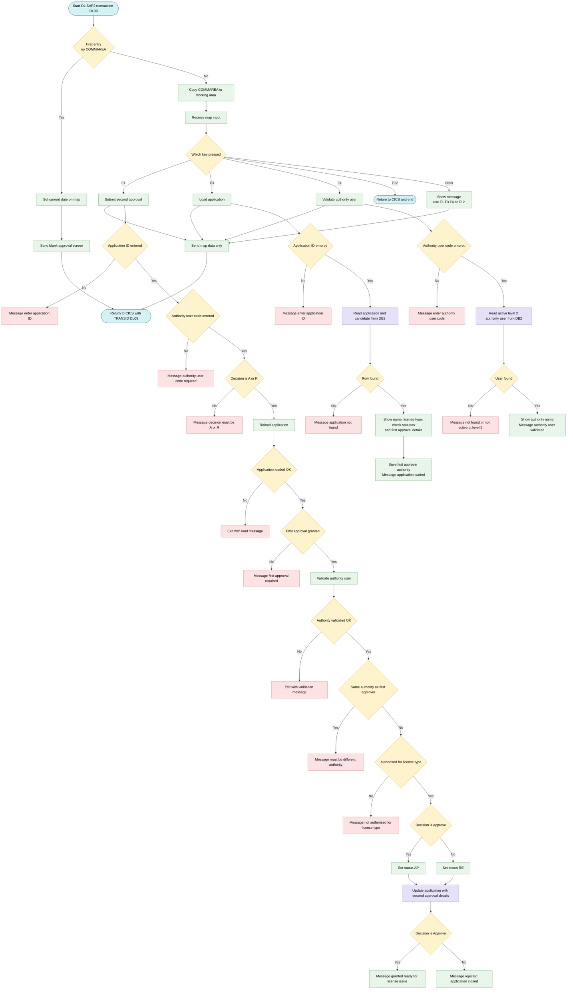
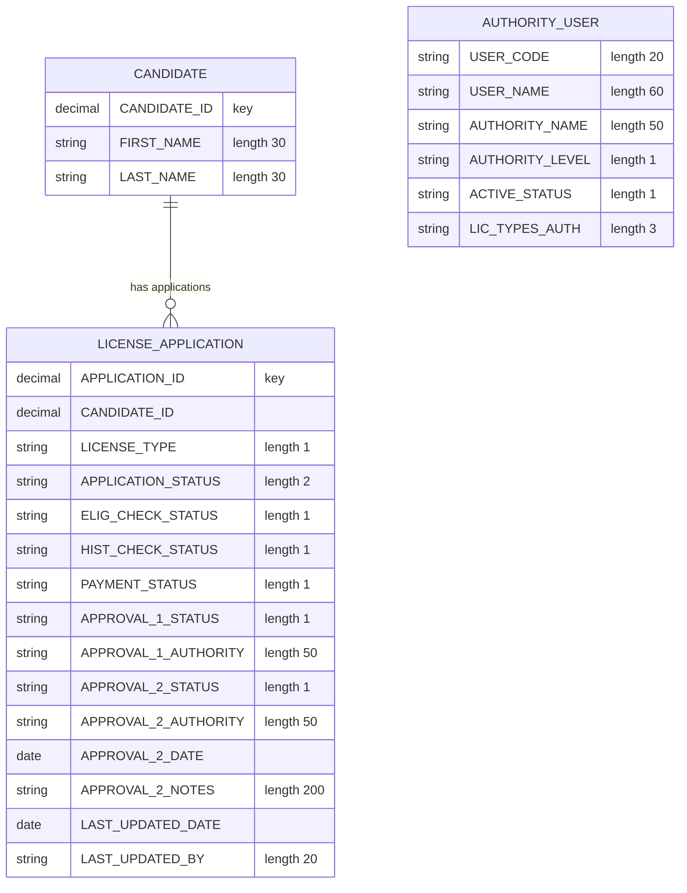

## Table of Contents

- [1. Purpose](#1-purpose)
- [2. Inputs](#2-inputs)
  - [2.1 CICS COMMAREA (Inter-Program Input)](#21-cics-commarea-inter-program-input)
  - [2.2 BMS Map Screen Input (DLISA2M01 / DLISA2)](#22-bms-map-screen-input-dlisa2m01--dlisa2)
  - [2.3 DB2 Tables (External Database)](#23-db2-tables-external-database)
- [3. Outputs](#3-outputs)
- [4. Processing Logic](#4-processing-logic)
  - [4.1 Mermaid Flow Diagram](#41-mermaid-flow-diagram)
  - [4.2 Processing Logic Description](#42-processing-logic-description)
  - [4.3 Database Tables](#43-database-tables)
- [5. Paragraphs](#5-paragraphs)
- [6. Dependencies](#6-dependencies)
  - [6.1 CICS Resources](#61-cics-resources)
  - [6.2 DB2 Tables](#62-db2-tables)
  - [6.3 DB2 Host-Variable Copybooks (DCLGEN Layouts)](#63-db2-host-variable-copybooks-dclgen-layouts)
  - [6.4 Working-Storage Copybooks](#64-working-storage-copybooks)
  - [6.5 Input Data / Screen Fields](#65-input-data--screen-fields)
  - [6.6 Business Logic / Validation Rules](#66-business-logic--validation-rules)
- [7. Constraints](#7-constraints)
  - [7.1 Input Validation Constraints](#71-input-validation-constraints)
  - [7.2 Authority User Validation Constraints](#72-authority-user-validation-constraints)
  - [7.3 Sequencing and Workflow Constraints](#73-sequencing-and-workflow-constraints)
  - [7.4 Segregation-of-Duties Constraint](#74-segregation-of-duties-constraint)
  - [7.5 Outcome and State Transition Constraints](#75-outcome-and-state-transition-constraints)
  - [7.6 User-Interface / Navigation Constraints](#76-user-interface--navigation-constraints)
  - [7.7 Database Integrity Constraints](#77-database-integrity-constraints)
- [8. Error Handling](#8-error-handling)
  - [8.1 Input validation and required-field checks](#81-input-validation-and-required-field-checks)
  - [8.2 Database "not found" handling](#82-database-not-found-handling)
  - [8.3 Business rule and workflow enforcement](#83-business-rule-and-workflow-enforcement)
  - [8.4 Control-flow based error exits](#84-control-flow-based-error-exits)
  - [8.5 User and system notifications](#85-user-and-system-notifications)
  - [8.6 Recovery and fallback logic](#86-recovery-and-fallback-logic)
  - [8.7 Gaps and limitations in error handling](#87-gaps-and-limitations-in-error-handling)
- [9. Examples](#9-examples)
  - [9.1 Example 1 — Successful Second Approval (Approve)](#91-example-1--successful-second-approval-approve)
  - [9.2 Example 2 — Rejection Due to Same Authority (Segregation-of-Duties Violation)](#92-example-2--rejection-due-to-same-authority-segregation-of-duties-violation)
  - [9.3 Example 3 — Rejection When First Approval Is Missing](#93-example-3--rejection-when-first-approval-is-missing)

## 1. Purpose

DLISAP2 is a CICS COBOL program (transaction DL09) that manages the **second-level authority approval** step in a driver's licence application workflow. It presents an interactive screen (map DLISA2M01) to an authorised reviewer, who can load an application by its ID to view the candidate's full name, licence type, eligibility and history check outcomes, payment status, and the first approver's details. The reviewer then identifies themselves via an authority user code, which the program validates against the database to confirm the user is active and holds a level-2 approval authority. Before accepting a decision, the program enforces two key controls: the second approver must belong to a **different authority** from the first approver (segregation of duties), and the approver must be authorised for the specific licence type being reviewed. Once all checks pass, the reviewer submits an approve ('A') or reject ('R') decision, which the program persists to the `LICENSE_APPLICATION` table — recording the second approval authority, date, and notes, and updating the overall application status to either 'AP' (approved and ready for licence issuance) or 'RE' (rejected and closed).

## 2. Inputs

### 2.1 CICS COMMAREA (Inter-Program Input)

- **DFHCOMMAREA** (`DLIS-COMMAREA`, 350 bytes) — passed by CICS on every pseudo-conversational re-entry; overlaid onto `DLIS-COMMAREA` to restore transaction context between interactions
  - **CA-TRANSACTION-ID** — identifies the owning transaction (`DL09`)
  - **CA-RETURN-SCREEN** — screen to return to after completion
  - **CA-APPLICATION-ID** — application identifier carried forward across screens
  - **CA-USER-ID** — CICS user ID of the signed-on operator

### 2.2 BMS Map Screen Input (DLISA2M01 / DLISA2)

Fields received from the terminal operator via `EXEC CICS RECEIVE MAP`:

- **DA2AIDI** — Application ID typed by the operator; used to look up the license application in DB2 (`LOAD-APPLICATION`, `SUBMIT-APPROVAL2`)
- **DA2AUCOI** — Authority user code typed by the operator; used to look up and validate the second-level approver (`VALIDATE-AUTHORITY`, `SUBMIT-APPROVAL2`); also written as `LAST_UPDATED_BY` in the DB2 update
- **DA2DECI** — Approval decision entered by the operator (`A` = approve, `R` = reject); drives the final application status and is stored as `APPROVAL_2_STATUS`
- **DA2DCNTI** — Decision notes entered by the operator; stored as `APPROVAL_2_NOTES` in DB2
- **EIBAID** — CICS attention identifier (PF1 / PF3 / PF4 / PF12) indicating which function key the operator pressed; controls which processing path executes

### 2.3 DB2 Tables (External Database)

- **DLIS.LICENSE_APPLICATION** — primary table queried by `APPLICATION-ID`; supplies all fields needed for the approval decision display and is updated with the second approval outcome
  - **APPLICATION-ID** — key used to SELECT and UPDATE the application row
  - **APPLICATION-STATUS** — current overall status; read on load, set to `AP` or `RE` on submission
  - **LICENSE-TYPE** — classification of the licence being applied for; displayed and checked against the approver's authorised types
  - **ELIG-CHECK-STATUS** — result of the eligibility check; displayed as context for the approver
  - **HIST-CHECK-STATUS** — result of the driving history check; displayed as context for the approver
  - **PAYMENT-STATUS** — payment state of the application; displayed as context for the approver
  - **APPROVAL-1-STATUS** — outcome of the first-level approval; must equal `A` before the second approval can be submitted (prerequisite gate)
  - **APPROVAL-1-AUTHORITY** — name of the authority that granted first approval; enforced segregation-of-duties check (second approver must differ)

- **DLIS.CANDIDATE** — joined to `LICENSE_APPLICATION` on `CANDIDATE_ID`; provides candidate identity details for display
  - **FIRST-NAME** — candidate's given name; combined with last name for on-screen display
  - **LAST-NAME** — candidate's family name; combined with first name for on-screen display

- **DLIS.AUTHORITY_USER** — queried by `USER-CODE` to validate the second-level approver
  - **USER-CODE** — look-up key supplied from the screen field `DA2AUCOI`
  - **AUTHORITY-NAME** — organisational authority of the approver; compared with `APPROVAL-1-AUTHORITY` for segregation of duties and stored as `APPROVAL_2_AUTHORITY`
  - **AUTHORITY-LEVEL** — must equal `2` for the user to qualify as a second-level approver (filter applied in the SQL WHERE clause)
  - **LIC-TYPES-AUTH** — list of licence types the authority user is permitted to approve; validated against the application's `LICENSE-TYPE`
  - **ACTIVE-STATUS** — must equal `A` (active) for the user to be accepted (filter applied in the SQL WHERE clause)

## 3. Outputs

**CICS BMS Screen (MAP `DLISA2M01` / MAPSET `DLISA2`)**

- `DA2MSG` — message field written to the BMS map on every interaction; communicates validation errors, progress, and final outcome to the operator (e.g., "APPLICATION LOADED", "SECOND APPROVAL GRANTED - READY FOR LICENSE ISSUE", "SECOND APPROVAL REJECTED - APPLICATION CLOSED", "FIRST APPROVAL MUST BE GRANTED BEFORE SECOND", "SECOND APPROVER MUST BE FROM DIFFERENT AUTHORITY", "AUTHORITY NOT AUTHORISED FOR THIS LICENSE TYPE", etc.)
- `DA2CNAMO` — candidate full name (first name + space + last name) displayed on screen after the application is loaded
- `DA2LTYO` — license type displayed on screen after the application is loaded
- `DA2ELIGO` — eligibility check status displayed on screen for the approver's context
- `DA2HISTO` — history check status displayed on screen for the approver's context
- `DA2PAYO` — payment status displayed on screen for the approver's context
- `DA2A1STO` — first approval status displayed on screen for the approver's context
- `DA2A1NMO` — first approval authority name displayed on screen, used by the operator to understand who performed the first approval
- `DA2AUNMO` — validated authority user name written to the screen after successful authority validation

**DB2 Table Update (`DLIS.LICENSE_APPLICATION`)**

Executed by the `EXEC SQL UPDATE` in `SUBMIT-APPROVAL2` when the second approval decision is submitted:

- `APPROVAL_2_STATUS` — set to the approver's decision (`A` = approve, `R` = reject); persisted as the definitive second-level approval outcome
  - Source: `WS-DECISION` (mapped from screen field `DA2DECI`)
- `APPROVAL_2_AUTHORITY` — set to the authority name of the validated second approver; records which authority performed the second approval
  - Source: `AUTHORITY-NAME` of `DCLDLIS-AUTH-USER`
- `APPROVAL_2_DATE` — set to `CURRENT DATE`; records when the second approval was completed
- `APPROVAL_2_NOTES` — set to the decision notes entered by the operator; captures any supporting remarks for the approval decision
  - Source: screen field `DA2DCNTI`
- `APPLICATION_STATUS` — updated to `'AP'` (approved) or `'RE'` (rejected) according to the second approver's decision; represents the overall resolved state of the license application
  - Source: `APPLICATION-STATUS` of `DCLDLIS-LICENSE-APPL`
- `LAST_UPDATED_DATE` — set to `CURRENT DATE`; timestamp of the most recent change to the application row
- `LAST_UPDATED_BY` — set to the authority user code entered by the operator; audit trail field recording who last changed the application row
  - Source: screen field `DA2AUCOI`

**CICS COMMAREA (`DLIS-COMMAREA`) — Pseudo-Conversational State**

- The 350-byte `DFHCOMMAREA` is returned via `EXEC CICS RETURN TRANSID('DL09') COMMAREA(DLIS-COMMAREA)` on every interaction cycle, preserving context across the pseudo-conversational transaction turns so that subsequent keystrokes (F1, F3, F4) are delivered back to this program with the correct state.

## 4. Processing Logic

### 4.1 Mermaid Flow Diagram



---

### 4.2 Processing Logic Description

**High-level Summary**

DLISAP2 is a pseudo-conversational CICS/COBOL program for transaction DL09. It uses BMS map DLISA2M01 in mapset DLISA2. It implements the second-level approval of a driving license application. An authorised level-2 approver can load an application and validate their own user code. They can then approve or reject the application. The program enforces three rules:
- The first approval must already be granted.
- The second approver must belong to a different authority than the first approver (segregation of duties).
- The approver must be authorised for the license type of the application.

On success, the program updates the application record in DB2 with the second approval details and the new overall status.

**Execution Flow**

1. **Entry (MAIN-LOGIC).**
   - If `EIBCALEN = 0`, this is the first invocation. The program runs INIT-SCREEN.
   - Otherwise, it copies `DFHCOMMAREA` into `DLIS-COMMAREA` and runs PROCESS-INPUT.
   - Control then reaches `STOP RUN`.

2. **INIT-SCREEN.**
   - It moves the current date to the map date field `DA2DATE`.
   - It sends the full map with `ERASE` and `FREEKB`.
   - It issues `EXEC CICS RETURN TRANSID('DL09')` with the COMMAREA, length 350. The next key press therefore restarts the transaction.

3. **PROCESS-INPUT.**
   - It receives the map and branches on the attention key:
     - **F1** runs SUBMIT-APPROVAL2.
     - **F3** runs LOAD-APPLICATION.
     - **F4** runs VALIDATE-AUTHORITY.
     - **F12** issues `EXEC CICS RETURN` with no TRANSID, which ends the conversation.
     - **Any other key** shows "USE F1 F3 F4 OR F12".
   - After the chosen action, it sends the map again with `DATAONLY` and `FREEKB`. It then returns with TRANSID `DL09` and the COMMAREA.

4. **LOAD-APPLICATION (F3).**
   - If the application ID is zero, it shows "ENTER APPLICATION ID" and exits.
   - Otherwise, it selects data from `LICENSE_APPLICATION` joined to `CANDIDATE` by candidate ID. The columns are license type, application status, eligibility, history and payment statuses, first approval status and authority, and the candidate's first and last name.
   - If `SQLCODE = 100`, it shows "APPLICATION NOT FOUND" and exits.
   - Otherwise, it builds the full name (first name, a space, last name) and fills the screen fields:
     - license type
     - eligibility status
     - history status
     - payment status
     - first approval status
     - first approver authority
   - It stores the first approver's authority in `WS-APPROVAL1-AUTH` for the later segregation check.
   - It sets the message "APPLICATION LOADED".

5. **VALIDATE-AUTHORITY (F4).**
   - If the user code is blank, it shows "ENTER AUTHORITY USER CODE" and exits.
   - Otherwise, it selects the user name, authority name, authority level and licensed types from `AUTHORITY_USER`. The row must have `ACTIVE_STATUS = 'A'` and `AUTHORITY_LEVEL = '2'`.
   - If `SQLCODE = 100`, it shows "AUTHORITY USER NOT FOUND OR NOT ACTIVE AT LEVEL 2" and exits.
   - Otherwise, it displays the authority name and sets "AUTHORITY USER VALIDATED".

6. **SUBMIT-APPROVAL2 (F1).** The checks run in this order. The first failure puts a message on the screen and exits without updating.
   1. The application ID must be entered.
   2. The authority user code must be entered.
   3. The decision must be `A` (approve) or `R` (reject).
   4. LOAD-APPLICATION is re-run. The message must equal "APPLICATION LOADED".
   5. `APPROVAL_1_STATUS` must be `'A'`. Otherwise the message is "FIRST APPROVAL MUST BE GRANTED BEFORE SECOND".
   6. VALIDATE-AUTHORITY is run. The message must equal "AUTHORITY USER VALIDATED".
   7. **Segregation of duties.** The approver's authority name must differ from the first approver's authority.
   8. **License type authorisation.** The application license type must be in the approver's authorised license type list.
   9. The decision is stored in `WS-DECISION`. The new application status is `AP` for approve or `RE` for reject.
   10. An `UPDATE` on `LICENSE_APPLICATION` for the application ID sets the following:
       - second approval status
       - second approval authority
       - second approval date (`CURRENT DATE`)
       - second approval notes
       - application status
       - last-updated date (`CURRENT DATE`)
       - last-updated user (the entered authority user code)
   11. The final message is either "SECOND APPROVAL GRANTED - READY FOR LICENSE ISSUE" or "SECOND APPROVAL REJECTED - APPLICATION CLOSED".

**Observations and Caveats**
- `SQLCODE` is only tested for 100. Other SQL errors are not handled explicitly, including after the `UPDATE`. A failed update could still produce a success message.
- No `COMMIT` or `SYNCPOINT` is issued. The unit of work is committed by the final `EXEC CICS RETURN`.
- The `RESP` values of the CICS calls are captured in `WS-RESP1` but never checked.
- The license type check uses the screen output field `DA2LTYO`, which LOAD-APPLICATION populates. It is tested with `NOT IN` against the authority's `LIC-TYPES-AUTH` string.
- The program header says transaction DL09, while the mapping table in AGENTS.md lists this program as DL08.

**External Interactions**
- **CICS BMS:** `SEND MAP` and `RECEIVE MAP` on `DLISA2M01` / `DLISA2`. This is the user interface.
- **CICS pseudo-conversation:** `RETURN TRANSID('DL09') COMMAREA(...)` carries state between interactions.
- **DB2 `DLIS.LICENSE_APPLICATION`:** read for application status, check statuses and first approval data. Updated with the second approval result.
- **DB2 `DLIS.CANDIDATE`:** read for the candidate's name.
- **DB2 `DLIS.AUTHORITY_USER`:** read to validate the approver (active, level 2) and to get the authority name and authorised license types.
- No MQ operations are present.

**Plain Language Summary**

This screen lets a senior officer give the final (second) sign-off on a driving license application. The officer enters the application number and their own user code. They then choose Approve or Reject. The program checks that:
- the application exists;
- the first approval was already given;
- the officer is an active senior approver;
- the officer works for a different authority from the first approver;
- the officer is allowed to approve this type of license.

If everything is in order, the program records the decision, the date and the officer. It marks the application as Approved (`AP`) or Rejected (`RE`). If any check fails, a clear message is shown and nothing is changed.

---

### 4.3 Database Tables



## 5. Paragraphs

**MAIN-LOGIC**
- Entry point of the CICS pseudo-conversational transaction DL09.
- Control flow:
  - If `EIBCALEN = 0`, this is the first invocation, so it performs INIT-SCREEN.
  - Otherwise it copies `DFHCOMMAREA` into `DLIS-COMMAREA` and performs PROCESS-INPUT.
  - It then ends with `STOP RUN`.
- No direct I/O. It only decides between the first-time and re-entry paths.

**INIT-SCREEN**
- Displays the empty Second Authority Approval screen on first entry.
- Operations:
  - Moves the first 10 characters of `CURRENT-DATE` to the screen date field `DA2DATE`.
  - Sends map `DLISA2M01` from mapset `DLISA2` with ERASE and FREEKB. The response goes to `WS-RESP1`.
  - Issues `EXEC CICS RETURN TRANSID('DL09')` with `DLIS-COMMAREA` (length 350), so the transaction restarts on the next key press.
- Control flow: sequential only. `WS-RESP1` is not checked.
- External interaction: CICS BMS terminal output and a CICS return with COMMAREA.

**PROCESS-INPUT**
- Handles each re-entry: reads the user's input and routes it by function key.
- Operations:
  - Receives map `DLISA2M01` from mapset `DLISA2`. The response goes to `WS-RESP1`.
  - Dispatches on the attention key `EIBAID` with `EVALUATE TRUE`:
    - PF1 performs SUBMIT-APPROVAL2.
    - PF3 performs LOAD-APPLICATION.
    - PF4 performs VALIDATE-AUTHORITY.
    - PF12 issues `EXEC CICS RETURN` with no TRANSID, which ends the conversation.
    - Any other key sets `DA2MSG` to 'USE F1 F3 F4 OR F12'.
  - Re-sends the map with DATAONLY and FREEKB, so only the changed data is sent.
  - Issues `EXEC CICS RETURN TRANSID('DL09')` with the COMMAREA to continue the pseudo-conversation.
- Control flow: multi-way EVALUATE, with PF12 as an early termination path.
- External interaction: CICS BMS RECEIVE MAP and SEND MAP, and CICS RETURN. The called paragraphs access DB2.

**LOAD-APPLICATION**
- Loads an application and its candidate details onto the screen (PF3). SUBMIT-APPROVAL2 also reuses it.
- Operations:
  - Validates that the application ID `DA2AIDI` is not zero. Otherwise it sets 'ENTER APPLICATION ID' and jumps to LOAD-APP-EXIT.
  - Moves `DA2AIDI` to `APPLICATION-ID` of `DCLDLIS-LICENSE-APPL`.
  - Runs a DB2 SELECT joining `DLIS.LICENSE_APPLICATION` and `DLIS.CANDIDATE`. It retrieves:
    - `LICENSE-TYPE`
    - `APPLICATION-STATUS`
    - `ELIG-CHECK-STATUS`
    - `HIST-CHECK-STATUS`
    - `PAYMENT-STATUS`
    - `APPROVAL-1-STATUS`
    - `APPROVAL-1-AUTHORITY`
    - `FIRST-NAME`
    - `LAST-NAME`
  - If `SQLCODE = 100`, it sets 'APPLICATION NOT FOUND' and exits. Other SQL errors are not checked.
  - Builds the candidate full name with STRING (first name, a space, last name) into `DA2CNAMO`.
  - Moves license type, eligibility, history, payment and first-approval status, and first-approval authority to the output screen fields (`DA2LTYO`, `DA2ELIGO`, `DA2HISTO`, `DA2PAYO`, `DA2A1STO`, `DA2A1NMO`).
  - Saves the first approver's authority in `WS-APPROVAL1-AUTH` for the segregation check.
  - Sets the message 'APPLICATION LOADED'.
- Control flow: two validation or not-found guards that jump to the exit with `GO TO`.
- External interaction: DB2 read (join of application and candidate tables).

**LOAD-APP-EXIT**
- Exit point for LOAD-APPLICATION. It contains only `EXIT` and is the target of the early `GO TO` statements.

**VALIDATE-AUTHORITY**
- Validates the authority user as an active level-2 approver (PF4). SUBMIT-APPROVAL2 also reuses it.
- Operations:
  - Checks that the user code `DA2AUCOI` is not blank. Otherwise it sets 'ENTER AUTHORITY USER CODE' and exits.
  - Moves the code to `USER-CODE` of `DCLDLIS-AUTH-USER`.
  - Runs a DB2 SELECT on `DLIS.AUTHORITY_USER` for the user code, requiring `ACTIVE_STATUS = 'A'` and `AUTHORITY_LEVEL = '2'`. It retrieves `USER-NAME`, `AUTHORITY-NAME`, `AUTHORITY-LEVEL` and `LIC-TYPES-AUTH`.
  - If `SQLCODE = 100`, it sets 'AUTHORITY USER NOT FOUND OR NOT ACTIVE AT LEVEL 2' and exits.
  - On success, it displays the authority name in `DA2AUNMO` and sets 'AUTHORITY USER VALIDATED'.
- Control flow: two guard conditions that jump to VALIDATE-AUTH-EXIT.
- External interaction: DB2 read of the authority user table.

**VALIDATE-AUTH-EXIT**
- Exit point for VALIDATE-AUTHORITY. It contains only `EXIT`.

**SUBMIT-APPROVAL2**
- Core business paragraph (PF1). It records the second approval or rejection of the application.
- Operations:
  - Input validation, each failure setting a message and jumping to SUBMIT-A2-EXIT:
    - The application ID must be present.
    - The authority user code must be present.
    - The decision `DA2DECI` must be 'A' or 'R'.
  - Performs LOAD-APPLICATION, and exits unless the message is 'APPLICATION LOADED'.
  - Checks that `APPROVAL-1-STATUS` is 'A'. Otherwise it sets 'FIRST APPROVAL MUST BE GRANTED BEFORE SECOND' and exits.
  - Performs VALIDATE-AUTHORITY, and exits unless the message is 'AUTHORITY USER VALIDATED'.
  - Segregation of duties: the second approver's `AUTHORITY-NAME` must differ from `WS-APPROVAL1-AUTH`. Otherwise it sets 'SECOND APPROVER MUST BE FROM DIFFERENT AUTHORITY' and exits.
  - License type authorisation: the license type `DA2LTYO` must appear in `LIC-TYPES-AUTH`. Otherwise it sets 'AUTHORITY NOT AUTHORISED FOR THIS LICENSE TYPE' and exits.
  - Moves the decision to `WS-DECISION` and sets `APPLICATION-STATUS` to 'AP' if approved or 'RE' if rejected.
  - Runs a DB2 UPDATE on `DLIS.LICENSE_APPLICATION` for the application ID. It sets:
    - `APPROVAL_2_STATUS`
    - `APPROVAL_2_AUTHORITY`
    - `APPROVAL_2_DATE` (the current date)
    - `APPROVAL_2_NOTES` (from `DA2DCNTI`)
    - `APPLICATION_STATUS`
    - `LAST_UPDATED_DATE` (the current date)
    - `LAST_UPDATED_BY` (the user code)
  - Sets the final message: 'SECOND APPROVAL GRANTED - READY FOR LICENSE ISSUE' for approval, or 'SECOND APPROVAL REJECTED - APPLICATION CLOSED' for rejection.
- Control flow: a chain of sequential guard checks with `GO TO` exits, nested PERFORMs of LOAD-APPLICATION and VALIDATE-AUTHORITY, and IF/ELSE branches on the decision. The SQLCODE of the UPDATE is not checked, and there is no explicit commit or rollback.
- External interaction: DB2 reads (through the performed paragraphs) and a DB2 update of the application record.

**SUBMIT-A2-EXIT**
- Exit point for SUBMIT-APPROVAL2. It contains only `EXIT`.

## 6. Dependencies

### 6.1 CICS Resources

- **Transaction `DL09`** — the CICS transaction identifier under which this program executes; used in every `EXEC CICS RETURN TRANSID` call to maintain pseudo-conversational flow
- **BMS Map `DLISA2M01` / Mapset `DLISA2`** — the BMS screen definition used for all map send and receive operations; drives the Second Authority Approval screen layout
- **CICS COMMAREA (`DFHCOMMAREA`, 350 bytes)** — the inter-transaction communication area passed between pseudo-conversational cycles; mapped to `DLIS-COMMAREA` to carry transaction ID, candidate/application/payment IDs, user ID, return codes, and messages
- **CICS EIB fields** — `EIBCALEN` (determines first-time vs. returning entry), `EIBAID` (identifies the PF key pressed: PF1, PF3, PF4, PF12), `EIBRESP` (captured in `WS-RESP1` for error handling)

---

### 6.2 DB2 Tables

- **`DLIS.LICENSE_APPLICATION`** — central application table; queried with a JOIN to retrieve license type, application status, eligibility/history/payment check statuses, and first-approval data; updated with the second-approval decision, authority, date, notes, and revised application status
- **`DLIS.CANDIDATE`** — candidate personal data table; joined to `LICENSE_APPLICATION` to retrieve the candidate's first and last name for display on screen
- **`DLIS.AUTHORITY_USER`** — authority user registry; queried to validate that the entered user code belongs to an active, level-2 approver and to retrieve their name, authority name, and authorised licence types

---

### 6.3 DB2 Host-Variable Copybooks (DCLGEN Layouts)

- **`DLISDCLG`** (expanded inline) — container copybook that includes all DCLGEN host-variable group items:
  - **`DCLDLIS-CANDIDATE`** (`DLISCAND`) — host variables for the `DLIS.CANDIDATE` table (`FIRST-NAME`, `LAST-NAME`, `CANDIDATE-ID`, etc.)
  - **`DCLDLIS-LICENSE-APPL`** (`DLISAPPL`) — host variables for the `DLIS.LICENSE_APPLICATION` table (`APPLICATION-ID`, `APPLICATION-STATUS`, `LICENSE-TYPE`, approval fields, check statuses, payment status, etc.)
  - **`DCLDLIS-DRIVING-HIST`** (`DLISHIST`) — host variables for the `DLIS.DRIVING_HISTORY` table (declared but not directly queried in this program)
  - **`DCLDLIS-PAYMENT`** (`DLISPAY`) — host variables for the payment table (declared but not directly queried in this program)
  - **`DCLDLIS-ISSUED-LIC`** (`DLISLIC`) — host variables for the issued licence table (declared but not directly queried in this program)
  - **`DCLDLIS-AUTH-USER`** (`DLISAUTH`) — host variables for the `DLIS.AUTHORITY_USER` table (`USER-CODE`, `USER-NAME`, `AUTHORITY-NAME`, `AUTHORITY-LEVEL`, `LIC-TYPES-AUTH`, `ACTIVE-STATUS`)
  - **`DCLDLIS-FEE-SCHED`** (`DLISFEE`) — host variables for the fee schedule table (declared but not directly queried in this program)
- **`SQLCA`** (included twice via `EXEC SQL INCLUDE SQLCA`) — DB2 SQL Communication Area; `SQLCODE` is checked after every SQL statement to detect not-found (100) conditions

---

### 6.4 Working-Storage Copybooks

- **`DLISWS`** — common working-storage copybook providing shared areas across all DLIS programs:
  - `WS-COMMON-AREA` — return code, message text, user ID, current date
  - `WS-CANDIDATE` — candidate data work fields
  - `WS-APPLICATION` — application status work fields
  - `WS-PAYMENT` — payment work fields
  - `WS-ELIGIBILITY` — eligibility check work fields
  - `WS-HISTORY` — history check work fields
  - `WS-APPROVAL` — approval work fields including `WS-DECISION` and `WS-AUTH-NAME`
  - `WS-LICENSE` — licence issuance work fields
  - `WS-NULL-INDICATORS` — DB2 null indicators for optional columns
- **`DLISCSEC`** — CICS COMMAREA layout copybook providing structured overlays:
  - `DLIS-COMMAREA` — main navigation commarea (transaction ID, IDs, user ID, return code, message)
  - `DLIS-CAND-COMMAREA` — candidate screen data commarea layout
  - `DLIS-APPL-COMMAREA` — application status data commarea layout
  - `WS-CICS-RESPONSE` — CICS response code fields (`WS-RESP1`, `WS-RESP2`)

---

### 6.5 Input Data / Screen Fields

- **`DA2AIDI`** — screen input field carrying the Application ID entered by the user
- **`DA2AUCOI`** — screen input field carrying the Authority User Code entered by the user
- **`DA2DECI`** — screen input field carrying the approver's decision (`A` = Approve, `R` = Reject)
- **`DA2DCNTI`** — screen input field carrying the approver's decision notes/comments
- **`DA2LTYO`** — screen output field displaying the licence type of the loaded application
- **`DA2CNAMO`** — screen output field displaying the candidate's full name
- **`DA2ELIGO`, `DA2HISTO`, `DA2PAYO`** — screen output fields displaying eligibility, history, and payment check statuses
- **`DA2A1STO`, `DA2A1NMO`** — screen output fields displaying the first-approval status and authority name
- **`DA2AUNMO`** — screen output field displaying the validated authority user's name
- **`DA2MSG`** — screen message field used for all operator feedback and error messages
- **`DA2DATE`** — screen output field displaying the current date on the initial screen

---

### 6.6 Business Logic / Validation Rules

- **First-approval prerequisite** — `APPROVAL-1-STATUS` must equal `'A'` before a second approval can be submitted; enforced internally within `SUBMIT-APPROVAL2`
- **Segregation-of-duties check** — `AUTHORITY-NAME` of the second approver must differ from `WS-APPROVAL1-AUTH` (the first approver's authority); enforced internally
- **Licence-type authorisation check** — the displayed licence type (`DA2LTYO`) must appear within `LIC-TYPES-AUTH` of the authority user record; enforced internally
- **Active level-2 approver requirement** — the SQL query against `DLIS.AUTHORITY_USER` filters by `ACTIVE_STATUS = 'A'` and `AUTHORITY_LEVEL = '2'`; no external service is called

## 7. Constraints

### 7.1 Input Validation Constraints

- **Application ID must be non-zero before any action**
  - Enforced in both `LOAD-APPLICATION` and `SUBMIT-APPROVAL2`: if `DA2AIDI = ZEROS`, processing halts with the message `'ENTER APPLICATION ID'` and exits the paragraph via `GO TO`
- **Authority user code must not be blank**
  - Enforced in `VALIDATE-AUTHORITY` and `SUBMIT-APPROVAL2`: if `DA2AUCOI = SPACES`, processing halts with `'ENTER AUTHORITY USER CODE IS REQUIRED'`
- **Decision field must be supplied and must equal `'A'` or `'R'`**
  - Enforced in `SUBMIT-APPROVAL2`: `IF DA2DECI = SPACES OR DA2DECI NOT IN ('A','R')` causes an immediate exit with the message `'DECISION MUST BE A=APPROVE OR R=REJECT'`; any other value is rejected
- **Application must exist in the database**
  - After the `SELECT` in `LOAD-APPLICATION`, `SQLCODE = 100` (not found) causes an exit with `'APPLICATION NOT FOUND'`; the calling paragraph in `SUBMIT-APPROVAL2` then checks whether `DA2MSG = 'APPLICATION LOADED'` before continuing

---

### 7.2 Authority User Validation Constraints

- **Authority user must exist and be active**
  - The `SELECT` in `VALIDATE-AUTHORITY` filters on `ACTIVE_STATUS = 'A'`; an `SQLCODE = 100` result causes an exit with `'AUTHORITY USER NOT FOUND OR NOT ACTIVE AT LEVEL 2'`
- **Authority user must hold approval level `'2'`**
  - The same `SELECT` also filters on `AUTHORITY_LEVEL = '2'`; users at any other level are rejected by the same `SQLCODE = 100` check
- **Authority user must be authorised for the application's license type**
  - After validation, `SUBMIT-APPROVAL2` checks `DA2LTYO NOT IN LIC-TYPES-AUTH OF DCLDLIS-AUTH-USER`; a mismatch causes an exit with `'AUTHORITY NOT AUTHORISED FOR THIS LICENSE TYPE'`

---

### 7.3 Sequencing and Workflow Constraints

- **First approval must be granted before second approval can be submitted**
  - In `SUBMIT-APPROVAL2`, after loading the application the code checks `APPROVAL-1-STATUS OF DCLDLIS-LICENSE-APPL NOT = 'A'`; any value other than `'A'` halts with `'FIRST APPROVAL MUST BE GRANTED BEFORE SECOND'`
- **`LOAD-APPLICATION` and `VALIDATE-AUTHORITY` must succeed before the decision is recorded**
  - `SUBMIT-APPROVAL2` performs `LOAD-APPLICATION`, then tests `DA2MSG = 'APPLICATION LOADED'` as a guard; it then performs `VALIDATE-AUTHORITY` and tests `DA2MSG = 'AUTHORITY USER VALIDATED'` before proceeding; failure at either step causes an immediate exit

---

### 7.4 Segregation-of-Duties Constraint

- **The second approver must belong to a different authority than the first approver**
  - `WS-APPROVAL1-AUTH` is populated in `LOAD-APPLICATION` from `APPROVAL-1-AUTHORITY OF DCLDLIS-LICENSE-APPL`
  - In `SUBMIT-APPROVAL2`, `AUTHORITY-NAME OF DCLDLIS-AUTH-USER = WS-APPROVAL1-AUTH` triggers an exit with `'SECOND APPROVER MUST BE FROM DIFFERENT AUTHORITY'`; the second approval is only accepted when the two authority names differ

---

### 7.5 Outcome and State Transition Constraints

- **Decision `'A'` sets application status to `'AP'`; decision `'R'` sets it to `'RE'`**
  - Enforced by the `IF WS-DECISION = 'A'` branch in `SUBMIT-APPROVAL2`, which MOVEs `'AP'` or `'RE'` into `APPLICATION-STATUS OF DCLDLIS-LICENSE-APPL` before the `UPDATE`
- **Only the two outcome values (`'AP'` / `'RE'`) can result from this program**
  - Because the only accepted input values are `'A'` and `'R'` (validated at entry), and the mapping from input to status is exhaustive (`ELSE` covers `'R'`), no other application status value can be written by this program

---

### 7.6 User-Interface / Navigation Constraints

- **Only four function keys are recognised; all others are rejected**
  - The `EVALUATE TRUE` in `PROCESS-INPUT` accepts `DFHPF1` (Submit), `DFHPF3` (Load App), `DFHPF4` (Validate Auth), and `DFHPF12` (Exit); any other AID key falls to the `OTHER` branch, which sets the message `'USE F1 F3 F4 OR F12'` without performing any processing
- **The program operates pseudo-conversationally; state is preserved only via the COMMAREA**
  - On every CICS return the program issues `EXEC CICS RETURN TRANSID('DL09') COMMAREA(DLIS-COMMAREA) LENGTH(350)`; `EIBCALEN = 0` on the first entry triggers `INIT-SCREEN`, and all subsequent entries go through `PROCESS-INPUT`
- **The COMMAREA is fixed at 350 bytes**
  - The `DFHCOMMAREA` linkage item is declared `PIC X(350)`, and `LENGTH(350)` is specified on every `EXEC CICS RETURN`; data exchanged between conversation turns is limited to this size

---

### 7.7 Database Integrity Constraints

- **The `UPDATE` is unconditional once all business rules pass**
  - No explicit `SQLCODE` check is performed after the `UPDATE` in `SUBMIT-APPROVAL2`; any SQL error is left unhandled and will propagate as an unhandled DB2 exception (abend) rather than producing a user message
- **`LAST_UPDATED_BY` is set to the authority user code supplied on the screen (`DA2AUCOI`), not to the CICS signed-on user ID**
  - This means the audit trail in the database records the authority user code, and there is no cross-check between the CICS user ID and the supplied code

## 8. Error Handling

### 8.1 Input validation and required-field checks
- Each action validates its input before it touches the database. Failures put a message in the screen message field, and the paragraph jumps to its exit.
  - Load application: a zero application ID gives "ENTER APPLICATION ID".
  - Validate authority: blank authority user code gives "ENTER AUTHORITY USER CODE".
  - Submit second approval:
    - A missing application ID gives "ENTER APPLICATION ID".
    - A blank authority user code gives "AUTHORITY USER CODE IS REQUIRED".
    - A decision that is blank or anything other than A or R gives "DECISION MUST BE A=APPROVE OR R=REJECT".
- An unrecognised attention key (not F1, F3, F4 or F12) falls to the default branch of the key evaluation. That branch shows "USE F1 F3 F4 OR F12" and does no processing.

### 8.2 Database "not found" handling
- Application lookup (join of application and candidate): SQLCODE 100 gives "APPLICATION NOT FOUND", and processing exits without populating the screen fields.
- Authority user lookup: the query accepts only active users at authority level 2. SQLCODE 100 gives "AUTHORITY USER NOT FOUND OR NOT ACTIVE AT LEVEL 2", and the paragraph exits.
  - Inactive users and users at the wrong level are rejected by the query's filter conditions. There is no separate error branch for them.

### 8.3 Business rule and workflow enforcement
- Prerequisite check: the second approval is refused unless the first approval status is 'A'. The message is "FIRST APPROVAL MUST BE GRANTED BEFORE SECOND".
- Segregation of duties: the second approver's authority name is compared with the first approval's authority. If they match, the submission is rejected with "SECOND APPROVER MUST BE FROM DIFFERENT AUTHORITY".
- License type authorisation: the application's license type must appear in the approver's list of authorised license types. Otherwise the message is "AUTHORITY NOT AUTHORISED FOR THIS LICENSE TYPE".
- Sequential gate checks: the submit routine reuses the load and validate routines and then tests the message text they leave behind.
  - If the message is not "APPLICATION LOADED" after the load, submission stops.
  - If the message is not "AUTHORITY USER VALIDATED" after the validation, submission stops.
  - Each failure therefore stops the flow and shows the earlier routine's message unchanged.

### 8.4 Control-flow based error exits
- The program uses GO TO to a dedicated exit paragraph (load exit, validate exit, submit exit) as its early-termination path.
  - Once an error message is set, no further validation or update logic runs.
- Only one message is shown at a time. The first failing check wins.

### 8.5 User and system notifications
- All user-facing feedback goes through one message field on the BMS map. The same field carries both error and success text.
  - Error messages are described in the sections above.
  - Success messages are "APPLICATION LOADED", "AUTHORITY USER VALIDATED", "SECOND APPROVAL GRANTED - READY FOR LICENSE ISSUE" and "SECOND APPROVAL REJECTED - APPLICATION CLOSED".
- The map is re-sent with the message after every action (data-only send with keyboard freed), so the user sees the outcome straight away.
- The program uses a pseudo-conversational pattern. It returns to transaction DL09 with the commarea after each interaction. This returns control cleanly to CICS and does not leave a failed state open.
- F12 ends the transaction with a plain CICS return.

### 8.6 Recovery and fallback logic
- The default branch for invalid attention keys re-displays the screen with guidance instead of failing.
- Every validation failure leaves the screen available for correction and resubmission. There is no retry loop, alternate data source or default-value substitution.
- The application's first-approval authority is re-read from the database on each submit, so the segregation check does not depend on earlier screen state.

### 8.7 Gaps and limitations in error handling
- Only SQLCODE 100 is tested. Negative SQLCODEs (deadlock, timeout, authorisation or connection problems) are not detected on either SELECT, so a database failure could proceed as if it had succeeded.
- The UPDATE that records the second approval has no SQLCODE check. The success message ("granted" or "rejected") is shown whatever the update result, including when no row was updated or an SQL error occurred.
- The RESP values for the CICS SEND and RECEIVE commands are captured in a response field but never examined. Map failures such as MAPFAIL, or terminal errors, are not handled.
- The program has no HANDLE CONDITION or HANDLE ABEND logic, no ABEND call, no explicit commit or rollback, and no logging to a queue, file or other audit destination.
- The SQL communication area and the shared return code and message fields from the common copybook are declared but not used. Error reporting relies only on the screen message field.

## 9. Examples

### 9.1 Example 1 — Successful Second Approval (Approve)

**Scenario:** An authority user from a different body than the first approver grants the second approval for a standard car license application.

**Input Data:**
| Screen Field | Value | Description |
|---|---|---|
| `DA2AIDI` (Application ID) | `1001` | Existing application in the database |
| `DA2AUCOI` (Authority User Code) | `AUTH002` | Level-2 active authority user |
| `DA2DECI` (Decision) | `A` | Approve |
| `DA2DCNTI` (Decision Notes) | `All checks clear` | Optional notes |

**Database state before submission:**
- Application `1001`: `APPROVAL_1_STATUS = 'A'`, `APPROVAL_1_AUTHORITY = 'City Transport Authority'`, `APPLICATION_STATUS = 'A1'`
- Authority user `AUTH002`: `AUTHORITY_LEVEL = '2'`, `ACTIVE_STATUS = 'A'`, `AUTHORITY_NAME = 'State Roads Authority'`, `LIC_TYPES_AUTH = 'CAB'`
- License type on the application: `C`

**Steps triggered (F3 → F4 → F1):**
1. **F3 (Load Application):** Fetches application `1001` and displays candidate name, license type `C`, eligibility/history/payment statuses, and the first approver's authority (`City Transport Authority`).
2. **F4 (Validate Authority):** Looks up `AUTH002`, confirms level-2 active status, and displays the authority name `State Roads Authority`.
3. **F1 (Submit):** Runs all guards in sequence, then executes the `UPDATE`.

**Expected Output / Screen Message:**
```
SECOND APPROVAL GRANTED - READY FOR LICENSE ISSUE
```

**Database change:**
- `APPROVAL_2_STATUS = 'A'`, `APPROVAL_2_AUTHORITY = 'State Roads Authority'`, `APPLICATION_STATUS = 'AP'`, `LAST_UPDATED_BY = 'AUTH002'`

**How the input leads to the output:**
- First approval is already `'A'` → prerequisite passes.
- `AUTH002`'s authority (`State Roads Authority`) differs from the first approver's (`City Transport Authority`) → segregation-of-duties check passes.
- License type `C` is within `AUTH002`'s authorized types (`'CAB'` contains `'C'`) → authorization check passes.
- Decision `'A'` sets `APPLICATION-STATUS` to `'AP'` and triggers the approval success message.

---

### 9.2 Example 2 — Rejection Due to Same Authority (Segregation-of-Duties Violation)

**Scenario:** The second approver belongs to the same authority as the first approver.

**Input Data:**
| Screen Field | Value | Description |
|---|---|---|
| `DA2AIDI` (Application ID) | `1002` | Existing application with first approval granted |
| `DA2AUCOI` (Authority User Code) | `AUTH003` | Level-2 active user from the same authority |
| `DA2DECI` (Decision) | `A` | Approve |

**Database state:**
- Application `1002`: `APPROVAL_1_STATUS = 'A'`, `APPROVAL_1_AUTHORITY = 'City Transport Authority'`
- Authority user `AUTH003`: `AUTHORITY_LEVEL = '2'`, `ACTIVE_STATUS = 'A'`, `AUTHORITY_NAME = 'City Transport Authority'`

**Expected Output / Screen Message:**
```
SECOND APPROVER MUST BE FROM DIFFERENT AUTHORITY
```

**How the input leads to the output:**
- After loading the application and validating the authority user, the program compares `AUTHORITY-NAME` of `AUTH003` (`City Transport Authority`) against `WS-APPROVAL1-AUTH` (`City Transport Authority`).
- They are equal, so the segregation-of-duties guard triggers and the submission is rejected before any `UPDATE` is issued.
- No database changes are made.

---

### 9.3 Example 3 — Rejection When First Approval Is Missing

**Scenario:** A user attempts to submit the second approval, but the first approval has not yet been granted.

**Input Data:**
| Screen Field | Value | Description |
|---|---|---|
| `DA2AIDI` (Application ID) | `1003` | Application with no first approval yet |
| `DA2AUCOI` (Authority User Code) | `AUTH004` | Valid level-2 authority user |
| `DA2DECI` (Decision) | `A` | Approve |

**Database state:**
- Application `1003`: `APPROVAL_1_STATUS = ' '` (blank / not approved)

**Expected Output / Screen Message:**
```
FIRST APPROVAL MUST BE GRANTED BEFORE SECOND
```

**How the input leads to the output:**
- After loading the application, the program checks `APPROVAL-1-STATUS`. Because it is not `'A'`, the guard condition fires immediately, sets the error message, and exits `SUBMIT-APPROVAL2` via `GO TO SUBMIT-A2-EXIT` without proceeding to authority validation or the database update.

---

Generated by IBM Bob Premium Package for Z
