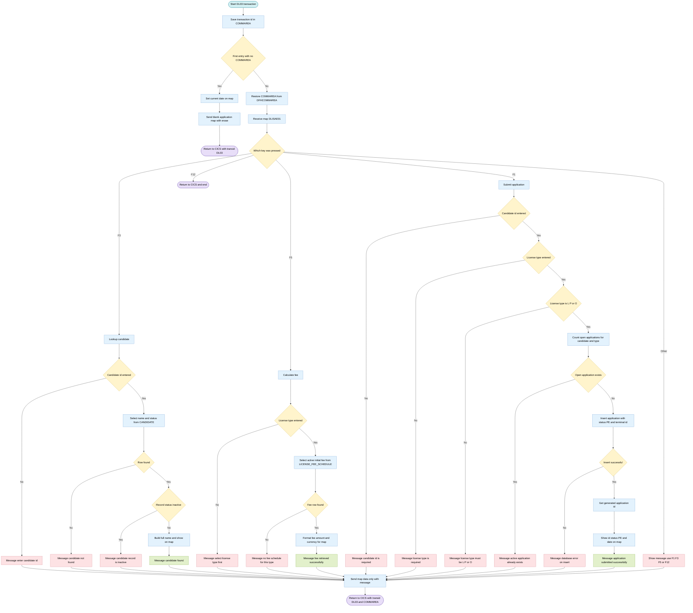
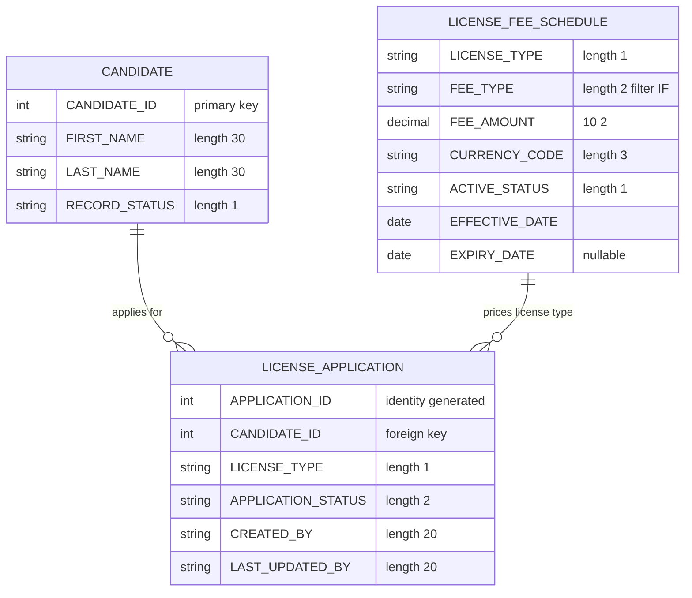

## Table of Contents

- [1. Purpose](#1-purpose)
- [2. Inputs](#2-inputs)
- [3. Outputs](#3-outputs)
- [4. Processing Logic](#4-processing-logic)
  - [4.1 Mermaid Flow Diagram](#41-mermaid-flow-diagram)
  - [4.2 Processing Logic Description](#42-processing-logic-description)
  - [4.3 Database Tables](#43-database-tables)
- [5. Paragraphs](#5-paragraphs)
- [6. Dependencies](#6-dependencies)
  - [6.1 Database Dependencies (IBM Db2)](#61-database-dependencies-ibm-db2)
  - [6.2 CICS System & Middleware Dependencies](#62-cics-system--middleware-dependencies)
  - [6.3 Copybook & Data Structure Dependencies](#63-copybook--data-structure-dependencies)
  - [6.4 Input Parameters & Interface Interfaces](#64-input-parameters--interface-interfaces)
- [7. Constraints](#7-constraints)
- [8. Error Handling](#8-error-handling)
- [9. Examples](#9-examples)

## 1. Purpose

DLISAPPL is a CICS transaction (DL03) that gives clerks a License Application Entry screen in a driver license information system. From this screen, an operator can look up a candidate by ID and check that the candidate exists and is active. The operator can also retrieve the current initial-issue fee and currency for a chosen license type from the fee schedule. Finally, the operator can submit a new license application for that candidate. Before submitting, the program checks that a candidate ID and a valid license type (L, P or O) were entered. It also checks that the candidate has no other open application of the same type. If the checks pass, it records the application as pending, tagged with the submitting terminal, and shows the new application ID, status and date on the screen. The program keeps the conversation going across screen interactions and ends the session on the exit key.

## 2. Inputs

- **CICS pseudo-conversational context**
  - `DFHCOMMAREA` (linkage section, 350 bytes)
    - Holds the communication area passed back by the previous `EXEC CICS RETURN TRANSID('DL03') COMMAREA(...)`.
    - It is copied into `DLIS-COMMAREA` to restore conversational state.
    - It is only read when `EIBCALEN` is not 0.
  - `EIBCALEN`
    - The length of the communication area passed in.
    - A value of 0 means first entry, so the program sends the blank entry screen.
    - Any other value means a reply to the screen, so the program processes the user's input.
  - `EIBTRNID`
    - The current transaction ID (`DL03`).
    - It is stored in `CA-TRANSACTION-ID` in the communication area.
  - `EIBTRMID`
    - The ID of the terminal that submitted the request.
    - It is used as the created-by and last-updated-by value when a new license application is inserted.
  - `EIBAID`
    - The attention identifier of the key the user pressed.
    - It selects the action:
      - F1 submits the application.
      - F3 looks up the candidate.
      - F5 calculates the fee.
      - F12 exits.
      - Any other key produces a "USE F1 F3 F5 OR F12" message.

- **User inputs (BMS map `DLISAE01` in mapset `DLISAE`, received with `EXEC CICS RECEIVE MAP`)**
  - `DAECIDI` (Candidate ID, numeric, unprotected field)
    - The candidate the user is working with.
    - It must be non-zero for lookup (F3) and submit (F1).
    - It is moved to `CANDIDATE-ID` for the candidate query, the duplicate-application check and the application insert.
  - `DAELTYPI` (License Type, 1 character)
    - The license type the user selects.
    - It must be entered for fee calculation (F5) and submit (F1).
    - On submit it must be `L` (Learner), `P` (Probation) or `O` (Open).
    - It is used as `LICENSE-TYPE` in the fee schedule lookup, the duplicate-application check and the application insert.
  - Keyboard function keys (F1, F3, F5, F12)
    - These are user inputs that choose the operation (see `EIBAID` above).

- **External data sources (DB2 tables read by the program)**
  - `DLIS.CANDIDATE`
    - Read in the F3 lookup, keyed by the candidate ID entered on screen.
    - It supplies the candidate's `FIRST_NAME`, `LAST_NAME` and `RECORD_STATUS`.
    - These are used to confirm the candidate exists and is not inactive (`I`), and to show the candidate's name.
  - `DLIS.LICENSE_FEE_SCHEDULE`
    - Read in the F5 fee calculation.
    - It is filtered by the license type entered, a fee type of `IF`, an active status of `A`, and the current effective and expiry dates.
    - It supplies `FEE_AMOUNT` and `CURRENCY_CODE`, which are shown on the screen.
  - `DLIS.LICENSE_APPLICATION`
    - Counted on submit to find existing applications for the same candidate and license type.
    - Applications with status `RE` or `IS` are excluded from the count.
    - A non-zero count blocks the new application.
    - After the insert, the generated application ID is read back with `IDENTITY_VAL_LOCAL()` from `SYSIBM.SYSDUMMY1`.

- **System-supplied values**
  - Current system date (`CURRENT-DATE`, first 10 characters)
    - Shown as the screen date when the screen is first displayed.
    - Shown as the application date after a successful submit.
  - `CURRENT DATE` (DB2 special register)
    - Used to select the fee schedule row that is in effect.

## 3. Outputs

- **Screen output (CICS BMS map DLISAE01, mapset DLISAE, transaction DL03)**
  - The program sends the map with `EXEC CICS SEND MAP`. It uses ERASE on first entry and DATAONLY on later interactions.
  - Message line
    - `DAEMSG` is the main user-facing status message. Its value depends on the PF key pressed and the result of the operation.
    - Prompts and validation messages:
      - "USE F1 F3 F5 OR F12"
      - "ENTER CANDIDATE ID"
      - "SELECT LICENSE TYPE FIRST"
      - "CANDIDATE ID IS REQUIRED"
      - "LICENSE TYPE IS REQUIRED"
      - "LICENSE TYPE MUST BE L P OR O"
    - Candidate lookup messages:
      - "CANDIDATE NOT FOUND"
      - "CANDIDATE RECORD IS INACTIVE"
      - "CANDIDATE FOUND"
    - Fee calculation messages:
      - "NO FEE SCHEDULE FOR THIS LICENSE TYPE"
      - "FEE RETRIEVED SUCCESSFULLY"
    - Submission messages:
      - "ACTIVE APPLICATION ALREADY EXISTS FOR THIS TYPE"
      - "DATABASE ERROR ON APPLICATION INSERT"
      - "APPLICATION SUBMITTED SUCCESSFULLY"
  - Initial screen
    - `DAEDATE` shows the current date, taken from the first 10 characters of `CURRENT-DATE`. It is set only on first entry, when there is no COMMAREA.
  - Candidate lookup (F3)
    - `DAECNAMO` shows the candidate's full name. It is built by concatenating `FIRST-NAME`, a space and `LAST-NAME` from `DCLDLIS-CANDIDATE`. It is shown only when the candidate exists and is not inactive (`RECORD-STATUS` not 'I').
  - Fee calculation (F5)
    - `DAEFEEO` shows the license fee. It comes from `FEE-AMOUNT`, passed through `WS-FEE-AMOUNT` and then the edited field `WS-FEE-AMOUNT-D`.
    - `DAECURRO` shows the fee currency, taken from `CURRENCY-CODE`.
  - Application submission (F1)
    - `DAEAIDO` shows the new application ID, taken from `APPLICATION-ID` after `IDENTITY_VAL_LOCAL()`.
    - `DAEASTTO` shows the initial status 'PE' (pending).
    - `DAEADATO` shows the submission date, taken from the first 10 characters of `CURRENT-DATE`.

- **Database writes (DB2)**
  - Table `DLIS.LICENSE_APPLICATION` receives one INSERT per successful submission.
    - Inserted columns:
      - `CANDIDATE_ID`, from `CANDIDATE-ID`.
      - `LICENSE_TYPE`, from `LICENSE-TYPE`.
      - `APPLICATION_STATUS`, set to the literal 'PE'.
      - `CREATED_BY`, from `CREATED-BY`. It holds the terminal ID (`EIBTRMID`) of the submitting terminal.
      - `LAST_UPDATED_BY`, set from the same terminal ID.
    - The INSERT also supplies a creation date. That part of the statement is truncated in the source.
    - The generated application ID is read back with `IDENTITY_VAL_LOCAL()` into `APPLICATION-ID` and displayed on the screen.
    - The INSERT is not committed explicitly, so any commit happens at CICS task end.
    - If the INSERT fails (SQLCODE not 0), the program shows the database error message and does not read back an ID.
  - The program does not write to any other table. The reads of `DLIS.CANDIDATE`, `DLIS.LICENSE_FEE_SCHEDULE` and `DLIS.LICENSE_APPLICATION` only affect what is displayed or whether the insert proceeds.

- **Conversation state returned to CICS**
  - `DLIS-COMMAREA` is passed back with `EXEC CICS RETURN TRANSID('DL03') COMMAREA(...) LENGTH(350)`. This keeps the conversation going and makes the next invocation restore state from `DFHCOMMAREA`.
  - `CA-TRANSACTION-ID` is set from `EIBTRNID` and returned in the COMMAREA to carry the transaction identity forward.
  - F12 ends the transaction with `EXEC CICS RETURN` and no COMMAREA, so the conversation ends.

- **Status and response fields**
  - `WS-RESP1` holds the CICS response code from the SEND MAP and RECEIVE MAP commands. It is stored but never checked or displayed.
  - `SQLCODE` is tested after the candidate lookup, fee lookup and application insert. It selects which message is shown and whether processing continues.
  - Lookup-driven eligibility
    - `RECORD-STATUS` ('I' means inactive) decides whether candidate details are displayed.
    - `APPLICATION-ID`, used as a count host variable, decides whether a duplicate active application blocks the insert. Duplicates are counted for the same candidate and license type, excluding statuses 'RE' and 'IS'.

- **Program termination**
  - `STOP RUN` ends the program at the end of `MAIN-LOGIC`. No numeric return code is set for a caller, and no files or queues are written.

## 4. Processing Logic

### 4.1 Mermaid Flow Diagram

### 4.2 Processing Logic Description

#### 4.2.1 High-level Summary
DLISAPPL is a pseudo-conversational CICS/COBOL program for transaction DL03, the License Application Entry screen. It uses BMS map DLISAE01 in mapset DLISAE and DB2 tables in schema DLIS. Through function keys, an operator can:
- look up a candidate (F3),
- calculate the initial license fee (F5),
- submit a new license application (F1).

F12 exits the transaction. A valid submission creates a `LICENSE_APPLICATION` row with status `PE` (Pending).

#### 4.2.2 Execution Flow
1. **Entry (MAIN-LOGIC)**
   - The program copies the transaction id (`EIBTRNID`) into `CA-TRANSACTION-ID`.
   - If `EIBCALEN = 0`, this is the first invocation and the program runs INIT-SCREEN.
   - Otherwise it moves `DFHCOMMAREA` into `DLIS-COMMAREA` and runs PROCESS-INPUT.
   - `STOP RUN` is only reached as a fallback, because both paths end in `EXEC CICS RETURN`.

2. **INIT-SCREEN (first entry)**
   - It moves the first 10 characters of `CURRENT-DATE` into the map date field `DAEDATE`.
   - It sends map `DLISAE01` with `ERASE` and `FREEKB`, and stores the response in `WS-RESP1`.
   - It issues `EXEC CICS RETURN TRANSID('DL03')` with the COMMAREA (`LENGTH(350)`). The transaction restarts when the user presses a key.

3. **PROCESS-INPUT (subsequent entries)**
   - It receives map `DLISAE01`.
   - It branches on the attention key (`EIBAID`):
     - **F1** runs SUBMIT-APPLICATION.
     - **F3** runs LOOKUP-CANDIDATE.
     - **F5** runs CALC-FEE.
     - **F12** issues `EXEC CICS RETURN` with no TRANSID, which ends the conversation.
     - **Any other key** sets the message "USE F1 F3 F5 OR F12".
   - It then re-sends the map with `DATAONLY` and `FREEKB`, so only changed data is refreshed.
   - It issues `RETURN TRANSID('DL03')` with the COMMAREA.

4. **LOOKUP-CANDIDATE (F3)**
   - If the candidate id input (`DAECIDI`) is zeros, the message is "ENTER CANDIDATE ID" and the paragraph exits.
   - Otherwise it selects `FIRST_NAME`, `LAST_NAME` and `RECORD_STATUS` from `DLIS.CANDIDATE` by `CANDIDATE_ID`.
   - If `SQLCODE = 100`, the message is "CANDIDATE NOT FOUND".
   - If `RECORD_STATUS = 'I'`, the message is "CANDIDATE RECORD IS INACTIVE".
   - Otherwise it builds the full name with `STRING`: first name up to the first space, one blank, then last name up to the first space. The result goes to `DAECNAMO`, and the message is "CANDIDATE FOUND".

5. **CALC-FEE (F5)**
   - If the license type input (`DAELTYPI`) is spaces or low-values, the message is "SELECT LICENSE TYPE FIRST".
   - Otherwise it selects `FEE_AMOUNT` and `CURRENCY_CODE` from `DLIS.LICENSE_FEE_SCHEDULE` where:
     - the license type matches,
     - `FEE_TYPE = 'IF'` (initial fee),
     - `ACTIVE_STATUS = 'A'`,
     - `EFFECTIVE_DATE <= CURRENT DATE`,
     - `EXPIRY_DATE` is null or `>= CURRENT DATE`.
   - The query uses `FETCH FIRST 1 ROW ONLY`.
   - If `SQLCODE = 100`, the message is "NO FEE SCHEDULE FOR THIS LICENSE TYPE".
   - Otherwise the amount is moved to `WS-FEE-AMOUNT`, then to the edited field `WS-FEE-AMOUNT-D` (picture `ZZZ,ZZ9.99`), then to the map field `DAEFEEO`. The currency goes to `DAECURRO`, and the message is "FEE RETRIEVED SUCCESSFULLY".

6. **SUBMIT-APPLICATION (F1)**
   - **Validations, in order:**
     - Candidate id must not be zeros: "CANDIDATE ID IS REQUIRED".
     - License type must not be blank or low-values: "LICENSE TYPE IS REQUIRED".
     - License type must be `L`, `P` or `O`: "LICENSE TYPE MUST BE L P OR O".
   - **Duplicate check:**
     - It counts rows in `DLIS.LICENSE_APPLICATION` for the same candidate and license type whose `APPLICATION_STATUS` is not `RE` (rejected) or `IS` (issued).
     - If the count is greater than 0, the message is "ACTIVE APPLICATION ALREADY EXISTS FOR THIS TYPE".
   - **Insert:**
     - `CREATED-BY` is set from the terminal id (`EIBTRMID`).
     - A new row is inserted with the candidate id, license type, status `'PE'`, and the creator and last-updater values.
     - If `SQLCODE` is not 0, the message is "DATABASE ERROR ON APPLICATION INSERT".
   - **Success:**
     - `IDENTITY_VAL_LOCAL()` from `SYSIBM.SYSDUMMY1` returns the generated application id.
     - The id goes to `DAEAIDO`, status `PE` to `DAEASTTO`, and the date to `DAEADATO`.
     - The message is "APPLICATION SUBMITTED SUCCESSFULLY".

#### 4.2.3 Important Business Rules
- Valid license types are `L`, `P` and `O` only.
- Only one open application is allowed per candidate and license type. Rejected (`RE`) and issued (`IS`) applications do not count as open.
- New applications always start with status `PE`.
- Fees come only from active schedule rows of fee type `IF` that are in effect on the current date.
- Inactive candidates (`RECORD_STATUS = 'I'`) are flagged on lookup.

#### 4.2.4 Observations
- The SQLCODE after the duplicate-count `SELECT` and the identity `SELECT` is not checked. After the candidate and fee `SELECT`s, only SQLCODE 100 is handled, so other negative codes are not.
- `SUBMIT-APPLICATION` does not check that the candidate exists or is active. This is only done in the F3 lookup.
- `RESP(WS-RESP1)` is captured on SEND and RECEIVE but never tested.
- The COMMAREA is returned with `LENGTH(350)`, while `DLIS-COMMAREA` is shorter than that. `DFHCOMMAREA` is `PIC X(350)`.
- `GO TO ...-EXIT` is used for early exits in the lookup, fee and submit paragraphs.
- Some embedded SQL lines in the source listing are truncated at column 72, for example the `INSERT` column and value lists.

#### 4.2.5 External Interactions
- **CICS/BMS:** Map `DLISAE01` in mapset `DLISAE` is sent and received. The program uses pseudo-conversational `RETURN TRANSID('DL03')` with a COMMAREA, and checks `EIBAID`, `EIBCALEN`, `EIBTRNID` and `EIBTRMID`.
- **DB2 `DLIS.CANDIDATE`:** Read to validate and display the candidate name and status.
- **DB2 `DLIS.LICENSE_FEE_SCHEDULE`:** Read to get the current initial fee and currency for a license type.
- **DB2 `DLIS.LICENSE_APPLICATION`:** Read to count open applications, then written with a new pending application.
- **DB2 `SYSIBM.SYSDUMMY1`:** Used with `IDENTITY_VAL_LOCAL()` to get the generated application id.

#### 4.2.6 Plain Language Summary
The screen lets a clerk start a driver's license application. After the clerk enters a candidate number and a license type, there are three actions:
- **F3** checks that the candidate exists and is active, and shows their name.
- **F5** shows the fee for the chosen license type.
- **F1** submits the application.

Before submitting, the program checks that both fields are filled in, that the type is L, P or O, and that the candidate doesn't already have an open application of that type. If all checks pass, it saves the application as "Pending", records which terminal created it, and shows the new application number. Any problem is shown as a short message on the same screen. F12 leaves the screen.

### 4.3 Database Tables

## 5. Paragraphs

- **MAIN-LOGIC** — Entry point and dispatcher for the program. This is the top-level paragraph that runs when CICS invokes transaction `DL03`.
  - Captures the current CICS transaction identifier from the Execute Interface Block (`EIBTRNID`) into `CA-TRANSACTION-ID`.
  - Checks `EIBCALEN` (the CICS Execute Interface Block field indicating the length of the passed communication area): if it equals zero, this is the first invocation of the transaction (no commarea exists), so `INIT-SCREEN` is performed; otherwise, the commarea passed from the prior pseudo-conversational cycle is moved from `DFHCOMMAREA` into `DLIS-COMMAREA` and `PROCESS-INPUT` is performed.
  - Terminates with `STOP RUN` after the chosen branch completes, transferring control back to CICS.

- **INIT-SCREEN** — Initialises and displays the blank application entry screen on the first transaction invocation.
  - Moves the current system date (first 10 characters of `CURRENT-DATE`) into the map field `DAEDATE` to pre-populate the date on-screen.
  - Issues `EXEC CICS SEND MAP('DLISAE01') MAPSET('DLISAE') ERASE FREEKB RESP(WS-RESP1)` to paint the full map to the terminal, erasing any prior content and unlocking the keyboard; the CICS response code is captured in `WS-RESP1`.
  - Issues `EXEC CICS RETURN TRANSID('DL03') COMMAREA(DLIS-COMMAREA) LENGTH(350)` to end this task while instructing CICS to re-invoke transaction `DL03` when the user next presses an AID key, preserving the 350-byte commarea for the next cycle — the core of pseudo-conversational design.

- **PROCESS-INPUT** — Receives user input and dispatches to the appropriate function handler based on the pressed function key.
  - Issues `EXEC CICS RECEIVE MAP('DLISAE01') MAPSET('DLISAE') RESP(WS-RESP1)` to transfer the terminal's 3270 data stream into the symbolic map fields; after the call, `EIBAID` contains the attention identifier (AID) of the key the user pressed.
  - Uses an `EVALUATE TRUE` construct to branch on `EIBAID`:
    - `DFHPF1` (PF1) → `PERFORM SUBMIT-APPLICATION`
    - `DFHPF3` (PF3) → `PERFORM LOOKUP-CANDIDATE`
    - `DFHPF5` (PF5) → `PERFORM CALC-FEE`
    - `DFHPF12` (PF12) → `EXEC CICS RETURN END-EXEC` (unconditional exit, ending the conversation)
    - Any other key → moves the instruction message `'USE F1 F3 F5 OR F12'` into the map message field `DAEMSG`
  - After the `EVALUATE`, issues `EXEC CICS SEND MAP('DLISAE01') MAPSET('DLISAE') DATAONLY FREEKB RESP(WS-RESP1)` to refresh only the data fields on the screen (without erasing the base map), then re-issues `EXEC CICS RETURN TRANSID('DL03') COMMAREA(DLIS-COMMAREA) LENGTH(350)` to continue the pseudo-conversational cycle.

- **LOOKUP-CANDIDATE** — Validates and retrieves candidate details from the database for display on the application entry screen (triggered by PF3).
  - Guards against a missing candidate ID: if map field `DAECIDI` is zeros, moves `'ENTER CANDIDATE ID'` to `DAEMSG` and exits via `GO TO LOOKUP-CANDIDATE-EXIT`.
  - Moves the screen-entered candidate ID (`DAECIDI`) into the DB2 host variable `CANDIDATE-ID OF DCLDLIS-CANDIDATE`.
  - Executes an `EXEC SQL SELECT` against `DLIS.CANDIDATE`, retrieving `FIRST_NAME`, `LAST_NAME`, and `RECORD_STATUS` into their respective host variables in `DCLDLIS-CANDIDATE`.
  - Checks `SQLCODE = 100` (row not found); if true, sets `DAEMSG` to `'CANDIDATE NOT FOUND'` and exits.
  - Checks whether `RECORD-STATUS OF DCLDLIS-CANDIDATE = 'I'` (inactive); if so, sets `DAEMSG` to `'CANDIDATE RECORD IS INACTIVE'` and exits.
  - On success, uses a `STRING` statement to concatenate `FIRST-NAME`, a space, and `LAST-NAME` (both space-delimited) into the map output field `DAECNAMO`, then sets `DAEMSG` to `'CANDIDATE FOUND'`.

- **LOOKUP-CANDIDATE-EXIT** — Degenerate exit paragraph for `LOOKUP-CANDIDATE`.
  - Contains only an `EXIT` statement; serves as the `GO TO` target to allow early exit from `LOOKUP-CANDIDATE` without falling through to subsequent logic.

- **CALC-FEE** — Retrieves the applicable license fee from the fee schedule table for the selected license type and displays it on screen (triggered by PF5).
  - Guards against a missing license type: if `DAELTYPI` is spaces or low-values, moves `'SELECT LICENSE TYPE FIRST'` to `DAEMSG` and exits via `GO TO CALC-FEE-EXIT`.
  - Moves the screen-entered license type (`DAELTYPI`) into the host variable `LICENSE-TYPE OF DCLDLIS-FEE-SCHED`.
  - Executes an `EXEC SQL SELECT` against `DLIS.LICENSE_FEE_SCHEDULE`, fetching `FEE_AMOUNT` and `CURRENCY_CODE` with filter criteria: matching license type, fee type `'IF'` (initial fee), active status `'A'`, effective date on or before the current date, and expiry date null or in the future; `FETCH FIRST 1 ROW ONLY` ensures a single result.
  - Checks `SQLCODE = 100`; if no schedule row exists, moves `'NO FEE SCHEDULE FOR THIS LICENSE TYPE'` to `DAEMSG` and exits.
  - On success: moves `FEE-AMOUNT OF DCLDLIS-FEE-SCHED` to `WS-FEE-AMOUNT`, moves it into the edited display field `WS-FEE-AMOUNT-D`, and then moves the formatted value to the map output field `DAEFEEO`; moves `CURRENCY-CODE OF DCLDLIS-FEE-SCHED` to `DAECURRO`; sets `DAEMSG` to `'FEE RETRIEVED SUCCESSFULLY'`.

- **CALC-FEE-EXIT** — Degenerate exit paragraph for `CALC-FEE`.
  - Contains only an `EXIT` statement; serves as the `GO TO` target for early exits from `CALC-FEE`.

- **SUBMIT-APPLICATION** — Validates screen inputs, checks for duplicate active applications, inserts a new license application row, and retrieves the generated application ID (triggered by PF1).
  - Validates that `DAECIDI` is not zeros; if missing, sets `DAEMSG` to `'CANDIDATE ID IS REQUIRED'` and exits.
  - Validates that `DAELTYPI` is not spaces/low-values; if missing, sets `DAEMSG` to `'LICENSE TYPE IS REQUIRED'` and exits.
  - Validates that license type is one of the permitted values `'L'`, `'P'`, or `'O'`; if not, sets `DAEMSG` to `'LICENSE TYPE MUST BE L P OR O'` and exits.
  - Moves screen inputs to the host variables `CANDIDATE-ID OF DCLDLIS-LICENSE-APPL` and `LICENSE-TYPE OF DCLDLIS-LICENSE-APPL`, then executes an `EXEC SQL SELECT COUNT(*)` against `DLIS.LICENSE_APPLICATION` to count existing active (non-`'RE'`/`'IS'` status) applications for the same candidate and license type; if the count exceeds zero, sets `DAEMSG` to `'ACTIVE APPLICATION ALREADY EXISTS FOR THIS TYPE'` and exits.
  - Captures the CICS terminal ID (`EIBTRMID`) into `CREATED-BY OF DCLDLIS-LICENSE-APPL` for audit purposes, then executes an `EXEC SQL INSERT INTO DLIS.LICENSE_APPLICATION` with status `'PE'` (pending), candidate ID, license type, and the created/last-updated-by values; if `SQLCODE ≠ 0`, sets `DAEMSG` to `'DATABASE ERROR ON APPLICATION INSERT'` and exits.
  - After a successful insert, executes `EXEC SQL SELECT IDENTITY_VAL_LOCAL() INTO :APPLICATION-ID ... FROM SYSIBM.SYSDUMMY1` to retrieve the DB2-generated identity value for the newly inserted row, placing it into `APPLICATION-ID OF DCLDLIS-LICENSE-APPL`.
  - Moves the retrieved application ID to the map output field `DAEAIDO`, sets status field `DAEASTTO` to `'PE'`, populates the application date field `DAEADATO` with the current date, and sets `DAEMSG` to `'APPLICATION SUBMITTED SUCCESSFULLY'`.

- **SUBMIT-APPLICATION-EXIT** — Degenerate exit paragraph for `SUBMIT-APPLICATION`.
  - Contains only an `EXIT` statement; serves as the `GO TO` target for all early exits from `SUBMIT-APPLICATION`.

## 6. Dependencies

### 6.1 Database Dependencies (IBM Db2)
- **DLIS.CANDIDATE**
  - Queried in the `LOOKUP-CANDIDATE` routine using `SELECT FIRST_NAME, LAST_NAME, RECORD_STATUS` filtered by `CANDIDATE_ID` to verify candidate existence, retrieve name details, and ensure the candidate record is active (`RECORD_STATUS <> 'I'`).
- **DLIS.LICENSE_FEE_SCHEDULE**
  - Queried in the `CALC-FEE` routine using `SELECT FEE_AMOUNT, CURRENCY_CODE` based on `LICENSE_TYPE`, initial fee type (`FEE_TYPE = 'IF'`), active status (`ACTIVE_STATUS = 'A'`), and current effective/expiry dates to compute and display application fees.
- **DLIS.LICENSE_APPLICATION**
  - Evaluated in `SUBMIT-APPLICATION` via `SELECT COUNT(*)` to ensure no existing active application exists for the candidate and license type (excluding rejected `'RE'` or issued `'IS'` statuses).
  - Target of an `INSERT` statement in `SUBMIT-APPLICATION` to create a new license application with status `'PE'` (Pending Eligibility), recording the candidate ID, license type, and creator ID.
- **SYSIBM.SYSDUMMY1**
  - Referenced via `SELECT IDENTITY_VAL_LOCAL() FROM SYSIBM.SYSDUMMY1` after application insertion to retrieve the auto-generated identity value assigned to the newly created `APPLICATION_ID`.
- **SQLCA (SQL Communication Area)**
  - Included via `EXEC SQL INCLUDE SQLCA END-EXEC` to track Db2 execution return status (`SQLCODE`), determining query success (`SQLCODE = 0`), record absence (`SQLCODE = 100`), or error states.

### 6.2 CICS System & Middleware Dependencies
- **CICS Control & Runtime Environment**
  - Relies on CICS transaction runtime to manage pseudo-conversational execution across screen interactions for transaction code `DL03`.
- **BMS Mapset / Map (DLISAE / DLISAE01)**
  - `EXEC CICS SEND MAP('DLISAE01') MAPSET('DLISAE')` sends screen layouts to the 3270 terminal, both during initial full screen paint (`ERASE`) and subsequent field-only refreshes (`DATAONLY`).
  - `EXEC CICS RECEIVE MAP('DLISAE01') MAPSET('DLISAE')` retrieves user input data submitted from the screen interface.
- **EXEC CICS RETURN**
  - Terminates execution turns and schedules the next transaction (`DL03`) while transferring state via `COMMAREA(DLIS-COMMAREA) LENGTH(350)` or exiting the application upon PF12.
- **CICS Execute Interface Block (EIB)**
  - `EIBCALEN`: Evaluated on program entry to distinguish between initial transaction execution (`EIBCALEN = 0`) and conversational map responses.
  - `EIBTRNID`: Used to capture and propagate the CICS transaction identifier into working storage.
  - `EIBAID`: Evaluated against CICS attention identifier standard values (`DFHPF1`, `DFHPF3`, `DFHPF5`, `DFHPF12`) to direct program control flow based on user function key presses.
  - `EIBTRMID`: Used to capture the terminal identifier populated into `CREATED-BY` and `LAST-UPDATED-BY` audit fields during database insertion.

### 6.3 Copybook & Data Structure Dependencies
- **DLISWS (`DLISWS.cpy`)**
  - Defines shared system work areas, common return codes (`WS-COMMON-AREA`), and business entity domain structures (`WS-CANDIDATE`, `WS-APPLICATION`, `WS-PAYMENT`, `WS-ELIGIBILITY`, `WS-HISTORY`, `WS-APPROVAL`, `WS-LICENSE`).
- **DLISCSEC (`DLISCSEC.cpy`)**
  - Defines the inter-program communication area structures, including the main navigation layout `DLIS-COMMAREA` used in `EXEC CICS RETURN`, as well as specialized commareas (`DLIS-CAND-COMMAREA`, `DLIS-APPL-COMMAREA`) and CICS response code holders (`WS-CICS-RESPONSE`).
- **DLISDCLG (`DLISDCLG.cpy`)**
  - Supplies Db2 table host variable declarations and DCLGEN record layouts for `DCLDLIS-CANDIDATE`, `DCLDLIS-LICENSE-APPL`, `DCLDLIS-DRIVING-HIST`, `DCLDLIS-PAYMENT`, `DCLDLIS-ISSUED-LIC`, `DCLDLIS-AUTH-USER`, and `DCLDLIS-FEE-SCHED`.
- **DLISAE (BMS Symbolic Map Copybook)**
  - Supplies screen I/O structure field definitions (e.g., `DAEDATE`, `DAECIDI`, `DAECNAMO`, `DAELTYPI`, `DAEFEEO`, `DAECURRO`, `DAEAIDO`, `DAEASTTO`, `DAEADATO`, `DAEMSG`) for sending data to and receiving data from BMS map `DLISAE01`.

### 6.4 Input Parameters & Interface Interfaces
- **DFHCOMMAREA (Linkage Section)**
  - Receives the 350-byte conversational communication area passed from prior CICS transaction turns or caller programs.
- **BMS Terminal Screen Input Fields**
  - `DAECIDI`: Candidate identifier input used to query candidate records or submit applications.
  - `DAELTYPI`: License type input code (`'L'`, `'P'`, `'O'`) used for fee lookup and application submission.

## 7. Constraints

- Transaction and session-flow constraints
  - Pseudo-conversational design
    - `EIBCALEN = 0` marks first entry. The program sends the map with `ERASE FREEKB`, then issues `EXEC CICS RETURN TRANSID('DL03')`.
    - When `EIBCALEN` is not 0, `DFHCOMMAREA` is moved to `DLIS-COMMAREA` and `PROCESS-INPUT` runs. The conversation continues only through the COMMAREA, and every path ends in `EXEC CICS RETURN TRANSID('DL03')`.
    - `EIBTRNID` is moved to `CA-TRANSACTION-ID` at the start of every invocation. The transaction identity is therefore always propagated.
  - COMMAREA size
    - `DFHCOMMAREA` is `PIC X(350)`, and the `RETURN` statements pass `LENGTH(350)`. State carried between interactions cannot exceed 350 bytes.
    - `DLIS-COMMAREA` is moved from `DFHCOMMAREA` without a length check. The program assumes the caller supplied a compatible layout.
  - Permitted keys
    - The `EVALUATE TRUE` on `EIBAID` accepts only F1 (submit), F3 (candidate lookup), F5 (fee calculation) and F12 (exit).
    - Any other key sets the message `USE F1 F3 F5 OR F12`.
    - The `OTHER` branch is written without the `WHEN` keyword, which is not valid `EVALUATE` syntax. As written, the "other key" rule may not compile.
  - Sequencing
    - `RECEIVE MAP` always runs before the AID is evaluated.
    - The reply map is sent with `DATAONLY FREEKB` after the action. The screen is rebuilt only after processing finishes.
    - F12 issues `EXEC CICS RETURN` without `TRANSID`. This ends the conversation, so the transaction no longer restarts.
  - CICS response handling
    - `RESP(WS-RESP1)` is captured on `SEND MAP` and `RECEIVE MAP`, but `WS-RESP1` is never tested. A failed `RECEIVE MAP` does not stop processing, so a BMS error is not enforced as a constraint.
  - Termination
    - `MAIN-LOGIC` ends with `STOP RUN`. In CICS this is effectively unreachable, because every path ends in `RETURN`.

- Candidate lookup constraints (F3)
  - Input validation
    - `DAECIDI = ZEROS` is rejected with `ENTER CANDIDATE ID`. A candidate ID is mandatory.
  - Existence
    - The candidate must exist in `DLIS.CANDIDATE`, found by `CANDIDATE_ID`. `SQLCODE = 100` gives `CANDIDATE NOT FOUND`.
    - The SELECT is a singleton. Any SQLCODE other than 0 or 100 is not handled, and the code proceeds as if the SELECT had succeeded.
  - Eligibility by record status
    - `RECORD-STATUS = 'I'` (inactive) blocks use of the candidate and gives `CANDIDATE RECORD IS INACTIVE`.
    - Only candidates that are not inactive are shown.
  - Display formatting
    - The full name is built with `STRING ... DELIMITED SPACE`. Each name is truncated at its first embedded space, so multi-word first or last names are cut short.
    - The result must fit in `DAECNAMO`. `STRING` has no `ON OVERFLOW` clause, so overflow is silently truncated.
  - Control flow
    - Each failed check uses `GO TO LOOKUP-CANDIDATE-EXIT`. No later step runs once a check fails.

- Fee calculation constraints (F5)
  - Input validation
    - The license type (`DAELTYPI`) must not be `SPACES` or `LOW-VALUES`. Otherwise the message is `SELECT LICENSE TYPE FIRST`.
    - F5 does not apply the L/P/O check that submit applies. Any non-blank value goes to the fee lookup.
  - Fee schedule selection rules (all enforced in the SQL `WHERE` clause)
    - `LICENSE_TYPE` must match the entered type.
    - `FEE_TYPE` must be `'IF'`, the initial fee type. This is hard-coded.
    - `ACTIVE_STATUS` must be `'A'`.
    - `EFFECTIVE_DATE` must be on or before `CURRENT DATE`.
    - `EXPIRY_DATE` must be null or on or after `CURRENT DATE`. The fee must be currently valid.
    - `FETCH FIRST 1 ROW ONLY` limits the result to a single row. Only one fee is used even if several rows qualify.
  - Existence
    - `SQLCODE = 100` gives `NO FEE SCHEDULE FOR THIS LICENSE TYPE`.
    - As in the lookup, other negative SQLCODEs are not checked.
  - Output formatting
    - The fee goes through `WS-FEE-AMOUNT` (`S9(10)V99 COMP-3`) into `WS-FEE-AMOUNT-D` (`ZZZ,ZZ9.99`).
    - The edited field allows at most 6 integer digits. Fees of 1,000,000 or more would be truncated on display.
    - The currency code is limited to 3 characters (`PIC X(3)`) and is shown next to the fee.

- Application submission constraints (F1)
  - Mandatory fields
    - `DAECIDI = ZEROS` gives `CANDIDATE ID IS REQUIRED`.
    - `DAELTYPI` as `SPACES` or `LOW-VALUES` gives `LICENSE TYPE IS REQUIRED`.
  - Domain of values
    - The license type must be `'L'`, `'P'` or `'O'`. Otherwise the message is `LICENSE TYPE MUST BE L P OR O`.
    - The checks run in a fixed order: candidate ID, then presence of license type, then the allowed values.
  - Business rule: one active application per candidate and license type
    - `COUNT(*)` is taken from `DLIS.LICENSE_APPLICATION` for the same `CANDIDATE_ID` and `LICENSE_TYPE`, where `APPLICATION_STATUS NOT IN ('RE','IS')`.
    - Statuses `RE` and `IS` are treated as terminal (rejected and issued). Any other status counts as active.
    - If the count is greater than 0, the program gives `ACTIVE APPLICATION ALREADY EXISTS FOR THIS TYPE` and no insert occurs.
    - The count is read into `APPLICATION-ID`, a `COMP-3` field reused as a counter. This reuse is an implementation constraint.
    - The SQLCODE of the count query is not checked.
    - The check and the insert are separate statements with no lock between them. Two concurrent submissions could in principle both pass the check.
  - Initial state of a new application
    - The status is set to the hard-coded value `'PE'` (pending) on insert and shown on the screen as `DAEASTTO`.
    - Every new application therefore starts in the pending state.
  - Audit data
    - `EIBTRMID` (the terminal ID) is moved into `CREATED-BY` and used for the creator and last-updater columns.
    - The audit field is `PIC X(20)` and the terminal ID is 4 characters.
    - Dates (created and last updated) are supplied by the program. The screen date comes from `CURRENT-DATE(1:10)`.
  - Insert result handling
    - `SQLCODE NOT = 0` after the insert gives `DATABASE ERROR ON APPLICATION INSERT`, and the identity is not retrieved.
    - On success, `IDENTITY_VAL_LOCAL()` from `SYSIBM.SYSDUMMY1` returns the system-generated application ID. The ID is therefore generated by the database and not entered by the user.
    - The application ID is shown on the screen (`DAEAIDO`) along with the status and date.
    - The success message is `APPLICATION SUBMITTED SUCCESSFULLY`.
  - Candidate state not verified
    - Submit does not check that the candidate exists or is active. It relies on database referential integrity, and a violation would surface only as the generic insert error.
    - Lookup and submit are independent paths, so F3 is not a required prior step.

- Data and field-size constraints
  - Key and identifier types
    - Candidate, application, license and payment IDs are `S9(10) COMP-3`, so at most 10 digits.
  - License type
    - It is a single character (`PIC X(1)`).
  - Application status
    - It is a 2-character code (`PIC X(2)`).
  - COMMAREA message and color
    - They are limited to 78 and 5 characters (`CA-MSG-TEXT`, `CA-MSG-COLOR`).
  - Screen-size limits on messages
    - Messages are moved into `DAEMSG`. The screen field length is defined in the BMS map, and longer text would be truncated.
  - Declared but unused structures
    - Many working-storage structures are declared but not used by this program. They are for eligibility, history, approval and license issuance. They place no runtime constraints on it.
    - `SQLCA` is included twice, once through the copybook section and once explicitly after the DCLGEN section. Duplicate definitions can cause compile errors.

- Error handling and message constraints
  - One message per interaction
    - Each validation failure moves a single text to `DAEMSG` and skips the remaining logic through the exit paragraphs. Only the first failing rule is reported.
  - Fixed messages
    - `ENTER CANDIDATE ID`, `CANDIDATE NOT FOUND`, `CANDIDATE RECORD IS INACTIVE`, `CANDIDATE FOUND`, `SELECT LICENSE TYPE FIRST`, `NO FEE SCHEDULE FOR THIS LICENSE TYPE`, `FEE RETRIEVED SUCCESSFULLY`, `CANDIDATE ID IS REQUIRED`, `LICENSE TYPE IS REQUIRED`, `LICENSE TYPE MUST BE L P OR O`, `ACTIVE APPLICATION ALREADY EXISTS FOR THIS TYPE`, `DATABASE ERROR ON APPLICATION INSERT`, `APPLICATION SUBMITTED SUCCESSFULLY` and `USE F1 F3 F5 OR F12`.
  - Partial error coverage
    - Only the insert is checked for SQLCODE other than 0, and in the lookup and fee queries only for 100. Other database errors in the three SELECTs do not stop processing or produce a message.
  - No explicit commit or rollback
    - The program does not issue `SYNCPOINT`. The insert is committed when the task ends through `EXEC CICS RETURN`, and a failed insert is not explicitly rolled back.

## 8. Error Handling

- **Input validation checks (user-facing, message-based)**
  - Lookup Candidate (F3)
    - If the candidate ID field is zero, the paragraph sets the message "ENTER CANDIDATE ID" and jumps to its exit paragraph. No database access is made.
  - Calculate Fee (F5)
    - If the license type field is spaces or low-values, the message "SELECT LICENSE TYPE FIRST" is set and control branches to the exit paragraph.
  - Submit Application (F1)
    - A zero candidate ID gives the message "CANDIDATE ID IS REQUIRED".
    - A license type that is spaces or low-values gives "LICENSE TYPE IS REQUIRED".
    - A license type other than L, P or O gives "LICENSE TYPE MUST BE L P OR O".
    - Each failure branches straight to the exit paragraph, so later checks and the database insert are skipped.
  - Function key validation
    - An unrecognised attention key (not F1, F3, F5 or F12) sets the message "USE F1 F3 F5 OR F12". The screen is then redisplayed and the conversation continues.

- **Database (DB2) error and exception handling**
  - "No rows found" handling
    - After the candidate SELECT, SQLCODE 100 sets "CANDIDATE NOT FOUND" and exits the paragraph.
    - After the fee schedule SELECT, SQLCODE 100 sets "NO FEE SCHEDULE FOR THIS LICENSE TYPE" and exits the paragraph. The fee and currency display fields are not updated.
  - Insert failure handling
    - After the INSERT into the license application table, any SQLCODE other than zero sets "DATABASE ERROR ON APPLICATION INSERT" and exits. This is the only generic check of SQLCODE for failure.
    - The message gives no detail from SQLCODE or the SQLCA.
  - Unchecked SQL statements (gaps)
    - Candidate SELECT: only SQLCODE 100 is checked. Other negative SQLCODEs (such as deadlock, authorization or connection errors) are not detected.
    - Fee SELECT: also only SQLCODE 100 is checked.
    - The duplicate-application COUNT query has no SQLCODE check. The program relies on the returned count, so a failed query would leave the count field unreliable.
    - The IDENTITY_VAL_LOCAL retrieval after the insert has no SQLCODE check. A failure here could show a wrong application ID with a success message.
    - A SELECT INTO with no explicit handling for multiple rows (SQLCODE -811) is only partly mitigated. The fee query limits results with FETCH FIRST 1 ROW ONLY, but the candidate query does not.

- **Business rule enforcement**
  - Inactive candidate check
    - After a successful candidate lookup, a record status of "I" sets "CANDIDATE RECORD IS INACTIVE" and exits. The candidate name is not displayed.
  - Duplicate application prevention
    - The program counts existing applications for the same candidate and license type, excluding those with status RE (rejected) or IS (issued).
    - If the count is above zero, the message "ACTIVE APPLICATION ALREADY EXISTS FOR THIS TYPE" is set and the insert is not attempted.
  - Fee eligibility filtering
    - The fee query itself acts as a safeguard. It selects only active fee schedule rows that are in effect today (effective date reached, expiry date null or not passed). If none qualify, the "no rows" path is taken.

- **CICS error handling**
  - Response code capture
    - SEND MAP and RECEIVE MAP commands use a RESP option that stores the result in a working-storage field.
    - The field is never tested after any command, so map send or receive failures (such as MAPFAIL) are not acted upon.
    - Because RESP is specified, CICS does not abend on these conditions. The errors are silently ignored, and processing continues with possibly empty or stale map data.
  - Exit via F12
    - A CICS RETURN without TRANSID ends the conversation cleanly. This is the sole intended termination path.
  - Working-storage fields for further CICS response codes (RESP2, saved EIBRESP and saved EIBCALEN) are defined in the shared copybook but not used in this program.

- **Recovery, fallback and flow control logic**
  - First-entry handling
    - If the communication area length is zero (first invocation), the program displays a blank map with the current date and returns with the transaction ID. It does not read input.
  - Conversational continuation
    - After every action, including failed validations or lookups, the map is resent with data only and the program returns to the same transaction with the communication area. The user sees the error message and can correct the input and retry. No data is lost and the session continues.
  - Early-exit pattern
    - Each processing paragraph uses a GO TO to a dedicated exit paragraph on any error. This prevents later steps (database calls or inserts) from running after a failed check.
  - Default message handling
    - Success paths set a message such as "CANDIDATE FOUND", "FEE RETRIEVED SUCCESSFULLY" or "APPLICATION SUBMITTED SUCCESSFULLY". Errors and successes use the same message field, which gives the user a single feedback channel.
  - No retry, rollback or abend logic
    - There are no retries, no explicit SYNCPOINT ROLLBACK, no HANDLE CONDITION or HANDLE ABEND, and no ABEND calls.
    - A failed insert is only reported to the user. Recovery of the unit of work depends on the CICS task-end default.

- **User and system notifications**
  - On-screen message line
    - All errors, validation failures and statuses are reported via a single message field on the map, shown after the map is resent.
  - No logging
    - The program writes no error logs, no transient data or temporary storage queue entries, and no console messages. The SQLCODE and CICS response values are not recorded for diagnostics.
  - Unused shared error fields
    - The shared working storage defines a return code, a return message and a message color. The program does not set them, so they play no part in error handling here.

- **Program termination**
  - The program ends through STOP RUN after the MAIN-LOGIC dispatch. In practice, the CICS RETURN statements in the initial display and input paragraphs end the task earlier.
  - There is no abnormal termination handling and no error exit routine.

## 9. Examples

**Example 1: Candidate lookup (F3)**

Input on screen DLISAE01 (transaction DL03):
- Candidate ID (`DAECIDI`) = `0000000123`
- Key pressed: F3

Assume `DLIS.CANDIDATE` holds candidate 123 with FIRST_NAME `JOHN`, LAST_NAME `SMITH` and RECORD_STATUS `A`.

Expected output:
- `DAECNAMO` = `JOHN SMITH`
- `DAEMSG` = `CANDIDATE FOUND`

Explanation: `PROCESS-INPUT` receives the map and `EIBAID = DFHPF3` runs `LOOKUP-CANDIDATE`. The program selects the name and status for the candidate ID. The row is found (SQLCODE is not 100) and the record status is not `I`. `STRING ... DELIMITED SPACE` joins the first and last name with a single blank. The map is then re-sent with `DATAONLY`, and the program returns to `DL03`.

**Example 2: Candidate lookup error cases (F3)**

| Input | `DAEMSG` shown | Reason |
|---|---|---|
| Candidate ID = `0000000000` | `ENTER CANDIDATE ID` | The ID is zero, so the program exits before any SQL. |
| Candidate ID = `0000009999` (no row) | `CANDIDATE NOT FOUND` | SQLCODE = 100. |
| Candidate ID = `0000000456`, RECORD_STATUS = `I` | `CANDIDATE RECORD IS INACTIVE` | The status check fails, so the name is not shown. |

**Example 3: Fee calculation (F5)**

Input:
- License type (`DAELTYPI`) = `L`
- Key pressed: F5

Assume `DLIS.LICENSE_FEE_SCHEDULE` has an active row for type `L`, fee type `IF`, FEE_AMOUNT = 85.50 and CURRENCY_CODE = `USD`. The row is currently effective (effective date reached, not yet expired).

Expected output:
- `DAEFEEO` = `    85.50` (edited with `ZZZ,ZZ9.99`)
- `DAECURRO` = `USD`
- `DAEMSG` = `FEE RETRIEVED SUCCESSFULLY`

Explanation: `CALC-FEE` selects the first active, currently effective "IF" fee row for the license type. It moves the amount through `WS-FEE-AMOUNT` into the edited field `WS-FEE-AMOUNT-D`, then to the screen. If the license type is blank, the message is `SELECT LICENSE TYPE FIRST`. If no row matches (SQLCODE = 100), the message is `NO FEE SCHEDULE FOR THIS LICENSE TYPE`.

**Example 4: Successful application submission (F1)**

Input:
- Candidate ID = `0000000123`
- License type = `P`
- Terminal ID (`EIBTRMID`) = `T001`
- Key pressed: F1

Assume candidate 123 has no application of type `P` with a status other than `RE` or `IS`.

Expected output:
- `DAEAIDO` = the new application ID from `IDENTITY_VAL_LOCAL()`, for example `1001`
- `DAEASTTO` = `PE`
- `DAEADATO` = the first 10 characters of `CURRENT-DATE`
- `DAEMSG` = `APPLICATION SUBMITTED SUCCESSFULLY`

Explanation: `SUBMIT-APPLICATION` checks that the candidate ID and license type are present, and that the type is `L`, `P` or `O`. A `COUNT(*)` query finds no open application for this candidate and type. The program inserts a new row with status `PE` (pending), with the terminal ID `T001` as creator and last updater. It then reads the generated identity value and shows it, together with the status and date, on the screen.

**Example 5: Submission rejected (F1)**

| Input | `DAEMSG` shown | Reason |
|---|---|---|
| Candidate ID = `0` | `CANDIDATE ID IS REQUIRED` | Candidate ID validation fails. |
| License type blank | `LICENSE TYPE IS REQUIRED` | License type validation fails. |
| License type = `X` | `LICENSE TYPE MUST BE L P OR O` | The type is not one of the allowed values. |
| Candidate 123, type `L`, with an existing application in status `PE` | `ACTIVE APPLICATION ALREADY EXISTS FOR THIS TYPE` | The count is greater than 0, so no insert is done. |
| INSERT returns SQLCODE not 0 | `DATABASE ERROR ON APPLICATION INSERT` | The insert failed. |

**Example 6: Initial entry and other keys**

- First invocation (`EIBCALEN = 0`): `INIT-SCREEN` puts the current date in `DAEDATE`, sends a blank map with `ERASE`, and returns with `TRANSID('DL03')`.
- Any other key, such as F2: `DAEMSG` = `USE F1 F3 F5 OR F12`.
- F12: the transaction ends with `EXEC CICS RETURN` and the map is not re-sent.

---

Generated by IBM Bob Premium Package for Z
