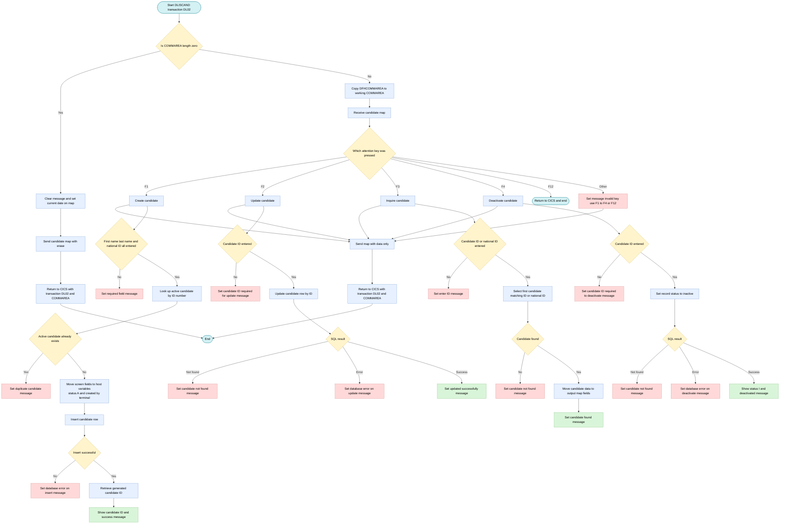
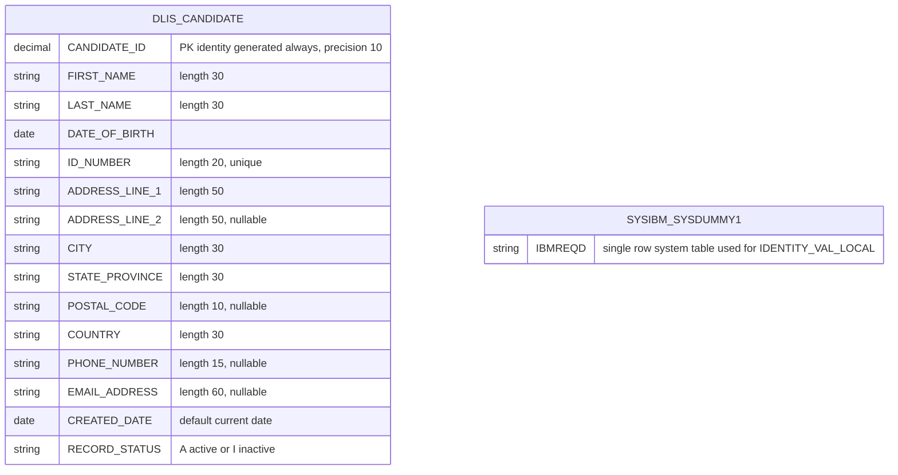

## Table of Contents

- [1. Purpose](#1-purpose)
- [2. Inputs](#2-inputs)
- [3. Outputs](#3-outputs)
  - [3.1 Database Outputs](#31-database-outputs)
  - [3.2 User Interface / Screen Outputs (BMS Map DLISCM01)](#32-user-interface--screen-outputs-bms-map-dliscm01)
  - [3.3 CICS Communication Area Outputs](#33-cics-communication-area-outputs)
- [4. Processing Logic](#4-processing-logic)
  - [4.1 Mermaid Flow Diagram](#41-mermaid-flow-diagram)
  - [4.2 Processing Logic Description](#42-processing-logic-description)
  - [4.3 Database Tables](#43-database-tables)
- [5. Paragraphs](#5-paragraphs)
- [6. Dependencies](#6-dependencies)
- [7. Constraints](#7-constraints)
- [8. Error Handling](#8-error-handling)
- [9. Examples](#9-examples)
  - [9.1 Example 1: Create a candidate (F1)](#91-example-1-create-a-candidate-f1)
  - [9.2 Example 2: Create rejected (missing field or duplicate)](#92-example-2-create-rejected-missing-field-or-duplicate)
  - [9.3 Example 3: Inquire by candidate ID (F3)](#93-example-3-inquire-by-candidate-id-f3)
  - [9.4 Example 4: Deactivate a candidate (F4)](#94-example-4-deactivate-a-candidate-f4)
  - [9.5 Example 5: Other keys](#95-example-5-other-keys)

## 1. Purpose

DLISCAND is a CICS/COBOL online transaction (DL02) that lets users maintain candidate records for a licensing system through a single 3270 screen. Function keys select the action. F1 creates a new candidate, after checking that first name, last name and national ID are present and that no active candidate already has that national ID. F2 updates an existing candidate's name, address, phone, email and status. F3 looks up a candidate by candidate ID or national ID and shows the details. F4 deactivates a candidate by setting its status to inactive instead of deleting it. F12 ends the session. The program stores and retrieves the data in the DLIS candidate database table. It shows success or error messages on the screen after each action and returns control to the same transaction so the user can keep working.

## 2. Inputs

- **Program invocation context (CICS)**
  - DFHCOMMAREA / DLIS-COMMAREA
    - Pseudo-conversational communication area, 350 bytes, passed in by CICS on re-entry. It is copied into the program's working area when EIBCALEN is greater than 0.
    - The program treats a zero length as first entry and shows a blank screen.
    - Fields such as the transaction ID, return screen, candidate ID, user ID, message text and action are carried across interactions.
  - EIBCALEN
    - Length of the COMMAREA received. It decides whether this is the initial entry or a reply.
  - EIBTRNID
    - ID of the running transaction (DL02). It is stored in the COMMAREA transaction ID field.
  - EIBTRMID
    - ID of the terminal. It is stored as the "created by" value on new candidate records.
  - EIBAID
    - Attention identifier of the key the user pressed. It selects the function:
      - F1 creates a candidate.
      - F2 updates a candidate.
      - F3 inquires about a candidate.
      - F4 deactivates a candidate.
      - F12 ends the transaction.
      - Any other key gives an invalid-key message.

- **User inputs from the BMS screen (map DLISCM01, mapset DLISCM)**
  - Received through EXEC CICS RECEIVE MAP.
  - Candidate identification
    - DCMCIDI: Candidate ID. It is required for update and deactivate. For inquiry it is an alternate key to the national ID.
    - DCMIDNOI: National ID number. It is required on create and used for the duplicate check. It is an alternate search key on inquiry.
  - Personal details
    - DCMFNAMI: First name (required on create).
    - DCMLNAMI: Last name (required on create).
    - DCMDOBI: Date of birth.
  - Address details
    - DCMADR1I: Address line 1.
    - DCMADR2I: Address line 2.
    - DCMCITYI: City.
    - DCMSTATI: State or province.
    - DCMPOSTI: Postal code.
    - DCMCTRYI: Country.
  - Contact details
    - DCMPHNI: Phone number.
    - DCMEMLI: Email address.

- **External data sources (DB2)**
  - DLIS.CANDIDATE table
    - It is read for the duplicate-ID check on create, using ID_NUMBER and active status.
    - It is read on inquiry, by candidate ID or ID number, returning the first matching row.
    - It is the target of the insert, update and deactivate actions.
  - SYSIBM.SYSDUMMY1 with IDENTITY_VAL_LOCAL()
    - Supplies the system-generated candidate ID after an insert.
  - Host variables for the CANDIDATE row
    - These carry the values above to and from DB2: CANDIDATE-ID, RECORD-STATUS, ID-NUMBER, FIRST-NAME, LAST-NAME, DATE-OF-BIRTH, EMAIL-ADDRESS, PHONE-NUMBER, ADDRESS-LINE-1, ADDRESS-LINE-2, CITY, STATE-PROVINCE, POSTAL-CODE, COUNTRY, CREATED-BY.
    - The update statement uses host variables that are not loaded from the screen in the update paragraph. They hold whatever values they had already, so they are not a reliable input.

- **System-provided values**
  - CURRENT-DATE
    - Used to populate the date field (DCMDATE) on the initial screen.

## 3. Outputs

### 3.1 Database Outputs

- **DLIS.CANDIDATE Table (Inserts)**
  - `FIRST-NAME` - Inserts the candidate's first name into column `FIRST_NAME`.
  - `LAST-NAME` - Inserts the candidate's last name into column `LAST_NAME`.
  - `DATE-OF-BIRTH` - Inserts the candidate's date of birth into column `DATE_OF_BIRTH`.
  - `ID-NUMBER` - Inserts the national identification number into column `ID_NUMBER`.
  - `ADDRESS-LINE-1` - Inserts the primary address into column `ADDRESS_LINE_1`.
  - `ADDRESS-LINE-2` - Inserts the secondary address into column `ADDRESS_LINE_2`.
  - `CITY` - Inserts the city into column `CITY`.
  - `STATE-PROVINCE` - Inserts the state or province into column `STATE_PROVINCE`.
  - `POSTAL-CODE` - Inserts the postal code into column `POSTAL_CODE`.
  - `COUNTRY` - Inserts the country into column `COUNTRY`.
  - `PHONE-NUMBER` - Inserts the contact telephone number into column `PHONE_NUMBER`.
  - `EMAIL-ADDRESS` - Inserts the electronic mail address into column `EMAIL_ADDRESS`.
  - `RECORD-STATUS` - Inserts the active lifecycle status flag (`'A'`) into column `RECORD_STATUS`.
  - `CREATED-BY` - Inserts the originating CICS terminal ID (`EIBTRMID`) into column `CREATED_BY`.

- **DLIS.CANDIDATE Table (Updates)**
  - `FIRST-NAME` - Updates column `FIRST_NAME` for the specified candidate ID.
  - `LAST-NAME` - Updates column `LAST_NAME` for the specified candidate ID.
  - `ADDRESS-LINE-1` - Updates column `ADDRESS_LINE_1` for the specified candidate ID.
  - `ADDRESS-LINE-2` - Updates column `ADDRESS_LINE_2` for the specified candidate ID.
  - `CITY` - Updates column `CITY` for the specified candidate ID.
  - `STATE-PROVINCE` - Updates column `STATE_PROVINCE` for the specified candidate ID.
  - `POSTAL-CODE` - Updates column `POSTAL_CODE` for the specified candidate ID.
  - `COUNTRY` - Updates column `COUNTRY` for the specified candidate ID.
  - `PHONE-NUMBER` - Updates column `PHONE_NUMBER` for the specified candidate ID.
  - `EMAIL-ADDRESS` - Updates column `EMAIL_ADDRESS` for the specified candidate ID.
  - `RECORD-STATUS` - Updates column `RECORD_STATUS` during profile modifications or when setting the status flag to inactive (`'I'`) during candidate deactivation.

### 3.2 User Interface / Screen Outputs (BMS Map DLISCM01)

- **System and Informational Fields**
  - `DCMDATE` - Displays the current system date (`YYYY-MM-DD`) on screen initialization.
  - `DCMMSG` - Displays operational feedback, validation errors, duplicate detection warnings, and database execution error messages to the terminal user.

- **Candidate Display Fields**
  - `DCMCIDO` - Transmits the generated or queried candidate ID to the screen display.
  - `DCMFNAMO` - Transmits the candidate's first name to the screen on inquiry.
  - `DCMLNAMO` - Transmits the candidate's last name to the screen on inquiry.
  - `DCMDOBO` - Transmits the candidate's date of birth to the screen on inquiry.
  - `DCMIDNOO` - Transmits the candidate's national ID number to the screen on inquiry.
  - `DCMADR1O` - Transmits address line 1 to the screen on inquiry.
  - `DCMADR2O` - Transmits address line 2 to the screen on inquiry.
  - `DCMCITYO` - Transmits the city name to the screen on inquiry.
  - `DCMSTATO` - Transmits the state or province to the screen on inquiry.
  - `DCMPOSTO` - Transmits the postal code to the screen on inquiry.
  - `DCMCTRYO` - Transmits the country to the screen on inquiry.
  - `DCMPHNO` - Transmits the phone number to the screen on inquiry.
  - `DCMEMLO` - Transmits the email address to the screen on inquiry.
  - `DCMSTSO` - Transmits the candidate record status (`'A'` or `'I'`) to the screen on inquiry or upon successful deactivation.

### 3.3 CICS Communication Area Outputs

- **DLIS-COMMAREA**
  - `CA-TRANSACTION-ID` - Contains the transaction ID (`EIBTRNID` / `DL02`) passed across pseudo-conversational returns via `EXEC CICS RETURN TRANSID('DL02') COMMAREA(...)`.

## 4. Processing Logic

### 4.1 Mermaid Flow Diagram

### 4.2 Processing Logic Description

**High-level Summary**

DLISCAND is a pseudo-conversational CICS/COBOL program for transaction DL02. It maintains candidate records in the DB2 table DLIS.CANDIDATE through the BMS map DLISCM01 in mapset DLISCM. The user picks the function with a function key:
- F1 creates a candidate.
- F2 updates a candidate.
- F3 inquires about a candidate.
- F4 deactivates a candidate.
- F12 exits.

**Execution Flow**

1. **Entry (MAIN-LOGIC)**
   - The program copies the transaction ID (EIBTRNID) into the COMMAREA and saves EIBCALEN.
   - If EIBCALEN is 0, this is the first entry, so it runs INIT-SCREEN.
   - Otherwise it copies DFHCOMMAREA into DLIS-COMMAREA and runs PROCESS-INPUT.

2. **INIT-SCREEN**
   - It clears the message field (DCMMSG) and moves a date value into DCMDATE.
   - It sends map DLISCM01 with ERASE and FREEKB.
   - It issues `EXEC CICS RETURN TRANSID('DL02')` with the COMMAREA (length 350), so the next key press restarts the transaction.

3. **PROCESS-INPUT**
   - It receives map DLISCM01 and stores the AID key in WS-PFKEY.
   - EVALUATE TRUE dispatches on the AID key:
     - F1 runs CREATE-CANDIDATE.
     - F2 runs UPDATE-CANDIDATE.
     - F3 runs INQUIRE-CANDIDATE.
     - F4 runs DEACTIVATE-CANDIDATE.
     - F12 issues `EXEC CICS RETURN` and ends the transaction without redisplaying the map.
     - Any other key sets the message "INVALID KEY - USE F1-F4 OR F12". The source writes this branch as `OTHER`, not the standard `WHEN OTHER`.
   - Afterwards the program sends the map with DATAONLY and FREEKB. It then returns with TRANSID DL02 and the COMMAREA.

4. **CREATE-CANDIDATE (F1)**
   - Validation: first name, last name, and national ID must each be neither spaces nor low-values. Each failure sets its own "... IS REQUIRED" message and exits.
   - Duplicate check: it selects CANDIDATE_ID from DLIS.CANDIDATE where ID_NUMBER matches and RECORD_STATUS = 'A'. If SQLCODE = 0, it reports "CANDIDATE WITH THIS ID NUMBER ALREADY EXISTS" and exits.
   - Insert: it moves the map input fields into the host variables and sets RECORD_STATUS to 'A'. It sets CREATED_BY from the terminal ID (EIBTRMID). It then inserts the row into DLIS.CANDIDATE.
   - If the INSERT's SQLCODE is not 0, it sets "DATABASE ERROR ON INSERT - CONTACT SUPPORT" and exits.
   - On success it reads the new ID with `IDENTITY_VAL_LOCAL()` from SYSIBM.SYSDUMMY1. It puts the ID in DCMCIDO and shows "CANDIDATE CREATED SUCCESSFULLY".

5. **UPDATE-CANDIDATE (F2)**
   - The candidate ID (DCMCIDI) must not be zeros or low-values. Otherwise it sets "CANDIDATE ID IS REQUIRED FOR UPDATE".
   - It updates the name, address, phone, email, and record status columns of the row with that CANDIDATE_ID.
   - SQLCODE 100 gives "CANDIDATE NOT FOUND". Any other non-zero code gives "DATABASE ERROR ON UPDATE". Otherwise the message is "CANDIDATE UPDATED SUCCESSFULLY".
   - The program does not move the screen input fields (other than the ID) into the host variables before the UPDATE. The values written are whatever the host variables already hold.
   - The UPDATE does not change DATE_OF_BIRTH or ID_NUMBER.

6. **INQUIRE-CANDIDATE (F3)**
   - At least one of the candidate ID or the national ID is required. If both are empty (zeros and spaces), it sets "ENTER CANDIDATE ID OR NATIONAL ID".
   - It selects one row (`FETCH FIRST 1 ROW ONLY`) where CANDIDATE_ID or ID_NUMBER matches.
   - SQLCODE 100 gives "CANDIDATE NOT FOUND". Other SQL errors are not specifically handled.
   - If a row is found, all fields, including the status, are moved to the output map fields (DCMxxxO). The message is "CANDIDATE FOUND".

7. **DEACTIVATE-CANDIDATE (F4)**
   - The candidate ID must not be zero. Otherwise it sets "CANDIDATE ID IS REQUIRED TO DEACTIVATE".
   - It performs a logical delete by setting RECORD_STATUS = 'I' for that CANDIDATE_ID.
   - SQLCODE 100 gives "CANDIDATE NOT FOUND". Any other non-zero code gives "DATABASE ERROR ON DEACTIVATE". On success it shows status 'I' and "CANDIDATE DEACTIVATED".

**Business Rules**
- First name, last name, and national ID are mandatory when creating a candidate.
- Only one active candidate may exist per national ID. The database also enforces a unique constraint on ID_NUMBER.
- New candidates are created with status 'A'. Deactivation sets status 'I', which is a soft delete.
- The creating terminal ID is stored as the audit field CREATED_BY.
- The candidate ID is system-generated through a DB2 identity column.
- Valid RECORD_STATUS values are 'A' and 'I', enforced by a check constraint.

**Observations on the code**
- STOP RUN follows the paragraph PERFORMs in MAIN-LOGIC, but the CICS RETURN statements end the task before it is reached.
- The RESP values from SEND and RECEIVE are not checked.
- After CREATE, the program does not issue an explicit commit or rollback. It relies on the CICS syncpoint at task end.
- In UPDATE, the status is written from the host variable, which could overwrite the record status unintentionally.
- INQUIRE does not exclude inactive candidates.

**External Interactions**
- **CICS terminal I/O:** SEND MAP and RECEIVE MAP on DLISCM01 in mapset DLISCM present the screen and read user input.
- **CICS task control:** RETURN TRANSID('DL02') with a 350-byte COMMAREA keeps the pseudo-conversational dialog going. The EIBAID key drives function selection.
- **DB2:** The program performs SELECT, INSERT, UPDATE, and `IDENTITY_VAL_LOCAL()` against DLIS.CANDIDATE. It checks SQLCODE after each statement, apart from the identity retrieval.
- **IBM MQ:** The program has no MQ interactions.

**Plain Language Summary**

This screen lets a clerk manage people who apply for a driver's license. The clerk presses F1 to add a new person, F2 to change their details, F3 to look someone up by candidate number or national ID, and F4 to mark someone as no longer active. F12 exits.

Before adding a person, the program checks that names and national ID are filled in. It also checks that nobody active already has the same national ID. After each action it shows a message such as "CANDIDATE CREATED SUCCESSFULLY" or "CANDIDATE NOT FOUND", and the screen waits for the next key press.

### 4.3 Database Tables

## 5. Paragraphs

**MAIN-LOGIC**
- Purpose: Entry point of the pseudo-conversational CICS transaction DL02 for candidate maintenance.
- Operations:
  - Copies the transaction ID (EIBTRNID) into CA-TRANSACTION-ID.
  - Saves the commarea length (EIBCALEN) into WS-EIBCALEN-SAVE.
- Control flow:
  - If EIBCALEN = 0, this is the first invocation, so it performs INIT-SCREEN.
  - Otherwise it moves DFHCOMMAREA into DLIS-COMMAREA and performs PROCESS-INPUT.
  - It ends with STOP RUN.
- External interaction: None directly. It reads the CICS EIB fields and the commarea.

**INIT-SCREEN**
- Purpose: Shows the blank candidate maintenance screen on first entry.
- Operations:
  - Clears the message field DCMMSG.
  - Moves the first 10 characters of CURRENT-DATE into the date field DCMDATE.
  - Issues EXEC CICS SEND MAP('DLISCM01') MAPSET('DLISCM') with ERASE and FREEKB.
  - Issues EXEC CICS RETURN TRANSID('DL02') with COMMAREA(DLIS-COMMAREA) LENGTH(350), so the next terminal input restarts the transaction.
- Control flow: Straight-line. The RETURN ends the task.
- External interaction: CICS BMS terminal output and CICS RETURN. The response goes to WS-RESP1 but is not checked.

**PROCESS-INPUT**
- Purpose: Handles each later interaction. It reads the screen, dispatches on the PF key, and redisplays the screen.
- Operations:
  - Issues EXEC CICS RECEIVE MAP('DLISCM01') MAPSET('DLISCM') with RESP(WS-RESP1).
  - Copies EIBAID into WS-PFKEY.
  - Dispatches on the pressed key.
  - Issues EXEC CICS SEND MAP with DATAONLY and FREEKB to refresh the screen.
  - Issues EXEC CICS RETURN TRANSID('DL02') with the commarea.
- Control flow: An EVALUATE TRUE on EIBAID:
  - PF1 performs CREATE-CANDIDATE.
  - PF2 performs UPDATE-CANDIDATE.
  - PF3 performs INQUIRE-CANDIDATE.
  - PF4 performs DEACTIVATE-CANDIDATE.
  - PF12 issues EXEC CICS RETURN with no transaction ID, which ends the conversation.
  - The last branch is written as `OTHER`. The standard COBOL keyword is `WHEN OTHER`, so as written this branch is likely a syntax problem. Its intent is to set the message 'INVALID KEY - USE F1-F4 OR F12' for any other key.
- External interaction: CICS RECEIVE MAP, SEND MAP and RETURN. The RESP value is stored but never checked.

**CREATE-CANDIDATE**
- Purpose: Creates a new candidate (PF1) after validating input and checking for a duplicate national ID.
- Operations:
  - Validation: checks that first name (DCMFNAMI), last name (DCMLNAMI) and national ID (DCMIDNOI) are not spaces or low-values. Each failure sets a specific message in DCMMSG.
  - Duplicate check: moves the national ID into ID-NUMBER and runs a SELECT of CANDIDATE_ID from DLIS.CANDIDATE where ID_NUMBER matches and RECORD_STATUS = 'A'.
  - Insert preparation: moves the screen fields into the DCLDLIS-CANDIDATE host variables. These are names, date of birth, ID number, address lines, city, state, postal code, country, phone and email. It sets RECORD-STATUS to 'A' and CREATED-BY to the terminal ID (EIBTRMID).
  - Insert: runs an INSERT INTO DLIS.CANDIDATE with those values.
  - ID retrieval: after a successful insert, runs SELECT IDENTITY_VAL_LOCAL() FROM SYSIBM.SYSDUMMY1 to get the generated candidate ID.
  - Result: moves the generated ID to the output field DCMCIDO and sets 'CANDIDATE CREATED SUCCESSFULLY'.
- Control flow:
  - Sequential IF checks, each using GO TO CREATE-CANDIDATE-EXIT on failure.
  - If the duplicate-check SQLCODE = 0, it reports 'CANDIDATE WITH THIS ID NUMBER ALREADY EXISTS' and exits.
  - If the INSERT SQLCODE is not 0, it reports a database error and exits.
  - Success also ends with a GO TO to the exit paragraph.
- External interaction: DB2 SELECT, INSERT and IDENTITY_VAL_LOCAL on DLIS.CANDIDATE. The SQLCODE of the identity retrieval is not checked.

**CREATE-CANDIDATE-EXIT**
- Purpose: Exit point for CREATE-CANDIDATE.
- Operations: A bare EXIT statement.
- Control flow: Target of all the GO TOs in CREATE-CANDIDATE.
- External interaction: None.

**UPDATE-CANDIDATE**
- Purpose: Updates an existing candidate (PF2) identified by candidate ID.
- Operations:
  - Checks that the candidate ID (DCMCIDI) is not zeros or low-values.
  - Moves DCMCIDI to CANDIDATE-ID.
  - Runs an UPDATE on DLIS.CANDIDATE. It sets first name, last name, address lines 1 and 2, city, state, postal code, country, phone, email and record status from the host variables, where CANDIDATE_ID matches.
  - Sets the message according to SQLCODE.
- Control flow:
  - If the ID is missing, it sets 'CANDIDATE ID IS REQUIRED FOR UPDATE' and does GO TO UPDATE-CANDIDATE-EXIT.
  - After the update: SQLCODE 100 gives 'CANDIDATE NOT FOUND', any other non-zero value gives 'DATABASE ERROR ON UPDATE', and zero gives 'CANDIDATE UPDATED SUCCESSFULLY'.
- External interaction: DB2 UPDATE on DLIS.CANDIDATE.
- Observation: The paragraph never moves the screen's input fields (DCMFNAMI and so on) into the host variables before the UPDATE. The UPDATE therefore uses whatever the host variables already hold.

**UPDATE-CANDIDATE-EXIT**
- Purpose: Exit point for UPDATE-CANDIDATE.
- Operations: A bare EXIT statement.
- Control flow: Target of the GO TO in UPDATE-CANDIDATE.
- External interaction: None.

**INQUIRE-CANDIDATE**
- Purpose: Looks up a candidate (PF3) by candidate ID or national ID and shows the details.
- Operations:
  - Requires at least one search key. If candidate ID is zeros and national ID is spaces, it sets 'ENTER CANDIDATE ID OR NATIONAL ID'.
  - Moves DCMCIDI and DCMIDNOI to the host variables CANDIDATE-ID and ID-NUMBER.
  - Runs a SELECT INTO of all candidate columns from DLIS.CANDIDATE where CANDIDATE_ID or ID_NUMBER matches, with FETCH FIRST 1 ROW ONLY.
  - On success it moves each retrieved column to the output map fields: DCMCIDO, DCMFNAMO, DCMLNAMO, DCMDOBO, DCMIDNOO, DCMADR1O, DCMADR2O, DCMCITYO, DCMSTATO, DCMPOSTO, DCMCTRYO, DCMPHNO, DCMEMLO and DCMSTSO. It then sets 'CANDIDATE FOUND'.
- Control flow:
  - GO TO INQUIRE-CANDIDATE-EXIT when no key is entered.
  - GO TO INQUIRE-CANDIDATE-EXIT with 'CANDIDATE NOT FOUND' when SQLCODE = 100.
  - Other non-zero SQLCODE values are not handled.
- External interaction: DB2 singleton SELECT on DLIS.CANDIDATE.

**INQUIRE-CANDIDATE-EXIT**
- Purpose: Exit point for INQUIRE-CANDIDATE.
- Operations: A bare EXIT statement.
- Control flow: Target of the GO TOs in INQUIRE-CANDIDATE.
- External interaction: None.

**DEACTIVATE-CANDIDATE**
- Purpose: Soft-deletes a candidate (PF4) by setting its status to inactive.
- Operations:
  - Checks that the candidate ID (DCMCIDI) is not zeros.
  - Moves DCMCIDI to CANDIDATE-ID.
  - Runs an UPDATE on DLIS.CANDIDATE that sets RECORD_STATUS = 'I' where CANDIDATE_ID matches.
  - Sets the result message.
- Control flow:
  - If the ID is missing, it sets 'CANDIDATE ID IS REQUIRED TO DEACTIVATE' and does GO TO DEACTIVATE-CANDIDATE-EXIT.
  - After the update: SQLCODE 100 gives 'CANDIDATE NOT FOUND', any other non-zero value gives 'DATABASE ERROR ON DEACTIVATE', and zero moves 'I' to the status output DCMSTSO and sets 'CANDIDATE DEACTIVATED'.
- External interaction: DB2 UPDATE on DLIS.CANDIDATE.

**DEACTIVATE-CANDIDATE-EXIT**
- Purpose: Exit point for DEACTIVATE-CANDIDATE.
- Operations: A bare EXIT statement.
- Control flow: Target of the GO TO in DEACTIVATE-CANDIDATE.
- External interaction: None.

## 6. Dependencies

-  Online transaction environment (CICS)
  - Transaction DL02
    - The program is registered under this transaction ID in the CICS CSD group `DLISGRP` (`csd/DLISCSD.csd`).
    - It re-invokes itself with `EXEC CICS RETURN TRANSID('DL02')` to run pseudo-conversationally.
  - CICS runtime services (`EXEC CICS`)
    - `SEND MAP` is used with ERASE and FREEKB on the first entry, and with DATAONLY and FREEKB on later replies.
    - `RECEIVE MAP` reads the user's input from the screen.
    - `RETURN` is used both with TRANSID and COMMAREA, and as a plain `RETURN` on F12 to exit.
    - Responses are captured in `WS-RESP1`, but the code never tests them.
  - Execute Interface Block (EIB) fields supplied by CICS
    - `EIBTRNID` is moved to `CA-TRANSACTION-ID`.
    - `EIBCALEN` is used to distinguish first entry from a reply (zero length means first entry).
    - `EIBAID` identifies the key the user pressed.
    - `EIBTRMID` supplies the terminal ID, which is stored in `CREATED_BY`.
  - Attention-key constants (`DFHPF1`, `DFHPF2`, `DFHPF3`, `DFHPF4`, `DFHPF12`)
    - These come from the CICS-supplied `DFHAID` definitions.
    - The program does not `COPY` them explicitly.
    - They drive the function selection: F1 create, F2 update, F3 inquire, F4 deactivate, F12 exit.
  - Communication area
    - `DFHCOMMAREA` is declared in the LINKAGE SECTION as 350 bytes.
    - It is moved into `DLIS-COMMAREA` on re-entry.
    - It is passed back with LENGTH(350) on each `RETURN`.
    - The 350-byte length must match the layout in the copybook.

- User interface (BMS)
  - Mapset `DLISCM`, map `DLISCM01` (`bms/DLISCM.bms`)
    - This is the Candidate Maintenance screen, sent and received by the program.
    - The map must be assembled into `DLIS.LOADLIB`.
  - Symbolic map fields
    - These are generated by BMS assembly into the `DLIS.COPYBOOK` library.
    - The program uses them without an explicit `COPY` statement.
    - Input fields (suffix `I`):
      - `DCMFNAMI`, `DCMLNAMI`, `DCMDOBI`, `DCMIDNOI`, `DCMCIDI`
      - `DCMADR1I`, `DCMADR2I`, `DCMCITYI`, `DCMSTATI`, `DCMPOSTI`
      - `DCMCTRYI`, `DCMPHNI`, `DCMEMLI`
    - Output fields (suffix `O`):
      - `DCMCIDO`, `DCMFNAMO`, `DCMLNAMO`, `DCMDOBO`, `DCMIDNOO`
      - `DCMADR1O`, `DCMADR2O`, `DCMCITYO`, `DCMSTATO`, `DCMPOSTO`
      - `DCMCTRYO`, `DCMPHNO`, `DCMEMLO`, `DCMSTSO`
    - Message and date fields: `DCMMSG` and `DCMDATE`.

- Database (DB2)
  - Subsystem and plan
    - DB2 subsystem `DSN1`.
    - Plan `DLISPLAN`.
    - Collection `DLISPKG`.
    - The program's DBRM is bound by `jcl/DLISBIND.jcl`.
    - The program must be precompiled with `DSNHPC` (`jcl/DLISCOMP.jcl`).
  - Table `DLIS.CANDIDATE` (`db2/DLIS0001-CREATE-TABLES.sql`)
    - This is the only table the program accesses.
    - Its columns are:
      - `CANDIDATE_ID` (generated identity)
      - `FIRST_NAME`, `LAST_NAME`, `DATE_OF_BIRTH`, `ID_NUMBER`
      - `ADDRESS_LINE_1`, `ADDRESS_LINE_2`, `CITY`, `STATE_PROVINCE`, `POSTAL_CODE`, `COUNTRY`
      - `PHONE_NUMBER`, `EMAIL_ADDRESS`
      - `RECORD_STATUS`, `CREATED_BY`
    - SQL operations on it:
      - SELECT, to check for a duplicate active `ID_NUMBER`
      - INSERT, to create a candidate
      - UPDATE, to change candidate details
      - SELECT, to inquire by `CANDIDATE_ID` or `ID_NUMBER`
      - UPDATE, to set `RECORD_STATUS` to 'I' on deactivation
  - Catalog table `SYSIBM.SYSDUMMY1`
    - It is used with the `IDENTITY_VAL_LOCAL()` function to retrieve the identity value generated by the insert.
  - Schema objects
    - Tables, indexes and grants come from `db2/DLIS0001-CREATE-TABLES.sql`, `db2/DLIS0002-CREATE-INDEXES.sql` and `db2/DLIS0003-GRANTS.sql`.
    - They are applied by `jcl/DLISDB2.jcl`.
    - The DB2 authorization (EXECUTE on the plan or package, and table access) must be granted to the CICS execution user.
  - SQL communication area
    - `SQLCA` is brought in with `EXEC SQL INCLUDE SQLCA`.
    - The program uses `SQLCODE` to detect success (0), not found (100) and errors.
    - The include appears twice, in the working-storage copybook and again in the program.

- Copybooks and shared definitions
  - `DLISWS` (`copybook/DLISWS.cpy`)
    - It holds common working storage: return codes and messages, and the candidate, application, payment, eligibility, history, approval and license work areas.
    - It also holds the null indicators and `SQLCA`.
  - `DLISCSEC` (`copybook/DLISCSEC.cpy`)
    - It holds the COMMAREA layouts: `DLIS-COMMAREA`, `DLIS-CAND-COMMAREA`, `DLIS-APPL-COMMAREA`.
    - It also holds the CICS response work fields.
  - `DLISDCLG` (`copybook/DLISDCLG.cpy`)
    - It holds the DCLGEN host structures: `DCLDLIS-CANDIDATE` and others.
    - The program uses `DCLDLIS-CANDIDATE`, which carries the host variables `CANDIDATE-ID`, `RECORD-STATUS`, `ID-NUMBER`, `FIRST-NAME`, `LAST-NAME`, `DATE-OF-BIRTH`, `EMAIL-ADDRESS`, `PHONE-NUMBER`, `ADDRESS-LINE-1`, `ADDRESS-LINE-2`, `CITY`, `STATE-PROVINCE`, `POSTAL-CODE`, `COUNTRY` and `CREATED-BY`.
    - The other table structures (application, driving history, payment, issued license, authority user, fee schedule) are unused by this program.
    - `CREATED-BY` is not a field of `DCLDLIS-CANDIDATE`. It exists only in the other structures (`DCLDLIS-LICENSE-APPL`). The unqualified `:CREATED-BY` host variable in the INSERT is therefore ambiguous or mismatched.

- Input data and runtime values
  - Terminal input
    - The user supplies the function key and the candidate fields on the screen.
    - Create needs first name, last name and national ID.
    - Update needs the candidate ID.
    - Inquire needs the candidate ID or the national ID.
    - Deactivate needs the candidate ID.
  - Incoming COMMAREA
    - This is the state passed from the previous invocation of the transaction (`DFHCOMMAREA`).
  - Terminal identifier
    - `EIBTRMID` is stored in `CREATED_BY` as an audit value.
  - Current date
    - `CURRENT-DATE(1:10)` is moved to `DCMDATE` on the initial screen.
    - It is not declared in the program, so it would have to come from a compiler-supported function or a definition outside the program.

- Build and deployment dependencies
  - BMS assembly: `jcl/DLISBMS.jcl` with `proc/DLISBASM.proc`.
  - Compile and link: `jcl/DLISCOMP.jcl` with `proc/DLISCLNK.proc`.
    - It runs the DB2 precompiler `DSNHPC`.
    - It runs the compiler `IGYCRCTL` with the options `RENT,APOST,LIB,NOSEQ,NOTERM`.
    - It runs the link-editor `IEWL` with `AMODE(31),RMODE(ANY)`.
  - DB2 bind: `jcl/DLISBIND.jcl`.
  - Load library `DLIS.LOADLIB` holds the program load module and the BMS map load module.
  - Copybook library `DLIS.COPYBOOK` holds the symbolic map and shared copybooks.
  - CICS resource definitions (`csd/DLISCSD.csd`, installed by `DFHCSDUP` into group `DLISGRP`) define the program, the transaction `DL02` and the mapset.

- Related programs
  - The program makes no `CALL`, `LINK` or `XCTL` to other programs.
  - `DLISMENU` (transaction `DL01`) is the main menu that routes to this transaction.
  - The shared COMMAREA layout (`DLIS-COMMAREA`) is intended for transfer between the DLIS transactions.
  - The program does not use `CA-RETURN-SCREEN` to navigate elsewhere.

- Not used
  - The program uses no IBM MQ, no sequential or VSAM files, no IMS calls, no external subroutines and no environment variables.

## 7. Constraints

- **Input and key validation (function-key driven)**
  - Only specific attention keys are accepted.
    - PF1 runs create, PF2 runs update, PF3 runs inquire, PF4 runs deactivate, and PF12 exits with `EXEC CICS RETURN`.
    - Any other key falls into the `OTHER` branch of the `EVALUATE`. The message "INVALID KEY - USE F1-F4 OR F12" is moved to `DCMMSG`, and no maintenance action runs.
    - The `OTHER` branch is not valid COBOL (`WHEN OTHER` is required), so this is the intended rule rather than a reliably enforced one.
  - The program needs a screen interaction before it does any work.
    - If `EIBCALEN = 0`, it only runs `INIT-SCREEN`. That paragraph sends a blank map and returns to transaction DL02 with the COMMAREA.
    - Only when a COMMAREA is present does it process input. The COMMAREA is copied from `DFHCOMMAREA` into `DLIS-COMMAREA`, then the map is received.
  - Each request handles one function only.
    - The `EVALUATE` runs exactly one action per interaction.
    - After the action, the program always re-sends the map with `DATAONLY` and returns to DL02 (pseudo-conversational).

- **Create candidate (PF1) – data validation**
  - Required fields:
    - First name (`DCMFNAMI`) must not be spaces or LOW-VALUES. Otherwise the message is "FIRST NAME IS REQUIRED".
    - Last name (`DCMLNAMI`) must not be spaces or LOW-VALUES. Otherwise the message is "LAST NAME IS REQUIRED".
    - National ID (`DCMIDNOI`) must not be spaces or LOW-VALUES. Otherwise the message is "NATIONAL ID IS REQUIRED".
  - The checks run in that order, and each failure jumps to `CREATE-CANDIDATE-EXIT` with `GO TO`. Only the first failing message is shown, and no database access happens.
  - Fields that are not validated:
    - Date of birth, address lines, city, state/province, postal code, country, phone and email are copied as entered.
    - There is no format, range or length check on them. Their only limits are the PIC sizes of the host variables, for example `ID-NUMBER` X(20), `FIRST-NAME` X(30) and `EMAIL-ADDRESS` X(60).
  - Duplicate prevention:
    - Before the insert, the program selects `CANDIDATE_ID` from `DLIS.CANDIDATE` where `ID_NUMBER` matches and `RECORD_STATUS = 'A'`.
    - If `SQLCODE = 0`, an active candidate with that ID number already exists. The message is "CANDIDATE WITH THIS ID NUMBER ALREADY EXISTS" and the insert is skipped.
    - Uniqueness applies to active candidates only. An inactive (`'I'`) candidate does not block re-registering the same ID number.
    - A SQLCODE other than 0 or 100 on this check is not examined and is treated as "no duplicate".
    - A SELECT INTO that matches more than one row returns SQLCODE -811 (nonzero), which would also be treated as "no duplicate".
  - Forced and system-controlled values on insert:
    - `RECORD_STATUS` is always set to `'A'` (active) on creation.
    - `CREATED_BY` is set from the terminal ID (`EIBTRMID`), not from user input.
    - The candidate ID is not supplied by the user. It is generated by the database and read back with `IDENTITY_VAL_LOCAL()`.
  - Database outcome rules:
    - If the insert returns `SQLCODE NOT = 0`, the message is "DATABASE ERROR ON INSERT - CONTACT SUPPORT" and the program exits without retrieving an ID.
    - The result of the `IDENTITY_VAL_LOCAL()` select is not checked.

- **Update candidate (PF2)**
  - Preconditions:
    - The candidate ID (`DCMCIDI`) must not be zeros or LOW-VALUES. Otherwise the message is "CANDIDATE ID IS REQUIRED FOR UPDATE".
    - The update only touches the row where `CANDIDATE_ID` equals the supplied ID.
  - Restrictions on what can change:
    - The update covers first name, last name, address lines 1 and 2, city, state/province, postal code, country, phone, email and record status.
    - Date of birth, national ID number and created-by/created-date are never modified by this function.
    - No required-field validation is applied on update, so blank values could overwrite existing data.
  - Outcome handling:
    - `SQLCODE = 100` gives "CANDIDATE NOT FOUND".
    - Any other nonzero SQLCODE gives "DATABASE ERROR ON UPDATE".
    - `SQLCODE = 0` gives "CANDIDATE UPDATED SUCCESSFULLY".
  - Implied dependency on working-storage values:
    - The update statement uses `:FIRST-NAME`, `:LAST-NAME`, `:RECORD-STATUS` and the other host variables.
    - The paragraph does not move the screen input fields into these variables (only `CANDIDATE-ID` is set).
    - The values written are therefore whatever the host variables currently hold, not what the user typed.
    - This is an implied data-flow constraint, and it may be a defect.

- **Inquire candidate (PF3)**
  - Search criteria:
    - At least one search key is required. If the candidate ID is zeros and the national ID is spaces, the message is "ENTER CANDIDATE ID OR NATIONAL ID".
    - The search matches on `CANDIDATE_ID` OR `ID_NUMBER`.
    - `FETCH FIRST 1 ROW ONLY` limits the result to a single record.
  - Result handling:
    - `SQLCODE = 100` gives "CANDIDATE NOT FOUND" and no fields are displayed.
    - Other nonzero SQLCODEs are not checked. If an error occurs, the program still moves the host variables to the screen and reports "CANDIDATE FOUND".
  - Visibility:
    - Inquire does not filter on `RECORD_STATUS`, so both active and inactive candidates can be found.
    - The record status is shown on the screen (`DCMSTSO`).
  - Partial key behavior:
    - Because of the OR condition, a blank or zero value for one key can still match rows when the other key is entered.

- **Deactivate candidate (PF4)**
  - Preconditions:
    - The candidate ID (`DCMCIDI`) must not be zeros. Otherwise the message is "CANDIDATE ID IS REQUIRED TO DEACTIVATE".
    - The check does not include LOW-VALUES, which differs from update.
  - Business rule:
    - Deactivation is a soft delete. It sets `RECORD_STATUS = 'I'` and never removes the row.
    - The update statement has no status condition, so deactivating an already inactive candidate succeeds.
    - There is no check for dependent records such as applications, payments or licences.
  - Outcome handling:
    - `SQLCODE = 100` gives "CANDIDATE NOT FOUND".
    - Any other nonzero SQLCODE gives "DATABASE ERROR ON DEACTIVATE".
    - On success, the status field on the screen is set to `'I'` and the message is "CANDIDATE DEACTIVATED".

- **Sequencing and flow constraints**
  - Validation comes before any database access in create, update, inquire and deactivate.
  - In create, the order is fixed: required-field checks, then the duplicate check, then the insert, then the identity retrieval, then the success message.
  - Each function paragraph exits early with `GO TO ...-EXIT` on the first failure, so only one error message is reported per request.
  - Pseudo-conversational sequencing:
    - Every interaction ends with `EXEC CICS RETURN TRANSID('DL02')`, so the next input must come back through transaction DL02 with the COMMAREA.
    - The map is received before any function key is evaluated.
    - Outbound map handling: the first call sends the full map with `ERASE`, and later calls send `DATAONLY`.
  - Response codes from the CICS SEND and RECEIVE commands are stored in `WS-RESP1` but never tested. A failed `RECEIVE MAP` would not stop processing.

- **Resource and size limits**
  - COMMAREA size:
    - `DFHCOMMAREA` is X(350), and the return passes `LENGTH(350)`.
    - Data moved from or to the COMMAREA is limited to 350 bytes.
  - Field length limits (host variables):
    - Candidate ID: S9(10) COMP-3 (up to 10 digits).
    - First name and last name: 30 characters each.
    - Date of birth: 10 characters.
    - ID number: 20 characters.
    - Address lines 1 and 2: 50 characters each.
    - City, state/province, country: 30 characters each.
    - Postal code: 10 characters.
    - Phone: 15 characters.
    - Email: 60 characters.
    - Record status: 1 character.
  - Inquiry limit: one row per request (`FETCH FIRST 1 ROW ONLY`).
  - Messages are limited by the size of the `DCMMSG` field.

- **Data integrity and status rules**
  - Record status values:
    - `'A'` means active, set at creation.
    - `'I'` means inactive, set on deactivation.
  - Only active records take part in the duplicate check.
  - The candidate ID is system-generated, so users cannot choose it on create.
  - The audit field `CREATED_BY` comes from the terminal ID, which ties creation to the originating terminal.
  - Program structure issues that affect enforcement:
    - The `INSERT` contains a stray `OF DCLDLIS-CANDIDATE` clause after `VALUES`, and some qualified references in the SQL are unusual.
    - `MAIN-LOGIC` ends with `STOP RUN` after paragraphs that perform CICS RETURN.
    - A single leading `IF` / `ELSE IF` chain is used for outcome handling in update and deactivate.
    - These affect how reliably the rules above are enforced at compile time and run time.

## 8. Error Handling

- Input validation on the screen
  - Create
    - The create routine rejects the request if first name, last name, or national ID is blank or low-values.
    - It checks them in that order and stops at the first failure.
    - The messages are "FIRST NAME IS REQUIRED", "LAST NAME IS REQUIRED" and "NATIONAL ID IS REQUIRED".
    - After setting a message, the routine branches straight to its exit paragraph, so no database call is made.
  - Update
    - If the candidate ID is zeros or low-values, the routine sets "CANDIDATE ID IS REQUIRED FOR UPDATE" and exits without touching the database.
  - Inquire
    - If both the candidate ID is zeros and the national ID is blank, the routine sets "ENTER CANDIDATE ID OR NATIONAL ID" and exits.
    - The check requires both fields to be empty. A candidate ID of low-values with a blank national ID is not caught by this test.
  - Deactivate
    - If the candidate ID is zeros, the routine sets "CANDIDATE ID IS REQUIRED TO DEACTIVATE" and exits.
    - It does not test for low-values, unlike the update routine.

- Business rule and duplicate checks
  - Before inserting, the create routine selects an active candidate (status 'A') with the same national ID.
  - If that select returns SQLCODE 0, a duplicate exists. The program sets "CANDIDATE WITH THIS ID NUMBER ALREADY EXISTS" and exits without inserting.
  - Any other SQLCODE from this select is not treated as an error. Only "found" blocks the insert, so a real database failure during the check is ignored and processing continues to the insert.

- Database (DB2) error handling through SQLCODE
  - Insert
    - After the insert, any SQLCODE other than 0 sets "DATABASE ERROR ON INSERT - CONTACT SUPPORT".
    - The routine then exits without retrieving the generated ID or reporting success. This message tells the user to contact support.
  - Update
    - SQLCODE 100 sets "CANDIDATE NOT FOUND".
    - Any other nonzero SQLCODE sets "DATABASE ERROR ON UPDATE".
    - SQLCODE 0 sets the success message "CANDIDATE UPDATED SUCCESSFULLY".
  - Deactivate
    - SQLCODE 100 sets "CANDIDATE NOT FOUND".
    - Any other nonzero SQLCODE sets "DATABASE ERROR ON DEACTIVATE".
    - On success, the status field on the screen is set to 'I' and the message "CANDIDATE DEACTIVATED" is shown.
  - Inquire
    - SQLCODE 100 sets "CANDIDATE NOT FOUND" and exits before any output fields are filled.
    - No other nonzero SQLCODE is handled. Errors such as a negative code or a multi-row condition fall through to the success path and show "CANDIDATE FOUND".
    - The query uses FETCH FIRST 1 ROW ONLY, which avoids the multiple-row error when the ID and national ID match different rows.
  - Generated ID retrieval
    - The SQLCODE of the IDENTITY_VAL_LOCAL select after a successful insert is not checked.
    - The program shows the success message regardless of that select's result.
  - Not handled
    - The program has no WHENEVER SQLERROR or SQLWARNING statement.
    - It has no explicit rollback or syncpoint handling after a failed SQL statement.
    - It has no distinction between specific negative SQLCODE values such as deadlock, timeout or constraint violation.
    - It does not use the SQLCA diagnostic fields to report details.

- User notifications and feedback
  - The program reports all outcomes by moving a text message to the map message field, DCMMSG.
  - The message is sent back to the terminal by the SEND MAP with DATAONLY at the end of input processing.
  - The messages fall into three groups:
    - validation failure
    - business rule violation or not-found
    - database error or success
  - The user is told to contact support only for insert failures.
  - The common working-storage fields for return code, message and color (WS-RETURN-CODE, WS-RETURN-MSG, WS-MSG-COLOR) are defined but never used.
  - Error messages are therefore not color-coded.

- Invalid terminal input handling
  - The program evaluates the attention identifier (EIBAID) to route the request.
  - PF1 to PF4 route to create, update, inquire and deactivate.
  - PF12 exits with a CICS RETURN.
  - Any other key falls to the default branch and sets "INVALID KEY - USE F1-F4 OR F12".
  - The message is then displayed on the re-sent screen.
  - The default branch is written as OTHER rather than WHEN OTHER, which is a coding defect and may cause a compile error.

- CICS response handling
  - SEND MAP and RECEIVE MAP specify RESP(WS-RESP1), so CICS conditions do not cause an automatic abend.
  - WS-RESP1 is never tested after any of these commands. This affects:
    - the initial SEND MAP
    - the RECEIVE MAP
    - the later DATAONLY SEND MAP
  - A failure such as MAPFAIL, which occurs when the user presses a key with no data, is silently ignored.
  - Processing continues using whatever is in the map input fields.
  - The RETURN TRANSID commands have no RESP option, so the default CICS handling applies to them.
  - The CICS response working-storage fields (WS-RESP2, WS-EIBRESP-SAVE) are defined but not used.

- Recovery, fallback and flow control
  - Each business routine uses early exit through a branch to its own exit paragraph.
    - A failed validation or database step skips the remaining processing.
    - The routine falls through to the screen send with the message set.
  - The program is pseudo-conversational. After every outcome, including errors, it sends the map and returns to transaction DL02 with the communication area.
    - The user can correct the input and retry.
    - There are no automatic retries and no alternate data sources.
  - On initial entry (EIBCALEN = 0), the program sends a blank screen with an empty message field. This is the only default handling in the program.
  - The program does not validate the communication area length beyond testing for zero.
    - It copies DFHCOMMAREA, a 350-byte area, into the communication area without a length check.
    - It does not check that the length is sufficient.

- Gaps and weaknesses in error handling
  - Update does not validate its input.
    - It does not check that the name fields are populated.
    - It does not move the screen input fields into the host variables before the update. The SQL uses host variables that were never loaded from the screen.
    - The update can therefore overwrite data with blanks or uninitialized values and still report success.
  - Duplicate national ID is checked only on create. Update does not check that the new value is unique.
  - There is no explicit abend or handling for unexpected CICS conditions, such as a HANDLE ABEND or a call to a common abort routine.
  - The program ends with STOP RUN rather than relying on CICS RETURN. Because every path through the main routines ends in a CICS RETURN, this code is unlikely to execute.
  - No logging or auditing of errors is done. Examples are writing to a CICS TD or TS queue or an error table. Diagnostics are limited to the terminal message.

## 9. Examples

### 9.1 Example 1: Create a candidate (F1)

**Input (screen fields, key pressed: F1)**

| Field | Value |
|---|---|
| First name | `JOHN` |
| Last name | `SMITH` |
| Date of birth | `1990-05-14` |
| National ID | `A1234567` |
| City | `BOSTON` |
| Country | `USA` |
| Terminal (EIBTRMID) | `T001` |

No active candidate with ID number `A1234567` exists. The database generates the new candidate ID `1001`.

**Expected output**
- Message: `CANDIDATE CREATED SUCCESSFULLY`
- Candidate ID field: `1001`
- A row is inserted into `DLIS.CANDIDATE` with `RECORD_STATUS = 'A'` and `CREATED_BY = 'T001'`.

**Explanation**
- F1 runs `CREATE-CANDIDATE`.
- First name, last name and national ID are all filled in, so validation passes.
- The duplicate check (`SELECT ... WHERE ID_NUMBER = ... AND RECORD_STATUS = 'A'`) returns SQLCODE +100 (no row), so processing continues.
- The screen values are copied to the host variables, status `'A'` is set, and the terminal ID is stored as creator.
- After the `INSERT`, `IDENTITY_VAL_LOCAL()` returns the generated ID, which is shown on the screen.

### 9.2 Example 2: Create rejected (missing field or duplicate)

**Input A (F1)**: First name `JANE`, last name left blank, national ID `B7654321`.
- **Output:** `LAST NAME IS REQUIRED`
- **Explanation:** The last-name validation fails first, so the program jumps to the exit and no SQL is run.

**Input B (F1)**: First name `JOHN`, last name `SMITH`, national ID `A1234567`, and an active record with this ID already exists.
- **Output:** `CANDIDATE WITH THIS ID NUMBER ALREADY EXISTS`
- **Explanation:** The duplicate check returns SQLCODE 0, so the insert is skipped.

### 9.3 Example 3: Inquire by candidate ID (F3)

**Input:** Candidate ID `1001`, national ID blank, key F3.

**Expected output**
- Message: `CANDIDATE FOUND`
- The screen is filled with the stored data: `JOHN`, `SMITH`, `1990-05-14`, `A1234567`, `BOSTON`, `USA`.
- The status field shows `A`.

**Explanation**
- The query selects the first row where `CANDIDATE_ID` equals the entered ID or `ID_NUMBER` equals the entered national ID (`FETCH FIRST 1 ROW ONLY`).
- A match populates all output fields.
- If nothing matches (SQLCODE +100), the message is `CANDIDATE NOT FOUND`.
- If both the ID and the national ID are empty, the message is `ENTER CANDIDATE ID OR NATIONAL ID`.

### 9.4 Example 4: Deactivate a candidate (F4)

**Input:** Candidate ID `1001`, key F4.

**Expected output**
- Message: `CANDIDATE DEACTIVATED`
- Status field: `I`
- The row for candidate 1001 now has `RECORD_STATUS = 'I'`.

**Explanation**
- `DEACTIVATE-CANDIDATE` is a soft delete: it updates `RECORD_STATUS` to `'I'` and does not remove the row.
- A deactivated candidate no longer counts in the "active" duplicate check, so the same national ID can be registered again.
- If the ID does not exist, the message is `CANDIDATE NOT FOUND`.
- If the ID field is zero, the message is `CANDIDATE ID IS REQUIRED TO DEACTIVATE`.

### 9.5 Example 5: Other keys

| Key | Result |
|---|---|
| F2 with candidate ID `1001` | Runs the update. On success the message is `CANDIDATE UPDATED SUCCESSFULLY`. If the ID is not found (SQLCODE +100), it is `CANDIDATE NOT FOUND`. The update's SET values come from the host variables (`FIRST-NAME`, `LAST-NAME`, and so on). The code does not copy the screen input into them first, so the stored values may not reflect what was typed. |
| F12 | Ends the session with `EXEC CICS RETURN`. |
| Any other key (such as ENTER) | Message `INVALID KEY - USE F1-F4 OR F12`. |
| First entry to transaction DL02 (`EIBCALEN = 0`) | The empty map is sent with the current date, and the program returns to await input. |

---

Generated by IBM Bob Premium Package for Z
