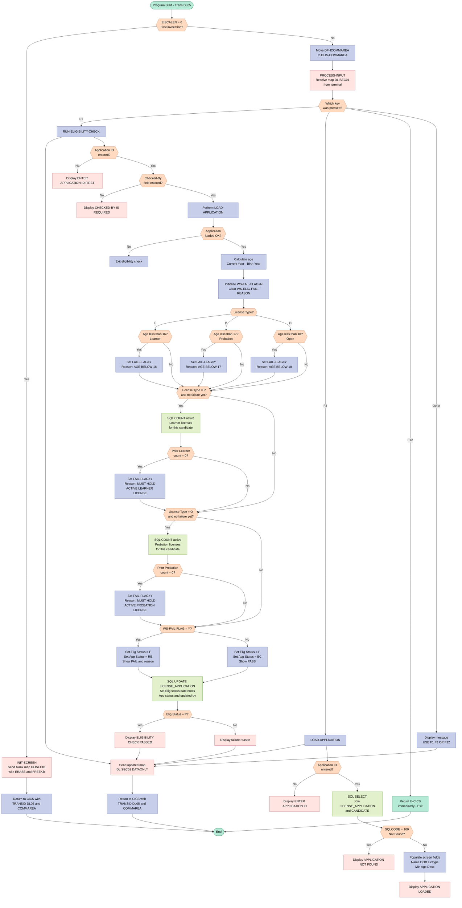

## Table of Contents

- [1. Purpose](#1-purpose)
- [2. Inputs](#2-inputs)
- [3. Outputs](#3-outputs)
- [4. Processing Logic](#4-processing-logic)
  - [4.1 Mermaid Flow Diagram](#41-mermaid-flow-diagram)
  - [4.2 Processing Logic Description](#42-processing-logic-description)
  - [4.3 Database Tables](#43-database-tables)
- [5. Paragraphs](#5-paragraphs)
- [6. Dependencies](#6-dependencies)
  - [6.1 Copybooks and Data Structures](#61-copybooks-and-data-structures)
  - [6.2 CICS Middleware and User Interface](#62-cics-middleware-and-user-interface)
  - [6.3 Database Resources (IBM DB2)](#63-database-resources-ibm-db2)
  - [6.4 Input Parameters and Program Context](#64-input-parameters-and-program-context)
- [7. Constraints](#7-constraints)
  - [7.1 Input / Entry Constraints](#71-input--entry-constraints)
  - [7.2 License-Type Validity Constraints](#72-license-type-validity-constraints)
  - [7.3 Minimum-Age Constraints](#73-minimum-age-constraints)
  - [7.4 Upgrade-Path / Prior-License Constraints](#74-upgrade-path--prior-license-constraints)
  - [7.5 Result-Recording Constraints](#75-result-recording-constraints)
  - [7.6 CICS Pseudo-Conversational Constraints](#76-cics-pseudo-conversational-constraints)
- [8. Error Handling](#8-error-handling)
  - [8.1 Input Validation Guards](#81-input-validation-guards)
  - [8.2 DB2 SQL Error and Not-Found Handling](#82-db2-sql-error-and-not-found-handling)
  - [8.3 Business Rule Eligibility Failure Tracking](#83-business-rule-eligibility-failure-tracking)
  - [8.4 Result Recording and User Notification](#84-result-recording-and-user-notification)
  - [8.5 CICS Pseudo-Conversational State Handling](#85-cics-pseudo-conversational-state-handling)
- [9. Examples](#9-examples)
  - [9.1 Example 1: Successful Eligibility Check for a Learner License](#91-example-1-successful-eligibility-check-for-a-learner-license)
  - [9.2 Example 2: Failed Eligibility Check Due to Missing Prerequisite License](#92-example-2-failed-eligibility-check-due-to-missing-prerequisite-license)

## 1. Purpose

DLISELIG is a CICS transaction (DL05) in the driver licensing system. It lets an operator run an eligibility check on a license application. The operator looks up an application and the candidate details behind it. The program then decides whether the candidate qualifies for the requested license type: Learner, Probation or Open. It checks that the candidate meets the minimum age for that type, which is 16, 17 or 18. For Probation and Open applications it also checks that the candidate holds an active prior license of the prerequisite type, which is Learner for Probation and Probation for Open. The program records the pass or fail result on the application, along with the reason for any failure, the checking officer and the date. It also moves the application to a status that shows whether it can continue in the licensing process or has been rejected. The result and any failure reason are shown on screen.

## 2. Inputs

- **Pseudo-conversational CICS context**
  - `DFHCOMMAREA` (350 bytes, mapped to `DLIS-COMMAREA`)
    - The caller or the previous invocation of transaction DL05 passes it in.
    - It carries the navigation and application context between screen interactions.
    - `DLIS-COMMAREA` is used to restore the state when the transaction restarts.
  - `EIBCALEN`
    - The length of the incoming communication area.
    - A value of 0 means this is the first entry, so the program just sends the initial screen.
    - Any other value means the program receives and processes the user's input.
  - `EIBAID`
    - The attention identifier of the key the user pressed.
    - F1 runs the eligibility check.
    - F3 looks up the application.
    - F12 exits.
    - Any other key produces a hint message.

- **User inputs from the BMS screen (map `DLISEC01`, mapset `DLISEC`)**
  - `DECAIDI` (Application ID)
    - The application identifier entered by the user.
    - It must be non-zero.
    - It is the key used to look up the application and candidate.
    - It is also the key used to update the eligibility result on the license application record.
    - It populates `APPLICATION-ID`.
  - `DECCHKBYI` (Checked-by)
    - The identity of the person running the eligibility check.
    - It is mandatory for the F1 action.
    - It is written to the application as the last-updated-by value.

- **External data sources: DB2 database**
  - `DLIS.LICENSE_APPLICATION` table
    - It is read using the application ID.
    - `APPLICATION-ID` identifies the application.
    - `CANDIDATE-ID` links the application to the candidate.
    - `LICENSE-TYPE` is `L` (Learner), `P` (Probation) or `O` (Open).
      - It determines the minimum age of 16, 17 or 18.
      - It determines which prior license is required.
    - The table is also the target of the update that records the eligibility result.
  - `DLIS.CANDIDATE` table
    - It is joined to the application on `CANDIDATE_ID`.
    - `FIRST-NAME` and `LAST-NAME` are used to build the full name shown on screen.
    - `DATE-OF-BIRTH` supplies the birth year used to calculate the candidate's age and is shown on screen.
  - `DLIS.ISSUED_LICENSE` table
    - It is queried for the count of the candidate's active (`LICENSE_STATUS = 'A'`) licenses.
    - The prerequisite type is Learner for a Probation application and Probation for an Open application.
    - The result is stored in `WS-PRIOR-COUNT`.
    - A count of zero means the upgrade prerequisite is not met.

- **System-supplied values**
  - Current system date (`CURRENT-DATE`)
    - The current year is stored in `WS-CURR-YEAR` and is used with `WS-DOB-YEAR` to calculate `WS-CALC-AGE`.
    - It is also used to display the date on the initial screen.
  - DB2 `CURRENT DATE` special register
    - It is used for the eligibility check date and the last-updated date on the application record.
  - `SQLCODE`
    - The DB2 return status after the application lookup.
    - A value of 100 means the application was not found.

## 3. Outputs

**DB2 Table: `DLIS.LICENSE_APPLICATION` (UPDATE)**
- `ELIG_CHECK_STATUS` — Written with `WS-ELIGIBILITY-STATUS` (`'P'` = pass, `'F'` = fail); persists the outcome of the eligibility check against the application record
- `ELIG_CHECK_DATE` — Set to `CURRENT DATE` at the time the eligibility check is executed
- `ELIG_CHECK_NOTES` — Written with `WS-ELIG-FAIL-REASON`; stores the human-readable reason text when a rule fails, or spaces when the check passes
- `APPLICATION_STATUS` — Written with `APPLICATION-STATUS` (`'EC'` = eligibility cleared, `'RE'` = re-evaluate / failed); advances or reverts the application's overall workflow state
- `LAST_UPDATED_DATE` — Set to `CURRENT DATE` to timestamp the update
- `LAST_UPDATED_BY` — Set from the screen field `DECCHKBYI`; records which officer performed the check

**CICS Screen (`DLISEC01` / `DLISEC` map) — sent back to the terminal after every interaction**
- `DECCNAMO` — Candidate full name (first + last), populated when an application is loaded; displayed on-screen for officer confirmation
- `DECDOBO` — Candidate date of birth retrieved from `DLIS.CANDIDATE`; displayed alongside the name
- `DECLTYO` — Single-character license type code (`L`, `P`, or `O`) loaded from the application record
- `DECLDSO` — Descriptive label for the license type (`LEARNER`, `PROBATION`, or `OPEN`); displayed beside the code
- `DECMAGEO` — Minimum age required for the license type (16, 17, or 18); shown as a reference on the screen
- `DECAGEO` — Candidate's calculated age in years; displayed so the officer can verify the age rule
- `DECESTSO` — Eligibility result label (`PASS` or `FAIL`); the primary pass/fail indicator shown after the check runs
- `DECENTSO` — Eligibility check notes; shows the failure reason text or is cleared to spaces on a pass
- `DECMSG` — Operator message line; carries status or error text such as `'APPLICATION LOADED'`, `'ELIGIBILITY CHECK PASSED'`, the failure reason, `'ENTER APPLICATION ID FIRST'`, `'CHECKED-BY IS REQUIRED'`, `'APPLICATION NOT FOUND'`, or `'USE F1 F3 OR F12'`

**CICS Pseudo-Conversational Return**
- `DLIS-COMMAREA` — Returned via `EXEC CICS RETURN TRANSID('DL05') COMMAREA(DLIS-COMMAREA) LENGTH(350)` at the end of every conversational cycle; carries the transaction context (transaction ID, candidate/application IDs, user ID, message text, action code) into the next invocation of the transaction

## 4. Processing Logic

### 4.1 Mermaid Flow Diagram



---

### 4.2 Processing Logic Description

#### 4.2.1 High-level Summary

DLISELIG is a CICS pseudo-conversational program (transaction `DL05`) that performs eligibility checking for driver's license applications in the Driver License Information System (DLIS). It presents a BMS screen (`DLISEC01` / mapset `DLISEC`) where an officer enters an Application ID and their own user ID, then triggers a rules-based eligibility assessment. The program validates the applicant's age against the minimum required for the requested license type (Learner, Probation, or Open), and — for upgrade licenses — verifies that the candidate already holds the required active predecessor license. The outcome (Pass/Fail) is persisted back to the DB2 `LICENSE_APPLICATION` table together with an audit date, status code, and explanatory notes.

---

#### 4.2.2 Execution Flow

**Step 1 — Entry Point: First vs. Returning Invocation**

Every CICS invocation enters at `MAIN-LOGIC`. The program examines `EIBCALEN` (the length of the passed communication area):
- If `EIBCALEN = 0` it is the first invocation (no COMMAREA exists). `INIT-SCREEN` is performed: the BMS map is sent with `ERASE` (which clears the 3270 screen and resets the cursor) and `FREEKB` (unlocks the keyboard). An `EXEC CICS RETURN TRANSID('DL05') COMMAREA(DLIS-COMMAREA) LENGTH(350)` then suspends the program and tells CICS to reinvoke `DL05` on the next terminal input, passing a 350-byte COMMAREA.
- If `EIBCALEN > 0`, a COMMAREA is present, meaning the user has already seen the map. The COMMAREA is copied into `DLIS-COMMAREA` and `PROCESS-INPUT` is performed.

**Step 2 — Receive User Input and Dispatch on Key**

`PROCESS-INPUT` issues `EXEC CICS RECEIVE MAP` to read the operator's keystrokes and typed data from the terminal. The Attention Identifier (`EIBAID`) indicates which key was pressed:

| Key | Action |
|---|---|
| **F1** | Perform `RUN-ELIGIBILITY-CHECK` |
| **F3** | Perform `LOAD-APPLICATION` |
| **F12** | `EXEC CICS RETURN` — terminates the transaction |
| **Other** | Display the message `USE F1 F3 OR F12` |

After any of the first three (except F12), the map is refreshed using `SEND MAP … DATAONLY` (which writes only application data, leaving BMS attributes untouched on screen) and the program returns pseudo-conversationally with `RETURN TRANSID('DL05') COMMAREA(…)`.

**Step 3 — Load Application (F3)**

`LOAD-APPLICATION`:
1. Validates that a non-zero Application ID has been entered on screen (`DECAIDI`); if not, shows `ENTER APPLICATION ID`.
2. Executes a DB2 `SELECT` joining `DLIS.LICENSE_APPLICATION` and `DLIS.CANDIDATE` to retrieve the application record together with the candidate's first name, last name, date of birth, and license type.
3. If `SQLCODE = 100` (no row found), displays `APPLICATION NOT FOUND`.
4. On success, populates the screen output fields: candidate full name (built with `STRING … DELIMITED SPACE`), date of birth, license type code, license type description (`LEARNER` / `PROBATION` / `OPEN`), and minimum age for display (`16` / `17` / `18`). Confirms with `APPLICATION LOADED`.

**Step 4 — Run Eligibility Check (F1)**

`RUN-ELIGIBILITY-CHECK` performs a series of validations:

*Pre-conditions:*
- Application ID must be non-zero; otherwise `ENTER APPLICATION ID FIRST`.
- The `CHECKED-BY` field (`DECCHKBYI`) must not be spaces; otherwise `CHECKED-BY IS REQUIRED`.
- `LOAD-APPLICATION` is re-executed to ensure fresh data; if it does not return `APPLICATION LOADED`, processing stops.

*Age Calculation:*
- The year portion of `DATE-OF-BIRTH` from the candidate record is extracted into `WS-DOB-YEAR`.
- The current system year is obtained from `CURRENT-DATE` into `WS-CURR-YEAR`.
- `WS-CALC-AGE = WS-CURR-YEAR − WS-DOB-YEAR` (a simple year-difference approximation).
- The computed age is moved to the screen output field `DECAGEO`.

*Age Rule (Business Rule 1):*

| License Type | Minimum Age | Fail Reason |
|---|---|---|
| `L` — Learner | 16 | `AGE BELOW 16 - LEARNER LICENSE REQUIRES MIN…` |
| `P` — Probation | 17 | `AGE BELOW 17 - PROBATION LICENSE REQUIRES M…` |
| `O` — Open | 18 | `AGE BELOW 18 - OPEN LICENSE REQUIRES MIN AG…` |

If the candidate's age is below the minimum, `WS-FAIL-FLAG` is set to `'Y'` and `WS-ELIG-FAIL-REASON` is populated.

*Upgrade Path Rule (Business Rule 2):*
- This check is only performed when `WS-FAIL-FLAG` is still `'N'` (age passed), preventing redundant DB2 calls.
- For a **Probation** (`'P'`) application: a `SELECT COUNT(*)` queries `DLIS.ISSUED_LICENSE` for any active (`LICENSE_STATUS = 'A'`) Learner (`LICENSE_TYPE = 'L'`) license for the same candidate. If `WS-PRIOR-COUNT = 0`, the flag is set to fail.
- For an **Open** (`'O'`) application: the same logic checks for an active Probation (`LICENSE_TYPE = 'P'`) license.
- Learner applications have no upgrade prerequisite.

*Recording the Result:*
- **Fail** (`WS-FAIL-FLAG = 'Y'`): `WS-ELIGIBILITY-STATUS` = `'F'`, screen status field `DECESTSO` = `FAIL`, reason text moved to `DECENTSO`, and `APPLICATION-STATUS` on the application record set to `'RE'` (Rejected/Eligibility fail).
- **Pass** (`WS-FAIL-FLAG = 'N'`): `WS-ELIGIBILITY-STATUS` = `'P'`, screen status field = `PASS`, notes cleared to spaces, `APPLICATION-STATUS` set to `'EC'` (Eligibility Checked).

*DB2 Update:*
```
UPDATE DLIS.LICENSE_APPLICATION SET
    ELIG_CHECK_STATUS = :WS-ELIGIBILITY-STATUS,
    ELIG_CHECK_DATE   = CURRENT DATE,
    ELIG_CHECK_NOTES  = :WS-ELIG-FAIL-REASON,
    APPLICATION_STATUS= :APPLICATION-STATUS,
    LAST_UPDATED_DATE = CURRENT DATE,
    LAST_UPDATED_BY   = :DECCHKBYI
WHERE APPLICATION_ID  = :APPLICATION-ID
```
This persists the eligibility outcome, the audit date, the reviewer's ID, and any failure notes in a single atomic update.

*User Feedback:*
- Pass: `ELIGIBILITY CHECK PASSED` displayed in the message field.
- Fail: The full `WS-ELIG-FAIL-REASON` text is displayed so the officer knows exactly which rule was violated.

---

#### 4.2.3 External Interactions

| System | Operation | Purpose |
|---|---|---|
| **DB2 — DLIS.LICENSE_APPLICATION** | `SELECT` (join with CANDIDATE) | Retrieve application and candidate details by Application ID |
| **DB2 — DLIS.ISSUED_LICENSE** | `SELECT COUNT(*)` | Count active predecessor licenses to validate upgrade path |
| **DB2 — DLIS.LICENSE_APPLICATION** | `UPDATE` | Persist eligibility result, date, notes, status, and auditor |
| **CICS BMS — DLISEC / DLISEC01** | `SEND MAP` (ERASE / DATAONLY) | Render the eligibility check screen to the 3270 terminal |
| **CICS BMS — DLISEC / DLISEC01** | `RECEIVE MAP` | Read operator input (Application ID, Checked-By, function key) |

---

#### 4.2.4 Plain Language Summary

An officer at a licensing authority opens transaction `DL05` on their terminal. The first time they enter the transaction, a blank form appears. They type in a license application number and press **F3** to look up the application — the system retrieves the applicant's name, date of birth, and the type of license being applied for, then displays the details on screen.

When the officer is satisfied the details are correct, they enter their own user ID in the "Checked-By" field and press **F1** to run the eligibility check. The program calculates the applicant's age and compares it to the legal minimum: 16 for a Learner license, 17 for Probation, and 18 for an Open license. If the applicant is applying for an upgrade (Probation or Open), the program also confirms that they already hold the required active lower-tier license in the database. If any rule fails, the screen shows exactly why. If all rules pass, the screen shows "ELIGIBILITY CHECK PASSED." Either way, the decision is saved back to the application record in the database — including the date, the checking officer's ID, and any failure notes — so there is a full audit trail. The officer can press **F12** at any time to exit the transaction.

---

### 4.3 Database Tables

```mermaid
erDiagram
    LICENSE_APPLICATION {
        int APPLICATION_ID "Primary key"
        int CANDIDATE_ID "FK to CANDIDATE"
        string LICENSE_TYPE "L P or O"
        string APPLICATION_DATE "length 10"
        string APPLICATION_STATUS "length 2 RE or EC"
        string ELIG_CHECK_STATUS "length 1 P or F"
        string ELIG_CHECK_DATE "length 10"
        string ELIG_CHECK_NOTES "length 200"
        string HIST_CHECK_STATUS "length 1"
        string HIST_CHECK_DATE "length 10"
        string HIST_CHECK_NOTES "length 200"
        string PAYMENT_STATUS "length 1"
        string PAYMENT_REFERENCE "length 20"
        string APPROVAL_1_STATUS "length 1"
        string APPROVAL_1_AUTHORITY "length 50"
        string APPROVAL_1_DATE "length 10"
        string APPROVAL_1_NOTES "length 200"
        string APPROVAL_2_STATUS "length 1"
        string APPROVAL_2_AUTHORITY "length 50"
        string APPROVAL_2_DATE "length 10"
        string APPROVAL_2_NOTES "length 200"
        string REJECTION_REASON "length 300"
        string CREATED_DATE "length 10"
        string LAST_UPDATED_DATE "length 10"
        string CREATED_BY "length 20"
        string LAST_UPDATED_BY "length 20"
    }

    CANDIDATE {
        int CANDIDATE_ID "Primary key"
        string FIRST_NAME "length 30"
        string LAST_NAME "length 30"
        string DATE_OF_BIRTH "length 10"
        string ID_NUMBER "length 20"
        string ADDRESS_LINE_1 "length 50"
        string ADDRESS_LINE_2 "length 50"
        string CITY "length 30"
        string STATE_PROVINCE "length 30"
        string POSTAL_CODE "length 10"
        string COUNTRY "length 30"
        string PHONE_NUMBER "length 15"
        string EMAIL_ADDRESS "length 60"
        string CREATED_DATE "length 10"
        string RECORD_STATUS "length 1"
    }

    ISSUED_LICENSE {
        int LICENSE_ID "Primary key"
        int APPLICATION_ID "FK to LICENSE_APPLICATION"
        int CANDIDATE_ID "FK to CANDIDATE"
        string LICENSE_NUMBER "length 20"
        string LICENSE_TYPE "L P or O"
        string ISSUE_DATE "length 10"
        string EXPIRY_DATE "length 10"
        string LICENSE_STATUS "A=Active"
        string VEHICLE_CLASS "length 2"
        string RESTRICTIONS "length 200"
        int DEMERIT_BALANCE
        string ISSUED_BY_AUTH "length 50"
        string ISSUED_BY_OFFICER "length 50"
        int RENEWAL_COUNT
        int PREV_LICENSE_ID "FK self-reference"
        string NOTES "length 300"
    }

    CANDIDATE ||--o{ LICENSE_APPLICATION : "applies via"
    LICENSE_APPLICATION ||--o{ ISSUED_LICENSE : "results in"
    CANDIDATE ||--o{ ISSUED_LICENSE : "holds"
```



## 5. Paragraphs

- **MAIN-LOGIC**
  - Entry point for the program. Implements the pseudo-conversational CICS design pattern.
  - Checks `EIBCALEN` (the Execute Interface Block field that holds the length of the passed communication area):
    - If `EIBCALEN = 0`, this is the first invocation of the transaction (no commarea was passed), so it performs `INIT-SCREEN` to display the blank eligibility check screen.
    - Otherwise, the transaction has been restarted after user input, so it moves `DFHCOMMAREA` into `DLIS-COMMAREA` to restore context and performs `PROCESS-INPUT` to handle the user's action.
  - Issues `STOP RUN` to terminate the COBOL program after the CICS pseudo-conversational cycle completes.

- **INIT-SCREEN**
  - Handles the very first invocation of transaction `DL05`.
  - Moves the current date into the screen date field (`DECDATE`) using `CURRENT-DATE`.
  - Issues `EXEC CICS SEND MAP('DLISEC01') MAPSET('DLISEC') ERASE FREEKB` to clear the terminal and display the eligibility check screen with `RESP(WS-RESP1)` for response capture.
  - Issues `EXEC CICS RETURN TRANSID('DL05') COMMAREA(DLIS-COMMAREA) LENGTH(350)` to end the current task and schedule the same transaction for the next user interaction, passing the 350-byte communication area so context is preserved on re-entry.

- **PROCESS-INPUT**
  - Handles all subsequent invocations after the initial screen display.
  - Issues `EXEC CICS RECEIVE MAP('DLISEC01') MAPSET('DLISEC')` to read the user's input from the BMS map into the symbolic map area.
  - Uses an `EVALUATE TRUE` block on `EIBAID` (the EIB attention identifier field) to branch on the key the user pressed:
    - `DFHPF1` — performs `RUN-ELIGIBILITY-CHECK` to execute the full eligibility check.
    - `DFHPF3` — performs `LOAD-APPLICATION` to look up and display application details.
    - `DFHPF12` — issues `EXEC CICS RETURN` with no `TRANSID`, ending the transaction and returning control to CICS.
    - Any other key — moves the message `'USE F1 F3 OR F12'` to the screen message field `DECMSG`.
  - After the `EVALUATE`, issues `EXEC CICS SEND MAP('DLISEC01') MAPSET('DLISEC') DATAONLY FREEKB` to refresh the screen with updated data only (no full erase), then `EXEC CICS RETURN TRANSID('DL05') COMMAREA(DLIS-COMMAREA) LENGTH(350)` to yield control and await the next user action.

- **LOAD-APPLICATION**
  - Validates that a non-zero application ID has been entered in `DECAIDI`; if not, moves `'ENTER APPLICATION ID'` to `DECMSG` and branches to `LOAD-APPLICATION-EXIT`.
  - Moves the screen input value `DECAIDI` into the DB2 host variable `APPLICATION-ID` of `DCLDLIS-LICENSE-APPL`.
  - Executes a DB2 `SELECT` joining `DLIS.LICENSE_APPLICATION` and `DLIS.CANDIDATE` on `CANDIDATE_ID` to fetch: `APPLICATION_ID`, `CANDIDATE_ID`, `LICENSE_TYPE`, `FIRST_NAME`, `LAST_NAME`, and `DATE_OF_BIRTH` into their respective host variables.
  - If `SQLCODE = 100` (no row found), moves `'APPLICATION NOT FOUND'` to `DECMSG` and branches to `LOAD-APPLICATION-EXIT`.
  - On a successful fetch:
    - Builds the candidate's full name using `STRING` with `DELIMITED SPACE` and moves the result to the screen output field `DECCNAMO`.
    - Moves date of birth to `DECDOBO` and license type to `DECLTYO`.
    - Uses an `EVALUATE` on `LICENSE-TYPE` to populate the license description (`DECLDSO`) and minimum age display (`DECMAGEO`) based on type: `'L'` → Learner / 16, `'P'` → Probation / 17, `'O'` → Open / 18.
    - Moves `'APPLICATION LOADED'` to `DECMSG` to signal success.
- **LOAD-APPLICATION-EXIT** — Inline exit paragraph (no-op `EXIT`) providing a branch target for `GO TO` within `LOAD-APPLICATION`.

- **RUN-ELIGIBILITY-CHECK**
  - The core eligibility processing paragraph.
  - **Input validation:** Checks that `DECAIDI` (application ID) is non-zero and `DECCHKBYI` (the checked-by officer field) is not spaces; branches to `RUN-ELIG-EXIT` with an appropriate error message if either is missing.
  - **Application load:** Calls `LOAD-APPLICATION` as a subroutine and verifies that `DECMSG` equals `'APPLICATION LOADED'`; if the load failed, branches to `RUN-ELIG-EXIT`.
  - **Age calculation:** Extracts the year portion from `DATE-OF-BIRTH` of `DCLDLIS-CANDIDATE` into `WS-DOB-YEAR`, obtains the current year from `CURRENT-DATE(1:4)` into `WS-CURR-YEAR`, computes `WS-CALC-AGE = WS-CURR-YEAR - WS-DOB-YEAR`, and moves the result to the screen field `DECAGEO`.
  - **Fail flag initialization:** Sets `WS-FAIL-FLAG` to `'N'` and clears `WS-ELIG-FAIL-REASON` to spaces before applying any rules.
  - **Minimum age check:** An `EVALUATE` on `LICENSE-TYPE` applies the following conditional rules:
    - `'L'` (Learner) — if `WS-CALC-AGE < 16`, sets `WS-FAIL-FLAG = 'Y'` and populates `WS-ELIG-FAIL-REASON` with an under-age message.
    - `'P'` (Probation) — if `WS-CALC-AGE < 17`, sets fail flag and reason accordingly.
    - `'O'` (Open) — if `WS-CALC-AGE < 18`, sets fail flag and reason accordingly.
  - **Upgrade path check for Probation:** If `LICENSE-TYPE = 'P'` and `WS-FAIL-FLAG = 'N'`, executes a DB2 `SELECT COUNT(*)` against `DLIS.ISSUED_LICENSE` for the candidate's active (`LICENSE_STATUS = 'A'`) Learner (`LICENSE_TYPE = 'L'`) licenses into `WS-PRIOR-COUNT`. If the count is zero, sets `WS-FAIL-FLAG = 'Y'` and assigns `'MUST HOLD ACTIVE LEARNER LICENSE FOR PROBATION'` to `WS-ELIG-FAIL-REASON`.
  - **Upgrade path check for Open:** If `LICENSE-TYPE = 'O'` and `WS-FAIL-FLAG = 'N'`, executes a similar DB2 `SELECT COUNT(*)` for active Probation (`LICENSE_TYPE = 'P'`) licenses. If count is zero, sets fail flag and assigns `'MUST HOLD ACTIVE PROBATION LICENSE FOR OPEN'`.
  - **Result recording:**
    - If `WS-FAIL-FLAG = 'Y'`: sets `WS-ELIGIBILITY-STATUS = 'F'`, populates screen fields `DECESTSO` with `'FAIL'` and `DECENTSO` with the failure reason, and sets `APPLICATION-STATUS = 'RE'` (Rejected/Eligibility failed).
    - Otherwise: sets `WS-ELIGIBILITY-STATUS = 'P'`, `DECESTSO` to `'PASS'`, clears `DECENTSO`, and sets `APPLICATION-STATUS = 'EC'` (Eligibility Checked/passed).
  - **DB2 UPDATE:** Executes `UPDATE DLIS.LICENSE_APPLICATION` setting `ELIG_CHECK_STATUS`, `ELIG_CHECK_DATE` (= `CURRENT DATE`), `ELIG_CHECK_NOTES`, `APPLICATION_STATUS`, `LAST_UPDATED_DATE` (= `CURRENT DATE`), and `LAST_UPDATED_BY` (= officer ID from `DECCHKBYI`) where `APPLICATION_ID` matches.
  - **Screen message:** Moves `'ELIGIBILITY CHECK PASSED'` to `DECMSG` on pass, or the failure reason text on fail.
- **RUN-ELIG-EXIT** — Inline exit paragraph (`EXIT`) serving as the `GO TO` branch target for early exit conditions within `RUN-ELIGIBILITY-CHECK`.

## 6. Dependencies

### 6.1 Copybooks and Data Structures
- `DLISWS` (included via expansion):
  - Provides shared working-storage layouts, system return codes, common message variables, and data structures for candidates, applications, payments, eligibility checks, history, approvals, and licenses across the DLIS application.
- `DLISCSEC` (included via expansion):
  - Defines inter-program communication structures for pseudo-conversational navigation across transactions, including the 350-byte `DLIS-COMMAREA`, `DLIS-CAND-COMMAREA`, and `DLIS-APPL-COMMAREA`.
- `DLISDCLG` (included via expansion):
  - Contains DB2 DCLGEN host variable declarations for DLIS database tables: `DLIS.CANDIDATE` (`DCLDLIS-CANDIDATE`), `DLIS.LICENSE_APPLICATION` (`DCLDLIS-LICENSE-APPL`), `DLIS.DRIVING_HISTORY` (`DCLDLIS-DRIVING-HIST`), `DLIS.PAYMENT` (`DCLDLIS-PAYMENT`), `DLIS.ISSUED_LICENSE` (`DCLDLIS-ISSUED-LIC`), `DLIS.AUTHORITY_USER` (`DCLDLIS-AUTH-USER`), and `DLIS.LICENSE_FEE_SCHEDULE` (`DCLDLIS-FEE-SCHED`).
- `SQLCA`:
  - Standard IBM DB2 SQL Communication Area included for DB2 return code handling and execution status checking (`SQLCODE`).

### 6.2 CICS Middleware and User Interface
- CICS Runtime Environment:
  - Supports pseudo-conversational execution using `EXEC CICS RECEIVE MAP`, `EXEC CICS SEND MAP`, and `EXEC CICS RETURN` commands.
  - Manages transaction invocation and control passing via transaction ID `DL05`.
  - Interfaces with CICS system fields (`EIBCALEN`, `EIBAID`) and AID keys (`DFHPF1`, `DFHPF3`, `DFHPF12`).
- Basic Mapping Support (BMS) Mapset and Map:
  - Mapset `DLISEC` / Map `DLISEC01`: Handles user interaction, input capture (Application ID `DECAIDI`, Inspector ID `DECCHKBYI`), and output rendering (candidate name, date of birth, license type description, calculated age, minimum age requirement, eligibility status, failure notes, system date, and feedback messages).

### 6.3 Database Resources (IBM DB2)
- `DLIS.LICENSE_APPLICATION` Table:
  - Queried in join operations to retrieve application details (`APPLICATION_ID`, `CANDIDATE_ID`, `LICENSE_TYPE`).
  - Updated upon completion of the eligibility evaluation to record `ELIG_CHECK_STATUS`, `ELIG_CHECK_DATE`, `ELIG_CHECK_NOTES`, `APPLICATION_STATUS` (`EC` for pass, `RE` for fail), `LAST_UPDATED_DATE`, and `LAST_UPDATED_BY`.
- `DLIS.CANDIDATE` Table:
  - Queried to obtain candidate identifying information (`FIRST_NAME`, `LAST_NAME`, `DATE_OF_BIRTH`) based on `CANDIDATE_ID`.
- `DLIS.ISSUED_LICENSE` Table:
  - Queried to verify license upgrade prerequisites by checking active (`LICENSE_STATUS = 'A'`) prior licenses held by the candidate (e.g., verifying an active Learner license for Probation applications, or an active Probation license for Open applications).

### 6.4 Input Parameters and Program Context
- `DFHCOMMAREA`:
  - 350-byte CICS communication area passed between pseudo-conversational invocations to retain session context and application state across terminal interactions.
- CICS Terminal Input / User Entry:
  - `DECAIDI` (Application ID): Primary key entered by the user to identify the license application under review.
  - `DECCHKBYI` (Checked By): User code of the examining officer running the eligibility check.
- System Date / Functions:
  - COBOL `CURRENT-DATE` intrinsic register/function: Used to derive the current calendar year for age calculation and screen date display.
  - DB2 Special Register `CURRENT DATE`: Used to populate timestamp fields (`ELIG_CHECK_DATE`, `LAST_UPDATED_DATE`) during database updates.

## 7. Constraints

### 7.1 Input / Entry Constraints

- **Application ID must be provided before any action**
  - Enforced in both `LOAD-APPLICATION` and `RUN-ELIGIBILITY-CHECK`: if `DECAIDI = ZEROS` the program moves an error message to `DECMSG` and exits the paragraph via `GO TO`, blocking all further processing
- **Checked-By field is mandatory for running the eligibility check**
  - Enforced at the top of `RUN-ELIGIBILITY-CHECK`: if `DECCHKBYI = SPACES` the program moves `'CHECKED-BY IS REQUIRED'` to `DECMSG` and exits, preventing the check from proceeding without an identified reviewer
- **Application must be successfully loaded before the eligibility check runs**
  - After calling `LOAD-APPLICATION` internally, `RUN-ELIGIBILITY-CHECK` tests whether `DECMSG = 'APPLICATION LOADED'`; any other outcome (e.g., application not found in DB2) causes an immediate exit via `GO TO RUN-ELIG-EXIT`
- **Application ID must exist in the database**
  - The `LOAD-APPLICATION` paragraph checks `SQLCODE = 100` after the `SELECT` join; a not-found result moves `'APPLICATION NOT FOUND'` to `DECMSG` and exits without populating the screen fields

### 7.2 License-Type Validity Constraints

- **License type must be one of the three recognised codes: `'L'` (Learner), `'P'` (Probation), `'O'` (Open)**
  - The `EVALUATE LICENSE-TYPE` in `LOAD-APPLICATION` only handles these three values; any other value produces no output to the description and minimum-age screen fields
  - The age-check `EVALUATE` in `RUN-ELIGIBILITY-CHECK` similarly only acts on these three codes, so an unrecognised type would bypass the age check entirely and no failure flag would be set

### 7.3 Minimum-Age Constraints

- **Learner license (`'L'`) requires a minimum age of 16**
  - Enforced by comparing `WS-CALC-AGE < 16`; if true, `WS-FAIL-FLAG` is set to `'Y'` and `WS-ELIG-FAIL-REASON` is populated with the age-below-16 message
- **Probation license (`'P'`) requires a minimum age of 17**
  - Enforced by comparing `WS-CALC-AGE < 17`; same failure mechanism as above
- **Open license (`'O'`) requires a minimum age of 18**
  - Enforced by comparing `WS-CALC-AGE < 18`; same failure mechanism as above
- **Age is calculated as a simple year subtraction (current year minus birth year), not an exact date comparison**
  - `WS-CALC-AGE = WS-CURR-YEAR - WS-DOB-YEAR` uses only the four-digit year extracted from `DATE-OF-BIRTH(1:4)` and `CURRENT-DATE(1:4)`; the month and day are not considered, meaning a candidate whose birthday falls later in the current year is treated as already having reached that age

### 7.4 Upgrade-Path / Prior-License Constraints

- **Upgrade-path checks only execute when the age check has already passed (`WS-FAIL-FLAG = 'N'`)**
  - Both `IF LICENSE-TYPE = 'P' AND WS-FAIL-FLAG = 'N'` and `IF LICENSE-TYPE = 'O' AND WS-FAIL-FLAG = 'N'` gate the DB2 `COUNT(*)` queries; a candidate who has already failed the age check is not further evaluated for prior-license requirements
- **A Probation application requires at least one active Learner license**
  - The program queries `DLIS.ISSUED_LICENSE` for records matching the candidate's ID, `LICENSE_TYPE = 'L'`, and `LICENSE_STATUS = 'A'`; if `WS-PRIOR-COUNT = 0` then `WS-FAIL-FLAG` is set to `'Y'` and the reason is set to `'MUST HOLD ACTIVE LEARNER LICENSE FOR PROBATION'`
- **An Open application requires at least one active Probation license**
  - The same pattern queries for `LICENSE_TYPE = 'P'` and `LICENSE_STATUS = 'A'`; if `WS-PRIOR-COUNT = 0` then failure is recorded with `'MUST HOLD ACTIVE PROBATION LICENSE FOR OPEN'`
- **A Learner application has no prior-license prerequisite**
  - No upgrade-path query is issued when `LICENSE-TYPE = 'L'`; the age check alone determines eligibility

### 7.5 Result-Recording Constraints

- **The eligibility result is always one of exactly two outcomes: Pass (`'P'`) or Fail (`'F'`)**
  - Enforced by the `IF WS-FAIL-FLAG = 'Y' … ELSE` block, which sets `WS-ELIGIBILITY-STATUS` to either `'F'` or `'P'` with no intermediate or unknown state
- **Application status is set to `'RE'` (Re-check / Rejected) on failure and `'EC'` (Eligibility Checked) on pass**
  - These two values are the only values ever assigned to `APPLICATION-STATUS OF DCLDLIS-LICENSE-APPL` within this program
- **The eligibility result and application status are persisted to DB2 unconditionally after the check**
  - The `UPDATE DLIS.LICENSE_APPLICATION` statement always executes regardless of pass or fail, writing `ELIG_CHECK_STATUS`, `ELIG_CHECK_DATE`, `ELIG_CHECK_NOTES`, `APPLICATION_STATUS`, `LAST_UPDATED_DATE`, and `LAST_UPDATED_BY` in one atomic update; there is no conditional guard around the UPDATE
- **The `LAST_UPDATED_BY` column is set to the value entered in the `DECCHKBYI` (Checked-By) screen field**
  - This ties the audit trail directly to the reviewer identity that was validated as non-spaces earlier in the flow

### 7.6 CICS Pseudo-Conversational Constraints

- **The program is strictly pseudo-conversational; no state is held in memory between user interactions**
  - Every execution path ends with `EXEC CICS RETURN TRANSID('DL05') COMMAREA(DLIS-COMMAREA) LENGTH(350)`, returning control to CICS and passing exactly 350 bytes of context for the next invocation
- **On the very first invocation (`EIBCALEN = 0`) the program can only initialise and display the blank screen**
  - `INIT-SCREEN` sends the map with `ERASE` and immediately issues the pseudo-conversational `RETURN`; no data entry or processing can occur until a second invocation supplies a populated COMMAREA
- **Only three function keys are accepted; all others produce a guidance message and no processing**
  - The `EVALUATE TRUE` on `EIBAID` handles `DFHPF1` (run check), `DFHPF3` (load application), and `DFHPF12` (exit); any other key falls to the `OTHER` clause, which writes `'USE F1 F3 OR F12'` to `DECMSG` and takes no further action
- **COMMAREA length is fixed at 350 bytes**
  - Both the `EXEC CICS RETURN` in `INIT-SCREEN` and in `PROCESS-INPUT` specify `LENGTH(350)`, matching the `DFHCOMMAREA PIC X(350)` declaration in the Linkage Section

## 8. Error Handling

### 8.1 Input Validation Guards

- **Missing Application ID on Lookup (F3)**
  - Before attempting a DB2 lookup in `LOAD-APPLICATION`, the program checks whether the application ID field on the screen (`DECAIDI`) contains zeros
  - If the field is zero, an inline message `ENTER APPLICATION ID` is placed into the screen message field and execution branches to `LOAD-APPLICATION-EXIT`, bypassing the SQL entirely

- **Missing Application ID on Eligibility Check (F1)**
  - At the start of `RUN-ELIGIBILITY-CHECK`, a parallel guard checks whether `DECAIDI` is zeros before allowing the check to proceed
  - If absent, the message `ENTER APPLICATION ID FIRST` is displayed and the paragraph exits early via `GO TO RUN-ELIG-EXIT`

- **Missing Checked-By Operator Identity**
  - A second guard in `RUN-ELIGIBILITY-CHECK` verifies that the `DECCHKBYI` (checked-by) field is not spaces before proceeding
  - If blank, the message `CHECKED-BY IS REQUIRED` is shown and execution exits via `GO TO RUN-ELIG-EXIT`, preventing a DB2 UPDATE with an empty auditor identity

- **Application Load Confirmation Gate**
  - After calling `LOAD-APPLICATION` from within `RUN-ELIGIBILITY-CHECK`, the program inspects the screen message field to confirm it reads `APPLICATION LOADED`
  - If the message indicates anything other than a successful load (e.g., `APPLICATION NOT FOUND`), processing exits immediately via `GO TO RUN-ELIG-EXIT`, preventing the eligibility logic from running against blank or stale data

- **Invalid or Unrecognised Key Press**
  - In `PROCESS-INPUT`, the `EVALUATE` block handles only `DFHPF1`, `DFHPF3`, and `DFHPF12`; any other AID key falls into the `OTHER` branch, which sets the screen message to `USE F1 F3 OR F12` without taking any further action

---

### 8.2 DB2 SQL Error and Not-Found Handling

- **Application Not Found (SQLCODE 100)**
  - After the `SELECT` in `LOAD-APPLICATION`, `SQLCODE` is checked against the value `100` (DB2 not-found condition)
  - If raised, the message `APPLICATION NOT FOUND` is placed on the screen and execution branches to `LOAD-APPLICATION-EXIT`, preventing downstream field moves from operating on empty host variables
  - No explicit check is made for negative SQLCODE values (hard SQL errors) on either the SELECT or the UPDATE statements

---

### 8.3 Business Rule Eligibility Failure Tracking

- **Fail-Flag Mechanism (`WS-FAIL-FLAG`)**
  - At the start of eligibility processing, `WS-FAIL-FLAG` is initialised to `'N'` and `WS-ELIG-FAIL-REASON` is cleared to spaces
  - Any subsequent rule failure sets `WS-FAIL-FLAG` to `'Y'` and populates `WS-ELIG-FAIL-REASON` with a descriptive reason; this acts as an accumulator-style error indicator across all checks

- **Minimum Age Checks**
  - The candidate's age is computed by subtracting the birth year from the current year
  - An `EVALUATE` on the license type then compares the computed age against type-specific minimums:
    - Learner (`'L'`): age must be 16 or above; failure sets the flag and records `AGE BELOW 16 - LEARNER LICENSE REQUIRES MIN…`
    - Probation (`'P'`): age must be 17 or above; failure records `AGE BELOW 17 - PROBATION LICENSE REQUIRES M…`
    - Open (`'O'`): age must be 18 or above; failure records `AGE BELOW 18 - OPEN LICENSE REQUIRES MIN AG…`

- **Prerequisite License Checks (Upgrade Path)**
  - For a Probation application, only when `WS-FAIL-FLAG` is still `'N'`, a DB2 `SELECT COUNT(*)` query counts active Learner licenses held by the candidate; a count of zero sets the flag and records `MUST HOLD ACTIVE LEARNER LICENSE FOR PROBATION`
  - For an Open application, the same pattern counts active Probation licenses; a count of zero sets the flag and records `MUST HOLD ACTIVE PROBATION LICENSE FOR OPEN`
  - Both checks are guarded by `WS-FAIL-FLAG = 'N'`, meaning a prior age failure short-circuits the prerequisite queries entirely

---

### 8.4 Result Recording and User Notification

- **Pass/Fail Status Assignment**
  - After all rule checks, `WS-FAIL-FLAG` is inspected:
    - `'Y'`: `WS-ELIGIBILITY-STATUS` is set to `'F'`, the screen status field `DECESTSO` is set to `FAIL`, the failure reason is copied to the screen notes field `DECENTSO`, and `APPLICATION-STATUS` is set to `'RE'` (re-evaluate / rejected)
    - `'N'`: `WS-ELIGIBILITY-STATUS` is set to `'P'`, `DECESTSO` is set to `PASS`, notes are cleared, and `APPLICATION-STATUS` is set to `'EC'` (eligibility confirmed)

- **DB2 UPDATE of Eligibility Result**
  - Regardless of pass or fail, a DB2 `UPDATE` statement writes the eligibility status, check date, failure notes, application status, last-updated date, and the operator's identity back to the `LICENSE_APPLICATION` table
  - This persists both the outcome and the audit trail unconditionally

- **On-Screen Outcome Message**
  - After the UPDATE, the screen message field (`DECMSG`) is set:
    - On pass: `ELIGIBILITY CHECK PASSED`
    - On fail: the full text of `WS-ELIG-FAIL-REASON` is displayed verbatim, giving the operator a human-readable explanation of the failure reason

---

### 8.5 CICS Pseudo-Conversational State Handling

- **First-Entry Guard (`EIBCALEN = 0`)**
  - At the top of `MAIN-LOGIC`, the CICS-supplied `EIBCALEN` field is tested; a value of zero indicates the transaction was invoked fresh with no commarea
  - In this case, `INIT-SCREEN` is called to send a blank map, bypassing `PROCESS-INPUT` and preventing any attempt to access an uninitialised commarea

- **CICS Command Response Capture**
  - All `EXEC CICS SEND MAP` and `EXEC CICS RECEIVE MAP` commands specify `RESP(WS-RESP1)` to capture the CICS response code into `WS-RESP1`; however, no subsequent `IF WS-RESP1 NOT = DFHRESP(NORMAL)` check is performed in the code, meaning CICS errors on map I/O are silently absorbed rather than acted upon

## 9. Examples

### 9.1 Example 1: Successful Eligibility Check for a Learner License

#### 9.1.1 Input Data
* **User Screen Inputs:**
  * `DECAIDI` (Application ID): `0000001001`
  * `DECCHKBYI` (Checked By): `OFFICER01`
  * Attention Identifier Key: `DFHPF1` (Run Eligibility Check)
* **Current System Date:** `2024-05-15`
* **Database State (`DLIS.LICENSE_APPLICATION` & `DLIS.CANDIDATE`):**
  * `APPLICATION_ID`: `1001`
  * `CANDIDATE_ID`: `501`
  * `LICENSE_TYPE`: `'L'` (Learner)
  * `FIRST_NAME`: `ALICE`
  * `LAST_NAME`: `SMITH`
  * `DATE_OF_BIRTH`: `'2007-03-12'`

#### 9.1.2 Expected Output
* **Screen Display Fields:**
  * `DECCNAMO` (Candidate Name): `ALICE SMITH`
  * `DECDOBO` (Date of Birth): `2007-03-12`
  * `DECLTYO` (License Type): `L`
  * `DECLDSO` (License Description): `LEARNER`
  * `DECMAGEO` (Minimum Age Required): `16`
  * `DECAGEO` (Calculated Age): `17`
  * `DECESTSO` (Eligibility Status): `PASS`
  * `DECENTSO` (Notes): SPACES
  * `DECMSG` (Message): `ELIGIBILITY CHECK PASSED`
* **Database Update (`DLIS.LICENSE_APPLICATION` for ID `1001`):**
  * `ELIG_CHECK_STATUS`: `'P'`
  * `ELIG_CHECK_DATE`: `2024-05-15`
  * `ELIG_CHECK_NOTES`: SPACES
  * `APPLICATION_STATUS`: `'EC'` (Eligibility Checked)
  * `LAST_UPDATED_DATE`: `2024-05-15`
  * `LAST_UPDATED_BY`: `'OFFICER01'`

#### 9.1.3 Explanation
1. The program executes `LOAD-APPLICATION` using Application ID `1001`, joining `DLIS.LICENSE_APPLICATION` and `DLIS.CANDIDATE` to retrieve the applicant's details and license type `'L'`.
2. It extracts the birth year (`2007`) and subtracts it from the current year (`2024`), calculating an age of `17`.
3. It evaluates the age against the minimum age threshold for a Learner license (`16`). Since `17 >= 16`, `WS-FAIL-FLAG` remains `'N'`.
4. Learner licenses do not require a prior prerequisite license check.
5. The application status is updated to `'EC'`, eligibility status is recorded as `'P'`, and a success confirmation message is returned to the screen.

---

### 9.2 Example 2: Failed Eligibility Check Due to Missing Prerequisite License

#### 9.2.1 Input Data
* **User Screen Inputs:**
  * `DECAIDI` (Application ID): `0000001002`
  * `DECCHKBYI` (Checked By): `OFFICER02`
  * Attention Identifier Key: `DFHPF1` (Run Eligibility Check)
* **Current System Date:** `2024-05-15`
* **Database State:**
  * `DLIS.LICENSE_APPLICATION`: `APPLICATION_ID` = `1002`, `CANDIDATE_ID` = `502`, `LICENSE_TYPE` = `'P'` (Probation)
  * `DLIS.CANDIDATE`: `FIRST_NAME` = `BOB`, `LAST_NAME` = `BROWN`, `DATE_OF_BIRTH` = `'2005-08-20'`
  * `DLIS.ISSUED_LICENSE`: No active records (`LICENSE_STATUS = 'A'`) found for `CANDIDATE_ID = 502` with `LICENSE_TYPE = 'L'`.

#### 9.2.2 Expected Output
* **Screen Display Fields:**
  * `DECCNAMO` (Candidate Name): `BOB BROWN`
  * `DECDOBO` (Date of Birth): `2005-08-20`
  * `DECLTYO` (License Type): `P`
  * `DECLDSO` (License Description): `PROBATION`
  * `DECMAGEO` (Minimum Age Required): `17`
  * `DECAGEO` (Calculated Age): `19`
  * `DECESTSO` (Eligibility Status): `FAIL`
  * `DECENTSO` (Notes): `MUST HOLD ACTIVE LEARNER LICENSE FOR PROBATION`
  * `DECMSG` (Message): `MUST HOLD ACTIVE LEARNER LICENSE FOR PROBATION`
* **Database Update (`DLIS.LICENSE_APPLICATION` for ID `1002`):**
  * `ELIG_CHECK_STATUS`: `'F'`
  * `ELIG_CHECK_DATE`: `2024-05-15`
  * `ELIG_CHECK_NOTES`: `'MUST HOLD ACTIVE LEARNER LICENSE FOR PROBATION'`
  * `APPLICATION_STATUS`: `'RE'` (Rejected/Eligibility Failed)
  * `LAST_UPDATED_DATE`: `2024-05-15`
  * `LAST_UPDATED_BY`: `'OFFICER02'`

#### 9.2.3 Explanation
1. The program loads application `1002` and candidate `502`.
2. It calculates the applicant's age (`2024 - 2005 = 19`), which meets the minimum requirement of `17` for a Probation license.
3. The upgrade path logic checks `DLIS.ISSUED_LICENSE` for an active prerequisite Learner license (`LICENSE_TYPE = 'L'` and `LICENSE_STATUS = 'A'`).
4. The query returns a count of `0` (`WS-PRIOR-COUNT = 0`), causing `WS-FAIL-FLAG` to be set to `'Y'` and populating the failure reason.
5. The application status is updated to `'RE'`, eligibility status is set to `'F'`, and the rejection reason is displayed on the screen.

---

Generated by IBM Bob Premium Package for Z
