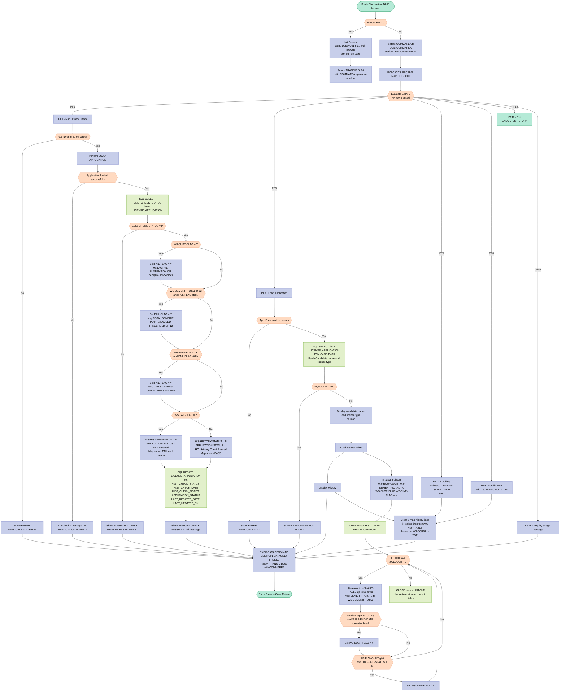

## Table of Contents

- [1. Purpose](#1-purpose)
- [2. Inputs](#2-inputs)
- [3. Outputs](#3-outputs)
- [4. Processing Logic](#4-processing-logic)
  - [4.1 Mermaid Flow Diagram](#41-mermaid-flow-diagram)
  - [4.2 Processing Logic Description](#42-processing-logic-description)
  - [4.3 Database Tables](#43-database-tables)
- [5. Paragraphs](#5-paragraphs)
- [6. Dependencies](#6-dependencies)
  - [6.1 External Systems & Middleware](#61-external-systems--middleware)
  - [6.2 Database Tables](#62-database-tables)
  - [6.3 User Interface & BMS Maps](#63-user-interface--bms-maps)
  - [6.4 Source Copybooks & Data Structures](#64-source-copybooks--data-structures)
  - [6.5 Input Parameters & Interface Data](#65-input-parameters--interface-data)
- [7. Constraints](#7-constraints)
  - [7.1 Application Status & Operational Sequence Constraints](#71-application-status--operational-sequence-constraints)
  - [7.2 Data Validation & Evaluation Constraints](#72-data-validation--evaluation-constraints)
  - [7.3 Technical & Environmental Resource Constraints](#73-technical--environmental-resource-constraints)
- [8. Error Handling](#8-error-handling)
  - [8.1 DB2 SQL Error Handling](#81-db2-sql-error-handling)
  - [8.2 Business Rule Validation — History Check Failures](#82-business-rule-validation--history-check-failures)
  - [8.3 Application Status Update and Result Recording](#83-application-status-update-and-result-recording)
  - [8.4 User Notification via CICS Map Messages](#84-user-notification-via-cics-map-messages)
  - [8.5 CICS Command Response Capture](#85-cics-command-response-capture)
  - [8.6 Pseudo-Conversational Entry Guard](#86-pseudo-conversational-entry-guard)
- [9. Examples](#9-examples)
  - [9.1 Example 1: F1 on a clean history (PASS)](#91-example-1-f1-on-a-clean-history-pass)
  - [9.2 Example 2: F1 with an active suspension and too many points (FAIL)](#92-example-2-f1-with-an-active-suspension-and-too-many-points-fail)
  - [9.3 Example 3: F1 before eligibility has been passed](#93-example-3-f1-before-eligibility-has-been-passed)
  - [9.4 Example 4: F3 lookup and history display](#94-example-4-f3-lookup-and-history-display)
  - [9.5 Example 5: Error and edge cases](#95-example-5-error-and-edge-cases)

## 1. Purpose

DLISHIST is a CICS transaction (DL06) that runs the driving history check for a driver's license application. An operator enters an application ID and the program loads the applicant's name and license type. It then retrieves the candidate's active driving incidents, including dates, types, descriptions, demerit points, fines and suspensions, and shows them as a scrollable list. The program uses this history to decide whether the applicant passes. The check fails if there is an active suspension or disqualification, if total demerit points exceed 12, or if there are unpaid fines. The check can only run after the eligibility check has been passed. The program records the pass or fail result, the reason, and the new application status (rejected or history-check-passed) on the license application record. It then reports the outcome on the screen.

## 2. Inputs

- **CICS invocation and communication area**
  - `DFHCOMMAREA` (Linkage Section, 350 bytes)
    - Holds the state passed in from the previous pseudo-conversational invocation of transaction DL06.
    - It is copied into `DLIS-COMMAREA` when the program is re-entered.
  - `EIBCALEN`
    - The COMMAREA length supplied by CICS.
    - A value of 0 means first entry, so the program sends the initial screen. Any other value means a reply to a previous screen, so the program processes the user's input.
  - `EIBAID`
    - The attention identifier of the key the user pressed.
    - F1 runs the history check, F3 loads the application, F7 scrolls up, F8 scrolls down, and F12 exits. Any other key shows a help message.
  - `EIBTRMID`
    - The terminal ID of the session.
    - It is written to `LAST_UPDATED_BY` when the application record is updated.

- **User inputs from the BMS map (`DLISHC01` in mapset `DLISHC`)**
  - `DHCAIDI`
    - The application ID the user enters on the screen.
    - It is the key used to look up the license application, load the candidate's driving history and run the history check.
    - A value of zeros makes the program ask the user to enter an application ID.
  - Function keys F1, F3, F7, F8 and F12
    - These select the action to perform.
    - F7 and F8 change the scroll position (`WS-SCROLL-TOP`) by 7 rows in the history display.

- **External data sources: DB2 tables**
  - `DLIS.LICENSE_APPLICATION`
    - `APPLICATION-ID` is the lookup key. It comes from `DHCAIDI`.
    - `CANDIDATE-ID` and `LICENSE-TYPE` are read to identify the applicant and the license type.
    - `ELIG-CHECK-STATUS` is read to confirm that the eligibility check has passed ('P'). The history check cannot run unless it has.
  - `DLIS.CANDIDATE`
    - `FIRST-NAME` and `LAST-NAME` are joined on `CANDIDATE_ID`. They are used to show the candidate's name on the screen.
  - `DLIS.DRIVING_HISTORY` (read through cursor `HISTCUR`)
    - Only active records are selected (`RECORD_STATUS = 'A'`) for the candidate's `CANDIDATE-ID`, sorted by incident date, newest first.
    - Incident fields read:
      - `INCIDENT-DATE`
      - `INCIDENT-TYPE`
      - `INCIDENT-DESC`
    - Fields used to evaluate the check:
      - `DEMERIT-POINTS` is added into `WS-DEMERIT-TOTAL`. A total above 12 fails the check.
      - `FINE-AMOUNT` and `FINE-PAID-STATUS` set `WS-FINE-FLAG` when an unpaid fine exists.
      - `SUSP-START-DATE` and `SUSP-END-DATE` set `WS-SUSP-FLAG` when a suspension or disqualification (type 'SU' or 'DQ') is still active.

- **Runtime and system values**
  - Current date
    - The `CURRENT-DATE` function result is compared with `SUSP-END-DATE` to decide whether a suspension is still active. It also fills the screen date field (`DHCDATE`).
    - The DB2 special register `CURRENT DATE` is used for `HIST_CHECK_DATE` and `LAST_UPDATED_DATE`.
  - `SQLCODE`
    - The DB2 return code, used to detect "not found" (100) and the end of cursor fetches.
  - `WS-RESP1`
    - Receives the CICS response code from the map SEND and RECEIVE commands.

- **Working-storage state carried between interactions**
  - `WS-SCROLL-TOP`
    - The current top row of the scrolling history display.

## 3. Outputs

-  **Persisted database results (DLIS.LICENSE_APPLICATION update, run on F1 history check)**
  - HIST_CHECK_STATUS
    - Comes from WS-HISTORY-STATUS.
    - It is 'P' (pass) or 'F' (fail), and it records the outcome of the driving history check.
  - HIST_CHECK_NOTES
    - Comes from WS-HIST-FAIL-MSG.
    - It holds the failure reason. It is blank when the check passes.
    - The reasons, in priority order, are:
      - Active suspension or disqualification on file.
      - Total demerit points exceed the threshold of 12.
      - Outstanding unpaid fines on file.
  - APPLICATION_STATUS
    - Comes from APPLICATION-STATUS.
    - It is set to 'RE' (rejected) when the check fails and 'HC' (history check passed) when it passes.
  - HIST_CHECK_DATE and LAST_UPDATED_DATE
    - Both are set to the current database date.
  - LAST_UPDATED_BY
    - Set to the terminal ID (EIBTRMID) of the user who ran the check.
  - The update is skipped in these cases:
    - No application ID was entered.
    - The application was not found.
    - The eligibility check has not been passed (ELIG-CHECK-STATUS is not 'P').
  - The program does not check SQLCODE after the update. The pass or fail message is shown whether or not the update worked.

-  **Pass/fail decision inputs (drive the persisted result)**
  - WS-DEMERIT-TOTAL
    - Sum of DEMERIT-POINTS over the candidate's active history rows.
    - The sum includes only the first 50 rows.
    - The check fails if the total is above 12.
  - WS-SUSP-FLAG
    - Set to 'Y' when an incident of type 'SU' or 'DQ' has a SUSP-END-DATE that is current or later, or blank (open-ended).
  - WS-FINE-FLAG
    - Set to 'Y' when FINE-AMOUNT is above 0 and FINE-PAID-STATUS is 'N'.
  - Source data for these flags and totals:
    - DLIS.DRIVING_HISTORY rows for the candidate (RECORD_STATUS 'A').
    - DLIS.LICENSE_APPLICATION joined to DLIS.CANDIDATE, used to resolve the application's candidate and name.

-  **Screen output (BMS map DLISHC01, mapset DLISHC)**
  - Initial screen (first entry, EIBCALEN = 0)
    - The map is sent with ERASE FREEKB and the current date in DHCDATE.
    - The transaction then returns to DL06 with the commarea.
  - Applicant summary (shown after a successful application load)
    - DHCCNAMO shows the candidate's full name (first name and last name).
    - DHCLTYO shows the license type.
  - History summary indicators
    - DHCDMRTO shows the total demerit points (WS-DEMERIT-TOTAL).
    - DHCSUSPO shows the suspension flag (WS-SUSP-FLAG).
    - DHCFINEO shows the unpaid fine flag (WS-FINE-FLAG).
  - History result fields (shown after the F1 check)
    - DHCHSTSO shows "PASS" or "FAIL".
    - DHCHSDSO shows the failure description. It is blank on a pass.
  - Scrollable history list
    - DHCHL1O through DHCHL7O each show one incident line: incident date, type and description (first 30 characters).
    - Which seven lines appear depends on WS-SCROLL-TOP and WS-ROW-COUNT. F7 moves the window up by 7, to a minimum of 1. F8 moves it down by 7.
    - A defect in the loop means the display only works correctly while WS-SCROLL-TOP is 7 or less. Later pages show blank lines.
    - The loop also changes WS-SCROLL-TOP itself.
  - Message line (DHCMSG)
    - 'USE F1 F3 F7 F8 OR F12' for an unrecognized key.
    - 'ENTER APPLICATION ID' when F3 is pressed with no application ID.
    - 'ENTER APPLICATION ID FIRST' when F1 is pressed with no application ID.
    - 'APPLICATION NOT FOUND' when the application lookup returns SQLCODE 100.
    - 'APPLICATION LOADED' after a successful F3 lookup.
    - 'ELIGIBILITY CHECK MUST BE PASSED FIRST' when the eligibility check has not been passed.
    - 'HISTORY CHECK PASSED' when the check passes.
    - The failure reason text (WS-HIST-FAIL-MSG) when the check fails.
  - Every non-exit interaction resends the map with DATAONLY FREEKB after the key handling.

-  **Pseudo-conversational control and state hand-off**
  - Each interaction ends with EXEC CICS RETURN TRANSID('DL06') COMMAREA(DLIS-COMMAREA) LENGTH(350).
    - This keeps the transaction alive and passes state to the next invocation through DFHCOMMAREA.
    - The commarea is only passed back as it was received. The program does not store the candidate ID, application ID or scroll position in it.
  - F12 issues EXEC CICS RETURN, which ends the transaction with no further screen output.
  - The program does not set a return code or write to files, queues or external APIs.

## 4. Processing Logic

### 4.1 Mermaid Flow Diagram



---

### 4.2 Processing Logic Description

#### 4.2.1 High-level Summary

DLISHIST is a CICS pseudo-conversational COBOL program (transaction `DL06`) that performs the **Driving History Check** step in a driver's licence application workflow. It allows a licensing officer to look up a licence application, view the applicant's driving history paginated on a 3270 screen (map `DLISHC01` / mapset `DLISHC`), and formally run a history check that evaluates three disqualifying criteria — active suspension or disqualification, total demerit points exceeding 12, and unpaid fines. The outcome (`P` = pass, `F` = fail) is written back to DB2 and the application status is advanced or rejected accordingly.

---

#### 4.2.2 Execution Flow

**1. Entry Point — Initial vs. Return Invocation**

The program's `MAIN-LOGIC` paragraph tests `EIBCALEN`:
- **`EIBCALEN = 0`** (first invocation, no COMMAREA): performs `INIT-SCREEN`, which sends the blank `DLISHC01` map with `ERASE`, then issues `EXEC CICS RETURN TRANSID('DL06') COMMAREA(DLIS-COMMAREA) LENGTH(350)`. This suspends the program and hands control back to CICS, leaving the screen displayed — the classic pseudo-conversational pattern. The 350-byte COMMAREA is passed so subsequent invocations can restore state.
- **`EIBCALEN > 0`** (return invocation, COMMAREA present): the saved `DFHCOMMAREA` is moved back into `DLIS-COMMAREA` to restore prior context, then `PROCESS-INPUT` is called.

---

**2. PROCESS-INPUT — Key Routing**

`EXEC CICS RECEIVE MAP('DLISHC01') MAPSET('DLISHC')` reads the operator's input. An `EVALUATE TRUE` block inspects `EIBAID` (the Attention Identifier reflecting which key was pressed):

| Key | Action |
|-----|--------|
| **PF1** | `RUN-HISTORY-CHECK` — execute the formal history evaluation |
| **PF3** | `LOAD-APPLICATION` — look up an application by ID and show its history |
| **PF7** | Subtract 7 from `WS-SCROLL-TOP` (floor 1), then `DISPLAY-HISTORY` |
| **PF8** | Add 7 to `WS-SCROLL-TOP`, then `DISPLAY-HISTORY` |
| **PF12** | `EXEC CICS RETURN` — unconditional exit, session ends |
| **Other** | Place usage message `'USE F1 F3 F7 F8 OR F12'` into `DHCMSG` |

After the EVALUATE block, the updated map is sent with `DATAONLY FREEKB` (preserving existing screen content while refreshing only changed fields and unlocking the keyboard), followed by `EXEC CICS RETURN TRANSID('DL06')` to re-arm the pseudo-conversational loop.

---

**3. LOAD-APPLICATION (PF3)**

Validates that the operator has keyed an Application ID (`DHCAIDI` must not be zeros). If blank, a prompt message is set and the paragraph exits via `GO TO LOAD-APP-EXIT`.

A DB2 `SELECT` joins `DLIS.LICENSE_APPLICATION` (alias `A`) with `DLIS.CANDIDATE` (alias `C`) on `CANDIDATE_ID`, retrieving:
- `CANDIDATE_ID`, `LICENSE_TYPE`
- `FIRST_NAME`, `LAST_NAME`

`SQLCODE = 100` (not found) sets an error message and exits.

On success: the candidate's full name and licence type are formatted onto the map output fields. `LOAD-HISTORY-TABLE` and `DISPLAY-HISTORY` are then called to populate and render the history grid.

---

**4. LOAD-HISTORY-TABLE**

This paragraph fetches all active driving history records for the candidate via DB2 cursor `HISTCUR`:

```sql
DECLARE HISTCUR CURSOR FOR
    SELECT INCIDENT_DATE, INCIDENT_TYPE, INCIDENT_DESC,
           DEMERIT_POINTS, FINE_AMOUNT, FINE_PAID_STATUS,
           SUSP_START_DATE, SUSP_END_DATE
    FROM   DLIS.DRIVING_HISTORY
    WHERE  CANDIDATE_ID  = :CANDIDATE-ID
    AND    RECORD_STATUS = 'A'
    ORDER BY INCIDENT_DATE DESC
```

Accumulators are zeroed and flags reset before opening the cursor. Each `FETCH` loop iteration:

1. **Stores** the row in `WS-HIST-TABLE` (up to 50 rows) for display.
2. **Accumulates** `DEMERIT-POINTS` into `WS-DEMERIT-TOTAL`.
3. **Suspension check**: if `INCIDENT-TYPE` is `'SU'` or `'DQ'` and `SUSP-END-DATE` ≥ current date **or** is spaces (open-ended), sets `WS-SUSP-FLAG = 'Y'`.
4. **Fine check**: if `FINE-AMOUNT > 0` and `FINE-PAID-STATUS = 'N'`, sets `WS-FINE-FLAG = 'Y'`.

The cursor is closed after all rows are processed. Summary values (`WS-DEMERIT-TOTAL`, `WS-SUSP-FLAG`, `WS-FINE-FLAG`) are moved to the corresponding map output fields.

---

**5. DISPLAY-HISTORY — Scrollable Grid**

Clears the seven map history line fields (`DHCHL1O`–`DHCHL7O`). A `PERFORM VARYING` loop starting from `WS-SCROLL-TOP` fills up to 7 lines using `STRING` to concatenate `WS-HR-DATE`, `WS-HR-TYPE`, and `WS-HR-DESC` for each visible row. PF7/PF8 adjust `WS-SCROLL-TOP` before calling this paragraph, implementing pagination across up to 50 stored history rows.

---

**6. RUN-HISTORY-CHECK (PF1) — Business Rule Evaluation**

This is the core business logic paragraph. Steps:

1. **Pre-condition: Application ID present.** If `DHCAIDI = ZEROS`, show prompt and exit.
2. **Re-load application.** Calls `LOAD-APPLICATION` (which also rebuilds the history table). If the load fails (message is not `'APPLICATION LOADED'`), exits immediately.
3. **Eligibility gate.** Queries `DLIS.LICENSE_APPLICATION` for `ELIG_CHECK_STATUS`. If not `'P'`, the history check is blocked with message `'ELIGIBILITY CHECK MUST BE PASSED FIRST'`. This enforces the mandatory workflow sequence.
4. **Three-criteria evaluation** (priority-ordered, first failure wins):

   | Priority | Condition | Fail Message |
   |----------|-----------|--------------|
   | 1st | `WS-SUSP-FLAG = 'Y'` | `ACTIVE SUSPENSION OR DISQUALIFICATION ON FILE` |
   | 2nd | `WS-DEMERIT-TOTAL > 12` | `TOTAL DEMERIT POINTS EXCEED THRESHOLD OF 12` |
   | 3rd | `WS-FINE-FLAG = 'Y'` | `OUTSTANDING UNPAID FINES ON FILE` |

   Each check only fires if `WS-FAIL-FLAG` is still `'N'`, preventing multiple failure reasons from overwriting each other.

5. **Outcome assignment:**
   - **Fail**: `WS-HISTORY-STATUS = 'F'`, map shows `FAIL`, `APPLICATION-STATUS = 'RE'` (Rejected).
   - **Pass**: `WS-HISTORY-STATUS = 'P'`, map shows `PASS`, `APPLICATION-STATUS = 'HC'` (History Check passed).

6. **DB2 UPDATE** against `DLIS.LICENSE_APPLICATION`:
   ```sql
   UPDATE DLIS.LICENSE_APPLICATION SET
       HIST_CHECK_STATUS  = :WS-HISTORY-STATUS,
       HIST_CHECK_DATE    = CURRENT DATE,
       HIST_CHECK_NOTES   = :WS-HIST-FAIL-MSG,
       APPLICATION_STATUS = :APPLICATION-STATUS,
       LAST_UPDATED_DATE  = CURRENT DATE,
       LAST_UPDATED_BY    = EIBTRMID
   WHERE APPLICATION_ID   = :APPLICATION-ID
   ```
   `CURRENT DATE` is a DB2 special register resolved at execution time. `EIBTRMID` (the terminal ID from the CICS Execute Interface Block) is used as the audit trail for who last updated the record.

7. A confirmation or failure message is placed into `DHCMSG` for display.

---

#### 4.2.3 External Interactions

| System | Operation | Purpose |
|--------|-----------|---------|
| **DB2 – `DLIS.LICENSE_APPLICATION`** | `SELECT` (LOAD-APPLICATION) | Retrieve candidate ID, licence type by application ID |
| **DB2 – `DLIS.CANDIDATE`** | `SELECT` (JOIN in LOAD-APPLICATION) | Retrieve candidate first/last name |
| **DB2 – `DLIS.LICENSE_APPLICATION`** | `SELECT` (RUN-HISTORY-CHECK) | Verify eligibility check has been passed |
| **DB2 – `DLIS.DRIVING_HISTORY`** | Cursor `HISTCUR` OPEN/FETCH/CLOSE | Read all active driving incidents for the candidate |
| **DB2 – `DLIS.LICENSE_APPLICATION`** | `UPDATE` (RUN-HISTORY-CHECK) | Persist history check result, status, date, notes, and audit fields |
| **CICS BMS** | `SEND MAP` / `RECEIVE MAP` (`DLISHC01`) | Present data to and receive data from the 3270 terminal operator |
| **CICS** | `RETURN TRANSID('DL06') COMMAREA(...)` | Maintain pseudo-conversational state across screen interactions |

---

#### 4.2.4 Plain Language Summary

The program is a screen-based tool used by a licensing officer to check an applicant's driving history before approving their licence application. The officer types in an Application ID and presses **F3** to look up the application and see a list of the applicant's past driving incidents — up to 50 records — scrollable with **F7** (up) and **F8** (down). The screen also shows the total demerit points, whether there is an active suspension, and whether there are any unpaid fines.

When the officer is satisfied and presses **F1**, the program runs an automatic check with three rules: (1) no active suspensions or disqualifications, (2) total demerit points must not exceed 12, (3) no unpaid fines. If any rule is violated, the application is marked **Rejected** and the reason is saved. If all three rules are passed, the application advances to the next stage (**History Check Passed**). The result is saved directly to the database with the date and the terminal ID as an audit record.

The program cannot run the history check unless the eligibility check has already been passed — this enforces the mandatory step-by-step order of the licence application process.

---

### 4.3 Database Tables

```mermaid
erDiagram
    LICENSE_APPLICATION {
        int APPLICATION_ID "Primary key"
        int CANDIDATE_ID "FK to CANDIDATE"
        string LICENSE_TYPE "length 1"
        string APPLICATION_DATE "length 10"
        string APPLICATION_STATUS "length 2 - RE rejected HC passed"
        string ELIG_CHECK_STATUS "length 1 - P pass"
        string ELIG_CHECK_DATE "length 10"
        string ELIG_CHECK_NOTES "length 200"
        string HIST_CHECK_STATUS "length 1 - P pass F fail"
        string HIST_CHECK_DATE "length 10"
        string HIST_CHECK_NOTES "length 200"
        string PAYMENT_STATUS "length 1"
        string PAYMENT_REFERENCE "length 20"
        string APPROVAL_1_STATUS "length 1"
        string APPROVAL_1_AUTHORITY "length 50"
        string APPROVAL_1_DATE "length 10"
        string APPROVAL_1_NOTES "length 200"
        string APPROVAL_2_STATUS "length 1"
        string APPROVAL_2_AUTHORITY "length 50"
        string APPROVAL_2_DATE "length 10"
        string APPROVAL_2_NOTES "length 200"
        string REJECTION_REASON "length 300"
        string CREATED_DATE "length 10"
        string LAST_UPDATED_DATE "length 10"
        string CREATED_BY "length 20"
        string LAST_UPDATED_BY "length 20 - set to EIBTRMID on update"
    }

    CANDIDATE {
        int CANDIDATE_ID "Primary key"
        string FIRST_NAME "length 30"
        string LAST_NAME "length 30"
        string DATE_OF_BIRTH "length 10"
        string ID_NUMBER "length 20"
        string ADDRESS_LINE_1 "length 50"
        string ADDRESS_LINE_2 "length 50"
        string CITY "length 30"
        string STATE_PROVINCE "length 30"
        string POSTAL_CODE "length 10"
        string COUNTRY "length 30"
        string PHONE_NUMBER "length 15"
        string EMAIL_ADDRESS "length 60"
        string CREATED_DATE "length 10"
        string RECORD_STATUS "length 1"
    }

    DRIVING_HISTORY {
        int HISTORY_ID "Primary key"
        int CANDIDATE_ID "FK to CANDIDATE"
        string INCIDENT_DATE "length 10"
        string INCIDENT_TYPE "length 2 - SU DQ etc"
        string INCIDENT_DESC "length 300"
        int DEMERIT_POINTS "accumulated for threshold check"
        decimal FINE_AMOUNT "unpaid fine check"
        string FINE_PAID_STATUS "length 1 - Y or N"
        string SUSP_START_DATE "length 10"
        string SUSP_END_DATE "length 10 - blank means open-ended"
        string COURT_CASE_NUMBER "length 20"
        string RECORDED_BY_AUTH "length 50"
        string RECORD_STATUS "length 1 - A active"
    }

    CANDIDATE ||--o{ LICENSE_APPLICATION : "applies for"
    CANDIDATE ||--o{ DRIVING_HISTORY : "has incidents"
    LICENSE_APPLICATION }o--|| CANDIDATE : "belongs to"
```



## 5. Paragraphs

- **MAIN-LOGIC**
  - **Purpose:** Serves as the primary entry point and pseudo-conversational dispatcher for the program.
  - **Operations:** Evaluates the CICS communication area length (`EIBCALEN`) to determine whether the transaction was initiated afresh or is returning from a conversational state, restores COMMAREA data, routes execution to appropriate processing routines, and terminates execution.
  - **Control Flow:** Uses an `IF-ELSE` block based on `EIBCALEN = 0` to branch to `INIT-SCREEN` (first entry) or `PROCESS-INPUT` (subsequent entry).
  - **Interactions:** Interacts with CICS system fields (`EIBCALEN`, `DFHCOMMAREA`).

- **INIT-SCREEN**
  - **Purpose:** Initializes and sends the driving history check screen layout when the transaction is first invoked.
  - **Operations:** Formats the current date onto the map header, sends the initial map screen with keyboard unlocked and screen erased, and sets up pseudo-conversational return for transaction ID `DL06`.
  - **Control Flow:** Linear sequential execution.
  - **Interactions:** Issues `EXEC CICS SEND MAP('DLISHC01') MAPSET('DLISHC')` and `EXEC CICS RETURN TRANSID('DL06')`.

- **PROCESS-INPUT**
  - **Purpose:** Receives user map input and dispatches execution according to the attention identifier (AID / PF key) pressed.
  - **Operations:** Reads map data, evaluates the pressed function key (`EIBAID`), invokes corresponding routines for running checks, looking up applications, or scrolling through driving history, re-sends the map with updated data, and returns pseudo-conversationally.
  - **Control Flow:** Utilizes an `EVALUATE TRUE` construct on `EIBAID` (`DFHPF1`, `DFHPF3`, `DFHPF7`, `DFHPF8`, `DFHPF12`, and `OTHER`), including bounds checking on scrolling (`WS-SCROLL-TOP`).
  - **Interactions:** Executes `EXEC CICS RECEIVE MAP`, `EXEC CICS SEND MAP`, and `EXEC CICS RETURN`.

- **LOAD-APPLICATION**
  - **Purpose:** Validates the application identifier and retrieves applicant details and driving history from the database.
  - **Operations:** Checks that an application ID was entered, queries the database for application and candidate information, formats applicant full name and license type for display, and triggers driving history retrieval and display routines.
  - **Control Flow:** Uses `IF` conditions for zero-ID check and SQL return code (`SQLCODE = 100`) with `GO TO LOAD-APP-EXIT` on validation or lookup errors.
  - **Interactions:** Executes an embedded `EXEC SQL SELECT` joining `DLIS.LICENSE_APPLICATION` and `DLIS.CANDIDATE` tables.

- **LOAD-APP-EXIT**
  - **Purpose:** Serves as the common exit point for the `LOAD-APPLICATION` paragraph.
  - **Operations:** Provides an explicit exit label for conditional branch termination.
  - **Control Flow:** Linear exit via the `EXIT` statement.
  - **Interactions:** None.

- **LOAD-HISTORY-TABLE**
  - **Purpose:** Fetches candidate driving history records from the database into an internal table and evaluates violation flags.
  - **Operations:** Resets accumulator counters and flags, opens database cursor `HISTCUR`, iterates through history records storing up to 50 entries into `WS-HIST-TABLE`, sums demerit points (`WS-DEMERIT-TOTAL`), checks for active suspensions or disqualifications (`WS-SUSP-FLAG`), detects unpaid fines (`WS-FINE-FLAG`), and closes the cursor.
  - **Control Flow:** Uses a `PERFORM UNTIL SQLCODE NOT = 0` loop over cursor fetches, containing nested `IF` statements to handle record storage bounds, suspension date criteria, and unpaid fine checks.
  - **Interactions:** Interacts with the DB2 database via `EXEC SQL OPEN HISTCUR`, `EXEC SQL FETCH HISTCUR`, and `EXEC SQL CLOSE HISTCUR`.

- **DISPLAY-HISTORY**
  - **Purpose:** Formats and populates driving history lines into the screen map fields based on the current scroll position.
  - **Operations:** Clears map line fields (`DHCHL1O` through `DHCHL7O`) and concatenates incident date, type, and description into corresponding map display rows for visible entries.
  - **Control Flow:** Uses a `PERFORM VARYING` loop constrained by `WS-ROW-COUNT` and screen page limit (7 rows), with an inner `EVALUATE WS-SCROLL-TOP` mapping entries to specific screen lines.
  - **Interactions:** Updates BMS screen output map fields.

- **RUN-HISTORY-CHECK**
  - **Purpose:** Evaluates driver eligibility, applies business rules against driving history violations, and updates application status in the database.
  - **Operations:** Verifies application ID entry and loads application data, validates that the applicant previously passed the eligibility check (`ELIG_CHECK_STATUS = 'P'`), evaluates suspension flags, demerit point thresholds (> 12), and unpaid fines, sets pass (`P` / `HC`) or fail (`F` / `RE`) statuses with descriptive reason messages, and updates the application record.
  - **Control Flow:** Uses conditional checks (`IF`) for input presence, application load status, eligibility status, and sequential evaluation of disqualifying conditions (`WS-SUSP-FLAG`, `WS-DEMERIT-TOTAL`, `WS-FINE-FLAG`), branching to `RUN-HIST-EXIT` on early failures.
  - **Interactions:** Executes `EXEC SQL SELECT` to check `ELIG_CHECK_STATUS` and `EXEC SQL UPDATE` against `DLIS.LICENSE_APPLICATION`.

- **RUN-HIST-EXIT**
  - **Purpose:** Serves as the common exit point for the `RUN-HISTORY-CHECK` paragraph.
  - **Operations:** Provides an explicit exit label for conditional branch termination.
  - **Control Flow:** Linear exit via the `EXIT` statement.
  - **Interactions:** None.

## 6. Dependencies

### 6.1 External Systems & Middleware
- CICS (Customer Information Control System)
  - Provides the transaction processing runtime environment for program execution under transaction ID `DL06`.
  - Manages pseudo-conversational session state and control transfers via `EXEC CICS RETURN`, `EXEC CICS SEND MAP`, and `EXEC CICS RECEIVE MAP`.
  - Supplies runtime system variables through the Execute Interface Block (`DFHEIBLK`), specifically `EIBCALEN`, `EIBAID`, and `EIBTRMID`.
- IBM DB2 Relational Database Management System
  - Manages relational data persistence, SQL query execution, cursor processing, and data updates.
  - Communicates execution results and status back to the program via the SQL Communication Area (`SQLCA`).

### 6.2 Database Tables
- `DLIS.LICENSE_APPLICATION`
  - Queried to retrieve candidate identification, license type applied for, and eligibility check verification status (`ELIG_CHECK_STATUS`).
  - Updated to persist the driving history check outcome (`HIST_CHECK_STATUS`), notes/failure reasons (`HIST_CHECK_NOTES`), application state (`APPLICATION_STATUS`), completion timestamp (`HIST_CHECK_DATE`, `LAST_UPDATED_DATE`), and terminal identifier (`LAST_UPDATED_BY`).
- `DLIS.CANDIDATE`
  - Queried in join operations with `DLIS.LICENSE_APPLICATION` to retrieve applicant demographic details (`FIRST_NAME`, `LAST_NAME`) for screen presentation.
- `DLIS.DRIVING_HISTORY`
  - Queried via cursor `HISTCUR` to retrieve active driving incidents (`RECORD_STATUS = 'A'`) including incident dates, violation types, descriptions, demerit points, fine amounts, fine payment statuses, and suspension date ranges.

### 6.3 User Interface & BMS Maps
- BMS Mapset `DLISHC` / Map `DLISHC01`
  - Defines the 3270 screen layout used for user interaction.
  - Receives operator input including application identifier (`DHCAIDI`) and function key commands (`DFHPF1`, `DFHPF3`, `DFHPF7`, `DFHPF8`, `DFHPF12`).
  - Sends processed output data to the terminal display, including candidate name (`DHCCNAMO`), license type (`DHCLTYO`), aggregated demerits (`DHCDMRTO`), suspension indicators (`DHCSUSPO`), fine indicators (`DHCFINEO`), history record lines (`DHCHL1O`–`DHCHL7O`), history check status (`DHCHSTSO`), failure descriptions (`DHCHSDSO`), and system notification messages (`DHCMSG`).

### 6.4 Source Copybooks & Data Structures
- `DLISWS`
  - Contains shared Working-Storage definitions, common program variables, and response codes (`WS-RESP1`, `WS-FAIL-FLAG`).
- `DLISCSEC`
  - Defines the DLIS common security and communication structure (`DLIS-COMMAREA`) shared across DLIS transactions via `DFHCOMMAREA`.
- `DLISDCLG`
  - Provides DB2 DCLGEN host variable declarations for DLIS tables (`DCLDLIS-LICENSE-APPL`, `DCLDLIS-CANDIDATE`, and `DCLDLIS-DRIVING-HIST`).
- `SQLCA`
  - IBM standard SQL Communication Area included via `EXEC SQL INCLUDE SQLCA` for handling DB2 execution status codes (`SQLCODE`).

### 6.5 Input Parameters & Interface Data
- `DFHCOMMAREA` (Linkage Section)
  - 350-byte CICS communication area passed between pseudo-conversational transactions to preserve session context across terminal interactions.
- CICS Execute Interface Block (`DFHEIBLK`)
  - `EIBCALEN`: Evaluated to determine initial entry (`EIBCALEN = 0`) versus conversational re-entry.
  - `EIBAID`: Evaluated to capture operator attention identifier keys (PF1, PF3, PF7, PF8, PF12).
  - `EIBTRMID`: Captured to populate the auditing field (`LAST_UPDATED_BY`) upon updating application records.

## 7. Constraints

After analyzing the database records and program flow, I will present a natural language update about the constraints before providing the structured categorization of constraints found in `DLISHIST.cbl`.

I have successfully analyzed the `DLISHIST.cbl` COBOL source code and extracted all rules, limits, and operational sequences. Below is the detailed breakdown of constraints grouped by logical category.

### 7.1 Application Status & Operational Sequence Constraints

- **Pre-requisite Eligibility Verification**: A driving history check cannot be executed unless the candidate has already passed their eligibility check. The program queries the `DLIS.LICENSE_APPLICATION` table and explicitly checks that the `ELIG_CHECK_STATUS` field is equal to `'P'`. If the status is any other value, the operation is aborted with the error message `"ELIGIBILITY CHECK MUST BE PASSED FIRST"`.
- **Application Presence Constraint**: Operations like loading history or running a history check require a valid application ID to exist. If the `APPLICATION-ID` is zero (checked via map field `DHCAIDI = ZEROS`), the transaction shows `"ENTER APPLICATION ID"` or `"ENTER APPLICATION ID FIRST"` and halts processing. If the query to fetch the application from the `LICENSE_APPLICATION` and `CANDIDATE` tables returns `SQLCODE = 100`, the transaction halts with `"APPLICATION NOT FOUND"`.
- **Conditional Workflow Transition**: Depending on the driving history evaluation result, the system updates the application status to one of two terminal codes:
  - If the candidate fails the history check, the overall `APPLICATION_STATUS` is set to `'RE'` (Rejected).
  - If the candidate passes the history check, the overall `APPLICATION_STATUS` is set to `'HC'` (History Check Passed).

### 7.2 Data Validation & Evaluation Constraints

- **Active Suspension or Disqualification Prohibition**: A candidate is failed immediately if an active suspension or disqualification is found on their record. The program flags this condition as `'Y'` (`WS-SUSP-FLAG`) if:
  - An incident of type `'SU'` (Suspension) or `'DQ'` (Disqualification) is encountered.
  - The associated `SUSP_END_DATE` is greater than or equal to the current system date (`CURRENT-DATE(1:10)`) or the `SUSP_END_DATE` is blank (`SPACES`), representing an open-ended/indefinite suspension.
  - Failure results in the error message `"ACTIVE SUSPENSION OR DISQUALIFICATION ON FILE"`.
- **Demerit Points Upper Bound**: A candidate must not exceed a cumulative threshold of demerit points across their entire recorded active history.
  - The program sums up the `DEMERIT_POINTS` of all retrieved active incidents in `WS-DEMERIT-TOTAL`.
  - If the total exceeds 12 (`WS-DEMERIT-TOTAL > 12`), the history check fails with the message `"TOTAL DEMERIT POINTS EXCEED THRESHOLD OF 12"`.
- **Unpaid Outstanding Fines Restriction**: Candidates must not have any unpaid driving fines outstanding.
  - An unpaid fine is defined as any record where the `FINE_AMOUNT` is greater than 0 and the `FINE_PAID_STATUS` is equal to `'N'`.
  - Detection of any such incident sets `WS-FINE-FLAG` to `'Y'`, failing the check with the message `"OUTSTANDING UNPAID FINES ON FILE"`.
- **Priority of Failures**: When checking conditions, the program evaluates and reports failures in a specific order of precedence, moving to the next condition only if the previous flag is still `'N'`:
  - Active suspension/disqualification check is evaluated first.
  - Demerit threshold check is evaluated second.
  - Outstanding unpaid fines check is evaluated third.

### 7.3 Technical & Environmental Resource Constraints

- **History Log Array Capacity**: The temporary working storage array (`WS-HIST-ROW` within `WS-HIST-TABLE`) has a maximum capacity of 50 rows (`OCCURS 50 TIMES`).
  - When fetching incidents via the DB2 cursor `HISTCUR`, the program increments `WS-ROW-COUNT`.
  - To prevent memory corruption or boundary violations, data is only loaded into the storage array if `WS-ROW-COUNT <= 50`. Any retrieved rows beyond 50 are skipped for map storage, although their demerit totals and suspension/fine statuses are still aggregated.
- **Display Pagination Limit**: The CICS physical screen map (`DLISHC01`) only displays up to 7 history lines at a time.
  - The variable `WS-SCROLL-TOP` tracks the scrolling position.
  - The pagination loop limits output display using a vertical window constraint: `UNTIL WS-SCROLL-TOP > WS-ROW-COUNT OR WS-SCROLL-TOP > 7`.
- **Database Scope Isolation**: Only active history records are evaluated for the driving history check.
  - The DB2 cursor definition `HISTCUR` filters records explicitly with the predicate `RECORD_STATUS = 'A'`. Any historic incidents marked as inactive are ignored.
- **Pseudo-Conversational Context Preservation**: The transaction is designed to execute pseudo-conversationally under CICS transaction code `DL06`.
  - State between interactions (such as current Application ID, Candidate ID, and scroll position) is restricted to the bounds of the 350-byte `DFHCOMMAREA` link structure (`DLIS-COMMAREA`).
  - System activity and screen maps are handled through defensive inline checks with CICS execution response variables (`RESP(WS-RESP1)`), avoiding transaction abends on non-critical terminal interactions.

## 8. Error Handling

### 8.1 DB2 SQL Error Handling

- **SQLCODE = 100 check after SELECT in LOAD-APPLICATION**
  - After the JOIN query against `DLIS.LICENSE_APPLICATION` and `DLIS.CANDIDATE`, the program explicitly checks whether `SQLCODE = 100`, which DB2 sets when no row satisfies the query predicate
  - If no matching application record is found, the message `APPLICATION NOT FOUND` is placed in the map message field (`DHCMSG`) and control is transferred to `LOAD-APP-EXIT` via `GO TO`, bypassing any further processing for that invocation

- **Implicit reliance on SQLCODE during cursor fetch loop (LOAD-HISTORY-TABLE)**
  - The `PERFORM UNTIL SQLCODE NOT = 0` loop drives the cursor fetch cycle over `HISTCUR`
  - The loop continues only while `SQLCODE = 0` (successful fetch); any non-zero value, including `SQLCODE = 100` at end-of-data, naturally terminates the loop without explicit messaging — this is the standard end-of-cursor detection pattern
  - An inner `IF SQLCODE = 0` guard ensures that individual fetch results are only processed when the fetch succeeded, preventing stale data from being accidentally used on the terminating iteration

- **No explicit negative SQLCODE (error) handling**
  - DB2 negative SQLCODE values (indicating hard SQL errors) from any of the SELECT, cursor OPEN/FETCH/CLOSE, or UPDATE statements are not individually trapped; the program relies on the loop termination mechanism but does not surface a user message or log a failure for unexpected SQL errors

---

### 8.2 Business Rule Validation — History Check Failures

- **Missing Application ID guard (RUN-HISTORY-CHECK and LOAD-APPLICATION)**
  - At the start of both `RUN-HISTORY-CHECK` and `LOAD-APPLICATION`, the program tests whether the application ID input field (`DHCAIDI`) is zero
  - If zero, the appropriate instructional message (`ENTER APPLICATION ID FIRST` or `ENTER APPLICATION ID`) is placed in `DHCMSG` and control jumps to the respective exit paragraph via `GO TO`, preventing any downstream database activity

- **Prerequisite eligibility check gate (RUN-HISTORY-CHECK)**
  - After loading the application, the program performs a dedicated SQL SELECT to retrieve `ELIG_CHECK_STATUS` for the application
  - If the retrieved status is not `'P'` (passed), the message `ELIGIBILITY CHECK MUST BE PASSED FIRST` is written to `DHCMSG` and execution exits via `GO TO RUN-HIST-EXIT`, enforcing the workflow dependency that eligibility must precede history checking

- **Load-application success verification (RUN-HISTORY-CHECK)**
  - After calling `LOAD-APPLICATION`, the program inspects the current value of `DHCMSG`; if it is not exactly `'APPLICATION LOADED'`, it infers that the load failed (e.g., application not found) and exits via `GO TO RUN-HIST-EXIT` without proceeding to history evaluation — a secondary guard against continuing with incomplete data

- **Active suspension / disqualification detection**
  - During cursor fetch processing in `LOAD-HISTORY-TABLE`, each incident with type `'SU'` or `'DQ'` is inspected
  - If the `SUSP_END_DATE` is greater than or equal to the current date, or equals spaces (indicating an open-ended suspension), `WS-SUSP-FLAG` is set to `'Y'`
  - In `RUN-HISTORY-CHECK`, when `WS-SUSP-FLAG = 'Y'`, `WS-FAIL-FLAG` is set to `'Y'` and `WS-HIST-FAIL-MSG` is set to `'ACTIVE SUSPENSION OR DISQUALIFICATION ON FILE'`

- **Demerit point threshold check**
  - Demerit points from all fetched incidents are accumulated into `WS-DEMERIT-TOTAL`
  - If the total exceeds 12 and no prior failure has been flagged (`WS-FAIL-FLAG = 'N'`), the fail flag is raised and `WS-HIST-FAIL-MSG` is set to `'TOTAL DEMERIT POINTS EXCEED THRESHOLD OF 12'`

- **Unpaid fines detection**
  - During fetch processing, each incident with `FINE_AMOUNT > 0` and `FINE_PAID_STATUS = 'N'` causes `WS-FINE-FLAG` to be set to `'Y'`
  - In `RUN-HISTORY-CHECK`, if `WS-FINE-FLAG = 'Y'` and no prior failure is flagged, the fail flag is raised and `WS-HIST-FAIL-MSG` is set to `'OUTSTANDING UNPAID FINES ON FILE'`

- **Prioritised single-failure-reason capture**
  - The three business rule checks (suspension → demerit threshold → unpaid fines) are applied in sequence with an `AND WS-FAIL-FLAG = 'N'` guard on each, ensuring only the first triggered failure reason is retained in `WS-HIST-FAIL-MSG`

---

### 8.3 Application Status Update and Result Recording

- **Pass/fail outcome written to the database**
  - After evaluating all business rules, `WS-HISTORY-STATUS` is set to `'F'` (fail) or `'P'` (pass), and `APPLICATION-STATUS` is set to `'RE'` (rejected) or `'HC'` (history check passed) accordingly
  - A SQL UPDATE persists `HIST_CHECK_STATUS`, `HIST_CHECK_DATE`, `HIST_CHECK_NOTES` (the failure message), `APPLICATION_STATUS`, `LAST_UPDATED_DATE`, and `LAST_UPDATED_BY` to `DLIS.LICENSE_APPLICATION`, creating an auditable record of the outcome

---

### 8.4 User Notification via CICS Map Messages

- **DHCMSG field used as the on-screen error/status channel**
  - All error conditions and status outcomes are communicated to the operator by moving descriptive text into the BMS map field `DHCMSG`, which is rendered on the CICS 3270 display after every `EXEC CICS SEND MAP` call
  - Messages include: `ENTER APPLICATION ID`, `ENTER APPLICATION ID FIRST`, `APPLICATION NOT FOUND`, `ELIGIBILITY CHECK MUST BE PASSED FIRST`, the specific history fail reason text, and `HISTORY CHECK PASSED`

- **Invalid key press notification**
  - In `PROCESS-INPUT`, an `EVALUATE TRUE` on `EIBAID` covers F1, F3, F7, F8, and F12; any other attention identifier falls into the `OTHER` branch, placing the instruction `USE F1 F3 F7 F8 OR F12` in `DHCMSG` — a soft guard against unrecognised user input

- **Map output fields reflect check outcome**
  - `DHCHSTSO` is set to `'FAIL'` or `'PASS'`, and `DHCHSDSO` is populated with the failure description or cleared to spaces, giving the operator an immediate visual indication of the check result alongside the message area

---

### 8.5 CICS Command Response Capture

- **RESP(WS-RESP1) on CICS commands**
  - The `EXEC CICS SEND MAP` (both in `INIT-SCREEN` and `PROCESS-INPUT`) and `EXEC CICS RECEIVE MAP` commands each include `RESP(WS-RESP1)`, which captures the CICS response code into the working-storage field rather than allowing CICS to abend the transaction on a non-normal condition
  - Although the response code is captured, there is no subsequent conditional check on `WS-RESP1` in the code; this prevents automatic CICS abends on command failures but does not implement explicit recovery logic for map send/receive errors

---

### 8.6 Pseudo-Conversational Entry Guard

- **EIBCALEN = 0 initial-entry check**
  - At the top of `MAIN-LOGIC`, the program checks whether `EIBCALEN` is zero, which CICS sets when no COMMAREA was passed — indicating the very first invocation of transaction DL06
  - On initial entry, `INIT-SCREEN` is performed to send a blank map and return; on subsequent invocations (EIBCALEN non-zero), the COMMAREA is restored and `PROCESS-INPUT` handles the operator's response — ensuring the program never attempts to process uninitialised input data on first entry

## 9. Examples

### 9.1 Example 1: F1 on a clean history (PASS)

**Input**
- Key pressed: F1
- Application ID (`DHCAIDI`): `1001`
- `LICENSE_APPLICATION`: candidate 501, license type `C`, `ELIG_CHECK_STATUS = 'P'`
- Active `DRIVING_HISTORY` rows for candidate 501, newest first:

| INCIDENT_DATE | TYPE | DEMERIT_POINTS | FINE_AMOUNT | FINE_PAID_STATUS | SUSP_END_DATE |
|---|---|---|---|---|---|
| 2023-08-14 | SP | 3 | 150.00 | Y | blank |
| 2021-03-02 | SP | 3 | 0 | blank | blank |

**Output**
- `DHCHSTSO` = `PASS`, `DHCHSDSO` = spaces
- `DHCDMRTO` = 6, `DHCSUSPO` = `N`, `DHCFINEO` = `N`
- `DHCMSG` = `HISTORY CHECK PASSED`
- `HIST_CHECK_STATUS = 'P'`, `APPLICATION_STATUS = 'HC'`, `HIST_CHECK_NOTES` = spaces

**Why**
- `LOAD-APPLICATION` finds the application, then `LOAD-HISTORY-TABLE` totals the points (3 + 3 = 6).
- No row has type `SU` or `DQ`, and no fine is unpaid, so both flags stay `N`.
- Eligibility is `P` and the total is not above 12, so `WS-FAIL-FLAG` stays `N`.
- The program takes the pass branch and runs the `UPDATE`.

### 9.2 Example 2: F1 with an active suspension and too many points (FAIL)

**Input**
- Key pressed: F1
- Application ID: `1002`, with `ELIG_CHECK_STATUS = 'P'`
- History rows:

| INCIDENT_DATE | TYPE | DEMERIT_POINTS | FINE_AMOUNT | FINE_PAID_STATUS | SUSP_END_DATE |
|---|---|---|---|---|---|
| 2024-01-10 | SU | 6 | 0 | blank | blank (open-ended) |
| 2022-06-05 | SP | 4 | 200.00 | N | blank |
| 2020-09-21 | SP | 4 | 0 | blank | blank |

**Output**
- `DHCHSTSO` = `FAIL`
- `DHCHSDSO` and `DHCMSG` = `ACTIVE SUSPENSION OR DISQUALIFICATION ON FILE`
- `DHCDMRTO` = 14, `DHCSUSPO` = `Y`, `DHCFINEO` = `Y`
- `HIST_CHECK_STATUS = 'F'`, `APPLICATION_STATUS = 'RE'`

**Why**
- All three failure conditions are true: an open-ended `SU` row, 14 demerit points (above 12), and an unpaid fine.
- The checks run in a fixed order: suspension, then demerit points, then fines.
- Each later check only runs if `WS-FAIL-FLAG` is still `N`. The suspension message is therefore the only one reported.

### 9.3 Example 3: F1 before eligibility has been passed

**Input**
- Key pressed: F1
- Application ID: `1003`, with `ELIG_CHECK_STATUS = 'F'`, or any value other than `P`

**Output**
- `DHCMSG` = `ELIGIBILITY CHECK MUST BE PASSED FIRST`
- No `UPDATE` is issued, and the application status is unchanged.

**Why**
- The application loads, so `DHCMSG` is `APPLICATION LOADED` and the program continues.
- It re-reads `ELIG_CHECK_STATUS`. The value is not `P`, so it jumps to `RUN-HIST-EXIT`.

### 9.4 Example 4: F3 lookup and history display

**Input**
- Key pressed: F3
- Application ID: `1001` (candidate John Smith, license type `C`, with the two history rows from Example 1)

**Output**
- `DHCCNAMO` = `John Smith`, `DHCLTYO` = `C`
- `DHCHL1O` = `2023-08-14 SP <first 30 chars of description>`
- `DHCHL2O` = `2021-03-02 SP <first 30 chars of description>`
- `DHCHL3O` to `DHCHL7O` = spaces
- `DHCDMRTO` = 6, `DHCSUSPO` = `N`, `DHCFINEO` = `N`
- `DHCMSG` = `APPLICATION LOADED`

**Why**
- F3 runs `LOAD-APPLICATION` only and does not update the database.
- `STRING` builds the name from first name, a space, and last name, each cut at the first space.
- `DISPLAY-HISTORY` fills up to 7 screen lines, one per stored row, newest first.

### 9.5 Example 5: Error and edge cases

| Input | Output (`DHCMSG`) | Reason |
|---|---|---|
| F3 with Application ID `0` | `ENTER APPLICATION ID` | `DHCAIDI = ZEROS` skips the lookup. |
| F1 with Application ID `0` | `ENTER APPLICATION ID FIRST` | The same check in `RUN-HISTORY-CHECK`. |
| F3 with an ID not in the table (SQLCODE 100) | `APPLICATION NOT FOUND` | The lookup returns no row. |
| Any other key, such as ENTER or F5 | `USE F1 F3 F7 F8 OR F12` | The `OTHER` branch of the `EVALUATE`. |
| F12 | Transaction ends with no further screen. | `EXEC CICS RETURN` without `TRANSID`. |
| F8 or F7 | Screen lines may come back blank. | `WS-SCROLL-TOP` and `WS-HIST-TABLE` are in Working-Storage, which is not saved in the COMMAREA. Each task starts with the scroll position at 1 and an empty table. F8 adds 7 and F7 subtracts 7, floored at 1. |

---

Generated by IBM Bob Premium Package for Z
