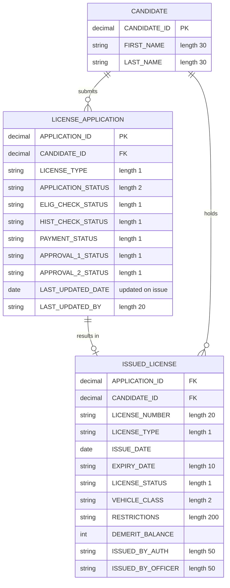

## Table of Contents

- [1. Purpose](#1-purpose)
- [2. Inputs](#2-inputs)
- [3. Outputs](#3-outputs)
- [4. Processing Logic](#4-processing-logic)
  - [4.1 Mermaid Flow Diagram](#41-mermaid-flow-diagram)
  - [4.2 Processing Logic Description](#42-processing-logic-description)
  - [4.3 Database Tables](#43-database-tables)
- [5. Paragraphs](#5-paragraphs)
- [6. Dependencies](#6-dependencies)
  - [6.1 External Interfaces and Middleware](#61-external-interfaces-and-middleware)
  - [6.2 Database Tables](#62-database-tables)
  - [6.3 External Programs and Subroutines](#63-external-programs-and-subroutines)
  - [6.4 Copybooks and Data Structures](#64-copybooks-and-data-structures)
  - [6.5 Input Parameters and Operator Data Sources](#65-input-parameters-and-operator-data-sources)
- [7. Constraints](#7-constraints)
  - [7.1 Transaction flow and sequencing constraints](#71-transaction-flow-and-sequencing-constraints)
  - [7.2 Input data validation rules](#72-input-data-validation-rules)
  - [7.3 Business eligibility and state constraints](#73-business-eligibility-and-state-constraints)
  - [7.4 Derived-value and format constraints](#74-derived-value-and-format-constraints)
  - [7.5 Resource, size and capacity limits](#75-resource-size-and-capacity-limits)
  - [7.6 Error handling and data integrity constraints](#76-error-handling-and-data-integrity-constraints)
  - [7.7 Printing and inter-program constraints](#77-printing-and-inter-program-constraints)
  - [7.8 Screen and presentation constraints](#78-screen-and-presentation-constraints)
- [8. Error Handling](#8-error-handling)
  - [8.1 Input Validation and Prerequisite Checks](#81-input-validation-and-prerequisite-checks)
  - [8.2 Database Error Handling](#82-database-error-handling)
  - [8.3 CICS Response Code Capture](#83-cics-response-code-capture)
  - [8.4 Navigation and AID Key Handling](#84-navigation-and-aid-key-handling)
  - [8.5 Indirect Error Propagation via Message Field](#85-indirect-error-propagation-via-message-field)
- [9. Examples](#9-examples)
  - [9.1 Example 1: Successful license issuance (F1)](#91-example-1-successful-license-issuance-f1)
  - [9.2 Example 2: Rejected because the application is not yet approved (F1)](#92-example-2-rejected-because-the-application-is-not-yet-approved-f1)
  - [9.3 Example 3: Input validation failure (F1)](#93-example-3-input-validation-failure-f1)
  - [9.4 Example 4: Loading an application (F3)](#94-example-4-loading-an-application-f3)
  - [9.5 Example 5: Printing and other keys](#95-example-5-printing-and-other-keys)

## 1. Purpose

DLISISSU is a CICS transaction (DL10) that lets a licensing officer issue driver's licenses in a driver licensing system. The officer loads an approved license application by its ID and reviews the applicant's name, license type, and the status of the eligibility, driving-history, payment, and two approval checks. The officer then enters the vehicle class, issuing officer, issuing authority, and any restrictions. The program confirms that the application has reached approved status. It then works out the license's validity period and expiry date from the license type, and builds a license number. It records the new license in the issued-license database table and marks the application as issued. The officer can also send the issued license to the printing program, DLISLPRT, and exit the transaction. Throughout, the program shows the officer status and error messages on a single interactive screen.

## 2. Inputs

**CICS Map Fields (operator input via DLISLIM01)**

- `DLIAIDI` — Application ID entered by the operator on the CICS map; used as the primary key to load and validate a license application from `DLIS.LICENSE_APPLICATION`
- `DLIVCLSI` — Vehicle class entered by the operator (`A`, `B`, `C`, or `D`); validated before issuance and used to populate the issued license record and generate the license number
- `DLIOFCRI` — Issuing officer identifier entered by the operator; stored in `DLIS.ISSUED_LICENSE` and recorded as the last-updated-by user in `DLIS.LICENSE_APPLICATION`
- `DLIAUTHI` — Issuing authority identifier entered by the operator; stored in `DLIS.ISSUED_LICENSE`
- `DLIRSTI` — License restrictions text entered by the operator; stored in the `RESTRICTIONS` column of `DLIS.ISSUED_LICENSE`
- `DLIILNUMO` — License number map field; checked during print initiation to confirm a license has been issued before allowing the print function

**CICS Communication Area (DFHCOMMAREA / DLIS-COMMAREA)**

- `DFHCOMMAREA` — 350-byte raw CICS communication area passed on every pseudo-conversational re-entry; moved to `DLIS-COMMAREA` to restore session state
  - `CA-TRANSACTION-ID` — Transaction identifier (`DL10`) carried across pseudo-conversational cycles
  - `CA-CANDIDATE-ID` — Candidate identifier carried in the COMMAREA for inter-program context
  - `CA-APPLICATION-ID` — Application identifier carried in the COMMAREA for inter-program context
  - `CA-LICENSE-ID` — License identifier carried in the COMMAREA for inter-program context
  - `CA-PAYMENT-ID` — Payment identifier carried in the COMMAREA for inter-program context
  - `CA-USER-ID` — Logged-on user identifier carried in the COMMAREA
  - `CA-RETURN-CODE` — Return code passed between invocations
  - `CA-MSG-TEXT` — Message text passed between invocations
  - `CA-MSG-COLOR` — Message colour attribute passed between invocations
  - `CA-ACTION` — Action indicator passed between invocations

**DB2 Tables**

- `DLIS.LICENSE_APPLICATION` — Source table for application data; queried via SQL `SELECT` using `APPLICATION-ID` as the key to retrieve `CANDIDATE-ID`, `LICENSE-TYPE`, `APPLICATION-STATUS`, check statuses, and approval statuses; subsequently updated to status `IS` after successful issuance
- `DLIS.ISSUED_LICENSE` — Target table for the new license record; receives a SQL `INSERT` containing all issuance data derived from map input and the application record

**CICS EIB (Execute Interface Block)**

- `EIBCALEN` — CICS-provided length of the incoming COMMAREA; used at program entry to distinguish first invocation (= 0) from a re-entry
- `EIBAID` — CICS-provided attention identifier; determines which program function to execute (F1 = Issue, F3 = Load Application, F6 = Print, F12 = Exit)

**Linked Program Interface**

- `DLIS-COMMAREA` (passed via `EXEC CICS LINK PROGRAM('DLISLPRT')`) — The COMMAREA forwarded to the `DLISLPRT` print program; carries the context needed by that program to locate and print the issued license

## 3. Outputs

- **Screen output (CICS map DLISLIM01, mapset DLISLI)**
  - Initial screen
    - On first entry (EIBCALEN = 0), the program sends the blank map with ERASE and FREEKB. It puts the current date in the date field (DLIDATE).
  - Re-displayed screen
    - After every user action, the program sends the map again with DATAONLY and FREEKB. The screen carries the message and any fields that were set.
  - Message line (DLIMSG)
    - This is the main status and error output. It holds one of the following messages:
      - `USE F1 F3 F6 OR F12`, for an unrecognised key.
      - `ENTER APPLICATION ID`
      - `APPLICATION NOT FOUND`
      - `APPLICATION LOADED`
      - `VEHICLE CLASS MUST BE A B C OR D`
      - `ISSUING OFFICER IS REQUIRED`
      - `ISSUING AUTHORITY IS REQUIRED`
      - `APPLICATION STATUS MUST BE AP BEFORE ISSUE`
      - `DATABASE ERROR ON LICENSE INSERT`
      - `DRIVER LICENSE ISSUED SUCCESSFULLY`
      - `ISSUE LICENSE FIRST BEFORE PRINTING`
      - `LICENSE SENT TO PRINTER`
  - Applicant and application details loaded on F3 (and on F1, which reloads first)
    - Candidate full name (DLICNAMO): first name and last name, each cut at the first space, joined by a single space.
    - License type (DLILTYO), from LICENSE-TYPE.
    - Eligibility check status (DLIELIG0), from ELIG-CHECK-STATUS.
    - Driving history check status (DLIHISTO), from HIST-CHECK-STATUS.
    - Payment status (DLIPAYO), from PAYMENT-STATUS.
    - First approval status (DLIAU1O), from APPROVAL-1-STATUS.
    - Second approval status (DLIAU2O), from APPROVAL-2-STATUS.
  - Issuance results shown after a successful F1
    - Generated license number (DLIILNUMO), from WS-LICENSE-NUMBER.
    - License expiry date (DLIEXPO), from WS-EXPIRY-DATE.

- **Database writes (DB2)**
  - New row in DLIS.ISSUED_LICENSE, inserted on F1 after the validations pass. The row holds:
    - Application identifier (APPLICATION-ID) and candidate identifier (CANDIDATE-ID).
    - Generated license number (WS-LICENSE-NUMBER).
    - License type (LICENSE-TYPE).
    - Issue date, taken from DB2 CURRENT DATE.
    - Calculated expiry date (WS-EXPIRY-DATE).
    - License status, set to the constant `A` (active).
    - Vehicle class (VEHICLE-CLASS), from the screen. It must be A, B, C or D.
    - Restrictions text, from the screen (DLIRSTI).
    - Demerit balance, set to the constant 12.
    - Issuing authority (ISSUED-BY-AUTH) and issuing officer (ISSUED-BY-OFFICER), both from the screen.
  - Update to DLIS.LICENSE_APPLICATION for the issued application:
    - APPLICATION_STATUS is set to `IS` (Issued).
    - LAST_UPDATED_DATE is set to the current date.
    - LAST_UPDATED_BY is set to the issuing officer.
    - This update runs without an SQLCODE check, so a failure would not be reported on screen.

- **Derived values that feed the outputs**
  - Expiry date (WS-EXPIRY-DATE)
    - The expiry year is the current year plus a validity period set by license type: `L` adds 1 year, `P` adds 2 years and `O` adds 5 years. The month and day are copied from the current date.
  - License number (WS-LICENSE-NUMBER)
    - It is built from these parts, joined in this order:
      - A type prefix: `LRN` for L, `PRB` for P, `OPN` for O.
      - The vehicle class.
      - The candidate identifier.
      - The application identifier.
    - It appears on the screen and in the inserted row.

- **Inter-program and transaction control outputs**
  - Pseudo-conversational return
    - After every screen interaction, the program returns to CICS with transaction ID `DL10`. It passes the 350-byte communication area (DLIS-COMMAREA) so the next invocation has the state.
  - Program link to the printing program (F6)
    - If a license number is already on screen, the program calls DLISLPRT with DLIS-COMMAREA. That program produces the printed license.
    - If no license number is on screen, the program shows `ISSUE LICENSE FIRST BEFORE PRINTING` and does not call it.
  - Session termination
    - F12 issues a CICS RETURN with no transaction ID, which ends the conversation.

- **Return and diagnostic values**
  - The CICS response code (WS-RESP1) is captured on SEND and RECEIVE. It is never tested or shown.
  - SQLCODE is tested only after the SELECT (for not found) and after the INSERT (for any non-zero result). Those tests drive the on-screen error messages above.

## 4. Processing Logic

### 4.1 Mermaid Flow Diagram

```mermaid
graph TD
    A([Start DLISISSU transaction DL10]) --> B{Is COMMAREA length zero}
    B -- Yes --> C[Send blank issuance map with current date]
    C --> D([Return to CICS with transaction DL10])
    B -- No --> E[Copy COMMAREA to working area]
    E --> F[Receive map input]
    F --> G{Which key was pressed}
    G -- F1 --> H[Issue license]
    G -- F3 --> I[Load application]
    G -- F6 --> J[Print license]
    G -- F12 --> K([Exit transaction])
    G -- Other --> L[Set message to use F1 F3 F6 or F12]
    H --> M[Send map data only]
    I --> M
    J --> M
    L --> M
    M --> N([Return to CICS with transaction DL10])

    subgraph LOADAPP [Load Application]
        I1{Application ID entered}
        I1 -- No --> I2[Message enter application ID]
        I1 -- Yes --> I3[Select application and candidate name from DB2]
        I3 --> I4{Row found}
        I4 -- No --> I5[Message application not found]
        I4 -- Yes --> I6[Format candidate name and show status fields]
        I6 --> I7[Message application loaded]
    end

    subgraph ISSUE [Issue License]
        H1{Application ID entered}
        H1 -- No --> H9[Message enter application ID]
        H1 -- Yes --> H2{Vehicle class A B C or D}
        H2 -- No --> H10[Message vehicle class must be A B C or D]
        H2 -- Yes --> H3{Officer entered}
        H3 -- No --> H11[Message issuing officer required]
        H3 -- Yes --> H4{Authority entered}
        H4 -- No --> H12[Message issuing authority required]
        H4 -- Yes --> H5[Reload application from DB2]
        H5 --> H6{Load successful}
        H6 -- No --> H13[Exit with load message]
        H6 -- Yes --> H7{Application status is AP}
        H7 -- No --> H14[Message status must be AP before issue]
        H7 -- Yes --> H8[Calculate expiry date and prefix by license type]
        H8 --> H15[Build license number]
        H15 --> H16[Insert issued license row]
        H16 --> H17{Insert successful}
        H17 -- No --> H18[Message database error on license insert]
        H17 -- Yes --> H19[Update application status to IS]
        H19 --> H20[Show license number and expiry date]
        H20 --> H21[Message license issued successfully]
    end

    subgraph PRINT [Print License]
        J1{License number shown on screen}
        J1 -- No --> J2[Message issue license first]
        J1 -- Yes --> J3[Link to DLISLPRT with COMMAREA]
        J3 --> J4[Message license sent to printer]
    end

    classDef start fill:#d4f1f4,stroke:#5a9bb5,color:#000;
    classDef process fill:#e6f4ea,stroke:#6aa57a,color:#000;
    classDef decision fill:#fff4cc,stroke:#c9a93a,color:#000;
    classDef error fill:#fde2e4,stroke:#d08a92,color:#000;
    classDef db fill:#e8dff5,stroke:#9b84c4,color:#000;

    class A,D,K,N start;
    class C,E,F,H,I,J,M process;
    class L,I2,I5,H9,H10,H11,H12,H13,H14,H18 error;
    class B,G,I1,I4,H1,H2,H3,H4,H6,H7,H17,J1 decision;
    class I3,H5,H16,H19,J3 db;
    class I6,I7,H8,H15,H20,H21,J2,J4 process;
```

### 4.2 Processing Logic Description

#### 4.2.1 High-level Summary
DLISISSU is a pseudo-conversational CICS/COBOL program for transaction DL10. It uses map DLISLIM01 in mapset DLISLI. It lets a licensing officer issue a driver's license for an application that has completed all approval steps. It also lets the officer load application details and send the license to print.

The function keys are:
- F1 issues the license.
- F3 loads the application.
- F6 prints the license.
- F12 exits.

#### 4.2.2 Execution Flow

**1. Entry (MAIN-LOGIC)**
- If `EIBCALEN = 0`, this is the first call. The program runs INIT-SCREEN. It puts the current date in the date field and sends the map with `ERASE FREEKB`. It then returns with `TRANSID('DL10')` and the COMMAREA, length 350.
- Otherwise it copies `DFHCOMMAREA` into `DLIS-COMMAREA` and runs PROCESS-INPUT.

**2. Input handling (PROCESS-INPUT)**
- It receives the map with `RESP(WS-RESP1)`. The response code is stored but not checked.
- It evaluates the attention key:

| Key | Action |
|---|---|
| F1 | ISSUE-LICENSE |
| F3 | LOAD-APPLICATION |
| F6 | PRINT-LICENSE |
| F12 | `EXEC CICS RETURN` with no transaction, which ends the conversation |
| Any other key | Message "USE F1 F3 F6 OR F12" |

- After the action, it sends the map with `DATAONLY FREEKB`. It then returns with `TRANSID('DL10')` and the COMMAREA to wait for the next input.

**3. Load application (LOAD-APPLICATION)**
- If the application ID is zero, the message is "ENTER APPLICATION ID" and the paragraph exits.
- Otherwise it runs a SELECT that joins `DLIS.LICENSE_APPLICATION` (A) to `DLIS.CANDIDATE` (C) on `CANDIDATE_ID`. It filters on `APPLICATION_ID`. It reads these fields:
  - candidate ID
  - license type
  - application status
  - eligibility, history and payment statuses
  - both approval statuses
  - the candidate's first and last name
- If `SQLCODE = 100`, the message is "APPLICATION NOT FOUND".
- Other SQL errors are not tested. Only the not-found case is handled.
- On success it builds the candidate full name in `DLICNAMO` from first name, a space and last name. It copies the license type and the eligibility, history, payment, approval 1 and approval 2 statuses to the screen. The message is "APPLICATION LOADED".

**4. Issue license (ISSUE-LICENSE)**
Validations run in order. Each failure sets a message and exits without changing data.
1. The application ID must be entered.
2. The vehicle class must be A, B, C or D. Otherwise the message is "VEHICLE CLASS MUST BE A B C OR D".
3. The issuing officer is required.
4. The issuing authority is required.
5. The program runs LOAD-APPLICATION again to read the current database state. If the message is not "APPLICATION LOADED", it exits with that message.
6. **Business gate:** `APPLICATION-STATUS` must equal `'AP'` (approved). Otherwise the message is "APPLICATION STATUS MUST BE AP BEFORE ISSUE". The code comment says all five gates must be satisfied, but the code checks only the overall application status. The individual eligibility, history, payment and approval flags are displayed but not checked here.

**Expiry date and license prefix**

The issue date is the first 10 characters of `CURRENT-DATE`. The expiry year starts as the current year. The month and day part is kept as it is.

| License type | Years added | Prefix |
|---|---|---|
| L (Learner) | 1 | LRN |
| P (Probationary) | 2 | PRB |
| O (Open) | 5 | OPN |

- There is no `WHEN OTHER`. For any other license type, the expiry year is not extended and the prefix keeps its previous value, which is uninitialized.
- The expiry date is built by concatenating the expiry year and the month/day part.
- The license number is built by concatenating the prefix, the vehicle class, the candidate ID and the application ID.

**Database changes**
- INSERT into `DLIS.ISSUED_LICENSE`:
  - The values come from the application, the generated license number and expiry date, the vehicle class, the restrictions, the issuing authority and the issuing officer.
  - The issue date is `CURRENT DATE`.
  - The license status is `'A'` (active).
  - The demerit balance starts at 12.
  - If `SQLCODE` is not 0, the message is "DATABASE ERROR ON LICENSE INSERT" and the paragraph exits.
- UPDATE `DLIS.LICENSE_APPLICATION`:
  - It sets `APPLICATION_STATUS` to `'IS'`.
  - It sets the last-updated date to `CURRENT DATE`.
  - It sets last-updated-by to the officer.
  - The SQLCODE of this update is not checked.
- Finally, the license number and expiry date are shown on the screen. The message is "DRIVER LICENSE ISSUED SUCCESSFULLY".
- The program does not issue an explicit commit or rollback. CICS syncpoint at task end or return controls it. If the update fails, the insert is not undone by this code.

**5. Print license (PRINT-LICENSE)**
- If the license number field on screen is blank, the message is "ISSUE LICENSE FIRST BEFORE PRINTING".
- Otherwise it does `EXEC CICS LINK PROGRAM('DLISLPRT')` with the COMMAREA, length 350. The message is "LICENSE SENT TO PRINTER".

**Observations**
- The `STOP RUN` in MAIN-LOGIC is not reached on normal paths, because every path ends with `EXEC CICS RETURN`.
- The `RESP` values for SEND, RECEIVE and LINK are not checked.
- The program does not copy the generated license number back into the COMMAREA.

#### 4.2.3 External Interactions
- **CICS terminal I/O:** `SEND MAP` and `RECEIVE MAP` on `DLISLIM01` in mapset `DLISLI`, with the function-key dispatch.
- **CICS pseudo-conversation:** `RETURN TRANSID('DL10') COMMAREA(...)` carries state between interactions.
- **CICS program link:** `LINK PROGRAM('DLISLPRT')` passes `DLIS-COMMAREA` to the print program.
- **DB2:**
  - Reads `DLIS.LICENSE_APPLICATION` joined to `DLIS.CANDIDATE`.
  - Inserts into `DLIS.ISSUED_LICENSE`.
  - Updates `DLIS.LICENSE_APPLICATION`.
- **MQ:** none.

#### 4.2.4 Plain Language Summary
An officer enters an application number on a screen. Pressing F3 shows the applicant's name and the status of each check. Pressing F1 issues the license, after the officer gives a vehicle class (A to D), their own name and the issuing authority. The program issues a license only if the application is fully approved.

When a license is issued, the program works out an expiry date:
- 1 year for a learner license.
- 2 years for a probationary license.
- 5 years for an open license.

It also builds a license number from a type prefix, the vehicle class, the candidate number and the application number. It saves the license as active with 12 demerit points. It then marks the application as issued. Pressing F6 sends the issued license to the printer, but only after a license has been issued. F12 leaves the transaction.

### 4.3 Database Tables

## 5. Paragraphs

**MAIN-LOGIC**
- Entry point of the pseudo-conversational CICS transaction DL10.
- Control flow:
  - If EIBCALEN = 0, this is the first invocation, so it performs INIT-SCREEN.
  - Otherwise it copies DFHCOMMAREA into DLIS-COMMAREA and performs PROCESS-INPUT.
  - It then ends with STOP RUN.
- External interaction: none directly. It only reads the CICS EIB commarea length.

**INIT-SCREEN**
- Purpose: show the blank license issuance screen on first entry.
- Operations:
  - Moves the first 10 characters of CURRENT-DATE to the map date field DLIDATE.
  - Sends map DLISLIM01 from mapset DLISLI with ERASE and FREEKB. The response goes to WS-RESP1.
  - Issues CICS RETURN with TRANSID DL10 and DLIS-COMMAREA (length 350), so the transaction restarts on the next user action.
- External interaction: CICS BMS terminal output and CICS RETURN.

**PROCESS-INPUT**
- Purpose: handle a returning screen interaction and dispatch on the key pressed.
- Operations:
  - Receives map DLISLIM01 from mapset DLISLI with the response in WS-RESP1.
  - Uses EVALUATE TRUE on EIBAID:
    - PF1 performs ISSUE-LICENSE.
    - PF3 performs LOAD-APPLICATION.
    - PF6 performs PRINT-LICENSE.
    - PF12 issues CICS RETURN to end the transaction.
    - Any other key puts "USE F1 F3 F6 OR F12" in DLIMSG.
  - Re-sends the map with DATAONLY and FREEKB.
  - Issues CICS RETURN with TRANSID DL10 and DLIS-COMMAREA (length 350).
- Control flow: multi-way EVALUATE on the attention key.
- External interaction: CICS RECEIVE MAP, SEND MAP and RETURN. The called paragraphs also access DB2 and call another program.

**LOAD-APPLICATION**
- Purpose: retrieve a license application and its candidate name, and show the application's check statuses on the screen (F3).
- Operations:
  - Validates that the application ID (DLIAIDI) is not zero. If it is zero, it sets "ENTER APPLICATION ID" and jumps to LOAD-APP-EXIT.
  - Moves DLIAIDI to APPLICATION-ID in DCLDLIS-LICENSE-APPL.
  - Runs a DB2 SELECT joining DLIS.LICENSE_APPLICATION (A) to DLIS.CANDIDATE (C) on CANDIDATE_ID.
    - The SELECT fetches the candidate ID, license type, application status, eligibility, history, payment, approval 1 and approval 2 statuses, and first and last name.
    - It filters on the application ID.
  - If SQLCODE = 100, it sets "APPLICATION NOT FOUND" and jumps to LOAD-APP-EXIT.
  - Uses STRING to build "first last" in the output field DLICNAMO.
  - Moves license type and the eligibility, history, payment, approval 1 and approval 2 statuses to the output map fields (DLILTYO, DLIELIG0, DLIHISTO, DLIPAYO, DLIAU1O, DLIAU2O).
  - Sets the message "APPLICATION LOADED".
- Control flow: guard conditions use GO TO to the exit paragraph. SQLCODE is checked only for 100, so other SQL errors are not handled.
- External interaction: DB2 SELECT on LICENSE_APPLICATION and CANDIDATE.

**LOAD-APP-EXIT**
- Exit point for LOAD-APPLICATION. It contains only EXIT and is the target of the GO TO statements.

**ISSUE-LICENSE**
- Purpose: validate input and issue a driver's license for an approved application (F1).
- Operations:
  - Validates the input fields in order, setting an error message and jumping to ISSUE-LIC-EXIT on the first failure:
    - Application ID is not zero.
    - Vehicle class (DLIVCLSI) is not spaces and is one of A, B, C or D.
    - Issuing officer (DLIOFCRI) is not blank.
    - Issuing authority (DLIAUTHI) is not blank.
  - Performs LOAD-APPLICATION to reload the application. It exits if DLIMSG is not "APPLICATION LOADED".
  - Checks that APPLICATION-STATUS is 'AP' (approved). Otherwise it sets "APPLICATION STATUS MUST BE AP BEFORE ISSUE" and exits.
  - Calculates the expiry date:
    - Sets the issue date, the expiry year and the month/day part from CURRENT-DATE.
    - Uses EVALUATE on the license type. L adds 1 year with prefix 'LRN', P adds 2 years with prefix 'PRB', and O adds 5 years with prefix 'OPN'.
    - Uses STRING to build WS-EXPIRY-DATE from the year and the month/day part.
  - Builds WS-LICENSE-NUMBER with STRING from the prefix, vehicle class, candidate ID and application ID.
  - Moves vehicle class, officer, authority and restrictions to the DCLDLIS-ISSUED-LIC host structure.
  - Runs a DB2 INSERT into DLIS.ISSUED_LICENSE. It sets status 'A' and demerit balance 12, and uses CURRENT DATE as the issue date.
    - If SQLCODE is not 0, it sets "DATABASE ERROR ON LICENSE INSERT" and exits.
  - Runs a DB2 UPDATE on DLIS.LICENSE_APPLICATION. It sets APPLICATION_STATUS = 'IS', LAST_UPDATED_DATE = CURRENT DATE and LAST_UPDATED_BY = officer.
    - The SQLCODE of the UPDATE is not checked.
  - Moves the license number to DLIILNUMO and the expiry date to DLIEXPO, and sets the message "DRIVER LICENSE ISSUED SUCCESSFULLY".
- Control flow: a chain of validation IF statements with GO TO ISSUE-LIC-EXIT, a nested PERFORM of LOAD-APPLICATION, and an EVALUATE on license type. Other license types add no years and set no prefix.
- External interaction: DB2 INSERT and UPDATE, plus the SELECT done through LOAD-APPLICATION.

**ISSUE-LIC-EXIT**
- Exit point for ISSUE-LICENSE. It contains only EXIT and is the target for all validation and error branches.

**PRINT-LICENSE**
- Purpose: send an issued license to the printing program (F6).
- Operations:
  - Checks that the issued license number field (DLIILNUMO) is not spaces. Otherwise it sets "ISSUE LICENSE FIRST BEFORE PRINTING" and jumps to PRINT-LIC-EXIT.
  - Uses CICS LINK to call program DLISLPRT with DLIS-COMMAREA (length 350).
  - Sets the message "LICENSE SENT TO PRINTER".
- Control flow: a single guard condition with GO TO.
- External interaction: CICS LINK to DLISLPRT.

**PRINT-LIC-EXIT**
- Exit point for PRINT-LICENSE. It contains only EXIT.

## 6. Dependencies

### 6.1 External Interfaces and Middleware
- **CICS (Customer Information Control System)**
  - Manages the online execution environment and transaction lifecycle under transaction ID `DL10`.
  - Coordinates pseudo-conversational session state and re-entry via `EIBCALEN`, `EXEC CICS RETURN TRANSID('DL10') COMMAREA(...)`, and terminal mapping operations.
  - Handles screen input/output and user terminal interactions using BMS mapset `DLISLI` and map `DLISLIM01` through `EXEC CICS SEND MAP` and `EXEC CICS RECEIVE MAP`.
- **IBM DB2 Relational Database Management System**
  - Manages relational data persistence, query execution, and transactional consistency for licensing operations via embedded SQL (`EXEC SQL ... END-EXEC`).

### 6.2 Database Tables
- **DLIS.LICENSE_APPLICATION**
  - Queried to validate the current application status (`AP`), retrieve candidate references, license type, and check the status of all five prerequisite validation gates (eligibility, driving history, payment, authority approval 1, and authority approval 2).
  - Updated upon successful license creation to set `APPLICATION_STATUS = 'IS'` (Issued), update `LAST_UPDATED_DATE` to the current date, and record `LAST_UPDATED_BY` with the issuing officer identifier.
- **DLIS.CANDIDATE**
  - Joined with `DLIS.LICENSE_APPLICATION` in the application lookup query to fetch applicant personal details (`FIRST_NAME`, `LAST_NAME`) associated with the candidate record.
- **DLIS.ISSUED_LICENSE**
  - Serves as the target table for newly created driver licenses; receives inserted records containing application ID, candidate ID, generated license number, license type, issue/expiry dates, initial active status (`'A'`), vehicle class, restrictions, starting demerit balance (`12`), issuing authority, and issuing officer.

### 6.3 External Programs and Subroutines
- **DLISLPRT**
  - External license printing program invoked dynamically via `EXEC CICS LINK PROGRAM('DLISLPRT') COMMAREA(DLIS-COMMAREA) LENGTH(350)` when the operator requests a physical license print using function key `F6`.

### 6.4 Copybooks and Data Structures
- **DLISWS (`DLISWS.cpy`)**
  - Common working-storage definitions including standard return codes, date-handling fields, message work areas, and domain data groups for candidates, applications, payments, eligibility, history, approvals, and issued licenses.
- **DLISCSEC (`DLISCSEC.cpy`)**
  - Defines the standardized 350-byte CICS Communication Area structures (`DLIS-COMMAREA`, `DLIS-CAND-COMMAREA`, `DLIS-APPL-COMMAREA`) utilized for inter-program navigation and state transfer across pseudo-conversational interactions.
- **DLISDCLG (`DLISDCLG.cpy`)**
  - DB2 DCLGEN host variable declarations and record layouts for database tables, including `DCLDLIS-CANDIDATE`, `DCLDLIS-LICENSE-APPL`, `DCLDLIS-DRIVING-HIST`, `DCLDLIS-PAYMENT`, `DCLDLIS-ISSUED-LIC`, `DCLDLIS-AUTH-USER`, and `DCLDLIS-FEE-SCHED`.
- **SQLCA (`SQLCA`)**
  - IBM standard SQL Communication Area structure included via `EXEC SQL INCLUDE SQLCA END-EXEC` to monitor SQL execution outcomes and return codes (`SQLCODE`).
- **DFHAID / DFHBMSCA (CICS System Copybooks)**
  - CICS attention identifier definitions used to evaluate operator action keys (`DFHPF1`, `DFHPF3`, `DFHPF6`, `DFHPF12`).

### 6.5 Input Parameters and Operator Data Sources
- **DFHCOMMAREA**
  - 350-byte linkage section area passed on transaction invocation to maintain session state across pseudo-conversational CICS executions.
- **Terminal User Input (BMS Map DLISLIM01)**
  - Operator-supplied fields including Application ID (`DLIAIDI`), Vehicle Class (`DLIVCLSI`), Issuing Officer (`DLIOFCRI`), Issuing Authority (`DLIAUTHI`), and Optional Restrictions (`DLIRSTI`).
  - Function key inputs determining program flow: `PF1` (Issue License), `PF3` (Load Application), `PF6` (Print License), and `PF12` (Exit / Return).

## 7. Constraints

### 7.1 Transaction flow and sequencing constraints

- The first invocation, detected by `EIBCALEN = 0`, only sends the blank map `DLISLIM01` and returns to transaction `DL10`.
  - No processing happens until the operator has seen the screen.
- Every later invocation copies `DFHCOMMAREA` into `DLIS-COMMAREA`, receives the map, and then processes the input.
  - This is the pseudo-conversational pattern.
  - Each interaction ends with `EXEC CICS RETURN TRANSID('DL10') COMMAREA(DLIS-COMMAREA) LENGTH(350)`, so state is carried only through the COMMAREA and the map fields.
- Only four attention keys are accepted. They are tested with `EVALUATE TRUE` on `EIBAID`.
  - F1 (`DFHPF1`) issues the license.
  - F3 (`DFHPF3`) loads the application.
  - F6 (`DFHPF6`) prints.
  - F12 (`DFHPF12`) exits with a plain `EXEC CICS RETURN`, so the transaction ends without a `TRANSID`.
  - Any other key sets `DLIMSG` to 'USE F1 F3 F6 OR F12' and no business action runs.
- Issuing a license always re-runs `LOAD-APPLICATION` first, so the database is re-read at issue time.
  - Issuing proceeds only if `DLIMSG` equals 'APPLICATION LOADED'.
  - Any failure in the load step (blank or zero ID, application not found) therefore stops the issue.
- Printing must follow issuing.
  - `PRINT-LICENSE` checks that the license number output field `DLIILNUMO` is not spaces.
  - Otherwise it shows 'ISSUE LICENSE FIRST BEFORE PRINTING' and exits.
- Inside `ISSUE-LICENSE` the order is fixed:
  - validate input,
  - load the application,
  - check the application status,
  - calculate the expiry date and license prefix,
  - build the license number,
  - `INSERT` into `DLIS.ISSUED_LICENSE`,
  - `UPDATE` `DLIS.LICENSE_APPLICATION` to 'IS'.
  - The `UPDATE` only runs if the `INSERT` returned `SQLCODE = 0`.

### 7.2 Input data validation rules

- **Application ID**
  - It is required in both `LOAD-APPLICATION` and `ISSUE-LICENSE`.
  - If `DLIAIDI = ZEROS`, the message is 'ENTER APPLICATION ID' and the paragraph exits through `GO TO`.
- **Vehicle class**
  - `DLIVCLSI` must not be spaces and must be one of 'A', 'B', 'C' or 'D'.
  - This is checked with `DLIVCLSI = SPACES OR DLIVCLSI NOT IN ('A','B','C','D')`.
  - The error is 'VEHICLE CLASS MUST BE A B C OR D'.
  - The target field `VEHICLE-CLASS` is `PIC X(2)`, but only a single-letter value passes validation.
- **Issuing officer**
  - `DLIOFCRI` is mandatory.
  - If it is spaces, the error is 'ISSUING OFFICER IS REQUIRED'.
  - Only a non-blank value is enforced. The program does not check it against any authority-user table.
- **Issuing authority**
  - `DLIAUTHI` is mandatory.
  - If it is spaces, the error is 'ISSUING AUTHORITY IS REQUIRED'.
  - It gets the same non-blank-only check as the officer.
- **Restrictions**
  - `DLIRSTI` is optional and is copied unvalidated into `RESTRICTIONS`, which is `PIC X(200)`.
- **Validation order**
  - Validation is fail-fast. Only the first failing rule is reported, and processing exits immediately.

### 7.3 Business eligibility and state constraints

- **Existence of the application**
  - `LOAD-APPLICATION` joins `DLIS.LICENSE_APPLICATION` to `DLIS.CANDIDATE` on `CANDIDATE_ID`.
  - `SQLCODE = 100` produces 'APPLICATION NOT FOUND'.
  - Because it is an inner join, an application whose candidate record is missing is also treated as not found.
- **Approval prerequisite**
  - `APPLICATION-STATUS` must equal 'AP' (Approved), otherwise the message is 'APPLICATION STATUS MUST BE AP BEFORE ISSUE'.
  - A comment says "All five gates must be fully satisfied". The eligibility, history, payment and the two approval statuses are loaded and displayed, but they are not tested individually.
  - The 'AP' status is the only enforced gate. The other checks are assumed to be reflected in it.
- **Prevention of re-issue**
  - After a successful issue the status becomes 'IS'.
  - Any further F1 attempt fails the 'AP' check, so a license cannot be issued twice for the same application.
- **License type rules**
  - The type is read from the application, not from user input.
  - Type 'L' (Learner) gets 1 year of validity and prefix 'LRN'.
  - Type 'P' (Probationary) gets 2 years and prefix 'PRB'.
  - Type 'O' (Open/Full) gets 5 years and prefix 'OPN'.
  - There is no `WHEN OTHER`. An unrecognised type leaves the expiry year equal to the current year and `WS-LIC-PREFIX` unset.
  - The program does not guard against this case.
- **Fixed values on the issued license**
  - `LICENSE_STATUS` is always 'A' (Active).
  - `DEMERIT_BALANCE` is always the literal 12.
  - `ISSUE_DATE` is the DB2 `CURRENT DATE`.

### 7.4 Derived-value and format constraints

- **Expiry date**
  - It is built from the current year, plus 1, 2 or 5 years depending on license type, followed by the 6-character month/day portion of `CURRENT-DATE`.
  - `WS-EXPIRY-YYYY` is `PIC 9(4)`, `WS-EXPIRY-MMDD` is `PIC X(6)`, and the result goes into `WS-EXPIRY-DATE`, which is `PIC X(10)`.
  - The result is exactly 10 characters, so it fits.
- **License number**
  - It is the concatenation of the 3-character prefix, the vehicle class, the candidate ID and the application ID.
  - It is stored in `WS-LICENSE-NUMBER`, which is `PIC X(20)`.
  - The candidate and application IDs are packed-decimal `S9(10) COMP-3` fields, so each is 6 bytes in the string.
  - The assembled value is about 16 bytes and fits within 20.
  - The `STRING` statements have no `ON OVERFLOW` handling, so any truncation would be silent.
- **Candidate name display**
  - First and last names are concatenated with a single space.
  - Each name is delimited by the first space, so only the first word of a multi-word name is shown.

### 7.5 Resource, size and capacity limits

- **COMMAREA size**
  - `DFHCOMMAREA` is `PIC X(350)`, and every `RETURN` and `LINK` passes `LENGTH(350)`.
  - The actual `DLIS-COMMAREA` structure is roughly 130 bytes, so the declared length is larger than the data structure.
  - Any caller COMMAREA longer than 350 bytes would be truncated.
- **Field sizes**
  - Names are 30 characters.
  - Status fields are 1 or 2 characters.
  - Restrictions are 200 characters.
  - Officer and authority are 50 characters each.
  - These limit what can be stored in the database columns.
- **Single-row retrieval**
  - The `SELECT ... INTO` returns only one row, so it relies on `APPLICATION_ID` being unique.
  - If more than one row came back, DB2 would return a negative `SQLCODE`.

### 7.6 Error handling and data integrity constraints

- **Insert failure**
  - Any non-zero `SQLCODE` from the `INSERT` gives 'DATABASE ERROR ON LICENSE INSERT' and stops further processing.
  - A duplicate key or constraint violation is therefore rejected.
  - The application status is not updated in this case.
- **Unchecked statements**
  - The `SELECT` is checked only for `SQLCODE = 100`. Other negative codes are not trapped and fall through to the 'APPLICATION LOADED' path.
  - The `UPDATE` to status 'IS' has no `SQLCODE` check.
  - The `RESP` fields on the CICS `SEND`, `RECEIVE` and `LINK` commands are captured in `WS-RESP1` but never tested.
  - The success message 'DRIVER LICENSE ISSUED SUCCESSFULLY' is shown even if the update fails.
- **Unit of work**
  - There is no explicit `SYNCPOINT` or `ROLLBACK`.
  - The insert and update are committed together as one unit of work when the task returns to CICS, and they would be backed out together if the task abends.
- **Host-variable population**
  - The `INSERT` takes its `APPLICATION-ID`, `CANDIDATE-ID`, `LICENSE-TYPE` and `RESTRICTIONS` values from the `DCLDLIS-ISSUED-LIC` structure.
  - The program explicitly populates only `VEHICLE-CLASS`, `ISSUED-BY-OFFICER`, `ISSUED-BY-AUTH` and `RESTRICTIONS` in that structure.
  - The application ID, candidate ID and license type are read into `DCLDLIS-LICENSE-APPL`.
  - Correct inserted values therefore depend on those fields being available to the SQL host-variable references.
- **Audit**
  - The `UPDATE` records the issuing officer (`DLIOFCRI`) in `LAST_UPDATED_BY`, and `LAST_UPDATED_DATE` is set to `CURRENT DATE`.

### 7.7 Printing and inter-program constraints

- Printing is allowed only after a license number is present on the screen.
- It runs through `EXEC CICS LINK PROGRAM('DLISLPRT')`, which passes the whole `DLIS-COMMAREA` with `LENGTH(350)`.
  - The called program must accept a 350-byte COMMAREA.
  - The linked program must also be defined and available to CICS.
- On return, the message 'LICENSE SENT TO PRINTER' is displayed without any check of the link outcome.

### 7.8 Screen and presentation constraints

- Output after the first display uses `SEND MAP ... DATAONLY FREEKB`, so only the data fields change and the keyboard is unlocked.
- The first display uses `ERASE FREEKB` and populates the current date field `DLIDATE` from the first 10 characters of `CURRENT-DATE`.
- Messages are limited to the map message field `DLIMSG`, so only one message is shown per interaction.

## 8. Error Handling

### 8.1 Input Validation and Prerequisite Checks

- **Missing Application ID guard** — Before both `LOAD-APPLICATION` and `ISSUE-LICENSE` proceed, the program checks whether the Application ID field on the map (`DLIAIDI`) contains zeros. If it does, an appropriate message is placed in the map message field (`DLIMSG`) and control branches immediately to the exit paragraph, preventing any database activity from occurring with an invalid key.

- **Vehicle Class validation** — During license issuance, the vehicle class input (`DLIVCLSI`) is checked to ensure it is neither spaces nor a value outside the permitted set of `A`, `B`, `C`, or `D`. If the validation fails, a descriptive error message is set and the issuance routine exits early without proceeding.

- **Issuing Officer mandatory check** — The `DLIOFCRI` field is verified not to be spaces before an issuance is attempted. A blank officer field triggers an error message and early exit.

- **Issuing Authority mandatory check** — Similarly, `DLIAUTHI` is checked for spaces. If blank, an error message is raised and issuance is abandoned.

- **Application status pre-condition gate** — After the application data is loaded, the `APPLICATION-STATUS` field from the `DCLDLIS-LICENSE-APPL` host structure is verified to equal `'AP'` (Approved). If the status is anything other than `'AP'`, a message indicating the required status is written and the issuance routine terminates early. This is the business-rule guard ensuring only fully approved applications can receive a license.

- **Print-before-issue guard** — In the `PRINT-LICENSE` routine, the program checks whether the issued license number output field (`DLIILNUMO`) is spaces. If it is, the user is informed that the license must be issued before printing can take place, and the print routine exits without invoking the external print program.

---

### 8.2 Database Error Handling

- **SQL NOT FOUND check in `LOAD-APPLICATION`** — After the `SELECT` joining `LICENSE_APPLICATION` and `CANDIDATE`, `SQLCODE` is tested against `100` (DB2's "not found" indicator). If the application record cannot be located, the message `'APPLICATION NOT FOUND'` is placed in `DLIMSG` and the routine exits via `GO TO LOAD-APP-EXIT`.

- **SQL error check after `INSERT` into `ISSUED_LICENSE`** — Following the `INSERT` into `DLIS.ISSUED_LICENSE`, `SQLCODE` is tested for any non-zero value. A non-zero `SQLCODE` indicates a database error (constraint violation, deadlock, etc.), and the program sets the message `'DATABASE ERROR ON LICENSE INSERT'` and exits the issuance routine early via `GO TO ISSUE-LIC-EXIT`. The `UPDATE` to `LICENSE_APPLICATION` that sets the status to `'IS'` is therefore only reached if the `INSERT` succeeds, preserving logical consistency.

- **No explicit SQLCODE check after `UPDATE`** — The `UPDATE` to `DLIS.LICENSE_APPLICATION` that sets `APPLICATION_STATUS` to `'IS'` does not have a dedicated post-execution `SQLCODE` check. This represents an implicit reliance on the DB2 runtime; if the update fails, the program continues and displays the success message.

---

### 8.3 CICS Response Code Capture

- **`RESP(WS-RESP1)` on `EXEC CICS SEND MAP`** — Both the initial `SEND MAP` in `INIT-SCREEN` and the subsequent `SEND MAP` in `PROCESS-INPUT` specify `RESP(WS-RESP1)`, which causes CICS to capture the response code into `WS-RESP1` rather than raising an immediate transaction abend. However, no conditional logic follows these commands to evaluate `WS-RESP1`, so the response code is collected but not acted upon.

- **`RESP(WS-RESP1)` on `EXEC CICS RECEIVE MAP`** — The `RECEIVE MAP` in `PROCESS-INPUT` likewise captures the CICS response code (such as `MAPFAIL` if no data was entered) into `WS-RESP1`. As with the `SEND MAP` commands, the stored code is not subsequently inspected, meaning conditions like `MAPFAIL` would silently pass through without explicit recovery.

- **No `RESP` on `EXEC CICS LINK`** — The call to `DLISLPRT` in `PRINT-LICENSE` does not include a `RESP` option. If the LINK fails (e.g., program not found), CICS would raise a default abend rather than allowing the program to handle the condition gracefully.

---

### 8.4 Navigation and AID Key Handling

- **Unrecognised key guard** — In `PROCESS-INPUT`, the `EVALUATE TRUE` on `EIBAID` covers `DFHPF1`, `DFHPF3`, `DFHPF6`, and `DFHPF12`. Any other attention identifier falls into the `OTHER` branch, which places the message `'USE F1 F3 F6 OR F12'` in `DLIMSG` and returns to the map without taking any action, preventing unexpected operations from unrecognised keystrokes.

- **F12 clean exit** — Pressing PF12 issues `EXEC CICS RETURN` without a `TRANSID` or `COMMAREA`, which terminates the pseudo-conversational transaction cleanly and returns control to CICS, acting as an orderly exit path.

---

### 8.5 Indirect Error Propagation via Message Field

- **`DLIMSG` as the unified error notification channel** — Across all routines (`LOAD-APPLICATION`, `ISSUE-LICENSE`, `PRINT-LICENSE`), errors are communicated to the operator exclusively through the BMS map message field `DLIMSG`. There is no logging to a transient data queue, no CICS abend issuance, and no structured return code set in the COMMAREA for upstream consumers. The `ISSUE-LICENSE` routine implicitly checks the success of `LOAD-APPLICATION` by testing whether `DLIMSG` equals `'APPLICATION LOADED'`; any deviation from this literal is treated as a failed load and causes issuance to halt.

- **Exit paragraphs as controlled termination points** — Each major routine (`LOAD-APP-EXIT`, `ISSUE-LIC-EXIT`, `PRINT-LIC-EXIT`) uses a dedicated `EXIT` paragraph reached via `GO TO`. This pattern acts as a structured bail-out mechanism: whenever an error condition is detected, control branches to the exit, bypassing all remaining processing steps in that routine and returning to the caller without completing the business operation.

## 9. Examples

### 9.1 Example 1: Successful license issuance (F1)

**Input (screen fields, AID = PF1)**

| Field | Value |
|---|---|
| Application ID (`DLIAIDI`) | `1001` |
| Vehicle class (`DLIVCLSI`) | `B` |
| Issuing officer (`DLIOFCRI`) | `OFFICER01` |
| Issuing authority (`DLIAUTHI`) | `DMV-CENTRAL` |
| Restrictions (`DLIRSTI`) | `CORRECTIVE LENSES` |

**Database state for application 1001:** `LICENSE_TYPE = 'P'`, `APPLICATION_STATUS = 'AP'`, candidate John Smith.

Assume the current date is formatted `2025-03-15`.

**Expected output**
- Message: `DRIVER LICENSE ISSUED SUCCESSFULLY`
- Expiry date (`DLIEXPO`): `2027-03-15`
- License number (`DLIILNUMO`): starts with `PRB` followed by `B`, then the candidate ID and application ID.
- A row is inserted into `DLIS.ISSUED_LICENSE` with `LICENSE_STATUS = 'A'` and `DEMERIT_BALANCE = 12`.
- The application row is updated to `APPLICATION_STATUS = 'IS'`, with `LAST_UPDATED_BY = 'OFFICER01'`.

**Explanation**
- The program checks that the application ID, a vehicle class of A, B, C or D, the officer and the authority are all present.
- It then calls `LOAD-APPLICATION` internally and confirms the status is `AP`.
- For license type `P`, it adds 2 years to the current year and sets the prefix to `PRB`.
  - Type `L` adds 1 year with prefix `LRN`.
  - Type `O` adds 5 years with prefix `OPN`.
- It builds the license number and inserts the issued license.
- It then marks the application as issued.
- Candidate and application IDs are packed-decimal (`COMP-3`) fields. The STRING statement copies their raw bytes, so those digits may not display legibly in the license number.

---

### 9.2 Example 2: Rejected because the application is not yet approved (F1)

**Input (AID = PF1)**

| Field | Value |
|---|---|
| Application ID | `1002` |
| Vehicle class | `A` |
| Officer | `OFFICER01` |
| Authority | `DMV-CENTRAL` |

**Database state for application 1002:** `APPLICATION_STATUS = 'PN'` (pending).

**Expected output**
- Message: `APPLICATION STATUS MUST BE AP BEFORE ISSUE`
- No insert or update is performed.
- The license number and expiry fields remain blank.

**Explanation:** The input validations pass and the application loads. The status check `APPLICATION-STATUS NOT = 'AP'` then fails, so the program jumps to `ISSUE-LIC-EXIT` before any database change.

---

### 9.3 Example 3: Input validation failure (F1)

**Input (AID = PF1):** Application ID `1003`, vehicle class `X`, officer `OFFICER01`, authority `DMV-CENTRAL`.

**Expected output:** Message `VEHICLE CLASS MUST BE A B C OR D`.

**Explanation:** `X` is not an allowed class, so the program stops before any database access. Other validation messages follow the same pattern:
- `ENTER APPLICATION ID` when the application ID is zero.
- `ISSUING OFFICER IS REQUIRED` when the officer is blank.
- `ISSUING AUTHORITY IS REQUIRED` when the authority is blank.

---

### 9.4 Example 4: Loading an application (F3)

**Input (AID = PF3):** Application ID `1001`.

**Expected output**
- Candidate name (`DLICNAMO`): `JOHN SMITH`
- License type: `P`
- Eligibility, history, payment, approval 1 and approval 2 status fields are populated from the database.
- Message: `APPLICATION LOADED`

**Explanation:** The program joins `LICENSE_APPLICATION` to `CANDIDATE` on the candidate ID. It strings the first and last name together, separated by a space, and moves the status flags to the screen. If no row exists (`SQLCODE = 100`), the message is `APPLICATION NOT FOUND`.

---

### 9.5 Example 5: Printing and other keys

| Action | Result |
|---|---|
| F6 before any license is issued (`DLIILNUMO` blank) | `ISSUE LICENSE FIRST BEFORE PRINTING` |
| F6 after a successful issue | The program LINKs to `DLISLPRT` with the COMMAREA, then shows `LICENSE SENT TO PRINTER` |
| F12 | The transaction returns and ends |
| Any other key (e.g. ENTER) | `USE F1 F3 F6 OR F12` |
| First invocation of `DL10` (`EIBCALEN = 0`) | The empty map `DLISLIM01` is sent and the program returns with transaction `DL10` for the next interaction |

---

Generated by IBM Bob Premium Package for Z
