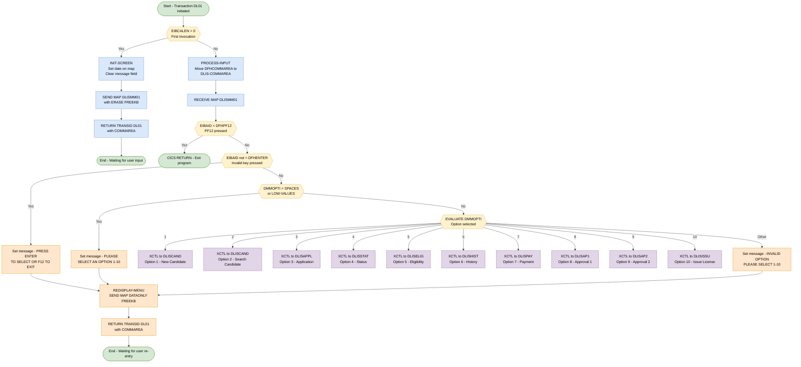

## Table of Contents

- [1. Purpose](#1-purpose)
- [2. Inputs](#2-inputs)
  - [2.1 CICS Communication Area (DFHCOMMAREA / DLIS-COMMAREA)](#21-cics-communication-area-dfhcommarea--dlis-commarea)
  - [2.2 BMS Map Input (EXEC CICS RECEIVE MAP)](#22-bms-map-input-exec-cics-receive-map)
  - [2.3 CICS Execution Interface Block (EIB)](#23-cics-execution-interface-block-eib)
- [3. Outputs](#3-outputs)
  - [3.1 User Interface and Map Outputs](#31-user-interface-and-map-outputs)
  - [3.2 CICS Navigation and Program Control Outputs](#32-cics-navigation-and-program-control-outputs)
- [4. Processing Logic](#4-processing-logic)
  - [4.1 Mermaid Flow Diagram](#41-mermaid-flow-diagram)
  - [4.2 Processing Logic Description](#42-processing-logic-description)
  - [4.3 Database Tables](#43-database-tables)
- [5. Paragraphs](#5-paragraphs)
- [6. Dependencies](#6-dependencies)
  - [6.1 CICS Resources](#61-cics-resources)
  - [6.2 Copybooks](#62-copybooks)
  - [6.3 Linkage / Communication Area](#63-linkage--communication-area)
  - [6.4 External Programs (XCTL Targets)](#64-external-programs-xctl-targets)
  - [6.5 DB2 / SQL](#65-db2--sql)
  - [6.6 Build & Runtime Infrastructure](#66-build--runtime-infrastructure)
- [7. Constraints](#7-constraints)
  - [7.1 Invocation & Session Lifecycle](#71-invocation--session-lifecycle)
  - [7.2 Terminal Input / AID Key Validation](#72-terminal-input--aid-key-validation)
  - [7.3 Menu Option Input Validation](#73-menu-option-input-validation)
  - [7.4 Control-Transfer & Program Routing](#74-control-transfer--program-routing)
  - [7.5 Screen Redisplay Loop Constraints](#75-screen-redisplay-loop-constraints)
  - [7.6 Data Structure & Field-Size Constraints](#76-data-structure--field-size-constraints)
- [8. Error Handling](#8-error-handling)
  - [8.1 Input validation and user notification](#81-input-validation-and-user-notification)
  - [8.2 Recovery and fallback logic](#82-recovery-and-fallback-logic)
  - [8.3 CICS response handling](#83-cics-response-handling)
  - [8.4 Transfer of control and abnormal conditions](#84-transfer-of-control-and-abnormal-conditions)
  - [8.5 Gaps and limitations](#85-gaps-and-limitations)
- [9. Examples](#9-examples)
  - [9.1 Example 1: First entry to transaction DL01](#91-example-1-first-entry-to-transaction-dl01)
  - [9.2 Example 2: Valid option selected](#92-example-2-valid-option-selected)
  - [9.3 Example 3: Blank or invalid selection](#93-example-3-blank-or-invalid-selection)
  - [9.4 Example 4: Function keys](#94-example-4-function-keys)

## 1. Purpose

DLISMENU is a CICS pseudo-conversational main menu program for the Driver License Information System (DLIS), running under transaction ID `DL01`. It presents users with a numbered menu screen (BMS map `DLISMM01`) that serves as the central navigation hub for the entire application, routing operator selections to one of ten downstream transactions — covering candidate maintenance, license application entry, application status inquiry, eligibility checking, driving history review, payment processing, first and second authority approvals, and license issuance — by transferring control via `EXEC CICS XCTL` with a shared communication area that carries session context between programs.

## 2. Inputs

### 2.1 CICS Communication Area (DFHCOMMAREA / DLIS-COMMAREA)

- **DFHCOMMAREA** — 350-byte Linkage Section area passed into the program by CICS on every pseudo-conversational re-entry (i.e., when `EIBCALEN > 0`). It carries the session state from the previous transaction cycle and is immediately moved into `DLIS-COMMAREA` for processing.
  - **CA-TRANSACTION-ID** — The 4-character CICS transaction ID of the originating or returning transaction.
  - **CA-RETURN-SCREEN** — The 8-character program name identifying which screen to return to after navigation.
  - **CA-CANDIDATE-ID** — Packed-decimal identifier of the candidate record being processed in the current session.
  - **CA-APPLICATION-ID** — Packed-decimal identifier of the license application record in context.
  - **CA-LICENSE-ID** — Packed-decimal identifier of the issued license record in context.
  - **CA-PAYMENT-ID** — Packed-decimal identifier of the payment record in context.
  - **CA-USER-ID** — 8-character ID of the CICS user currently operating the session.
  - **CA-RETURN-CODE** — Numeric return code set by a previously executed program to signal success or error status back to the menu.
  - **CA-MSG-TEXT** — 78-character message text passed back from a previously executed program for display on the menu screen.
  - **CA-MSG-COLOR** — 5-character display color attribute accompanying the message text.
  - **CA-ACTION** — Single-character action code indicating the operation requested or last performed.

### 2.2 BMS Map Input (EXEC CICS RECEIVE MAP)

- **DMMOPTI** (map field `DMMOPT` on map `DLISMM01`, mapset `DLISMM`) — The user-entered menu option (values `'1'` through `'10'`), received from the 3270 terminal screen via `EXEC CICS RECEIVE MAP`. This is the primary user selection that drives all routing logic, determining which downstream CICS program (`DLISCAND`, `DLISAPPL`, `DLISSTAT`, `DLISELIG`, `DLISHIST`, `DLISPAY`, `DLISAP1`, `DLISAP2`, or `DLISISSU`) receives control via `EXEC CICS XCTL`.

### 2.3 CICS Execution Interface Block (EIB)

- **EIBCALEN** — CICS-provided field indicating the length of the passed COMMAREA. Used on entry to distinguish between the first invocation of the transaction (`EIBCALEN = 0`, triggers `INIT-SCREEN`) and a pseudo-conversational re-entry (`EIBCALEN > 0`, triggers `PROCESS-INPUT`).
- **EIBAID** — CICS-provided attention identifier key pressed by the user. The program tests this against:
  - `DFHPF12` — PF12 key press; causes an immediate `EXEC CICS RETURN` to exit the transaction.
  - `DFHENTER` — Enter key press; the only key that allows menu option processing to proceed.

## 3. Outputs

### 3.1 User Interface and Map Outputs

- `DMMDATE`
  - Formatted current system date placed onto the BMS map header field (`DLISMM01`) during initial screen display (`INIT-SCREEN`).
- `DMMMSG`
  - Status and error notification field on the BMS screen (`DLISMM01`). It transmits informational messages, operational prompts (e.g., prompting for Enter/F12 or valid menu choices), and validation error notifications to the end user.
- BMS Screen Transmission (`DLISMM` / `DLISMM01`)
  - Screen rendering via `EXEC CICS SEND MAP` commands:
    - Initial screen presentation using mapset `DLISMM` with `ERASE` and `FREEKB` options.
    - Redisplay of modified fields (`DMMMSG`) using `DATAONLY` and `FREEKB` options upon input errors or invalid selections.

### 3.2 CICS Navigation and Program Control Outputs

- `DLIS-COMMAREA`
  - Inter-program communication area passed as payload data across CICS transactions and program transfers:
    - Retained across pseudo-conversational cycles via `EXEC CICS RETURN TRANSID('DL01') COMMAREA(...) LENGTH(350)`.
    - Passed to target child programs via `EXEC CICS XCTL` based on the user's selected menu option (`1` through `10`).
- Target Program Control Routing (`EXEC CICS XCTL`)
  - Program execution transfer to specific subsystem modules based on selection:
    - `DLISCAND`: Transferred for Option 1 (Candidate Registration) and Option 2 (Candidate Search / Maintenance).
    - `DLISAPPL`: Transferred for Option 3 (License Application Entry).
    - `DLISSTAT`: Transferred for Option 4 (Application Status Inquiry).
    - `DLISELIG`: Transferred for Option 5 (Eligibility Check).
    - `DLISHIST`: Transferred for Option 6 (Driving History Check).
    - `DLISPAY`: Transferred for Option 7 (Payment Processing).
    - `DLISAP1`: Transferred for Option 8 (Authority 1 Approval).
    - `DLISAP2`: Transferred for Option 9 (Authority 2 Approval).
    - `DLISISSU`: Transferred for Option 10 (License Issuance).
- Session Termination (`EXEC CICS RETURN`)
  - Termination of the CICS transaction returning control directly back to CICS without re-queuing a transaction ID when the user presses `PF12`.

## 4. Processing Logic

### 4.1 Mermaid Flow Diagram

---

### 4.2 Processing Logic Description

#### 4.2.1 High-level Summary

**DLISMENU** is the main menu program of the **Driver License Information System (DLIS)**. Running under CICS transaction `DL01`, it displays a BMS map (`DLISMM01` / mapset `DLISMM`) that presents up to 10 functional options to a terminal operator. Based on the option selected, it routes control to one of the specialized DLIS sub-programs using CICS `XCTL`. It follows the **pseudo-conversational** CICS programming model — the program terminates after each interaction and is re-invoked when the operator presses a key, conserving system resources.

---

#### 4.2.2 Execution Flow

**Step 1 — Entry point: `MAIN-LOGIC`**

The program begins at `MAIN-LOGIC` and immediately inspects the CICS Execute Interface Block (EIB) field `EIBCALEN`, which holds the length of any COMMAREA passed by the previous invocation:

- **`EIBCALEN = 0`** → No COMMAREA present; this is the **first (cold) invocation** of the transaction. Control passes to `INIT-SCREEN`.
- **`EIBCALEN > 0`** → A COMMAREA exists, meaning the terminal operator has already seen the menu and has pressed a key. The program maps the 350-byte `DFHCOMMAREA` into `DLIS-COMMAREA` and calls `PROCESS-INPUT`.

---

**Step 2 — First invocation: `INIT-SCREEN`**

1. The current date is moved into the map field `DMMDATE` for display.
2. The message field `DMMMSG` is cleared to spaces.
3. **`EXEC CICS SEND MAP`** is issued with `ERASE FREEKB`:
   - `ERASE` clears the 3270 terminal screen before painting the menu — mandatory on the first output of a pseudo-conversational sequence.
   - `FREEKB` unlocks the keyboard so the operator can type.
4. **`EXEC CICS RETURN TRANSID('DL01') COMMAREA(DLIS-COMMAREA) LENGTH(350)`** is issued. This terminates the current task, but instructs CICS to re-invoke transaction `DL01` (i.e., this same program) when the operator next presses an AID key, passing the 350-byte COMMAREA back in. From the operator's perspective, the menu simply appears and waits.

---

**Step 3 — Subsequent invocation: `PROCESS-INPUT`**

1. **`EXEC CICS RECEIVE MAP`** reads back the operator's input from the 3270 terminal into the map symbolic description area (DMMOPTI etc.).
2. **PF12 check** — `EIBAID` is compared to `DFHPF12`. If the operator pressed PF12 (the designated exit key), an unconditional `EXEC CICS RETURN` is issued with no TRANSID or COMMAREA — the transaction ends cleanly.
3. **Enter key check** — `EIBAID` is compared to `DFHENTER`. If any other AID key was pressed (e.g., a PF key other than PF12), the program sets the message `'PRESS ENTER TO SELECT OR F12 TO EXIT'` and calls `REDISPLAY-MENU`.
4. **Blank option check** — If `DMMOPTI` (the option field typed by the operator) is SPACES or LOW-VALUES (i.e., nothing was entered), the message `'PLEASE SELECT AN OPTION (1-10)'` is set and `REDISPLAY-MENU` is called.
5. **Option routing** — An `EVALUATE` statement inspects `DMMOPTI` and routes control to the appropriate sub-program via `EXEC CICS XCTL`:

| Option | Target Program | Purpose |
|--------|---------------|---------|
| 1 | DLISCAND | Candidate registration (new) |
| 2 | DLISCAND | Candidate lookup/search |
| 3 | DLISAPPL | License application entry |
| 4 | DLISSTAT | Application status inquiry |
| 5 | DLISELIG | Eligibility check |
| 6 | DLISHIST | Driving history review |
| 7 | DLISPAY | Fee payment processing |
| 8 | DLISAP1 | First-level approval |
| 9 | DLISAP2 | Second-level approval |
| 10 | DLISISSU | License issuance |
| Other | — | Error message + redisplay |

`EXEC CICS XCTL` transfers control at the **same logical level** — the calling program (DLISMENU) is released from storage and does not regain control. The `DLIS-COMMAREA` (350 bytes) is passed to each target program, carrying the session context (candidate ID, application ID, user ID, messages, etc.).

---

**Step 4 — Error redisplay: `REDISPLAY-MENU`**

When validation fails (invalid AID key, no option entered, or invalid option value):
1. **`EXEC CICS SEND MAP DATAONLY FREEKB`** — refreshes only the data fields of the screen (not the static labels/attributes), displaying the error message set by the caller. `DATAONLY` is more efficient than `ERASE` because it avoids repainting the entire screen.
2. **`EXEC CICS RETURN TRANSID('DL01') COMMAREA(DLIS-COMMAREA) LENGTH(350)`** — re-arms the pseudo-conversational cycle so the operator can correct their input.

---

#### 4.2.3 External Interactions

| Interaction | Command | Purpose |
|---|---|---|
| BMS Terminal (3270) | `EXEC CICS SEND MAP … ERASE FREEKB` | Initial display of the main menu |
| BMS Terminal (3270) | `EXEC CICS SEND MAP … DATAONLY FREEKB` | Refresh menu with error message |
| BMS Terminal (3270) | `EXEC CICS RECEIVE MAP` | Read operator's option selection and AID key |
| CICS Pseudo-conv. | `EXEC CICS RETURN TRANSID COMMAREA` | Suspend and re-queue the transaction, preserving session state |
| Sub-program routing | `EXEC CICS XCTL PROGRAM … COMMAREA` | Transfer control to the chosen DLIS functional program |

There are **no direct database (DB2/SQL) interactions** within this menu program. The SQLCA and null indicators included via the shared copybook DLISWS are present for completeness across the DLIS suite but are not exercised here.

---

#### 4.2.4 Plain Language Summary

When a DLIS operator starts transaction `DL01` at their terminal for the first time, the menu screen appears with today's date and a list of 10 functions (e.g., register a new candidate, check eligibility, process payment, issue a license). The program then steps back and waits — it does not stay running in memory.

When the operator types a number and presses Enter, the program wakes back up, reads what was typed, and immediately hands control to the right sub-program — for example, typing `7` sends the operator to the payment screen. If the operator presses PF12, the session ends. If they press a wrong key or leave the option blank, a helpful error message appears and the menu is shown again. The session context (who the operator is, which candidate or application is being worked on) travels along with every handoff in a small shared data area (COMMAREA), keeping all screens in sync.

---

### 4.3 Database Tables

No database tables are directly accessed in DLISMENU. The program performs no `EXEC SQL` statements; it acts purely as a navigation hub routing to other programs that handle data persistence.

## 5. Paragraphs

- **MAIN-LOGIC**
  - **Purpose:** Acts as the primary entry point and high-level controller for the pseudo-conversational execution flow of the menu program.
  - **Operations:** Checks the length of the incoming communication area (`EIBCALEN`) to determine transaction state, populates `DLIS-COMMAREA` from `DFHCOMMAREA` when conversational data exists, delegates execution to initialization or input processing routines, and halts program execution with `STOP RUN`.
  - **Control Flow:** Uses an `IF-ELSE-END-IF` construct based on `EIBCALEN = 0` to branch between initial map presentation (`PERFORM INIT-SCREEN`) and subsequent user interaction processing (`PERFORM PROCESS-INPUT`).
  - **Interactions:** Interacts with the CICS runtime environment via the EXEC Interface Block (`EIBCALEN`) and Linkage Section communication area (`DFHCOMMAREA`).

- **INIT-SCREEN**
  - **Purpose:** Initializes and displays the initial DLIS main menu screen for first-time transaction invocation.
  - **Operations:** Extracts the current system date formatted into the map date field (`DMMDATE`), clears the map message field (`DMMMSG`), transmits the complete menu map to the terminal, and sets up pseudo-conversational re-entry.
  - **Control Flow:** Sequential execution terminating with a CICS pseudo-conversational return.
  - **Interactions:** Issues `EXEC CICS SEND MAP('DLISMM01') MAPSET('DLISMM') ERASE FREEKB` to write to the 3270 terminal and `EXEC CICS RETURN TRANSID('DL01') COMMAREA(...)` to pass control back to CICS while awaiting next terminal input.

- **PROCESS-INPUT**
  - **Purpose:** Receives user input from the terminal map, validates attention identifier (AID) keys and selected menu options, and transfers control to the corresponding target application program.
  - **Operations:** Receives formatted screen inputs into symbolic map variables, evaluates AID keys (`EIBAID`), validates the entered menu selection (`DMMOPTI`), sets error messages when input is missing or invalid, and transfers control along with `DLIS-COMMAREA` to target subprograms based on selected option codes (`1` through `10`).
  - **Control Flow:** 
    - Evaluates `EIBAID = DFHPF12` to terminate the session via `EXEC CICS RETURN`.
    - Uses `IF` conditions to check for non-Enter key presses or empty menu options (`SPACES` or `LOW-VALUES`), invoking `PERFORM REDISPLAY-MENU`.
    - Uses an `EVALUATE` statement to branch across menu choices (`1`–`10`) or route unexpected values through the `OTHER` branch to `PERFORM REDISPLAY-MENU`.
  - **Interactions:** 
    - Communicates with CICS terminal services using `EXEC CICS RECEIVE MAP('DLISMM01') MAPSET('DLISMM')`.
    - Performs program control transfers using `EXEC CICS XCTL PROGRAM(...)` with `COMMAREA` to route execution to `DLISCAND` (Options 1 and 2), `DLISAPPL` (Option 3), `DLISSTAT` (Option 4), `DLISELIG` (Option 5), `DLISHIST` (Option 6), `DLISPAY` (Option 7), `DLISAP1` (Option 8), `DLISAP2` (Option 9), and `DLISISSU` (Option 10).
    - Terminates transaction flow via `EXEC CICS RETURN`.

- **REDISPLAY-MENU**
  - **Purpose:** Refreshes the terminal screen with updated dynamic content, such as validation error messages, while retaining static screen elements.
  - **Operations:** Sends map data back to the terminal using the `DATAONLY` option and returns control to CICS to await subsequent operator input under the `DL01` transaction ID.
  - **Control Flow:** Sequential execution ending with a CICS pseudo-conversational return.
  - **Interactions:** Issues `EXEC CICS SEND MAP('DLISMM01') MAPSET('DLISMM') DATAONLY FREEKB` for terminal output and `EXEC CICS RETURN TRANSID('DL01') COMMAREA(...)` to preserve conversational state.

## 6. Dependencies

### 6.1 CICS Resources

- **Transaction `DL01`** — The CICS transaction ID under which `DLISMENU` runs; registered in the CICS CSD (`csd/DLISCSD.csd`) under group `DLISGRP`. Used in every `EXEC CICS RETURN TRANSID('DL01')` to re-queue the pseudo-conversational transaction.
- **BMS Map Set `DLISMM` / Map `DLISMM01`** — The Basic Mapping Support map set defined in `bms/DLISMM.bms`. Used by:
  - `EXEC CICS SEND MAP('DLISMM01') MAPSET('DLISMM')` — renders the main menu screen to the terminal.
  - `EXEC CICS RECEIVE MAP('DLISMM01') MAPSET('DLISMM')` — reads user input fields (`DMMOPTI`, `DMMMSG`, `DMMDATE`) from the terminal.
- **CICS EIB (Execute Interface Block)** — Implicitly provided by CICS at runtime. The program reads:
  - `EIBCALEN` — determines whether this is an initial entry (= 0) or a returning pseudo-conversational invocation.
  - `EIBAID` — identifies the attention identifier key pressed (`DFHPF12` for exit, `DFHENTER` for selection).
- **CICS CSD Group `DLISGRP`** (`csd/DLISCSD.csd`) — Registers the `DLISMENU` program and `DL01` transaction definition so CICS can load and route the program.

### 6.2 Copybooks

- **`DLISWS.cpy`** (`copybook/DLISWS.cpy`) — Inlined into Working-Storage. Provides shared data structures used across all DLIS programs:
  - `WS-COMMON-AREA` — return codes, messages, user ID, current date.
  - `WS-CANDIDATE`, `WS-APPLICATION`, `WS-PAYMENT`, `WS-ELIGIBILITY`, `WS-HISTORY`, `WS-APPROVAL`, `WS-LICENSE` — shared working-storage groups for all entity types.
  - `WS-NULL-INDICATORS` — DB2 null indicator array.
  - `EXEC SQL INCLUDE SQLCA END-EXEC` — SQL Communication Area embedded within this copybook.
- **`DLISCSEC.cpy`** (`copybook/DLISCSEC.cpy`) — Inlined into Working-Storage. Provides CICS COMMAREA layout structures:
  - `DLIS-COMMAREA` — primary 350-byte navigation commarea passed on every `EXEC CICS RETURN` and `EXEC CICS XCTL`, carrying transaction ID, candidate/application/license/payment IDs, user ID, return code, message, and action flag.
  - `DLIS-CAND-COMMAREA` — candidate screen data commarea layout.
  - `DLIS-APPL-COMMAREA` — application status data commarea layout.
  - `WS-CICS-RESPONSE` — holds `WS-RESP1`, `WS-RESP2`, and EIB save fields for CICS command response checking.

### 6.3 Linkage / Communication Area

- **`DFHCOMMAREA`** (`LINKAGE SECTION`, `PIC X(350)`) — Standard CICS communication area passed in by CICS on each pseudo-conversational re-entry. Its content is moved into `DLIS-COMMAREA` for structured processing when `EIBCALEN > 0`.

### 6.4 External Programs (XCTL Targets)

- **`DLISCAND`** — Candidate Maintenance program (options 1 and 2); receives `DLIS-COMMAREA` via `EXEC CICS XCTL`.
- **`DLISAPPL`** — License Application Entry program (option 3); receives `DLIS-COMMAREA` via `EXEC CICS XCTL`.
- **`DLISSTAT`** — Application Status Inquiry program (option 4); receives `DLIS-COMMAREA` via `EXEC CICS XCTL`.
- **`DLISELIG`** — Eligibility Check program (option 5); receives `DLIS-COMMAREA` via `EXEC CICS XCTL`.
- **`DLISHIST`** — Driving History Check program (option 6); receives `DLIS-COMMAREA` via `EXEC CICS XCTL`.
- **`DLISPAY`** — Payment Entry & Processing program (option 7); receives `DLIS-COMMAREA` via `EXEC CICS XCTL`.
- **`DLISAP1`** — First Authority Approval program (option 8); receives `DLIS-COMMAREA` via `EXEC CICS XCTL`.
- **`DLISAP2`** — Second Authority Approval program (option 9); receives `DLIS-COMMAREA` via `EXEC CICS XCTL`.
- **`DLISISSU`** — License Issuance program (option 10); receives `DLIS-COMMAREA` via `EXEC CICS XCTL`.

### 6.5 DB2 / SQL

- **SQLCA (`EXEC SQL INCLUDE SQLCA END-EXEC`)** — The SQL Communication Area is included (via `DLISWS.cpy`) in Working-Storage. Although `DLISMENU` itself performs no SQL statements, the SQLCA structure is compiled into the program through the shared copybook and the DB2 precompiler (`DSNHPC`) processes it during compilation.

### 6.6 Build & Runtime Infrastructure

- **DB2 Precompiler `DSNHPC`** — Processes the `EXEC SQL INCLUDE SQLCA` embedded in `DLISWS.cpy`; part of the compile step in `jcl/DLISCOMP.jcl`.
- **IGYCRCTL (Enterprise COBOL Compiler)** — Compiles the program with options `RENT,APOST,LIB,NOSEQ,NOTERM` as defined in `proc/DLISCLNK.proc`.
- **IEWL Link Editor** — Links the compiled object with `AMODE(31),RMODE(ANY)` into `DLIS.LOADLIB`.
- **`jcl/DLISCOMP.jcl`** / **`proc/DLISCLNK.proc`** — JCL and procedure used to compile and link-edit the program.
- **`csd/DLISCSD.csd`** (DFHCSDUP) — Defines and installs the `DL01` transaction and `DLISMENU` program resource definitions into CICS group `DLISGRP`.

## 7. Constraints

### 7.1 Invocation & Session Lifecycle

- **First-invocation detection via `EIBCALEN`:** The program checks `EIBCALEN = 0` at the start of `MAIN-LOGIC` (line 233). When `EIBCALEN` is zero, no COMMAREA was passed, meaning this is the first time the transaction is entered. Only then is the `INIT-SCREEN` routine performed. Any subsequent invocation must carry a non-zero `EIBCALEN`; without one, the program bypasses all input processing and goes directly to screen initialisation.

- **Pseudo-conversational continuity requirement:** `INIT-SCREEN` issues `EXEC CICS RETURN TRANSID('DL01') COMMAREA(DLIS-COMMAREA) LENGTH(350)` (lines 247–249). Every re-entry of the transaction must therefore arrive under transaction id `DL01` with a 350-byte COMMAREA. If the transaction is restarted under any other transaction id, or without a COMMAREA, `EIBCALEN` will be zero and the menu will be re-initialised, discarding any in-flight session state.

- **COMMAREA must be mapped before use:** On any non-initial invocation (line 236), `DFHCOMMAREA` (defined as `PIC X(350)`) is moved into `DLIS-COMMAREA` before `PROCESS-INPUT` is called. This move must happen first; no input processing occurs without it. The fixed length of 350 bytes is hardcoded in all three `EXEC CICS RETURN` calls and all ten `EXEC CICS XCTL` calls, constraining the COMMAREA contract between DLISMENU and every downstream program.

---

### 7.2 Terminal Input / AID Key Validation

- **PF12 is the only accepted exit key:** In `PROCESS-INPUT` (lines 255–257), if `EIBAID = DFHPF12` the program immediately returns to CICS with `EXEC CICS RETURN`, terminating the transaction cleanly. No other PF key is recognized as a valid exit.

- **ENTER is the only accepted action key:** If `EIBAID` is anything other than `DFHENTER` (lines 258–261), the program sets message `'PRESS ENTER TO SELECT OR F12 TO EXIT'` and re-displays the menu. All other AID values (PA keys, PF1–PF11, PF13–PF24, Clear, etc.) are therefore rejected and loop the user back to the menu.

- **These two AID checks are sequential and unconditional:** The PF12 check runs first. If that is not satisfied, the DFHENTER check runs second. Only when both pass does processing continue to option validation.

---

### 7.3 Menu Option Input Validation

- **Option field must not be empty:** If `DMMOPTI` is `SPACES` or `LOW-VALUES` (line 262), the program sets message `'PLEASE SELECT AN OPTION (1-10)'` and re-displays the menu. A blank or null option field is an absolute rejection; no routing occurs.

- **Option value must be a valid single character or two-character code '1'–'10':** The `EVALUATE DMMOPTI` block (lines 267–301) accepts exactly ten literal values: `'1'` through `'10'`. Any value outside this set triggers the `OTHER` branch, which sets message `'INVALID OPTION. PLEASE SELECT 1-10'` and re-displays the menu. There is no tolerance for leading spaces, lowercase, or non-numeric characters.

- **Option '1' and option '2' route to the same program:** Both `WHEN '1'` and `WHEN '2'` issue `EXEC CICS XCTL PROGRAM('DLISCAND')` (lines 268–273). This is a structural constraint: two distinct menu choices are functionally indistinguishable at routing time.

---

### 7.4 Control-Transfer & Program Routing

- **`XCTL` is one-way and non-returning:** All ten routing paths use `EXEC CICS XCTL` (lines 268–297). Per CICS semantics, XCTL releases the transferring program; control never returns to DLISMENU. Once a valid option is selected, DLISMENU ceases to exist in memory. Consequently, all session state that downstream programs need must be carried forward in the 350-byte COMMAREA passed on each `XCTL`.

- **Every `XCTL` passes exactly 350 bytes:** `COMMAREA(DLIS-COMMAREA) LENGTH(350)` is specified identically on all ten `EXEC CICS XCTL` calls (lines 269, 272, 275, 278, 281, 284, 287, 290, 293, 296). This constrains all receiving programs to expect and consume exactly this COMMAREA layout and length.

- **`STOP RUN` is the only local termination point after routing:** After the `EVALUATE` block in `PROCESS-INPUT` (line 302) and at the end of `MAIN-LOGIC` (line 239), `STOP RUN` is coded. Because all valid `WHEN` branches execute `XCTL` before reaching `STOP RUN`, the `STOP RUN` in `PROCESS-INPUT` is only reachable if the `EVALUATE` falls through abnormally; under normal operation, control is transferred before it executes.

---

### 7.5 Screen Redisplay Loop Constraints

- **`REDISPLAY-MENU` always follows with `EXEC CICS RETURN TRANSID('DL01')`:** Every error path (invalid AID, blank option, invalid option value) calls `REDISPLAY-MENU` (lines 304–310), which sends the map with `DATAONLY FREEKB` and then issues `EXEC CICS RETURN TRANSID('DL01') COMMAREA(DLIS-COMMAREA) LENGTH(350)`. This means the error response is always a full pseudo-conversational cycle — the program terminates and waits for the next terminal input. It is not possible to loop inline within a single task invocation.

- **Error messages are set before calling `REDISPLAY-MENU` but the routine itself does not set any message:** The message field `DMMMSG` is populated at the call site (lines 259, 263, 299). `REDISPLAY-MENU` only sends the map and returns. This means if `REDISPLAY-MENU` were ever called without a preceding message assignment, the map would display whatever was last in `DMMMSG`.

---

### 7.6 Data Structure & Field-Size Constraints

- **COMMAREA fixed at 350 bytes (`DFHCOMMAREA PIC X(350)`):** The Linkage Section defines `DFHCOMMAREA` as exactly 350 characters (line 229). The logical overlay `DLIS-COMMAREA` (lines 171–182) and all `EXEC CICS RETURN`/`XCTL` calls use the same 350-byte length, establishing a hard maximum for inter-program data exchange via COMMAREA in this system.

- **`CA-TRANSACTION-ID` limited to 4 characters** (`PIC X(4)`, line 172), matching the 4-character CICS transaction id constraint.

- **`CA-USER-ID` and `WS-USER-ID` limited to 8 characters** (`PIC X(8)`, lines 178, 34), matching the maximum CICS userid length.

- **`CA-MSG-TEXT` limited to 78 characters** (`PIC X(78)`, line 180), constraining the length of any user-facing message that can be communicated through the COMMAREA.

- **`WS-RESP1` initialized to 0** (`PIC S9(8) COMP VALUE 0`, line 223): The CICS response code field is pre-zeroed. However, the program performs no explicit check of `WS-RESP1` after `SEND MAP` or `RECEIVE MAP` — if either CICS command fails, the error is silently ignored and processing continues as if it succeeded.

## 8. Error Handling

### 8.1 Input validation and user notification
- Function key validation
  - After the map is received, the program checks which attention key (AID) was pressed.
  - PF12 is treated as a normal exit. The program issues a CICS RETURN without a transaction ID, which ends the conversation.
  - Any key other than ENTER is rejected. The program sets the message "PRESS ENTER TO SELECT OR F12 TO EXIT" in the map message field and redisplays the menu.
- Missing selection check
  - If the option field is spaces or low-values, the user has not selected anything.
  - The program sets the message "PLEASE SELECT AN OPTION (1-10)" and redisplays the menu.
- Invalid option handling
  - The option is evaluated against the values 1 through 10, and each valid value transfers control to its target program.
  - Any other value goes to the fallback branch, which sets the message "INVALID OPTION. PLEASE SELECT 1-10" and redisplays the menu.
  - This branch is written as a bare OTHER, not WHEN OTHER. That is non-standard COBOL syntax and could cause a compile problem or stop the fallback from working as intended.
- Message delivery
  - All user-facing errors are shown through the single message field on the menu map (DMMMSG).
  - The message field is cleared on the first display of the screen, so no stale text carries over.

### 8.2 Recovery and fallback logic
- Redisplay and re-enter the dialog
  - The redisplay routine sends the map with the DATAONLY and FREEKB options.
    - DATAONLY refreshes only the changed data and keeps the screen layout.
    - FREEKB unlocks the keyboard so the user can correct the input.
  - It then issues a CICS RETURN with the DL01 transaction ID and the communication area. This makes the transaction pseudo-conversational, and the user can retry with the session context preserved.
  - Because each validation failure ends in this routine, the later checks and the option dispatch are not reached. This works only because the routine ends in a RETURN.
- First-entry handling
  - If no communication area was passed (length zero), the program treats the call as the first invocation. It displays a clean menu with the current date and an empty message, then returns with the same transaction ID.
  - If a communication area was passed, the program restores it into the working copy and processes the user's input. This is the normal path for a returning user.

### 8.3 CICS response handling
- Response code capture
  - The SEND MAP and RECEIVE MAP commands specify a response field (WS-RESP1). This suppresses the default CICS abend on conditions such as MAPFAIL, so an error response would not abend the transaction.
  - The program never tests this field after any command.
    - A MAPFAIL or other receive error is not detected or reported.
    - The program continues processing and tests the attention key and the option field, which may hold unexpected content.
    - Errors on send operations are also silently ignored.
- Unused error-support fields
  - The shared working storage defines further fields that are not referenced in this program's logic:
    - WS-RESP2.
    - Saved EIB response and EIB length fields.
    - A common return code, message and message color.
    - The SQL communication area.
    - The return code, message text and message color in the communication area.
  - These fields are designed for common error propagation but are not used here.

### 8.4 Transfer of control and abnormal conditions
- Program transfer commands
  - The XCTL commands to the target transaction programs have no RESP option and no HANDLE CONDITION or HANDLE ABEND.
  - If a target program is not found or not enabled, CICS applies its default behavior and abends the task. The program has no recovery or user-friendly message for this case.
- Termination
  - The program ends with STOP RUN after the main logic and after the option dispatch. Under CICS this normally ends the task.
  - The paths that precede it end in a CICS RETURN, which ends the task before the STOP RUN is reached.
  - There is no explicit abort or abend routine and no logging.

### 8.5 Gaps and limitations
- Validation is limited to the attention key and the option field. No further sanity checks are made on the communication area content or length beyond the zero-length test.
- The communication area length passed on RETURN and XCTL is a fixed 350 bytes. No check confirms that this matches the actual structure size.
- The 10-option check compares against a literal that may not fit the one-character option field. Option 10 may therefore be unreachable, and "10" could be treated as invalid, depending on the map field definition.
- The program contains no retry counters, no error logging or queue writing, and no database or file error handling. The SQL communication area is declared but no SQL is executed.
- No MQ operations are present in this program.

## 9. Examples

### 9.1 Example 1: First entry to transaction DL01

**Input**
- Transaction `DL01` is started from a blank terminal.
- `EIBCALEN = 0`, so there is no COMMAREA.

**Expected output**
- The `DLISMM01` menu is displayed with the screen erased and the keyboard freed.
- The date field `DMMDATE` shows the first 10 characters of `CURRENT-DATE`.
- The message line `DMMMSG` is blank.
- The task ends with `RETURN TRANSID('DL01')`, passing `DLIS-COMMAREA` with length 350. The next Enter key press restarts `DL01` with a COMMAREA.

**Explanation**
`MAIN-LOGIC` sees `EIBCALEN = 0` and performs `INIT-SCREEN`. That paragraph sends the map and returns pseudo-conversationally.

### 9.2 Example 2: Valid option selected

**Input**
- The user types `3` in `DMMOPT` (the "SELECT OPTION" field) and presses ENTER.
- `EIBCALEN = 350`.

**Expected output**
- Control transfers with `XCTL PROGRAM('DLISAPPL')`. The 350-byte `DLIS-COMMAREA` is passed along.
- The user sees the New License Application screen.

**Explanation**
- `DFHCOMMAREA` is moved to `DLIS-COMMAREA`, and `PROCESS-INPUT` receives the map.
- `EIBAID = DFHENTER` and the option is not blank, so `EVALUATE DMMOPTI` is reached.
- `WHEN '3'` selects `DLISAPPL`.

| Option | Target program |
|---|---|
| 1, 2 | `DLISCAND` |
| 3 | `DLISAPPL` |
| 4 | `DLISSTAT` |
| 5 | `DLISELIG` |
| 6 | `DLISHIST` |
| 7 | `DLISPAY` |
| 8 | `DLISAP1` |
| 9 | `DLISAP2` |
| 10 | `DLISISSU` |

Options 1 (Candidate Maintenance) and 2 (Candidate Inquiry) both go to `DLISCAND`. The menu does not set anything in the COMMAREA to tell them apart.

### 9.3 Example 3: Blank or invalid selection

**Input A**
- The user leaves the option blank and presses ENTER.

**Output A**
- The menu is redisplayed with `PLEASE SELECT AN OPTION (1-10)` in the message line.

**Input B**
- The user enters `42` and presses ENTER.

**Output B**
- The menu is redisplayed with `INVALID OPTION. PLEASE SELECT 1-10`.

**Explanation**
- For a blank or low-values option, the program moves the "please select" text to `DMMMSG` and performs `REDISPLAY-MENU`.
- For `42`, no `WHEN` matches. The `OTHER` branch sets the error text and performs `REDISPLAY-MENU`.
- `REDISPLAY-MENU` sends only the changed data (`DATAONLY`) and issues `RETURN TRANSID('DL01')`, so the user stays on the menu.

### 9.4 Example 4: Function keys

**Input A**
- The user presses PF12.

**Output A**
- `EXEC CICS RETURN` ends the transaction without a `TRANSID`. The conversation with the menu stops.

**Input B**
- The user presses any other AID key, such as PF3 or CLEAR.

**Output B**
- The menu is redisplayed with `PRESS ENTER TO SELECT OR F12 TO EXIT`.

**Explanation**
- PF12 is tested first, right after `RECEIVE MAP`.
- Any key other than ENTER or PF12 produces the hint text and a redisplay, and the task returns to transaction `DL01`.

---

Generated by IBM Bob Premium Package for Z
