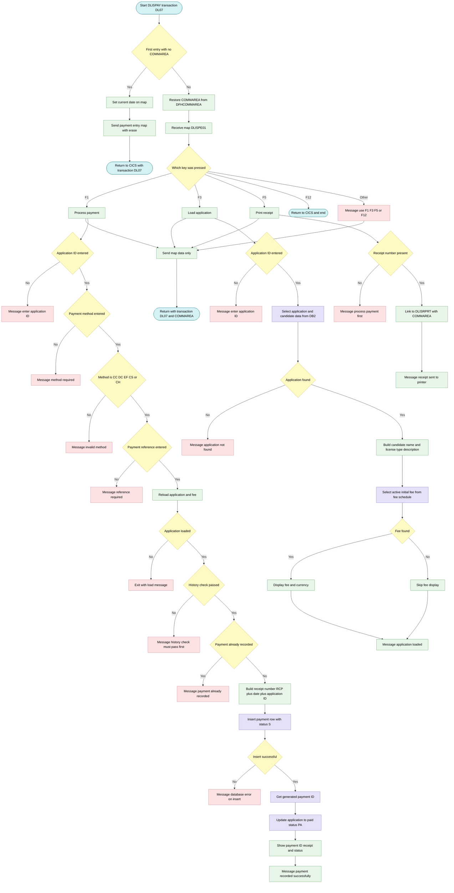
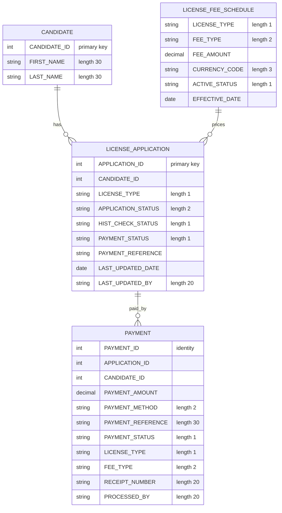

## Table of Contents

- [1. Purpose](#1-purpose)
- [2. Inputs](#2-inputs)
  - [2.1 CICS Communication Area (COMMAREA / DFHCOMMAREA)](#21-cics-communication-area-commarea--dfhcommarea)
  - [2.2 BMS Map Input Fields (DLISPE01 / DLISPE)](#22-bms-map-input-fields-dlispe01--dlispe)
  - [2.3 DB2 Database Tables](#23-db2-database-tables)
  - [2.4 CICS System Values](#24-cics-system-values)
- [3. Outputs](#3-outputs)
  - [3.1 CICS Screen Output Fields (Map `DLISPE01`)](#31-cics-screen-output-fields-map-dlispe01)
  - [3.2 Database Records (DB2 Writes and Updates)](#32-database-records-db2-writes-and-updates)
  - [3.3 CICS Communication and Navigation (COMMAREA & Links)](#33-cics-communication-and-navigation-commarea--links)
- [4. Processing Logic](#4-processing-logic)
  - [4.1 Mermaid Flow Diagram](#41-mermaid-flow-diagram)
  - [4.2 Processing Logic Description](#42-processing-logic-description)
  - [4.3 Database Tables](#43-database-tables)
- [5. Paragraphs](#5-paragraphs)
- [6. Dependencies](#6-dependencies)
- [7. Constraints](#7-constraints)
  - [7.1 Data Validation Constraints](#71-data-validation-constraints)
  - [7.2 Business Rule and Workflow Constraints](#72-business-rule-and-workflow-constraints)
  - [7.3 Operational and Sequencing Constraints](#73-operational-and-sequencing-constraints)
  - [7.4 Technical and Resource Constraints](#74-technical-and-resource-constraints)
- [8. Error Handling](#8-error-handling)
- [9. Examples](#9-examples)
  - [9.1 Example 1: F3 lookup of an existing application](#91-example-1-f3-lookup-of-an-existing-application)
  - [9.2 Example 2: F1 successful payment](#92-example-2-f1-successful-payment)
  - [9.3 Example 3: F1 rejected payments (validation and business rules)](#93-example-3-f1-rejected-payments-validation-and-business-rules)
  - [9.4 Example 4: F5 receipt printing](#94-example-4-f5-receipt-printing)
  - [9.5 Example 5: Other keys and first entry](#95-example-5-other-keys-and-first-entry)

## 1. Purpose

DLISPAY is a CICS/COBOL online payment entry and processing program for the Driver License Information System (DLIS), operating under transaction code DL07. It presents operators with an interactive payment screen (map DLISPE/DLISPE01) through which they can look up a license application, record a fee payment against it, and trigger receipt printing. When an application is loaded, the program retrieves the applicant's details and applicable fee from the DB2 `LICENSE_APPLICATION`, `CANDIDATE`, and `LICENSE_FEE_SCHEDULE` tables and displays them on screen. Before accepting a payment, it enforces two key business rules: the applicant's history check must have a passed status, and the application must not already carry a paid payment status. On successful payment, the program inserts a new row into the `PAYMENT` table — capturing the payment method, reference, amount, receipt number, and processing officer — and updates the `LICENSE_APPLICATION` record to reflect a paid status and a new application status of "PA". A system-generated receipt number is constructed from the prefix "RCP", the current date, and the application ID, and the DB2 `IDENTITY_VAL_LOCAL()` function is used to retrieve the newly assigned payment identifier for display. Operators may also trigger printing of the payment receipt, which is delegated to the linked program `DLISRPRT` via an `EXEC CICS LINK` call.

## 2. Inputs

### 2.1 CICS Communication Area (COMMAREA / DFHCOMMAREA)

- **`DFHCOMMAREA`** — Standard CICS Linkage Section field (350 bytes) through which state is passed back into the program on every pseudo-conversational re-entry. Its content is moved into `DLIS-COMMAREA` at the start of each transaction cycle to restore the prior session context.
  - **`CA-TRANSACTION-ID`** — Identifies the owning CICS transaction (`DL07`); used for routing and return control.
  - **`CA-CANDIDATE-ID`** — Candidate identifier carried across screen interactions to maintain context between calls.
  - **`CA-APPLICATION-ID`** — Application identifier carried across screen interactions, available for use by linked programs such as `DLISRPRT`.
  - **`CA-USER-ID`** — Operator user ID preserved in the COMMAREA for audit and context continuity.
  - **`CA-ACTION`** — Action code passed between pseudo-conversational cycles to indicate the next operation to perform.

### 2.2 BMS Map Input Fields (DLISPE01 / DLISPE)

Operator-entered fields received from the CICS map via `EXEC CICS RECEIVE MAP`:

- **`DPEAIDI`** — Application ID entered by the operator. Used as the primary key to retrieve the license application record from `DLIS.LICENSE_APPLICATION` and as a component in generating the receipt number.
- **`DPEMETHI`** — Payment method code entered by the operator (e.g., `CC`, `DC`, `EF`, `CS`, `CH`). Validated against allowed values before payment processing proceeds; inserted into `DLIS.PAYMENT`.
- **`DPEREFI`** — Payment reference entered by the operator (e.g., a bank authorisation or reference code). Required before payment is accepted; inserted into both `DLIS.PAYMENT` and `DLIS.LICENSE_APPLICATION`.
- **`DPEPRCBYI`** — Processed-by identifier entered by the operator. Identifies the staff member recording the payment; inserted into `DLIS.PAYMENT` and used to update `LAST_UPDATED_BY` in `DLIS.LICENSE_APPLICATION`.
- **`DPERCTO`** — Receipt number field on the map. Checked during the Print Receipt action to confirm a payment has already been processed before dispatching to `DLISRPRT`.

### 2.3 DB2 Database Tables

- **`DLIS.LICENSE_APPLICATION`** — Primary source of application data. The program reads the following columns to drive processing logic:
  - **`CANDIDATE_ID`** — Identifies the applicant associated with the application; propagated to the payment record.
  - **`LICENSE_TYPE`** — Classification of the license (`L`, `P`, `O`); drives fee schedule lookup and display labels.
  - **`HIST_CHECK_STATUS`** — History check outcome; must equal `'P'` (Passed) before payment is permitted.
  - **`PAYMENT_STATUS`** — Existing payment state; prevents duplicate payment if already `'P'` (Paid).
- **`DLIS.CANDIDATE`** — Joined to `LICENSE_APPLICATION` to retrieve the candidate's name (`FIRST_NAME`, `LAST_NAME`) for display on the payment screen.
- **`DLIS.LICENSE_FEE_SCHEDULE`** — Queried to obtain the applicable fee for the license type:
  - **`FEE_AMOUNT`** — Monetary amount charged for the license application; used as the payment amount.
  - **`CURRENCY_CODE`** — Currency denomination of the fee; displayed alongside the fee amount on screen.

### 2.4 CICS System Values

- **`EIBCALEN`** — CICS Execute Interface Block field indicating the length of the passed COMMAREA. Tested at entry to determine whether the program is being invoked for the first time (initial screen) or re-entered after operator input.
- **`EIBAID`** — CICS attention identifier reflecting which function key the operator pressed (`DFHPF1` to process payment, `DFHPF3` to look up an application, `DFHPF5` to print a receipt, `DFHPF12` to exit).
- **`CURRENT-DATE`** — IBM COBOL intrinsic function value providing the system date; used to populate the screen date field and to construct the receipt number.

## 3. Outputs

### 3.1 CICS Screen Output Fields (Map `DLISPE01`)
The program writes data directly to the user's terminal by updating specific output fields of map `DLISPE01` in mapset `DLISPE` to reflect screen updates:
- **Candidate and Application Details**
  - `DPECNAMO`: Displays the candidate's formatted full name, constructed by concatenating their first and last name with a separating space.
  - `DPELTYO`: Displays the single-character license type code retrieved from the license application database record.
  - `DPELDSO`: Displays the user-friendly description of the license type based on its code (e.g., 'LEARNER', 'PROBATION', or 'OPEN').
- **Financial Information**
  - `DPEFEEO`: Displays the formatted, decimal-aligned license fee amount retrieved from the active fee schedule.
  - `DPECURRO`: Displays the three-character currency code associated with the loaded fee schedule.
- **Transaction Confirmation**
  - `DPEPIDO`: Displays the newly generated, system-assigned payment identifier retrieved from the database after a successful insertion.
  - `DPERCTO`: Displays the formatted receipt number generated for the successful payment.
  - `DPEPSTSO`: Displays the payment status indicator (set to 'S' on successful insertion) on the screen.
- **Messages and System Fields**
  - `DPEMSG`: Displays status, success, and validation error messages (e.g., "PAYMENT RECORDED SUCCESSFULLY", "APPLICATION NOT FOUND", "HISTORY CHECK MUST BE PASSED BEFORE PAYMENT", "PROCESS PAYMENT FIRST BEFORE PRINTING").
  - `DPEDATE`: Displays the current system date, initialized when the map is first sent.

### 3.2 Database Records (DB2 Writes and Updates)
The program updates the relational database to write the transaction details and update the state of the license application:
- **DLIS.PAYMENT Table (Insert)**
  - `APPLICATION_ID`: References the license application for which the payment is made.
  - `CANDIDATE_ID`: Identifies the candidate performing the payment.
  - `PAYMENT_AMOUNT`: Records the fee amount charged for the application.
  - `PAYMENT_METHOD`: Records the verified payment method code (e.g., 'CC', 'DC', 'EF', 'CS', 'CH').
  - `PAYMENT_REFERENCE`: Records the externally provided reference code or authorization code.
  - `PAYMENT_STATUS`: Sets the database payment status (hardcoded to 'S').
  - `LICENSE_TYPE`: Identifies the classification of the license paid for.
  - `FEE_TYPE`: Identifies the type of fee being paid (hardcoded to 'IF').
  - `RECEIPT_NUMBER`: Stores the constructed receipt number.
  - `PROCESSED_BY`: Tracks the identifier of the operator who processed the payment.
- **DLIS.LICENSE_APPLICATION Table (Update)**
  - `PAYMENT_STATUS`: Updated to 'P' (Paid) to indicate that payment has been successfully recorded.
  - `PAYMENT_REFERENCE`: Updated with the corresponding transaction reference code for financial auditing.
  - `APPLICATION_STATUS`: Updated to 'PA' (Payment Approved/Processed) to advance the application to the next workflow state.
  - `LAST_UPDATED_DATE`: Updated with the current DB2 date.
  - `LAST_UPDATED_BY`: Updated with the ID of the processing operator.

### 3.3 CICS Communication and Navigation (COMMAREA & Links)
The program maintains state across screen interactions and transfers context to downstream processing:
- **DLIS-COMMAREA**
  - Passed via `EXEC CICS RETURN` to the transaction `DL07` to maintain business state across conversational steps.
  - Passed as the communication area parameter in `EXEC CICS LINK` when invoking the receipt printing program `DLISRPRT`.
  - Main outputs inside the communication area structure include:
    - `CA-TRANSACTION-ID`: Carries the current transaction identifier.
    - `CA-CANDIDATE-ID`: Carries the candidate identifier.
    - `CA-APPLICATION-ID`: Carries the application identifier.
    - `CA-PAYMENT-ID`: Relays the newly created payment identifier to the print program so that the corresponding receipt can be retrieved and formatted.
    - `CA-USER-ID`: Tracks the active operator ID.

## 4. Processing Logic

### 4.1 Mermaid Flow Diagram

---

### 4.2 Processing Logic Description

**High-level Summary**

DLISPAY is a pseudo-conversational CICS/COBOL program for transaction DL07. It uses map DLISPE01 in mapset DLISPE, and operators use it to take a license application fee payment. Each function key does one job:
- F1 validates and records a payment.
- F3 looks up an application and shows the fee.
- F5 prints a receipt through program DLISRPRT.
- F12 exits.

The program reads and updates DB2 tables for license applications, candidates, fee schedules and payments.

**Execution Flow**

1. **Entry (MAIN-LOGIC)**
   - If EIBCALEN is 0, this is the first invocation. The program runs INIT-SCREEN.
   - INIT-SCREEN puts the current date on the map and sends the map with ERASE and FREEKB. It then issues a CICS RETURN to transaction DL07, passing the 350-byte COMMAREA.
   - If a COMMAREA exists, DFHCOMMAREA is copied into DLIS-COMMAREA. The program then runs PROCESS-INPUT.

2. **Input handling (PROCESS-INPUT)**
   - The program receives map DLISPE01 and evaluates the attention key (AID):
     - F1 runs PROCESS-PAYMENT.
     - F3 runs LOAD-APPLICATION.
     - F5 runs PRINT-RECEIPT.
     - F12 ends the transaction with a plain CICS RETURN.
     - Any other key sets the message "USE F1 F3 F5 OR F12".
   - The map is then re-sent with DATAONLY and FREEKB. The program returns to DL07 with the COMMAREA, which keeps the conversation going.

3. **Load application (F3, LOAD-APPLICATION)**
   - If the application ID is zero, the message is "ENTER APPLICATION ID" and the routine exits.
   - A DB2 join of LICENSE_APPLICATION and CANDIDATE reads these fields:
     - candidate ID
     - license type
     - history check status
     - payment status
     - first and last name
   - If SQLCODE is 100, the message is "APPLICATION NOT FOUND" and the routine exits. No other SQLCODE is checked for this select.
   - The program builds the candidate full name by joining first and last name with a space. It also sets the license type code and its description: L is LEARNER, P is PROBATION, O is OPEN.
   - A second query reads the fee and currency from LICENSE_FEE_SCHEDULE. It filters on these conditions:
     - the license type matches
     - the fee type is 'IF' (initial fee)
     - the status is Active
     - the effective date is on or before today
     - only the first row is taken
   - If the fee is found, the program formats it with an edited picture and shows it with the currency code. If it isn't found, nothing is shown and the load still succeeds.
   - The message is "APPLICATION LOADED".

4. **Process payment (F1, PROCESS-PAYMENT)**
   - Validations run in this order. Each failure sets a message and exits.
     1. The application ID is entered.
     2. The payment method is entered.
     3. The method is one of CC, DC, EF, CS or CH.
     4. The payment reference is entered.
   - The program then runs LOAD-APPLICATION again to get the current data and fee. It continues only if the message is "APPLICATION LOADED".
   - Business rules:
     - The history check status must be 'P' (passed). Otherwise the message is "HISTORY CHECK MUST BE PASSED BEFORE PAYMENT".
     - The payment status must not already be 'P'. Otherwise the message is "PAYMENT ALREADY RECORDED FOR THIS APPLICATION".
   - The receipt number is built as 'RCP' + the date (YYYYMMDD) + the application ID entered on the screen.
   - The program fills the payment host variables: method, reference, application ID, candidate ID, license type, amount (the looked-up fee), receipt number and processed-by.
   - It inserts a row into DLIS.PAYMENT with payment status 'S' and fee type 'IF'. If SQLCODE is not 0, the message is "DATABASE ERROR ON PAYMENT INSERT" and the routine exits.
   - It reads the generated payment ID with IDENTITY_VAL_LOCAL().
   - It updates LICENSE_APPLICATION:
     - payment status becomes 'P'
     - the payment reference is stored
     - the application status becomes 'PA'
     - the last-updated date and last-updated-by fields are set
   - The update's SQLCODE is not checked.
   - The screen shows the payment ID, receipt number and payment status 'S', with the message "PAYMENT RECORDED SUCCESSFULLY".

5. **Print receipt (F5, PRINT-RECEIPT)**
   - If the receipt field on the screen is blank, the message is "PROCESS PAYMENT FIRST BEFORE PRINTING".
   - Otherwise the program does an EXEC CICS LINK to DLISRPRT, passing the COMMAREA. The message is then "RECEIPT SENT TO PRINTER".

**External Interactions**

- **CICS BMS:** SEND MAP and RECEIVE MAP on DLISPE01 in mapset DLISPE. RETURN TRANSID('DL07') with COMMAREA is used for pseudo-conversational flow.
- **CICS LINK:** program DLISRPRT is called for receipt printing.
- **DB2 tables:**
  - DLIS.LICENSE_APPLICATION: read, then updated with payment status.
  - DLIS.CANDIDATE: read for the candidate name.
  - DLIS.LICENSE_FEE_SCHEDULE: read for the fee and currency.
  - DLIS.PAYMENT: a payment row is inserted.
  - SYSIBM.SYSDUMMY1: used to get the generated payment ID.
- There are no IBM MQ operations in this program.

**Plain Language Summary**

A clerk opens the payment screen and presses F3 after typing an application number. The program shows the applicant's name, license type and fee. The clerk then enters the payment method and reference, and presses F1. The program only accepts payment if these checks pass:
- all required fields are filled
- the method is valid
- the background history check has passed
- the application hasn't been paid already

When the checks pass, the program issues a receipt number, saves the payment, and marks the application as paid. Pressing F5 sends the receipt to the printer, but only after a payment has been made. F12 exits.

---

### 4.3 Database Tables

## 5. Paragraphs

**MAIN-LOGIC**
- Entry point and dispatcher of the pseudo-conversational CICS transaction DL07.
- Control flow:
  - If EIBCALEN = 0, this is the first invocation, so it performs INIT-SCREEN.
  - Otherwise it moves DFHCOMMAREA into DLIS-COMMAREA to restore state and performs PROCESS-INPUT.
  - It ends with STOP RUN.
- External interaction: none directly. It reads the CICS EIB commarea length.

**INIT-SCREEN**
- Sends the blank payment entry map on first entry.
- Operations:
  - Moves the first 10 characters of CURRENT-DATE to the map date field DPEDATE.
  - Sends map DLISPE01 from mapset DLISPE with ERASE and FREEKB. The response goes to WS-RESP1.
  - Issues EXEC CICS RETURN TRANSID('DL07') with DLIS-COMMAREA (length 350), so the next terminal input restarts the transaction.
- External interaction: CICS terminal I/O (SEND MAP) and CICS RETURN.
- Control flow: none. It is a straight sequence that ends the task.

**PROCESS-INPUT**
- Handles every re-entry. It receives the screen and routes by the attention key.
- Operations:
  - Receives map DLISPE01 into the symbolic map fields, with the response in WS-RESP1.
  - Evaluates EIBAID:
    - PF1 performs PROCESS-PAYMENT.
    - PF3 performs LOAD-APPLICATION.
    - PF5 performs PRINT-RECEIPT.
    - PF12 issues EXEC CICS RETURN, which ends the transaction without a TRANSID.
    - Any other key moves 'USE F1 F3 F5 OR F12' to DPEMSG.
  - Sends the map again with DATAONLY and FREEKB to refresh the data.
  - Issues EXEC CICS RETURN TRANSID('DL07') with the commarea to continue the pseudo-conversation.
- Control flow: EVALUATE TRUE on the AID key.
- External interaction: CICS RECEIVE MAP, SEND MAP and RETURN. It calls the other paragraphs, which do the database work.

**LOAD-APPLICATION**
- Looks up the license application and its candidate, shows the details, and retrieves the applicable initial fee.
- Operations:
  - Validation: if DPEAIDI is zeros, it sets 'ENTER APPLICATION ID' and does GO TO LOAD-APP-EXIT.
  - Moves DPEAIDI to APPLICATION-ID in DCLDLIS-LICENSE-APPL.
  - Runs a DB2 SELECT joining DLIS.LICENSE_APPLICATION and DLIS.CANDIDATE. It fetches CANDIDATE_ID, LICENSE_TYPE, HIST_CHECK_STATUS, PAYMENT_STATUS, FIRST_NAME and LAST_NAME.
  - If SQLCODE = 100, it sets 'APPLICATION NOT FOUND' and exits.
  - Builds the candidate full name (first name, a space, last name) with STRING into DPECNAMO. Each name is delimited by space.
  - Moves the license type to DPELTYO.
  - Maps the license type code to a description in DPELDSO: L is LEARNER, P is PROBATION, O is OPEN.
  - Runs a second SELECT on DLIS.LICENSE_FEE_SCHEDULE for FEE_AMOUNT and CURRENCY_CODE. The filters are the license type, FEE_TYPE 'IF', ACTIVE_STATUS 'A' and EFFECTIVE_DATE <= CURRENT DATE. It fetches only the first row.
  - If SQLCODE = 0, it moves the fee to WS-FEE-AMOUNT, edits it into WS-FEE-AMOUNT-D, and shows the fee (DPEFEEO) and currency (DPECURRO).
  - Sets DPEMSG to 'APPLICATION LOADED'.
- Control flow:
  - Early exits by GO TO LOAD-APP-EXIT.
  - IF tests on the SQLCODE after each SELECT.
  - EVALUATE on the license type.
  - There is no loop.
  - The SQLCODE is not checked for errors other than 100 after the first SELECT. A failed fee lookup is silently skipped.
- External interaction: DB2 reads on the LICENSE_APPLICATION, CANDIDATE and LICENSE_FEE_SCHEDULE tables.

**LOAD-APP-EXIT**
- Exit point for LOAD-APPLICATION. It contains only EXIT and is the target of the GO TO statements.

**PROCESS-PAYMENT**
- Validates the input and the application state, then records the payment and updates the application.
- Operations:
  - Input validation, each failure setting DPEMSG and going to PROCESS-PAY-EXIT:
    - The application ID must not be zeros.
    - The payment method (DPEMETHI) must not be blank.
    - The payment method must be one of CC, DC, EF, CS or CH.
    - The payment reference (DPEREFI) must not be blank.
  - Performs LOAD-APPLICATION to refresh the application and fee data. It exits if DPEMSG is not 'APPLICATION LOADED'.
  - Business-rule checks:
    - HIST-CHECK-STATUS must be 'P'.
    - PAYMENT-STATUS must not already be 'P', which prevents a duplicate payment.
  - Builds the receipt number from 'RCP', the first 8 characters of CURRENT-DATE (WS-RECEIPT-DATE) and the application ID (DPEAIDI), using STRING into WS-RECEIPT-NUMBER.
  - Moves screen and application values into the DCLDLIS-PAYMENT host variables: method, reference, application ID, candidate ID, license type, amount (WS-FEE-AMOUNT), receipt number and processed-by (DPEPRCBYI).
  - Runs a DB2 INSERT into DLIS.PAYMENT with payment status 'S' and fee type 'IF'. If SQLCODE is not 0, it sets 'DATABASE ERROR ON PAYMENT INSERT' and exits.
  - Runs SELECT IDENTITY_VAL_LOCAL() from SYSIBM.SYSDUMMY1 to get the generated PAYMENT-ID.
  - Runs a DB2 UPDATE on DLIS.LICENSE_APPLICATION. It sets PAYMENT_STATUS to 'P', stores PAYMENT_REFERENCE, sets APPLICATION_STATUS to 'PA', and sets LAST_UPDATED_DATE and LAST_UPDATED_BY. The SQLCODE of this UPDATE and of the identity SELECT is not checked.
  - Shows the payment ID (DPEPIDO), the receipt number (DPERCTO) and the status 'S' (DPEPSTSO), and sets 'PAYMENT RECORDED SUCCESSFULLY'.
- Control flow: a chain of IF guards that branch to PROCESS-PAY-EXIT by GO TO, and a nested PERFORM of LOAD-APPLICATION. There is no loop.
- External interaction: DB2 INSERT, SELECT and UPDATE on the PAYMENT, SYSDUMMY1 and LICENSE_APPLICATION tables. It also uses the data read by LOAD-APPLICATION.

**PROCESS-PAY-EXIT**
- Exit point for PROCESS-PAYMENT. It contains only EXIT and is the target of the GO TO statements.

**PRINT-RECEIPT**
- Prints the receipt for a payment that has already been processed.
- Operations:
  - If the receipt number field DPERCTO is blank, it sets 'PROCESS PAYMENT FIRST BEFORE PRINTING' and goes to PRINT-RECEIPT-EXIT.
  - Otherwise it issues EXEC CICS LINK PROGRAM('DLISRPRT') with DLIS-COMMAREA (length 350).
  - It then sets 'RECEIPT SENT TO PRINTER'.
- Control flow: a single IF guard with an early exit.
- External interaction: a CICS LINK to the receipt-printing program DLISRPRT.

**PRINT-RECEIPT-EXIT**
- Exit point for PRINT-RECEIPT. It contains only EXIT and is the target of the GO TO statement.

## 6. Dependencies

- **Transaction and Runtime Environment (CICS)**
  - Transaction `DL07` is the program's own pseudo-conversational transaction ID.
    - It is used in `EXEC CICS RETURN TRANSID('DL07')` to re-invoke the program after each screen interaction.
    - The workspace documentation (`AGENTS.md`) lists the payment transaction as `DL06`, while the program source uses `DL07`. The CSD definition should be checked for consistency.
  - CICS resource definitions in `csd/DLISCSD.csd` (group `DLISGRP`) register the program and transaction.
  - The CICS Execute Interface Block (EIB) supplies runtime state:
    - `EIBCALEN` distinguishes first entry (0) from re-entry.
    - `EIBAID` identifies the pressed key.
  - The attention-identifier constants `DFHPF1`, `DFHPF3`, `DFHPF5` and `DFHPF12` come from the CICS-supplied `DFHAID` definitions. They drive the function-key dispatch:
    - F1 processes the payment.
    - F3 looks up the application.
    - F5 prints the receipt.
    - F12 exits.
  - `DFHCOMMAREA` (350 bytes, LINKAGE SECTION) receives state from the prior invocation.
    - It is moved into `DLIS-COMMAREA` on re-entry.
    - `DLIS-COMMAREA` is passed back through `EXEC CICS RETURN COMMAREA(...) LENGTH(350)`.
  - `WS-RESP1` receives the `RESP` option from CICS SEND and RECEIVE commands.

- **Screen and Presentation Dependencies (BMS)**
  - Mapset `DLISPE` and map `DLISPE01` are used by `EXEC CICS SEND MAP` and `RECEIVE MAP`.
    - The BMS source is referenced in the workspace documentation as `bms/DLISECHPE.bms`.
    - It must be assembled through `jcl/DLISBMS.jcl` and `proc/DLISBASM.proc` into `DLIS.LOADLIB`.
  - The symbolic map fields come from the BMS-generated copybook (`DLIS.COPYBOOK`). The program uses these fields but does not declare them. They must be provided at compile time.
    - Input fields:
      - `DPEAIDI` (application ID)
      - `DPEMETHI` (payment method)
      - `DPEREFI` (payment reference)
      - `DPEPRCBYI` (processed by)
    - Output fields:
      - `DPEMSG`
      - `DPEDATE`
      - `DPECNAMO`
      - `DPELTYO`
      - `DPELDSO`
      - `DPEFEEO`
      - `DPECURRO`
      - `DPEPIDO`
      - `DPERCTO`
      - `DPEPSTSO`
    - The receipt field `DPERCTO` is also read as a condition for printing.

- **Called Programs and Modules**
  - `DLISRPRT` is invoked through `EXEC CICS LINK PROGRAM('DLISRPRT')` with `DLIS-COMMAREA`, 350 bytes.
    - It handles receipt printing for the F5 function.
    - It must be defined in CICS and available in the load library.

- **Database Dependencies (DB2)**
  - The DB2 subsystem is `DSN1`.
    - The program needs a precompile with `DSNHPC` through `jcl/DLISCOMP.jcl`.
    - It needs a bind of its DBRM into collection `DLISPKG` and plan `DLISPLAN` through `jcl/DLISBIND.jcl`.
  - Schema creation is in `db2/DLIS0001-CREATE-TABLES.sql`, `db2/DLIS0002-CREATE-INDEXES.sql` and `db2/DLIS0003-GRANTS.sql`, run through `jcl/DLISDB2.jcl`.
    - The grants must allow the CICS execution user to read and write the tables below.
  - Tables:
    - `DLIS.LICENSE_APPLICATION`
      - Read for application details: `CANDIDATE_ID`, `LICENSE_TYPE`, `HIST_CHECK_STATUS` and `PAYMENT_STATUS`.
      - Updated after payment to set `PAYMENT_STATUS='P'`, `PAYMENT_REFERENCE`, `APPLICATION_STATUS='PA'`, `LAST_UPDATED_DATE` and `LAST_UPDATED_BY`.
    - `DLIS.CANDIDATE`
      - Joined to retrieve `FIRST_NAME` and `LAST_NAME` for display.
    - `DLIS.LICENSE_FEE_SCHEDULE`
      - Read to get `FEE_AMOUNT` and `CURRENCY_CODE`.
      - The filter is the license type, `FEE_TYPE='IF'`, `ACTIVE_STATUS='A'` and `EFFECTIVE_DATE <= CURRENT DATE`.
    - `DLIS.PAYMENT`
      - Receives the new payment row: application, candidate, amount, method, reference, status `'S'`, license type, fee type `'IF'`, receipt number and processed-by.
    - `SYSIBM.SYSDUMMY1`
      - Used with `IDENTITY_VAL_LOCAL()` to retrieve the generated payment ID.
    - The `PAYMENT_ID` identity column must exist in the `DLIS.PAYMENT` table definition for this to work.
  - The SQL communication area comes from `EXEC SQL INCLUDE SQLCA`, which is used for `SQLCODE` checks (0 and 100).
  - DB2 special register `CURRENT DATE` is used in the fee lookup and in the application update.
  - Host variable structures come from DCLGEN-style layouts:
    - `DCLDLIS-CANDIDATE`
    - `DCLDLIS-LICENSE-APPL`
    - `DCLDLIS-DRIVING-HIST`
    - `DCLDLIS-PAYMENT`
    - `DCLDLIS-ISSUED-LIC`
    - `DCLDLIS-AUTH-USER`
    - `DCLDLIS-FEE-SCHED`

- **Copybooks (Compile-Time Dependencies)**
  - `DLISWS` (`copybook/DLISWS.cpy`)
    - Holds common working storage: return codes, messages, and candidate, application, payment, eligibility, history, approval and license work areas.
    - Also holds the null indicators.
  - `DLISCSEC` (`copybook/DLISCSEC.cpy`)
    - Defines the COMMAREA layouts, including `DLIS-COMMAREA`, and the CICS response work area.
  - `DLISDCLG` (`copybook/DLISDCLG.cpy`)
    - Defines the DB2 host variable structures for the CANDIDATE, LICENSE_APPLICATION, DRIVING_HISTORY, PAYMENT, ISSUED_LICENSE, AUTHORITY_USER and LICENSE_FEE_SCHEDULE tables.
  - The symbolic map copybook for `DLISPE` is generated from BMS and is not listed explicitly in the source.

- **Input Parameters and Data Sources**
  - Terminal user input from map `DLISPE01`:
    - Application ID
    - Payment method, which must be one of `CC`, `DC`, `EF`, `CS` or `CH`
    - Payment reference
    - Processed-by identifier
    - Function key pressed
  - COMMAREA content passed from the previous invocation. It is 350 bytes and uses the `DLIS-COMMAREA` layout.
  - System date from `CURRENT-DATE`:
    - It is used for the screen date.
    - Its first 8 characters form the receipt number.

- **Business Rule and Data Prerequisites**
  - The history check on the application (`HIST_CHECK_STATUS`) must be `'P'` before payment is accepted. The program depends on the upstream history check transaction having been run.
  - `PAYMENT_STATUS` must not already be `'P'`, which prevents duplicate payment.
  - A fee-schedule row of type `'IF'` and status `'A'` must exist for the license type, with an effective date on or before today. Otherwise no fee is displayed and the amount defaults to the working-storage value.
  - The application and candidate records must exist.
    - They are created by upstream transactions such as candidate maintenance (`DLISCAND`) and application entry (`DLISAPPL`).

- **Build and Deployment Dependencies**
  - Compile `jcl/DLISCOMP.jcl` using `proc/DLISCLNK.proc`.
    - The compiler is `IGYCRCTL` with options `RENT,APOST,LIB,NOSEQ,NOTERM`.
    - The link-edit step uses `IEWL` with `AMODE(31),RMODE(ANY)`.
  - CICS run-time libraries are needed:
    - The CICS translator and stub are needed to process `EXEC CICS`.
    - The DB2 language interface is needed for `EXEC SQL`.
  - Load library `DLIS.LOADLIB` holds the compiled program and BMS maps.
  - The CICS CSD group `DLISGRP` (`csd/DLISCSD.csd`, run through `DFHCSDUP`) must define the program, the transaction, the mapset `DLISPE` and `DLISRPRT`.

- **IBM MQ**
  - The program does not use MQ.
  - It has no external file I/O (no `SELECT` or `FD` entries) and no environment variables.

## 7. Constraints

### 7.1 Data Validation Constraints

- **Application Identifier Required and Non-Zero**
  - **Implementation**: In both `LOAD-APPLICATION` (lines 66–69) and `PROCESS-PAYMENT` (lines 119–122), the program checks `IF DPEAIDI = ZEROS`. If true, processing terminates immediately, and error message `'ENTER APPLICATION ID'` is displayed in `DPEMSG`.
- **Payment Method Mandatory**
  - **Implementation**: In `PROCESS-PAYMENT` (lines 123–126), the input is checked via `IF DPEMETHI = SPACES`. If empty, the transaction displays `'PAYMENT METHOD IS REQUIRED'` and exits the routine.
- **Allowed Payment Method Code Values**
  - **Implementation**: In `PROCESS-PAYMENT` (lines 127–130), the value is validated against a discrete domain: `IF DPEMETHI NOT IN ('CC','DC','EF','CS','CH')`. An invalid code triggers error message `'INVALID PAYMENT METHOD'` and stops processing.
- **Payment Reference Mandatory**
  - **Implementation**: In `PROCESS-PAYMENT` (lines 131–134), the input is checked via `IF DPEREFI = SPACES`. If missing, the program sets `DPEMSG` to `'PAYMENT REFERENCE IS REQUIRED'` and exits.
- **Receipt Generation Format Specification**
  - **Implementation**: In `PROCESS-PAYMENT` (lines 150–152), the receipt number is formatted by concatenating the literal `'RCP'`, an 8-character current date (`CURRENT-DATE(1:8)`), and the 10-digit application ID (`DPEAIDI`) into `WS-RECEIPT-NUMBER` (`PIC X(20)`).

### 7.2 Business Rule and Workflow Constraints

- **Application Record Existence**
  - **Implementation**: In `LOAD-APPLICATION` (lines 71–87), an SQL `SELECT` joins `DLIS.LICENSE_APPLICATION` and `DLIS.CANDIDATE` on `CANDIDATE_ID`. If `SQLCODE = 100`, the transaction halts with `'APPLICATION NOT FOUND'`.
- **Prerequisite Driving History Check Status**
  - **Implementation**: In `PROCESS-PAYMENT` (lines 139–143), the application's history check flag is evaluated via `IF HIST-CHECK-STATUS OF DCLDLIS-LICENSE-APPL NOT = 'P'`. Payment recording is blocked with `'HISTORY CHECK MUST BE PASSED BEFORE PAYMENT'` if the status is not `'P'` (Passed).
- **Duplicate Payment Prevention**
  - **Implementation**: In `PROCESS-PAYMENT` (lines 144–148), the current payment flag is checked via `IF PAYMENT-STATUS OF DCLDLIS-LICENSE-APPL = 'P'`. If already marked as paid, execution is prevented with `'PAYMENT ALREADY RECORDED FOR THIS APPLICATION'`.
- **Active Fee Schedule Lookup and Filtering**
  - **Implementation**: In `LOAD-APPLICATION` (lines 99–108), the fee amount is queried from `DLIS.LICENSE_FEE_SCHEDULE` matching `LICENSE_TYPE`, with hardcoded criteria `FEE_TYPE = 'IF'`, `ACTIVE_STATUS = 'A'`, and `EFFECTIVE_DATE <= CURRENT DATE` (limited to `FETCH FIRST 1 ROW ONLY`).
- **Payment Lifecycle State Updates**
  - **Implementation**: Upon recording a payment in `PROCESS-PAYMENT` (lines 165–195), the newly inserted payment record is explicitly assigned a status of `'S'` (Settled/Successful) with fee type `'IF'`. Concurrently, `DLIS.LICENSE_APPLICATION` is updated with `PAYMENT_STATUS = 'P'`, `APPLICATION_STATUS = 'PA'` (Payment Approved/Accepted), `LAST_UPDATED_DATE = CURRENT DATE`, and `LAST_UPDATED_BY` set to the operator ID.

### 7.3 Operational and Sequencing Constraints

- **Payment Requirement Before Receipt Printing**
  - **Implementation**: In `PRINT-RECEIPT` (lines 203–206), the routine checks `IF DPERCTO = SPACES`. If no receipt number is present on the screen, execution halts with `'PROCESS PAYMENT FIRST BEFORE PRINTING'`.
- **Controlled Attention Identifier (AID) Key Navigation**
  - **Implementation**: In `PROCESS-INPUT` (lines 50–57), only specific function keys are permitted: `DFHPF1` (Process Payment), `DFHPF3` (Load/Lookup Application), `DFHPF5` (Print Receipt), and `DFHPF12` (Exit via `EXEC CICS RETURN`). Any other AID key generates the error message `'USE F1 F3 F5 OR F12'`.
- **Application Reloading Prior to Payment Insertion**
  - **Implementation**: In `PROCESS-PAYMENT` (lines 135–138), `PERFORM LOAD-APPLICATION` is explicitly called to fetch the latest application state, verify record concurrency, and ensure `DPEMSG = 'APPLICATION LOADED'` before proceeding with SQL inserts.

### 7.4 Technical and Resource Constraints

- **CICS Pseudo-Conversational Communication Area Fixed Size**
  - **Implementation**: Across `INIT-SCREEN`, `PROCESS-INPUT`, and inter-program linkage in `PRINT-RECEIPT` (invoking `DLISRPRT`), `DFHCOMMAREA` and `DLIS-COMMAREA` are constrained to a fixed length of 350 bytes (`LENGTH(350)`).
- **Database Transaction Integrity and Local Identity Retrieval**
  - **Implementation**: In `PROCESS-PAYMENT` (lines 175–183), the `INSERT` operation status is verified via `IF SQLCODE NOT = 0`, halting with `'DATABASE ERROR ON PAYMENT INSERT'`. The system-generated payment primary key must be obtained immediately after insertion using `SELECT IDENTITY_VAL_LOCAL() FROM SYSIBM.SYSDUMMY1`.

## 8. Error Handling

-  Input validation checks (PROCESS-PAYMENT)
  - A missing application ID (zeros) stops processing and sets the message "ENTER APPLICATION ID". Control then jumps to the paragraph exit.
  - A blank payment method stops processing and sets "PAYMENT METHOD IS REQUIRED".
  - A payment method outside the allowed list (CC, DC, EF, CS, CH) sets "INVALID PAYMENT METHOD".
  - A blank payment reference stops processing and sets "PAYMENT REFERENCE IS REQUIRED".
  - Each failed check uses a GO TO to the exit paragraph. This works as a fail-fast guard sequence: the first failure ends the routine, and nothing is written to the database.

- Business-rule gate checks
  - After the application is reloaded, payment proceeds only if the message equals "APPLICATION LOADED". Any other message, such as "APPLICATION NOT FOUND" or "ENTER APPLICATION ID", is carried through as the result and processing stops.
  - The history check status must be "P" (Passed). Otherwise the message is "HISTORY CHECK MUST BE PASSED BEFORE PAYMENT" and the payment is blocked.
  - If the payment status is already "P", the message is "PAYMENT ALREADY RECORDED FOR THIS APPLICATION". This prevents duplicate payments.
  - PRINT-RECEIPT checks that a receipt number is present on the screen. If it is blank, the message is "PROCESS PAYMENT FIRST BEFORE PRINTING" and the LINK to the print program is skipped.

- Database error handling (DB2 SQLCODE checks)
  - Application lookup (LOAD-APPLICATION):
    - SQLCODE 100 (no row found) sets "APPLICATION NOT FOUND" and exits.
    - Other non-zero SQLCODEs (negative errors) are not tested. After a failed lookup, the program carries on with whatever values are in the host variables.
  - Fee schedule lookup:
    - The fee is moved to the screen only when SQLCODE is 0.
    - If no fee is found or an error occurs, the fee and currency fields are silently left unpopulated. Loading still ends with "APPLICATION LOADED".
    - The SELECT uses FETCH FIRST 1 ROW ONLY, which avoids a multiple-row error (SQLCODE -811) if several fee rows match.
  - Payment INSERT:
    - Any non-zero SQLCODE sets "DATABASE ERROR ON PAYMENT INSERT" and exits before any further updates.
    - This is the only general SQL failure check in the program.
  - Not checked:
    - The IDENTITY_VAL_LOCAL() retrieval after the insert has no SQLCODE check.
    - The UPDATE of LICENSE_APPLICATION to set the payment status to "P" and the application status to "PA" has no SQLCODE check.
    - The program contains no explicit rollback (CICS SYNCPOINT ROLLBACK) and no SQLCODE-based recovery. If the insert succeeds and the update fails, the data can become inconsistent.
    - Sensitive SQL failures are never logged.

- CICS command and response handling
  - The SEND MAP and RECEIVE MAP commands use the RESP option, so a CICS condition does not cause an abend.
    - The response is stored in a working-storage field.
    - That field is never examined afterwards, so errors such as MAPFAIL are effectively ignored.
  - The LINK to DLISRPRT has no RESP or RESP2 option and no HANDLE CONDITION or HANDLE ABEND.
    - If the print program is not found or abends, the default CICS handling applies, which usually abends the task.
    - The program still shows "RECEIPT SENT TO PRINTER" after the LINK returns. It does not confirm the outcome.
  - MAIN-LOGIC tests the length of the incoming communication area (EIBCALEN).
    - A length of zero is treated as the first entry into the transaction, so the program initialises the screen.
    - A non-zero length restores the saved state and processes the user's input.
    - This is the only mechanism that distinguishes first entry from re-entry.

- User input and navigation control
  - An unrecognised attention key (not F1, F3, F5 or F12) falls to the OTHER branch of the EVALUATE and shows "USE F1 F3 F5 OR F12".
  - F12 ends the transaction cleanly with a CICS RETURN and no further processing.
  - After every action, the result message is shown on the screen with a SEND MAP (DATAONLY). The transaction then RETURNs with TRANSID DL07 and the communication area, so the user sees the outcome and can correct the input.

- Recovery and fallback logic
  - Validation failures are recoverable: the screen is redisplayed with a message and the user can correct the input and retry. No retry loops or automatic retries exist.
  - The license type description (EVALUATE) has no default branch for values other than L, P or O. The description field is left unchanged for unknown license types.
  - The program uses default CICS error handling for all conditions it doesn't test for.

- User and system notifications
  - All errors and statuses are reported through a single message field on the screen (DPEMSG).
    - Messages include validation errors, business-rule violations, the database failure and the success message "PAYMENT RECORDED SUCCESSFULLY".
  - The copybook defines a return code, message and colour fields (WS-RETURN-CODE, WS-RETURN-MSG, WS-MSG-COLOR). It also defines CICS response and abend working-storage areas.
    - The procedure logic never uses these fields.
    - No message colour is set to distinguish errors from successes.
  - There is no logging, no abend call (EXEC CICS ABEND), no error-write to a TD queue and no operator notification.

- Control-flow safeguards
  - Each routine has a dedicated exit paragraph (LOAD-APP-EXIT, PROCESS-PAY-EXIT, PRINT-RECEIPT-EXIT), reached by GO TO from an error condition. This gives each routine a single exit point.
  - A GO TO from a failure inside LOAD-APPLICATION leaves only that routine. The caller PROCESS-PAYMENT then detects the failure by checking the message text.
  - Detecting failure by comparing message text is fragile. Any change to the wording of the success message would break the check.

## 9. Examples

### 9.1 Example 1: F3 lookup of an existing application

**Input (screen, F3 pressed)**

| Field | Value |
|---|---|
| Application ID (`DPEAIDI`) | `1234567` |

DB2 data for this application:
- The application has candidate John Smith.
- License type is `L`.
- History check status is `P`.
- Payment status is `N`.
- The `LICENSE_FEE_SCHEDULE` row for `L` and fee type `IF` is active, with `FEE_AMOUNT` 25.00 and currency `USD`.

**Expected output**

| Field | Value |
|---|---|
| Candidate name | `John Smith` |
| License type | `L` |
| License description | `LEARNER` |
| Fee | `    25.00` |
| Currency | `USD` |
| Message | `APPLICATION LOADED` |

**Explanation:** `EIBAID = DFHPF3` runs `LOAD-APPLICATION`. A join of `LICENSE_APPLICATION` and `CANDIDATE` returns the candidate's name and license type. The name is built by `STRING` from the first and last names, each delimited by space. License type `L` maps to `LEARNER`. A second query reads the active `IF` fee. The fee is edited through `WS-FEE-AMOUNT-D` (`ZZZ,ZZ9.99`) for display. The program then re-sends the map and returns to transaction `DL07`.

---

### 9.2 Example 2: F1 successful payment

**Input (screen, F1 pressed)**

| Field | Value |
|---|---|
| Application ID | `1234567` |
| Payment method (`DPEMETHI`) | `CC` |
| Payment reference (`DPEREFI`) | `BANKREF-98765` |
| Processed by (`DPEPRCBYI`) | `CLERK01` |

The application has history check status `P` and payment status `N`. Today's date is 2025-01-15.

**Expected output**

| Item | Value |
|---|---|
| Receipt number (`DPERCTO`) | `RCP202501151234567` |
| Payment ID (`DPEPIDO`) | The identity value generated by DB2, for example `5001` |
| Payment status (`DPEPSTSO`) | `S` |
| Message | `PAYMENT RECORDED SUCCESSFULLY` |

Database changes:
- A new `DLIS.PAYMENT` row is inserted with amount 25.00, method `CC`, status `S`, fee type `IF` and receipt `RCP202501151234567`.
- `LICENSE_APPLICATION` is updated to `PAYMENT_STATUS='P'` and `APPLICATION_STATUS='PA'`.
- The update also sets the payment reference and `LAST_UPDATED_BY='CLERK01'`.

**Explanation:** `PROCESS-PAYMENT` first checks that the application ID, the method and the reference are present. The method must be one of `CC`, `DC`, `EF`, `CS` or `CH`. It then reloads the application, which also fetches the fee. The history check is `P` and payment is not already `P`, so it builds the receipt number as `'RCP'` + date (`YYYYMMDD`) + application ID. It inserts the payment and gets the new key with `IDENTITY_VAL_LOCAL()`. Finally it marks the application as paid.

---

### 9.3 Example 3: F1 rejected payments (validation and business rules)

| Input (F1) | Condition | Message shown |
|---|---|---|
| Application ID `1234567`, method `XX`, reference `REF1` | Method is not in the allowed list | `INVALID PAYMENT METHOD` |
| Application ID `1234567`, method `CC`, reference blank | Reference is missing | `PAYMENT REFERENCE IS REQUIRED` |
| Application ID `7654321`, method `CS`, reference `REF2`, history check status `F` | History check not passed | `HISTORY CHECK MUST BE PASSED BEFORE PAYMENT` |
| Application ID `1234567`, method `CC`, reference `REF3`, payment status already `P` | Duplicate payment | `PAYMENT ALREADY RECORDED FOR THIS APPLICATION` |
| Application ID `9999999`, method `CC`, reference `REF4`, no matching row | `SQLCODE = 100` | `APPLICATION NOT FOUND` |

**Explanation:** Each check uses `GO TO PROCESS-PAY-EXIT` to stop processing before the insert. No `PAYMENT` row is written and the application is not updated. Only the message field changes.

---

### 9.4 Example 4: F5 receipt printing

| Scenario | Input | Output |
|---|---|---|
| Receipt field is blank | F5 pressed before any payment | `PROCESS PAYMENT FIRST BEFORE PRINTING` |
| Receipt field holds `RCP202501151234567` | F5 pressed after a successful payment | `DLISRPRT` is linked with the COMMAREA, then the message is `RECEIPT SENT TO PRINTER` |

**Explanation:** `PRINT-RECEIPT` allows printing only when `DPERCTO` holds a receipt number. Otherwise it asks the operator to process the payment first.

---

### 9.5 Example 5: Other keys and first entry

| Input | Output |
|---|---|
| First entry to `DL07` (`EIBCALEN = 0`) | The empty payment map `DLISPE01` is sent and the program returns with `TRANSID('DL07')`. |
| Any other key, such as F2 | `USE F1 F3 F5 OR F12` |
| F12 | The transaction ends with `EXEC CICS RETURN`. |

---

Generated by IBM Bob Premium Package for Z
