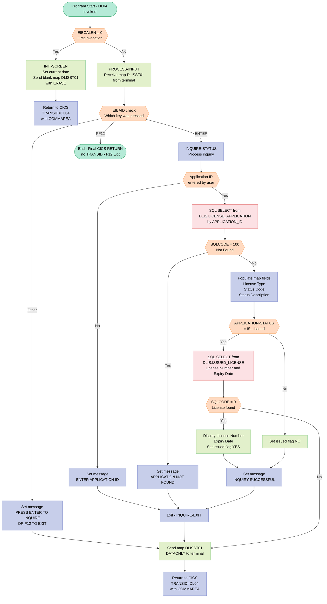
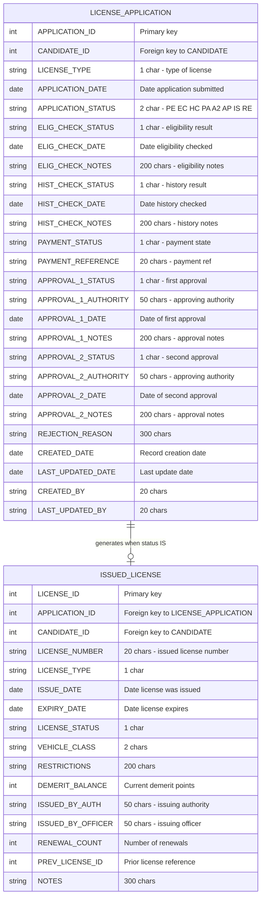

## Table of Contents

- [1. Purpose](#1-purpose)
- [2. Inputs](#2-inputs)
  - [2.1 User Interface & Screen Inputs (BMS Map `DLISST01` / CICS EIB)](#21-user-interface--screen-inputs-bms-map-dlisst01--cics-eib)
  - [2.2 Inter-Program Communication Area (CICS COMMAREA)](#22-inter-program-communication-area-cics-commarea)
  - [2.3 External Database Inputs (IBM Db2)](#23-external-database-inputs-ibm-db2)
  - [2.4 System & Runtime Environment Inputs](#24-system--runtime-environment-inputs)
- [3. Outputs](#3-outputs)
  - [3.1 CICS Screen Output (BMS Map DLISST01)](#31-cics-screen-output-bms-map-dlisst01)
  - [3.2 Inter-Program and Session State Outputs](#32-inter-program-and-session-state-outputs)
- [4. Processing Logic](#4-processing-logic)
  - [4.1 Mermaid Flow Diagram](#41-mermaid-flow-diagram)
  - [4.2 Processing Logic Description](#42-processing-logic-description)
  - [4.3 Database Tables](#43-database-tables)
- [5. Paragraphs](#5-paragraphs)
- [6. Dependencies](#6-dependencies)
  - [6.1 CICS Resources](#61-cics-resources)
  - [6.2 BMS Map](#62-bms-map)
  - [6.3 DB2 Tables](#63-db2-tables)
  - [6.4 DB2 Bind Artifacts](#64-db2-bind-artifacts)
  - [6.5 Copybooks](#65-copybooks)
  - [6.6 CICS Runtime EIB Fields](#66-cics-runtime-eib-fields)
  - [6.7 CICS COMMAREA](#67-cics-commarea)
  - [6.8 Build and Deployment Artefacts](#68-build-and-deployment-artefacts)
- [7. Constraints](#7-constraints)
- [8. Error Handling](#8-error-handling)
  - [8.1 User Input Validation](#81-user-input-validation)
  - [8.2 Database Error Handling and Status Checking](#82-database-error-handling-and-status-checking)
  - [8.3 CICS Communication and Screen Control Handling](#83-cics-communication-and-screen-control-handling)
- [9. Examples](#9-examples)
  - [9.1 Example 1: Issued license found](#91-example-1-issued-license-found)
  - [9.2 Example 2: Application still in progress](#92-example-2-application-still-in-progress)
  - [9.3 Example 3: Input validation and error cases](#93-example-3-input-validation-and-error-cases)
  - [9.4 Example 4: First invocation](#94-example-4-first-invocation)

## 1. Purpose

DLISSTAT is a CICS/COBOL interactive inquiry program (transaction DL04) that allows users to look up the real-time processing status of a driver's license application within the Driver License Information System (DLIS). Given an application ID entered on screen, it queries the DB2 `DLIS.LICENSE_APPLICATION` table to retrieve and display each stage of the application workflow — eligibility check, history check, payment, and both levels of authority approval — along with a human-readable description of the overall application status. If the application has been fully issued, the program additionally retrieves the assigned license number and expiry date from the `DLIS.ISSUED_LICENSE` table and presents them on the inquiry screen.

## 2. Inputs

### 2.1 User Interface & Screen Inputs (BMS Map `DLISST01` / CICS EIB)
- **Attention Identifier (`EIBAID`)**
  - Identifies the terminal key pressed by the user (e.g., `DFHENTER` to initiate an inquiry or `DFHPF12` to exit the transaction), directing the control flow in the evaluation logic.
- **Application ID (`DSTAIDI`)**
  - Captures the numeric application identifier entered by the operator on the BMS screen map (`DLISST01`), serving as the search key for database inquiries.

### 2.2 Inter-Program Communication Area (CICS COMMAREA)
- **`DFHCOMMAREA`**
  - Represents the 350-byte CICS communication area received in the `LINKAGE SECTION`.
  - Transferred into the working-storage structure `DLIS-COMMAREA` when `EIBCALEN` is greater than zero to maintain session state across pseudo-conversational transaction cycles.

### 2.3 External Database Inputs (IBM Db2)
- **`DLIS.LICENSE_APPLICATION` Table Records**
  - Retrieved via SQL `SELECT` using `APPLICATION_ID` as the primary key:
    - **`LICENSE-TYPE`**: Classification code of the driver's license requested.
    - **`APPLICATION-STATUS`**: Current lifecycle processing code (e.g., `PE`, `EC`, `HC`, `PA`, `A2`, `AP`, `IS`, `RE`) used to determine descriptive text and subsequent querying.
    - **`ELIG-CHECK-STATUS`**, **`ELIG-CHECK-DATE`**, **`ELIG-CHECK-NOTES`**: Status, completion date, and remarks for the eligibility verification stage.
    - **`HIST-CHECK-STATUS`**, **`HIST-CHECK-DATE`**, **`HIST-CHECK-NOTES`**: Status, completion date, and remarks for the driving history verification stage.
    - **`PAYMENT-STATUS`**, **`PAYMENT-REFERENCE`**: Payment settlement status and payment reference identifier.
    - **`APPROVAL-1-STATUS`**, **`APPROVAL-1-DATE`**, **`APPROVAL-1-AUTHORITY`**: Decision status, approval date, and authorizing officer/role for the primary authority approval.
    - **`APPROVAL-2-STATUS`**, **`APPROVAL-2-DATE`**, **`APPROVAL-2-AUTHORITY`**: Decision status, approval date, and authorizing officer/role for the secondary authority approval.

- **`DLIS.ISSUED_LICENSE` Table Records**
  - Conditionally retrieved when `APPLICATION-STATUS` equals `'IS'` (Issued):
    - **`LICENSE-NUMBER`**: The unique driver license number issued to the applicant.
    - **`EXPIRY-DATE`**: The date when the issued license expires.

### 2.4 System & Runtime Environment Inputs
- **Current System Date (`CURRENT-DATE(1:10)`)**
  - An intrinsic COBOL date function supplying the current calendar date to initialize the date field (`DSTDATE`) on the screen header.
- **Communication Area Length (`EIBCALEN`)**
  - CICS Exec Interface Block field that provides the length of the incoming COMMAREA to distinguish between an initial transaction entry (`EIBCALEN = 0`) and conversational user input.

## 3. Outputs

### 3.1 CICS Screen Output (BMS Map DLISST01)
- `DSTDATE`: Transmits the current system date (`CURRENT-DATE(1:10)`) formatted on the screen header during initial screen rendering.
- `DSTLTYO`: Displays the license classification type (retrieved from `LICENSE-TYPE`).
- `DSTASTTO`: Displays the two-character application status code (retrieved from `APPLICATION-STATUS`).
- `DSTADSO`: Displays the resolved human-readable description for the application status (e.g., 'PENDING - AWAITING ELIGIBILITY CHECK', 'LICENSE ISSUED', 'REJECTED').
- `DST1STSO`: Displays the eligibility check stage status flag (retrieved from `ELIG-CHECK-STATUS`).
- `DST1DATO`: Displays the date when the eligibility check was performed (retrieved from `ELIG-CHECK-DATE`).
- `DST1NTSO`: Displays notes or comments recorded during the eligibility check stage (retrieved from `ELIG-CHECK-NOTES`).
- `DST2STSO`: Displays the driving history check stage status flag (retrieved from `HIST-CHECK-STATUS`).
- `DST2DATO`: Displays the date when the history check was performed (retrieved from `HIST-CHECK-DATE`).
- `DST2NTSO`: Displays notes or comments recorded during the history check stage (retrieved from `HIST-CHECK-NOTES`).
- `DST3STSO`: Displays the payment transaction status flag (retrieved from `PAYMENT-STATUS`).
- `DST3REFO`: Displays the payment reference identifier (retrieved from `PAYMENT-REFERENCE`).
- `DST4STSO`: Displays the first authority approval status flag (retrieved from `APPROVAL-1-STATUS`).
- `DST4DATO`: Displays the date of first authority approval action (retrieved from `APPROVAL-1-DATE`).
- `DST4AUTO`: Displays the authority ID or name that processed the first approval stage (retrieved from `APPROVAL-1-AUTHORITY`).
- `DST5STSO`: Displays the second authority approval status flag (retrieved from `APPROVAL-2-STATUS`).
- `DST5DATO`: Displays the date of second authority approval action (retrieved from `APPROVAL-2-DATE`).
- `DST5AUTO`: Displays the authority ID or name that processed the second approval stage (retrieved from `APPROVAL-2-AUTHORITY`).
- `DST6FLGO`: Displays an issuance indicator flag ('YES' if the license has been issued, 'NO' otherwise).
- `DST6NUMO`: Displays the issued license number (retrieved from `LICENSE-NUMBER` when the application status is 'IS').
- `DST6EXPO`: Displays the expiry date of the issued license (retrieved from `EXPIRY-DATE` when the application status is 'IS').
- `DSTMSG`: Transmits operational, informational, and error messages to the user (e.g., 'PRESS ENTER TO INQUIRE OR F12 TO EXIT', 'ENTER APPLICATION ID', 'APPLICATION NOT FOUND', 'INQUIRY SUCCESSFUL').

### 3.2 Inter-Program and Session State Outputs
- `DLIS-COMMAREA`: Preserves session context and transaction state across pseudo-conversational invocations by passing the 350-byte communication area via `EXEC CICS RETURN TRANSID('DL04') COMMAREA(...)`.

## 4. Processing Logic

### 4.1 Mermaid Flow Diagram

---

### 4.2 Processing Logic Description

#### 4.2.1 High-level Summary

DLISSTAT is a CICS pseudo-conversational COBOL program running under transaction **DL04**. Its purpose is to allow an operator to inquire on the full processing status of a driver license application by entering an Application ID. The program retrieves all workflow stage details from the DB2 database and presents them on screen, including eligibility check, history check, payment, dual-authority approvals, and — if the license has been issued — the license number and expiry date.

---

#### 4.2.2 Execution Flow

**Step 1 — Entry Point: MAIN-LOGIC**

The program checks `EIBCALEN`, the CICS Execute Interface Block field that holds the length of the COMMAREA passed from the prior invocation:
- `EIBCALEN = 0` → this is the **first invocation** (user typed `DL04` at the terminal); perform `INIT-SCREEN`.
- `EIBCALEN ≠ 0` → a COMMAREA exists from a previous invocation; the prior session state is restored from `DFHCOMMAREA` into `DLIS-COMMAREA`, then `PROCESS-INPUT` is performed.

---

**Step 2 — INIT-SCREEN (First invocation)**

- The current date (`CURRENT-DATE`) is moved to the map date field `DSTDATE`.
- `EXEC CICS SEND MAP('DLISST01') MAPSET('DLISST') ERASE FREEKB` sends the blank inquiry screen to the terminal. `ERASE` clears the entire screen before writing; `FREEKB` unlocks the keyboard so the user can type.
- `EXEC CICS RETURN TRANSID('DL04') COMMAREA(DLIS-COMMAREA) LENGTH(350)` returns control to CICS, instructing it to re-invoke transaction DL04 when the user next presses a key, passing the 350-byte COMMAREA to preserve session state. This is the standard pseudo-conversational pattern.

---

**Step 3 — PROCESS-INPUT (Subsequent invocations)**

- `EXEC CICS RECEIVE MAP('DLISST01') MAPSET('DLISST')` reads any data keyed by the operator from the terminal screen into the symbolic map fields.
- An `EVALUATE TRUE` block inspects `EIBAID` (the attention identifier indicating which key was pressed):
  - **DFHENTER (Enter key):** Perform `INQUIRE-STATUS` to carry out the database lookup.
  - **DFHPF12 (PF12 key):** Execute `EXEC CICS RETURN` with no TRANSID — this terminates the transaction cleanly (exit).
  - **Any other key:** Move the guidance message `'PRESS ENTER TO INQUIRE OR F12 TO EXIT'` to `DSTMSG`.
- After the evaluation (except for PF12), the updated map is sent back to the terminal using `EXEC CICS SEND MAP DATAONLY FREEKB` — `DATAONLY` refreshes only the variable data fields without re-sending the static labels, which is more efficient.
- Finally, `EXEC CICS RETURN TRANSID('DL04') COMMAREA(...)` keeps the pseudo-conversational loop alive.

---

**Step 4 — INQUIRE-STATUS: Input Validation**

- If the Application ID input field `DSTAIDI` is zero (blank/not entered), the message `'ENTER APPLICATION ID'` is moved to `DSTMSG` and the program exits to `INQUIRE-EXIT` immediately without touching the database.

---

**Step 5 — INQUIRE-STATUS: Primary DB2 Query**

The entered Application ID is moved into the DCLGEN host variable `APPLICATION-ID OF DCLDLIS-LICENSE-APPL` and a `SELECT` is issued against **`DLIS.LICENSE_APPLICATION`**, retrieving:

| Column | Purpose |
|---|---|
| LICENSE_TYPE | Type of license applied for |
| APPLICATION_STATUS | Current overall two-character status code |
| ELIG_CHECK_STATUS / DATE / NOTES | Eligibility stage results |
| HIST_CHECK_STATUS / DATE / NOTES | History check stage results |
| PAYMENT_STATUS / REFERENCE | Payment stage results |
| APPROVAL_1_STATUS / DATE / AUTHORITY | First authority approval |
| APPROVAL_2_STATUS / DATE / AUTHORITY | Second authority approval |

- `SQLCODE = 100` (row not found) → set message `'APPLICATION NOT FOUND'` and exit to `INQUIRE-EXIT`.

---

**Step 6 — INQUIRE-STATUS: Status Code to Description Mapping**

The raw two-character `APPLICATION-STATUS` code is translated to a human-readable description placed in the map output field `DSTADSO` via an `EVALUATE`:

| Code | Description |
|---|---|
| `PE` | PENDING - AWAITING ELIGIBILITY CHECK |
| `EC` | ELIGIBILITY CHECKED - AWAITING HISTORY |
| `HC` | HISTORY CHECKED - AWAITING PAYMENT |
| `PA` | PAYMENT APPROVED - AWAITING AUTH 1 |
| `A2` | AWAITING SECOND AUTHORITY APPROVAL |
| `AP` | FULLY APPROVED - READY FOR ISSUE |
| `IS` | LICENSE ISSUED |
| `RE` | REJECTED |
| Other | UNKNOWN STATUS |

This status code sequence reflects the complete lifecycle of a driver license application through the DLIS workflow.

---

**Step 7 — INQUIRE-STATUS: Map Population**

All retrieved fields are moved to their corresponding BMS map output fields:
- Eligibility check status/date/notes → `DST1STSO`, `DST1DATO`, `DST1NTSO`
- History check status/date/notes → `DST2STSO`, `DST2DATO`, `DST2NTSO`
- Payment status/reference → `DST3STSO`, `DST3REFO`
- Approval 1 status/date/authority → `DST4STSO`, `DST4DATO`, `DST4AUTO`
- Approval 2 status/date/authority → `DST5STSO`, `DST5DATO`, `DST5AUTO`

---

**Step 8 — INQUIRE-STATUS: Conditional License Lookup**

A key business rule is applied:
- **If** `APPLICATION-STATUS = 'IS'` (license has been issued), a **second SQL query** is executed against **`DLIS.ISSUED_LICENSE`** to fetch `LICENSE_NUMBER` and `EXPIRY_DATE` for the same `APPLICATION_ID`.
  - If `SQLCODE = 0` (record found): the license number and expiry date are placed in map fields `DST6NUMO` and `DST6EXPO`, and the issued flag `DST6FLGO` is set to `'YES'`.
- **Otherwise** (application still in progress): `DST6FLGO` is set to `'NO'` — the license number and expiry fields remain blank.

This ensures that license details are only displayed when a physical license actually exists.

---

**Step 9 — Successful Completion**

`'INQUIRY SUCCESSFUL'` is moved to `DSTMSG`, control returns to `INQUIRE-EXIT`, and the flow returns to `PROCESS-INPUT`, which sends the fully populated map back to the terminal and issues `EXEC CICS RETURN` to await the next operator action.

---

#### 4.2.3 External Interactions

| System | Operation | Purpose |
|---|---|---|
| CICS BMS | `SEND MAP` DLISST01 with ERASE | Display blank inquiry screen on first entry |
| CICS BMS | `RECEIVE MAP` DLISST01 | Accept Application ID and key input from operator |
| CICS BMS | `SEND MAP` DLISST01 DATAONLY | Refresh data fields with inquiry results |
| CICS COMMAREA | `RETURN TRANSID('DL04')` | Maintain pseudo-conversational state between invocations |
| DB2 — `DLIS.LICENSE_APPLICATION` | `SELECT` by APPLICATION_ID | Retrieve full workflow status and stage details |
| DB2 — `DLIS.ISSUED_LICENSE` | `SELECT` by APPLICATION_ID | Retrieve license number and expiry date (only when status = 'IS') |

---

#### 4.2.4 Plain Language Summary

When a user types transaction `DL04` at a terminal, they are presented with a blank inquiry screen. They type an Application ID and press **Enter**. The program looks up that application in the database and displays the full processing history on screen — whether the eligibility check passed, what the history check found, whether payment was received, and the outcome of up to two authority approvals. If the application has reached the final "Issued" stage, the actual license number and its expiry date are also retrieved and shown. Pressing **PF12** exits the transaction. The program uses a pseudo-conversational technique, meaning it releases all CICS resources between each user interaction and only resumes when the user presses a key, making it highly efficient on the mainframe.

---

### 4.3 Database Tables

## 5. Paragraphs

**MAIN-LOGIC**
- Entry point and dispatcher for the CICS pseudo-conversational transaction DL04.
- Control flow:
  - If `EIBCALEN = 0`, this is the first invocation, so it performs `INIT-SCREEN`.
  - Otherwise it copies `DFHCOMMAREA` into `DLIS-COMMAREA` and performs `PROCESS-INPUT`.
  - It ends with `STOP RUN`.
- External interaction: none directly. It relies on the CICS-supplied `EIBCALEN` and `DFHCOMMAREA`.

**INIT-SCREEN**
- Purpose: show the blank Application Status Inquiry screen on the first entry.
- Operations:
  - Moves the first 10 characters of `CURRENT-DATE` to the map field `DSTDATE`.
  - Sends map `DLISST01` from mapset `DLISST` with `ERASE` and `FREEKB`. The response goes to `WS-RESP1`.
  - Issues `EXEC CICS RETURN TRANSID('DL04')` with `DLIS-COMMAREA` (length 350), so the transaction restarts on the next user input.
- Control flow: sequential, with no branching. `WS-RESP1` is captured but never checked.
- External interaction: CICS BMS terminal output and a CICS RETURN that passes the COMMAREA.

**PROCESS-INPUT**
- Purpose: handle the user's response on later invocations.
- Operations:
  - Receives map `DLISST01` from mapset `DLISST`, with the response in `WS-RESP1`.
  - Uses `EVALUATE TRUE` on the attention key (`EIBAID`):
    - `DFHENTER` performs `INQUIRE-STATUS`.
    - `DFHPF12` issues `EXEC CICS RETURN` with no TRANSID, which ends the conversation.
    - Any other key moves "PRESS ENTER TO INQUIRE OR F12 TO EXIT" to `DSTMSG`.
  - Sends the map again with `DATAONLY` and `FREEKB`, so only the changed data is sent.
  - Returns with `TRANSID('DL04')` and the COMMAREA, so the next input restarts the transaction.
- Control flow: a multi-way `EVALUATE` for key handling. The PF12 branch exits without going through the send and return.
- External interaction: CICS BMS receive and send, and CICS RETURN. Via `INQUIRE-STATUS`, it also reaches DB2.

**INQUIRE-STATUS**
- Purpose: look up a license application by ID and fill the output screen fields with its processing status. If the license has been issued, it also fills in the license details.
- Operations:
  - **Validation**:
    - If `DSTAIDI` is zeros, it sets the message "ENTER APPLICATION ID" and jumps to `INQUIRE-EXIT` with `GO TO`.
  - **Main query**:
    - Moves `DSTAIDI` to `APPLICATION-ID` in `DCLDLIS-LICENSE-APPL`.
    - Runs a singleton `SELECT ... INTO` on `DLIS.LICENSE_APPLICATION` where `APPLICATION_ID` matches.
    - The columns retrieved are:
      - license type and application status
      - eligibility check status, date and notes
      - history check status, date and notes
      - payment status and reference
      - first and second approval status, date and authority
    - If `SQLCODE = 100`, it sets "APPLICATION NOT FOUND" and jumps to `INQUIRE-EXIT`.
    - Other SQL errors are not checked.
  - **Screen population**:
    - Moves the license type (`DSTLTYO`) and the status code (`DSTASTTO`) to the screen.
    - Uses `EVALUATE` on `APPLICATION-STATUS` to set the description `DSTADSO`:
      - `PE`: pending, awaiting eligibility check
      - `EC`: eligibility checked, awaiting history
      - `HC`: history checked, awaiting payment
      - `PA`: payment approved, awaiting authority 1
      - `A2`: awaiting second authority approval
      - `AP`: fully approved, ready for issue
      - `IS`: license issued
      - `RE`: rejected
      - any other value: "UNKNOWN STATUS"
    - Moves the stage fields to the output fields: eligibility (`DST1*`), history (`DST2*`), payment (`DST3*`), first approval (`DST4*`) and second approval (`DST5*`).
  - **Issued license lookup**:
    - If the status is `IS`, it runs a second `SELECT` on `DLIS.ISSUED_LICENSE` for `LICENSE_NUMBER` and `EXPIRY_DATE`, matched on the same application ID.
    - If `SQLCODE = 0`, it moves the license number (`DST6NUMO`) and expiry date (`DST6EXPO`) to the screen and sets `DST6FLGO` to 'YES'.
    - If the status is not `IS`, it sets `DST6FLGO` to 'NO'.
    - If the status is `IS` but the second query finds no row, `DST6FLGO` is not set.
  - Sets the message "INQUIRY SUCCESSFUL" in `DSTMSG`.
- Control flow: an `IF` for input validation, `IF` checks on `SQLCODE`, an `EVALUATE` for status text, and a conditional second query. There are two early `GO TO INQUIRE-EXIT` branches.
- External interaction: DB2 reads from `DLIS.LICENSE_APPLICATION` and, for issued licenses, `DLIS.ISSUED_LICENSE`. It also writes to BMS map output fields.

**INQUIRE-EXIT**
- Purpose: common exit point for `INQUIRE-STATUS`, the target of its `GO TO` branches.
- Operations: contains only `EXIT`, so control returns to the caller (`PROCESS-INPUT`), which then sends the map.
- External interaction: none.

## 6. Dependencies

### 6.1 CICS Resources

- **Transaction `DL04`** — The CICS transaction identifier under which `DLISSTAT` executes; defined in `csd/DLISCSD.csd` within group `DLISGRP`. The program is invoked when a terminal user initiates transaction `DL04` and continues to re-attach itself to this transaction ID via pseudo-conversational `EXEC CICS RETURN TRANSID('DL04')`.
- **CICS DB2ENTRY `DLISDB2E`** — The CICS-to-DB2 connection entry defined in `csd/DLISCSD.csd`, binding the program to DB2 plan `DLISPLAN` under subsystem `DSN1`. Provides the thread pool (up to 10 threads) used for all embedded SQL calls.
- **CICS Profile `DFHCICST`** — The standard CICS transaction profile applied to transaction `DL04` via the CSD definition, governing terminal I/O and security settings.

### 6.2 BMS Map

- **Mapset `DLISST` / Map `DLISST01`** — Defined in `bms/DLISAPPR.bms`. The 24×80 3270 screen used for all user interaction:
  - `DSTAID` — Input field for the Application ID entered by the user; read via `EXEC CICS RECEIVE MAP`.
  - `DSTLTYP`, `DSTADSC`, `DSTASTT` — Output fields displaying license type, overall status code, and human-readable status description.
  - `DST1STS`/`DST1DAT`/`DST1NTS` through `DST5STS`/`DST5DAT`/`DST5AUT` — Output fields displaying the status, date, and notes/authority for each of the five processing stages (eligibility check, history check, payment, first approval, second approval).
  - `DST6FLG`, `DST6NUM`, `DST6EXP` — Output fields indicating whether a license has been issued and showing its number and expiry date.
  - `DSTMSG` — Message line used for operator feedback (e.g., "INQUIRY SUCCESSFUL", "APPLICATION NOT FOUND").
  - `DSTDATE` — Date field populated with the current system date on screen initialisation.

### 6.3 DB2 Tables

- **`DLIS.LICENSE_APPLICATION`** — Primary table queried in `INQUIRE-STATUS`. Supplies all workflow-stage data for a given `APPLICATION_ID`: license type, overall application status, eligibility check status/date/notes, history check status/date/notes, payment status/reference, first-approval status/date/authority, and second-approval status/date/authority.
- **`DLIS.ISSUED_LICENSE`** — Secondary table queried when `APPLICATION-STATUS = 'IS'` (Issued). Provides the `LICENSE_NUMBER` and `EXPIRY_DATE` to display in the license-issued section of the screen.

### 6.4 DB2 Bind Artifacts

- **DB2 Plan `DLISPLAN`** — The bound DB2 application plan (collection `DLISPKG`, subsystem `DSN1`) that packages the static SQL issued by `DLISSTAT`. Created by submitting `jcl/DLISBIND.jcl`.
- **SQLCA (SQL Communication Area)** — Included twice via `EXEC SQL INCLUDE SQLCA END-EXEC`; provides `SQLCODE` and related fields used to detect "not found" (100) and success (0) conditions after each SQL `SELECT`.

### 6.5 Copybooks

- **`DLISWS` (`copybook/DLISWS.cpy`)** — Common working-storage definitions expanded inline; supplies `WS-COMMON-AREA`, `WS-APPLICATION`, `WS-CANDIDATE`, `WS-PAYMENT`, `WS-ELIGIBILITY`, `WS-HISTORY`, `WS-APPROVAL`, `WS-LICENSE`, and `WS-NULL-INDICATORS`.
- **`DLISCSEC` (`copybook/DLISCSEC.cpy`)** — CICS COMMAREA layouts expanded inline; supplies `DLIS-COMMAREA` (main 350-byte navigation COMMAREA), `DLIS-CAND-COMMAREA`, `DLIS-APPL-COMMAREA`, and `WS-CICS-RESPONSE` (holding `WS-RESP1`/`WS-RESP2`).
- **`DLISDCLG` (`copybook/DLISDCLG.cpy`)** — DB2 DCLGEN host-variable structures expanded inline; supplies:
  - `DCLDLIS-CANDIDATE` — Host structure for `DLIS.CANDIDATE`.
  - `DCLDLIS-LICENSE-APPL` — Host structure for `DLIS.LICENSE_APPLICATION`; the primary SELECT target.
  - `DCLDLIS-DRIVING-HIST` — Host structure for `DLIS.DRIVING_HISTORY`.
  - `DCLDLIS-PAYMENT` — Host structure for `DLIS.PAYMENT`.
  - `DCLDLIS-ISSUED-LIC` — Host structure for `DLIS.ISSUED_LICENSE`; used in the secondary SELECT when a license has been issued.
  - `DCLDLIS-AUTH-USER` — Host structure for `DLIS.AUTHORITY_USER`.
  - `DCLDLIS-FEE-SCHED` — Host structure for `DLIS.LICENSE_FEE_SCHEDULE`.

### 6.6 CICS Runtime EIB Fields

- **`EIBCALEN`** — Examined at program entry to determine whether a COMMAREA was passed (non-zero = returning invocation; zero = first entry requiring screen initialisation).
- **`EIBAID`** — Compared against `DFHENTER` and `DFHPF12` in `PROCESS-INPUT` to route the user's attention-key action to the correct paragraph (inquiry or exit).

### 6.7 CICS COMMAREA

- **`DFHCOMMAREA` (Linkage Section, 350 bytes)** — Receives the COMMAREA passed from the prior pseudo-conversational cycle. On re-entry its content is moved into `DLIS-COMMAREA` to restore session state (transaction ID, candidate/application/license/payment IDs, user ID, message text, and action code).

### 6.8 Build and Deployment Artefacts

- **`jcl/DLISCOMP.jcl`** — JCL to DB2-precompile (`DSNHPC`) and compile (`IGYCRCTL`) the program, producing a load module in `DLIS.LOADLIB`.
- **`jcl/DLISBIND.jcl`** — JCL to bind the DBRM into plan `DLISPLAN` / collection `DLISPKG` under DB2 subsystem `DSN1`.
- **`jcl/DLISBMS.jcl`** — JCL to assemble the `DLISST` mapset from `bms/DLISAPPR.bms`, producing the load module and symbolic DSECT copybooks in `DLIS.LOADLIB` / `DLIS.COPYBOOK`.
- **`csd/DLISCSD.csd`** — DFHCSDUP batch input that registers program `DLISSTAT`, mapset `DLISST`, transaction `DL04`, and DB2ENTRY `DLISDB2E` into CICS CSD group `DLISGRP`.

## 7. Constraints

-  **Input validation rules**
  - An application ID is required before any lookup.
    - `INQUIRE-STATUS` tests `IF DSTAIDI = ZEROS`. If true, it sets `DSTMSG` to 'ENTER APPLICATION ID' and does `GO TO INQUIRE-EXIT`, so no SQL runs.
  - The application ID is the only search key.
    - `DSTAIDI` is moved to `APPLICATION-ID OF DCLDLIS-LICENSE-APPL`. Both SQL statements use it in `WHERE APPLICATION_ID = :APPLICATION-ID`.
    - The program does no numeric class check, range check or length check on the ID beyond the zero test.
  - The data types and sizes of the fields limit what the program accepts and returns.
    - `APPLICATION-ID` is `PIC S9(10) COMP-3`, so it holds at most 10 digits.
    - `LICENSE-TYPE` is 1 character.
    - `APPLICATION-STATUS` is 2 characters.
    - The check and approval status fields are 1 character each.
    - `PAYMENT-REFERENCE` is 20 characters.
    - The notes fields are 200 characters each.
    - The authority fields are 50 characters each.
    - The date fields are 10 characters each.
  - Only the listed key presses are valid.
    - `EVALUATE TRUE` accepts `DFHENTER` and `DFHPF12`.
    - Any other attention key (`OTHER`) sets `DSTMSG` to 'PRESS ENTER TO INQUIRE OR F12 TO EXIT'.

- **Data existence and lookup rules**
  - The application must exist in `DLIS.LICENSE_APPLICATION`.
    - After the `SELECT ... INTO`, `IF SQLCODE = 100` sets 'APPLICATION NOT FOUND' and jumps to `INQUIRE-EXIT`.
    - The program only checks for 100, so other negative `SQLCODE` values (errors) are not handled. The program then continues with whatever is in the host variables.
  - Each lookup is a singleton `SELECT`.
    - The `WHERE` clause matches one application ID and uses no cursor.
    - If a duplicate-key condition returned several rows, the program would not handle that case, because it does not check for it.
  - The issued license lookup applies only to issued applications.
    - The `SELECT` on `DLIS.ISSUED_LICENSE` runs only when `APPLICATION-STATUS = 'IS'`.
    - The license number and expiry date are shown only when `SQLCODE = 0` on that second query.
    - If the second query does not return `SQLCODE = 0`, `DST6FLGO` is not set and the license number and expiry date fields are left unpopulated.

- **Conditional processing and status rules**
  - The status code maps to a fixed description through `EVALUATE APPLICATION-STATUS`.
    - 'PE' = pending, awaiting eligibility check.
    - 'EC' = eligibility checked, awaiting history.
    - 'HC' = history checked, awaiting payment.
    - 'PA' = payment approved, awaiting authority 1.
    - 'A2' = awaiting second authority approval.
    - 'AP' = fully approved, ready for issue.
    - 'IS' = license issued.
    - 'RE' = rejected.
    - Any other value gives 'UNKNOWN STATUS'.
  - The license-issued indicator depends on the status.
    - `DST6FLGO` is 'YES' only when the status is 'IS' and the issued-license row is found.
    - It is 'NO' when the status is not 'IS'.
  - The inquiry is read-only.
    - The program issues only `SELECT` statements and does not update any table.
  - On success, `DSTMSG` is set to 'INQUIRY SUCCESSFUL'.
    - This message is set at the end of the paragraph.
    - It is also set when the second query fails or returns no row, because the program does not check that case.

- **Sequencing and flow constraints**
  - The first invocation must display the map before any input is processed.
    - `MAIN-LOGIC` tests `IF EIBCALEN = 0`. If true, `INIT-SCREEN` sends `DLISST01` with `ERASE FREEKB` and returns with `TRANSID('DL04')`.
    - `INIT-SCREEN` first does `MOVE CURRENT-DATE(1:10) TO DSTDATE`.
  - Later invocations restore state and then process the input.
    - If `EIBCALEN` is not 0, `DFHCOMMAREA` is moved to `DLIS-COMMAREA` and `PROCESS-INPUT` runs.
    - `PROCESS-INPUT` always receives the map before it evaluates the attention key.
  - The inquiry must complete before the screen is redisplayed.
    - `PERFORM INQUIRE-STATUS` finishes before the second `SEND MAP ... DATAONLY FREEKB`.
    - The `SEND` is followed by `RETURN TRANSID('DL04')`.
    - `DATAONLY` sends only the changed data and keeps the existing screen layout.
  - The transaction is pseudo-conversational.
    - Each interaction ends with `EXEC CICS RETURN TRANSID('DL04') COMMAREA(DLIS-COMMAREA) LENGTH(350)`. The program does not hold any resources between interactions.
  - F12 ends the session.
    - On `DFHPF12`, `EXEC CICS RETURN END-EXEC` runs with no `TRANSID`, so the transaction ends.
    - This `RETURN` happens inside the `EVALUATE`, before the redisplay `SEND MAP`, so no further send occurs.
  - On early-exit paths, `GO TO INQUIRE-EXIT` skips the rest of the inquiry. This covers a missing ID and an application that is not found.
    - The screen is still redisplayed with the message.

- **Resource and size limits**
  - The COMMAREA is fixed at 350 bytes.
    - `DFHCOMMAREA` is `PIC X(350)`, and every `RETURN` uses `LENGTH(350)`.
    - The `DLIS-COMMAREA` structure is much shorter than 350 bytes.
    - `MOVE DFHCOMMAREA TO DLIS-COMMAREA` truncates anything beyond the structure length.
  - Each lookup returns a single row. There is no multi-row retrieval, so record counts are bounded at one.
  - The screen is limited to the fields of map `DLISST01` in mapset `DLISST`. The inquiry output is limited to the license type, status, description, the check and approval stages, and the issued license number, expiry date and flag.

- **Error handling constraints**
  - CICS responses are captured in `WS-RESP1` but never tested.
    - Failures of `SEND MAP`, `RECEIVE MAP` (for example `MAPFAIL`) are not acted on.
    - If `RECEIVE MAP` fails, the program carries on with the input fields as they are.
  - `SQLCODE` handling is limited to 100 (application not found) and 0 (issued license found). Other SQL errors are not handled.
  - The program provides no authorization or user identity checks. Any user who can run transaction DL04 can inquire on any application ID.

- **Output and display constraints**
  - All messages go through the single map field `DSTMSG`.
    - Only one message appears at a time. The last one assigned is the one shown.
  - Output fields are limited to those defined for map `DLISST01`.
    - Nothing is displayed beyond the map's output fields, for example the notes and the approval 2 authority, which are shown only through their mapped fields.

## 8. Error Handling

### 8.1 User Input Validation

- Application Identifier Validation
  - Evaluates whether the user-supplied application ID map field contains zeros or is blank.
  - If invalid or unpopulated, populates an informative message on the screen requesting a valid application ID and bypasses database querying via an immediate branch to the exit paragraph.

- Unrecognized Attention Identifier (AID) Key Handling
  - An evaluation structure inspects the incoming terminal attention identifier against allowed operational keys.
  - While designated keys handle status inquiry execution and program termination, any other key triggers a fallback notification informing the user of valid key options before redisplaying the map.

### 8.2 Database Error Handling and Status Checking

- Primary Application Record Not Found Check
  - Following the SQL query against the license application table, the program inspects the database return code.
  - If a code representing record absence is encountered, the program captures this condition, updates the screen message area to indicate that the requested application was not found, and branches to the exit routine to avoid processing nonexistent data.

- Unhandled Query Return Codes
  - The program checks for missing records following the primary query, but negative status codes indicative of catastrophic database failures (e.g., deadlock, connection failure, syntax errors) fall through into normal display processing without dedicated abend or recovery routines.

- Issued License Retrieval Verification
  - When querying the issued license table for completed applications, the program verifies that the database operation completed successfully before transferring license numbers and expiry dates to the output display fields.
  - If the issued license record is not found or encounters an error, the update to license detail fields is bypassed silently without raising an error message.

- Unrecognized Application Status Fallback
  - An evaluation block maps application status codes to descriptive textual descriptions.
  - If an unrecognized status code is retrieved from the database, the fallback branch assigns a default label to indicate an unknown status.

### 8.3 CICS Communication and Screen Control Handling

- CICS Map Command Response Code Capture
  - Screen mapping commands use response tracking parameters to capture execution status codes into designated working-storage response fields.
  - Although the response code fields are allocated and populated by CICS command execution, explicit condition evaluations on these fields are omitted, allowing CICS default condition handling to manage severe terminal or BMS failures.

- Session State Initialization
  - Checks the communication area length upon entry to determine whether the transaction represents an initial invocation or a pseudo-conversational response.
  - If invoked without prior context, the program initializes the screen map and sets the transaction identifier for subsequent interactions.

## 9. Examples

### 9.1 Example 1: Issued license found

**Input**
- Screen: DLISST01 (transaction DL04), `DSTAIDI` = `0000001234`
- Key pressed: ENTER
- `DLIS.LICENSE_APPLICATION` row for application 1234:
  - `LICENSE_TYPE` = `C`
  - `APPLICATION_STATUS` = `IS`
  - `ELIG_CHECK_STATUS` = `P`, `ELIG_CHECK_DATE` = `2024-03-01`
  - `HIST_CHECK_STATUS` = `P`, `HIST_CHECK_DATE` = `2024-03-02`
  - `PAYMENT_STATUS` = `P`, `PAYMENT_REFERENCE` = `PAY-998877`
  - `APPROVAL_1_STATUS` = `A`, `APPROVAL_1_DATE` = `2024-03-05`, `APPROVAL_1_AUTHORITY` = `J. SMITH`
  - `APPROVAL_2_STATUS` = `A`, `APPROVAL_2_DATE` = `2024-03-07`, `APPROVAL_2_AUTHORITY` = `M. JONES`
- `DLIS.ISSUED_LICENSE` row for application 1234: `LICENSE_NUMBER` = `DL-2024-000123`, `EXPIRY_DATE` = `2029-03-10`

**Output (map fields)**

| Field | Value |
|---|---|
| `DSTLTYO` | `C` |
| `DSTASTTO` | `IS` |
| `DSTADSO` | `LICENSE ISSUED` |
| `DST1STSO` / `DST1DATO` | `P` / `2024-03-01` |
| `DST2STSO` / `DST2DATO` | `P` / `2024-03-02` |
| `DST3STSO` / `DST3REFO` | `P` / `PAY-998877` |
| `DST4STSO` / `DST4DATO` / `DST4AUTO` | `A` / `2024-03-05` / `J. SMITH` |
| `DST5STSO` / `DST5DATO` / `DST5AUTO` | `A` / `2024-03-07` / `M. JONES` |
| `DST6NUMO` | `DL-2024-000123` |
| `DST6EXPO` | `2029-03-10` |
| `DST6FLGO` | `YES` |
| `DSTMSG` | `INQUIRY SUCCESSFUL` |

**Explanation:** `EIBAID` is ENTER, so `INQUIRE-STATUS` runs. The application ID is non-zero, so the program selects the application row. The status `IS` maps to `LICENSE ISSUED`. Because the status is `IS`, a second query reads `DLIS.ISSUED_LICENSE`. It returns `SQLCODE` 0, so the license number and expiry date are shown and the flag is set to `YES`. The map is then re-sent with `DATAONLY`, and the program returns to transaction `DL04`.

### 9.2 Example 2: Application still in progress

**Input**
- `DSTAIDI` = `0000005678`, key pressed: ENTER
- Application row: `APPLICATION_STATUS` = `HC`, `LICENSE_TYPE` = `M`
- The eligibility and history checks are completed.
- The payment, approval 1 and approval 2 fields are blank or not yet set.

**Output**
- `DSTASTTO` = `HC`
- `DSTADSO` = `HISTORY CHECKED - AWAITING PAYMENT`
- `DST1…` and `DST2…` show the eligibility and history results.
- `DST3…`, `DST4…` and `DST5…` are blank.
- `DST6FLGO` = `NO`
- `DSTMSG` = `INQUIRY SUCCESSFUL`

**Explanation:** The status is not `IS`, so the `ISSUED_LICENSE` table is not queried. The program sets the license flag to `NO` and leaves the license number and expiry fields untouched.

### 9.3 Example 3: Input validation and error cases

| Input | Result | Reason |
|---|---|---|
| ENTER with `DSTAIDI` = zeros | `DSTMSG` = `ENTER APPLICATION ID` | The zero check fails before any SQL is run. |
| ENTER with an ID that has no row (`SQLCODE` = 100) | `DSTMSG` = `APPLICATION NOT FOUND` | No row matches, and the detail fields are not populated. |
| Any other key, such as PF3 | `DSTMSG` = `PRESS ENTER TO INQUIRE OR F12 TO EXIT` | `EVALUATE` falls to `OTHER`. |
| PF12 | The transaction ends with `EXEC CICS RETURN` and no map is re-sent. | This is the exit key. |
| Status not in the known list, such as `XX` | `DSTADSO` = `UNKNOWN STATUS` | The `OTHER` branch of the status `EVALUATE`. |

### 9.4 Example 4: First invocation

**Input:** The transaction `DL04` starts with `EIBCALEN` = 0, so there is no COMMAREA.

**Output:** The blank screen DLISST01 is displayed with the current date in `DSTDATE`. The program then returns to `DL04` with a 350-byte COMMAREA.

**Explanation:** `MAIN-LOGIC` takes the `INIT-SCREEN` path. Later invocations have a non-zero `EIBCALEN`. They copy `DFHCOMMAREA` into `DLIS-COMMAREA` and run `PROCESS-INPUT`.

---

Generated by IBM Bob Premium Package for Z
